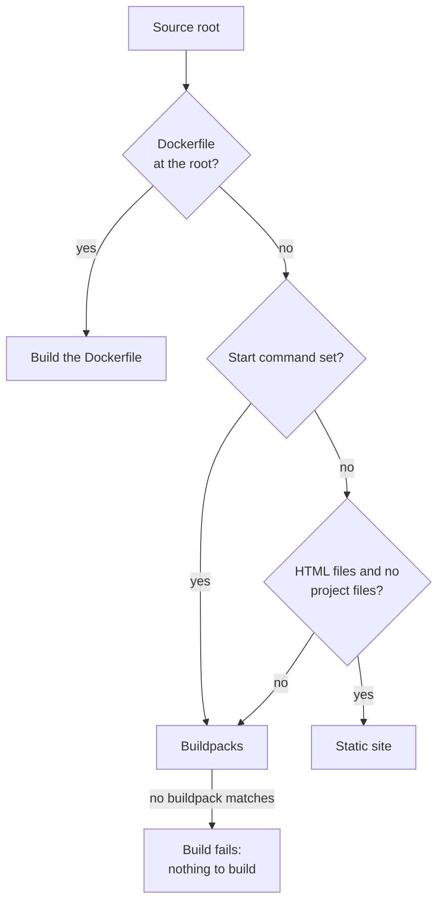

Every time you deploy, Cloider turns your source into a container image with one of three **build strategies**: your
own `Dockerfile`, **Cloud Native Buildpacks** for a project without one, or a **static site** server for plain HTML.
This page explains how the strategy is chosen, what detection does, how the port and start command work, and how to pass
values to a build with build arguments and build variables.

## At a glance

Cloider checks the root of your source and uses the first strategy that applies:

| Order | Strategy | Used when | The image starts with |
| --- | --- | --- | --- |
| 1 | **Dockerfile** | A file named exactly `Dockerfile` is at the root | The Dockerfile's `CMD` / `ENTRYPOINT` |
| 2 | **Static site** | No `Dockerfile`, no start command, no project files at the root, and at least one `.html` or `.htm` file anywhere | A web server that serves your files on `$PORT` |
| 3 | **Buildpacks** | Everything else | The start command, a `Procfile`, or what the buildpack detects |



All three build for `linux/amd64`, push the image to your account's private apps registry project, and are limited to
30 minutes for the whole build.

## What does Cloider detect?

When you create an app, Cloider reads the uploaded source once to fill in the **Configure your app** form for you. It
reports:

| Detected | Where it is used |
| --- | --- |
| **Language** and **framework** (for example JavaScript and Express, Python and Django, Go) | Shown on the form and as **Detected** on the app's **Overview** tab |
| **Port** the project declares, such as in its framework configuration or a Dockerfile's `EXPOSE` | Prefilled as the app's **Port** |
| **Name** from the project's own manifest, such as `package.json` or `pom.xml` | Prefilled as **App Name**, made valid (lowercase, `-` for anything else) |
| **ARGs** your `Dockerfile` declares | Offered as **Declared in your Dockerfile** buttons under **Build arguments** |

Detection is only a suggestion. The build never reads it: a `Dockerfile` or a buildpack decides how the app is built,
and the port you confirm decides where traffic goes. When detection recognizes nothing, the form keeps its defaults
(port `8080`) and the app is created normally. When a repository holds several projects, detection reports on the one
closest to the root.

<Screenshot
  src="/img/screenshots/apps/new-app-configure.webp"
  url="/dashboard/apps/new-app"
  alt="Configure your app: We had a look at your code shows JavaScript, Express, port 3000, with the app name, port and subdomain fields filled in"
  caption="Detection prefills the form; you can change every field."
/>

## Build with your own Dockerfile

A `Dockerfile` at the root of the source always wins. Cloider builds it with BuildKit exactly as written, with the
source root as the build context, and runs the image's own command. Use it when you need a specific base image,
system packages, a compiled language buildpacks don't cover, or a multi-stage build.

```dockerfile title="Dockerfile"
FROM node:22-alpine AS build
WORKDIR /app
COPY package*.json ./
RUN npm ci
COPY . .
RUN npm run build

FROM node:22-alpine
WORKDIR /app
ENV NODE_ENV=production
COPY --from=build /app/package*.json ./
RUN npm ci --omit=dev
COPY --from=build /app/dist ./dist
# Cloider sets PORT to the app's port
CMD ["node", "dist/server.js"]
```

Things to know:

- The file must be named `Dockerfile` (capital D) and sit at the root. `Dockerfile.prod`, `docker/Dockerfile` or
  `dockerfile` aren't used. If you upload a zip with a single top folder, its contents are the root.
- The image's `ENTRYPOINT` and `CMD` start the app. A **Start command**, when you set one, runs with `sh -c` in their
  place, so the image needs a shell. Changing it redeploys the app without building it again.
- `EXPOSE` doesn't route anything. Traffic goes to the app's **Port**, and the container gets that port as `PORT`.
  Either listen on `$PORT`, or set the app's port to the port your image listens on.
- The image runs as the user the Dockerfile sets. Running as root works, and so does a non-root user on a port below
  1024.
- A `.dockerignore` at the root is honored as usual by BuildKit.
- Only variables you set as **build arguments** reach the build. See [Build arguments](#build-arguments-for-a-dockerfile).

## Build with buildpacks

A project without a `Dockerfile` is built with **Cloud Native Buildpacks**, using Heroku's open source builder
(`heroku/builder:26`). A buildpack recognizes your language from the project files at the root (such as
`package.json`, `requirements.txt`, `go.mod` or `pom.xml`), installs the runtime and your dependencies, runs your build
step, and works out how to start the app. See [Supported languages](/apps/supported-languages) for each language's
files and conventions.

The finished image runs as a non-root user named `cloider`, gets the app's port as `PORT`, and must listen on it.

### How a buildpack app starts

In order of precedence:

1. The app's **Start command** setting, if set. Cloider writes it into the source as a `Procfile` line,
   `web: <your command>`, replacing any `Procfile` you had.
2. A `Procfile` at the root of your project. Only the `web` process runs.
3. What the language's buildpack defines, for example the `start` script in a Node.js `package.json`.

```text title="Procfile"
web: gunicorn app:app --bind 0.0.0.0:$PORT
```

### Buildpack caching

Cloider keeps a build cache for each app, and each build starts from the layers of the version deployed before it. The
first build of an app downloads its runtime and dependencies; later builds usually reuse them and finish faster.

## Static sites

A source with HTML and nothing else is served as a **static site**: no build step, no runtime. Cloider uses this
strategy when all of these are true:

- There is no `Dockerfile` at the root.
- The app has no **Start command**.
- None of these files is at the root: `package.json`, `requirements.txt`, `Pipfile`, `Pipfile.lock`, `pyproject.toml`,
  `poetry.lock`, `uv.lock`, `setup.py`, `setup.cfg`, `runtime.txt`, `.python-version`, `go.mod`, `pom.xml`, `mvnw`,
  `build.gradle`, `build.gradle.kts`, `settings.gradle`, `settings.gradle.kts`, `gradlew`, `system.properties`,
  `build.sbt`, `composer.json`, `composer.lock`, `Gemfile`, `Gemfile.lock`, `Procfile`, `project.toml`, or a `.csproj`,
  `.fsproj`, `.vbproj`, `.sln`, `.slnx` or `.cs` file.
- There is no `.php` file anywhere.
- There is at least one `.html` or `.htm` file somewhere.

Every file of the source is served as is by an unprivileged nginx web server listening on `$PORT`. Put an
`index.html` at the root: it is what `/` serves, and without it `/` answers `403 Forbidden`. Files are made readable for
the server whatever permissions the zip carried.

```text
my-site/
  index.html
  about.html
  css/style.css
  img/logo.png
```

A site that needs a build step (React, Vue, Astro and other frameworks) has a `package.json`, so it is built by the
Node.js buildpack instead. See [Supported languages](/apps/supported-languages#static-sites-and-single-page-apps).

## The app's port

The **Port** is the one port Cloider sends traffic to. It is required, between 1 and 65535, and defaults to the detected
port or `8080`.

- Cloider sets the `PORT` environment variable in the container to this port. A variable named `PORT` that you set
  yourself is overridden.
- A version only goes live once something accepts connections on this port, so an app listening elsewhere never
  becomes ready and its build fails with **The app did not start in time**.
- Listen on all interfaces (`0.0.0.0`), not only on `localhost` / `127.0.0.1`, or the platform can't reach it.

```js title="server.js"
const port = process.env.PORT || 3000;
app.listen(port, "0.0.0.0", () => console.log(`Listening on ${port}`));
```

Changing the port on the **Settings** tab redeploys the running version with the new port, without a rebuild. See
[Settings](/apps/settings).

## The start command

The **Start command** is optional and only used by buildpack builds. Leave it empty to let the project decide through its
`Procfile` or its language's conventions. It must be a single line of at most 1000 characters. Setting it also stops a
source from being treated as a static site, since a command means something should run.

Changing the start command on the **Settings** tab rebuilds the source the app is serving, because the command is built
into the image.

## Build arguments, build variables and environment variables

An app has three lists of variables, and each reaches a different place:

| List | Reaches | Strategy | Set with |
| --- | --- | --- | --- |
| **Environment variables** | The running app, when its container starts | All | **Environment** tab, `cloider app env`, `--env` / `--secret-env` |
| **Build arguments** | The `docker build` of your `Dockerfile` | Dockerfile | **Environment** tab, `cloider app build-args`, `--build-arg` / `--secret-build-arg` |
| **Build variables** | The buildpack build | Buildpacks | **Environment** tab, `cloider app build-env`, `--build-env` / `--secret-build-env` |

Build arguments and build variables never reach the running app. Each variable in each list can be **secret**
(locked): its value is never listed back, only revealed on request. Changing a build list rebuilds the version the
app is serving. See [Environment variables](/apps/environment-variables) for limits, secrets and the full how-to.

### Build arguments for a Dockerfile

A plain build argument is passed as `--build-arg`, which your Dockerfile reads with `ARG`:

```dockerfile title="Dockerfile"
FROM node:22-alpine
WORKDIR /app
COPY . .
# Set NEXT_PUBLIC_API_URL as a build argument of the app
ARG NEXT_PUBLIC_API_URL
ARG NODE_VERSION_LABEL=22
RUN npm ci && npm run build
CMD ["npm", "start"]
```

An empty value isn't passed at all, so the `ARG`'s own default applies. That is how the **Declared in your
Dockerfile** suggestions are added: with an empty value, keeping your defaults until you type one.

A **secret build argument** is passed as a BuildKit build secret instead, never as a build arg, because build args are
kept in the image's history. Read it with a secret mount, which exists only for that one `RUN` step:

```dockerfile title="Dockerfile"
FROM node:22-alpine
WORKDIR /app
COPY package*.json .npmrc ./
# NPM_TOKEN is a secret build argument of the app; .npmrc reads ${NPM_TOKEN}
RUN --mount=type=secret,id=NPM_TOKEN,env=NPM_TOKEN npm ci
COPY . .
CMD ["node", "server.js"]
```

The secret's id is the variable's name. Without `env=`, the value is a file at `/run/secrets/<NAME>`:

```dockerfile
RUN --mount=type=secret,id=PIP_INDEX_URL \
    pip install --index-url "$(cat /run/secrets/PIP_INDEX_URL)" -r requirements.txt
```

<Tabs groupId="interface" queryString>
<TabItem value="dashboard" label="Dashboard" default>

1. Open the app and go to the **Environment** tab.
2. Under **Build arguments**, click a name under **Declared in your Dockerfile**, or **Add argument**.
3. Type the value. Click the lock icon to store it as a secret.
4. Click **Save and rebuild** (or **Save changes** if the app has never deployed).

</TabItem>
<TabItem value="cli" label="CLI">

```bash
cloider app build-args set web NEXT_PUBLIC_API_URL=https://api.example.com
cloider app build-args set web --secret NPM_TOKEN=npm_xxxxxxxxxxxxxxxx
```

```text title="Output"
✓ Saved 1 argument(s), building web again
✓ Saved 2 argument(s), building web again
```

On a first deploy, pass them as flags:

```bash
cloider deploy --name web \
  --build-arg NEXT_PUBLIC_API_URL=https://api.example.com \
  --secret-build-arg NPM_TOKEN=npm_xxxxxxxxxxxxxxxx
```

</TabItem>
<TabItem value="terraform" label="Terraform">

The Terraform provider can't manage app variables. Use the dashboard, the CLI or the API.

</TabItem>
<TabItem value="api" label="API">

`PUT` replaces the whole list. A secret sent back with `"value": null` keeps its stored value:

```bash
curl -X PUT https://cloider.com/api/apps/w4d8hz/build-args \
  -H "Authorization: Bearer $CLOIDER_TOKEN" \
  -H "Content-Type: application/json" \
  -d '{"env_vars": [
    {"key": "NEXT_PUBLIC_API_URL", "value": "https://api.example.com", "secret": false},
    {"key": "NPM_TOKEN", "value": "npm_xxxxxxxxxxxxxxxx", "secret": true}
  ]}'
```

```json title="Response"
{"applied": "build"}
```

`applied` is `build` when a rebuild of the running version started, `none` when the app hasn't deployed yet.

</TabItem>
<TabItem value="mcp" label="MCP">

Ask your agent:

```text title="Prompt"
Set the build argument NEXT_PUBLIC_API_URL=https://api.example.com on the web app.
```

```json title="Tool call: set_app_variables"
{"app": "web", "kind": "build-args", "variables": {"NEXT_PUBLIC_API_URL": "https://api.example.com"}}
```

</TabItem>
</Tabs>

### Build variables for buildpacks

**Build variables** are the environment a buildpack build runs in. Use them to configure the buildpacks, or for
anything your build step reads, such as a token for a private package registry:

```bash
cloider app build-env set blog API_BASE_URL=https://api.example.com
cloider app build-env set blog --secret NPM_TOKEN=npm_xxxxxxxxxxxxxxxx
```

The buildpack build also sees the app's **plain** (non-secret) environment variables. A build variable with the same
name wins over an environment variable. Secret environment variables never reach a build; a secret build variable is
available to the build step alone and isn't stored in the image.

## Build limits

| Limit | Value |
| --- | --- |
| Whole build, from download to pushed image | 30 minutes |
| New version answering on its port after deploy | 5 minutes |
| Source | 100 MB compressed, 500 MB extracted |
| Platform | `linux/amd64` |
| Builds at once | One per app |
| Build output kept | The last 64 KB |

A build that is still running after the limit fails. See [Troubleshooting apps](/apps/troubleshooting) for the
messages each failure shows.

## Next steps

- [Supported languages](/apps/supported-languages): minimal projects per language.
- [Environment variables](/apps/environment-variables): runtime variables and secrets.
- [Builds and deployments](/apps/builds-and-deployments): watch a build, read its logs, retry it.
- [Settings](/apps/settings): change the port and start command.

<FAQ items={[
  {q: 'Does Cloider use my Dockerfile?', a: 'Yes. If a file named Dockerfile is at the root of your source, Cloider builds it exactly as written with BuildKit and runs its CMD. Without one, Cloider uses Cloud Native Buildpacks, or serves plain HTML as a static site.'},
  {q: 'Which buildpacks does Cloider use?', a: 'Cloider builds apps without a Dockerfile with Heroku\'s open source Cloud Native Buildpacks builder, heroku/builder:26, which covers Node.js, Python, Go, Java, Scala, PHP, Ruby and .NET.'},
  {q: 'Does the start command work with a Dockerfile?', a: 'Yes. An image built from your Dockerfile runs the start command with sh -c in place of its ENTRYPOINT and CMD, and changing it only redeploys the app. Left empty, the image starts with its own ENTRYPOINT and CMD. A buildpack build writes the start command into a Procfile instead.'},
  {q: 'How do I pass a secret to docker build on Cloider?', a: 'Add it as a secret build argument. Cloider passes it as a BuildKit build secret, which you read with RUN --mount=type=secret,id=NAME,env=NAME, so it never lands in an image layer or the image history.'},
  {q: 'Why is my Next.js NEXT_PUBLIC_ variable empty?', a: 'NEXT_PUBLIC_ variables are inlined at build time. With a Dockerfile, set them as build arguments and declare them with ARG before the build step. With buildpacks, a plain environment variable or a build variable reaches the build.'},
  {q: 'Which port does my app have to listen on?', a: 'The app\'s Port setting, which the container receives as the PORT environment variable. Listen on 0.0.0.0 and that port, or change the port setting to match your app.'},
]} />
