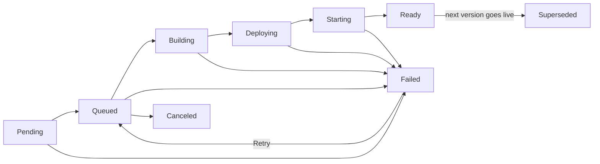

Every deploy of a Cloider app creates a **build**: a numbered version that downloads your source, builds an image,
deploys it and waits until it is running. The **Builds** tab is the app's deployment history, with each build's
status, source, timing and full output. This page explains the build lifecycle, how a new version replaces the old one,
how to follow and read build logs, and how to retry or redeploy.

## At a glance

- Builds are numbered per app: `1`, `2`, `3` and so on. A retry keeps the number and counts as another attempt.
- One build runs at a time per app. A deploy, retry or push that arrives during a build is refused or skipped.
- A new version goes live only once it is running and has stayed up for 15 seconds. Until then the previous version
  keeps serving, so a broken build never takes a working app down.
- The whole build is limited to 30 minutes, and the new version must answer on its port within 5 minutes of deploying.
- Each build keeps the last 64 KB of its output, including the app's own output when it fails to start.
- Cloider keeps the images of the two most recently deployed versions. There is no rollback to older images.

<Screenshot
  src="/img/screenshots/apps/detail-builds.webp"
  url="/dashboard/apps/blog-a7c2mq"
  alt="The Builds tab of the blog app listing versions 3, 2 and 1 with their status, source, start time and duration, version 3 marked live"
  caption="The Builds tab: every version of the app, newest first."
/>

## What starts a build?

| Action | Source of the build |
| --- | --- |
| Creating an app | The uploaded folder or the fetched repository |
| `cloider deploy` in a linked folder, or **Deploy new version** | A new upload |
| A push to the branch of a git app with auto deploy on, **Deploy latest commit**, or `cloider deploy --git` | The newest commit of the branch |
| Changing the **Start command** on **Settings** | The source the app is serving, built again |
| Saving **Build arguments** or **Build variables** | The source the app is serving, built again |
| **Retry** on a failed build | That build's own source, built again as a new attempt |
| **Deploy**, `cloider deploy --app`, or the deploy hook of an [image app](/apps/deploy-an-image) | The image the app's tag points at, nothing is built |

Changing the **Port** doesn't build: it redeploys the image the app is already running with the new port. Saving
**Environment variables** doesn't build either: it restarts the app.

## Build statuses

A build moves through these statuses. The app's own status mirrors the build that is running, so the Apps list shows how
far a deploy has got.



| Status | Meaning |
| --- | --- |
| `Pending` | Waiting for the source: the upload hasn't finished, or the commit is being fetched from git |
| `Queued` | The source is in place and the build is waiting for a builder |
| `Building` | Downloading the source and building the image |
| `Deploying` | The image is pushed and being applied to the platform |
| `Starting` | The new container is starting. Cloider waits for it to accept connections on the app's port and stay up for 15 seconds |
| `Ready` | This version is running. It is the app's live version, marked **live** in the list |
| `Superseded` | This version was live and a newer one replaced it |
| `Failed` | The build, the deploy or the start failed. The message says which. A failed build can be retried |
| `Canceled` | The app was deleted while the build waited in the queue |

A build that sits in `Pending` for 15 minutes, or in one of the running statuses for 45 minutes without moving, is
marked `Failed` so it can't block the app's next build.

## How does a new version replace the old one?

Deploys are rolling and safe by default:

1. While the new version builds, the current one keeps serving.
2. When the image is ready, Cloider starts a container of the new version **next to** the old one.
3. The new container only receives traffic once it accepts connections on the app's port.
4. Cloider then watches it for 15 seconds. If it stays up, the build is `Ready`, the previous build becomes
   `Superseded`, and the old container is stopped.
5. If the new container crashes, never opens the port within 5 minutes, or its image can't be pulled, the build is
   `Failed` and the app stays `Ready` on its previous version.

The first version of an app has nothing to fall back to, so when its build fails the app itself is `Failed` until a
build succeeds.

## Follow a build and read its logs

A build's output covers the whole deploy: downloading the source, the `docker build` or buildpack output, the push, the
deploy and the wait for the app to start. It streams live while the build runs, colors included.

<Tabs groupId="interface" queryString>
<TabItem value="dashboard" label="Dashboard" default>

1. Open the app and go to the **Builds** tab.
2. Click **Logs** on a build. The **Build output** dialog opens; a running build shows **Live** and follows new lines.
3. Click the maximize button for a full screen view, and **Close** when done.

<Screenshot
  src="/img/screenshots/apps/build-logs.webp"
  url="/dashboard/apps/blog-a7c2mq"
  alt="The Build output dialog for version 3 of blog, streaming buildpack output with a Live badge"
  caption="A build's output, streamed live while it runs."
/>

</TabItem>
<TabItem value="cli" label="CLI">

List the builds:

```bash
cloider app builds blog
```

```text title="Output"
VERSION   STATUS       SOURCE            CREATED            MESSAGE
3         Ready        blog.zip          2026-10-20 10:12   -
2         Failed       blog.zip          2026-10-20 09:58   The app did not start in time
1         Superseded   blog.zip          2026-10-19 16:40   -
```

A git app's **SOURCE** shows the short commit SHA and message instead, for example `9f2c1e7 Add health endpoint`.
Add `-o wide` for the build ids.

Print a build's output. With no build it is the latest; a build still running is followed until it ends:

```bash
cloider app build logs blog        # the latest build
cloider app build logs blog 2      # version 2 (or v2, or its id)
```

`cloider deploy` follows the build it starts by default; use `--detach` to return at once.

</TabItem>
<TabItem value="terraform" label="Terraform">

The Terraform provider has no access to app builds. Use the dashboard, the CLI or the API.

</TabItem>
<TabItem value="api" label="API">

List the builds, newest first:

```bash
curl https://cloider.com/api/apps/a7c2mq/builds \
  -H "Authorization: Bearer $CLOIDER_TOKEN"
```

```json title="Response"
[
  {
    "hashed_id": "c9w3rt",
    "version": "3",
    "attempt": 1,
    "status": "Ready",
    "source_filename": "blog.zip",
    "source_size": 19352,
    "uploaded": true,
    "commit_sha": "",
    "commit_message": "",
    "image_ref": "registry.cloider.com/acme-apps/blog-a7c2mq:3",
    "message": "",
    "started_at": "2026-10-20T10:12:31Z",
    "finished_at": "2026-10-20T10:14:02Z",
    "created_at": "2026-10-20T10:12:20Z"
  }
]
```

Read a finished build's output as plain text:

```bash
curl https://cloider.com/api/apps/a7c2mq/builds/c9w3rt/logs \
  -H "Authorization: Bearer $CLOIDER_TOKEN"
```

Follow a running build as server-sent events. Each chunk of output arrives as `data:` lines, and the stream ends with an
`end` event. Reconnect with the `Last-Event-ID` header to resume where you left off:

```bash
curl -N https://cloider.com/api/apps/a7c2mq/builds/c9w3rt/logs/stream \
  -H "Authorization: Bearer $CLOIDER_TOKEN"
```

```text title="Response"
: open

id: 1729419151000-0
data: Downloading source for app a7c2mq...

event: end
data: 1
```

</TabItem>
<TabItem value="mcp" label="MCP">

Ask your agent:

```text title="Prompt"
Why did the last build of the blog app fail?
```

It calls `list_app_builds` and then `get_app_build_logs`:

```json title="Tool call: get_app_build_logs"
{"app": "blog"}
```

</TabItem>
</Tabs>

### What is in a failed build's output?

When a version builds but fails to start, the output ends with a `--- app output ---` line followed by the last 100
lines your app printed before it stopped. That is usually where the real error is: a missing environment variable, a
module that isn't installed, or an exception at startup.

```text title="Build output (end)"
Deploying the image...
Waiting for the app to start...
The app started and then stopped.
--- app output ---
Error: Cannot find module 'express'
Require stack:
- /workspace/server.js
```

## Retry a failed build

**Retry** runs a failed build again on the same source, keeping its version number and adding an attempt (shown as
**attempt 2**). It is the right move for a failure that wasn't caused by your code, such as a registry hiccup or a
timeout. To fix your code, deploy a new version instead.

<Tabs groupId="interface" queryString>
<TabItem value="dashboard" label="Dashboard" default>

1. Open the app's **Builds** tab.
2. Click **Retry** on the failed build.

**Retry** is disabled while another build runs or the app is paused.

</TabItem>
<TabItem value="cli" label="CLI">

```bash
cloider app build retry blog 2 --follow
```

```text title="Output"
✓ Retrying version 2
...
✓ Deployed version 2 of blog
https://blog-x7k2.cloider.app/
```

</TabItem>
<TabItem value="terraform" label="Terraform">

The Terraform provider has no access to app builds. Use the dashboard, the CLI or the API.

</TabItem>
<TabItem value="api" label="API">

```bash
curl -X POST https://cloider.com/api/apps/a7c2mq/builds/f2h6pk/retry \
  -H "Authorization: Bearer $CLOIDER_TOKEN" \
  -H "Content-Type: application/json" \
  -d '{}'
```

The response is the build, back in `Queued` with `attempt` increased.

</TabItem>
<TabItem value="mcp" label="MCP">

```text title="Prompt"
Retry the failed build 2 of the blog app and wait until it is up.
```

```json title="Tool call: retry_app_build"
{"app": "blog", "build": "2", "follow": true}
```

</TabItem>
</Tabs>

Only a `Failed` build can be retried, and only if its source was uploaded. A build whose upload never finished says
**This build never received its source, deploy a new version instead!**

## Redeploy without changing the code

There is no separate redeploy button; each of these redeploys the app:

- **Restart with new settings**: save the **Environment** tab. The app restarts with the same image.
- **Same image, new port**: change the **Port** on **Settings**.
- **Rebuild the same source**: change the **Start command** or a build list. The source the app serves is built again
  as a new version.
- **Rebuild a git app**: click **Deploy latest commit**, even when the branch hasn't moved.
- **Rebuild an upload**: run `cloider deploy` again in the linked folder.
- **Pull an image app's tag again**: click **Deploy** on the **Builds** tab of an [image app](/apps/deploy-an-image).
  When the tag still points at the running image, nothing is deployed.

## Roll back to an earlier version

Cloider doesn't roll back to an older image. To go back, deploy the old code again as a new version: check out the
earlier commit and run `cloider deploy`, or revert the commit in git and push. Because a failed build never replaces the
live version, you rarely need to roll back after a bad deploy: fix the problem and deploy again. An
[image app](/apps/deploy-an-image) rolls back by deploying a tag that still points at the older image.

## Verify

- The newest build is `Ready` and marked **live** on the **Builds** tab.
- The app's **Overview** shows the same **Live version**.
- `cloider app get blog` prints the version and `Status Ready`.

## Troubleshooting

| Build message | What it means |
| --- | --- |
| `Image build failed` | The `docker build` or buildpack build failed. The output says why |
| `Deploy failed` | The platform didn't accept the deploy. Retry the build |
| `The app image could not be pulled` | The new image couldn't be pulled for 60 seconds. Retry the build |
| `The app started and then stopped` | The container exited or crashed. See the app output at the end of the logs |
| `The app did not start in time` | Nothing accepted connections on the app's port within 5 minutes. Usually a port mismatch |
| `The app could not be started` | The container couldn't be created, for example an invalid command or entrypoint |
| `The source upload did not finish` | The upload was interrupted or never confirmed. Deploy again |
| `The build did not finish in time` | The build made no progress for 45 minutes. Retry it |
| `The app's registry couldn't be prepared, retry the build in a moment.` | A temporary registry problem. Retry |
| **This app is already building, wait for that build to finish before deploying a new version!** | One build at a time per app |

[Troubleshooting apps](/apps/troubleshooting) goes through each failure and its fixes.

## Next steps

- [Logs](/apps/logs): the running app's output after it deploys.
- [Troubleshooting](/apps/troubleshooting): fix build and start failures.
- [Deploy from git](/apps/deploy-from-git): builds on every push.
- [App builds API](/api/endpoints/app-builds): every build endpoint.

<FAQ items={[
  {q: 'Does a Cloider deploy cause downtime?', a: 'No. The new version starts next to the old one and only receives traffic once it accepts connections on the app\'s port and stays up for 15 seconds. If it fails, the previous version keeps serving.'},
  {q: 'How long can a build take?', a: 'The whole build, from downloading the source to pushing the image, is limited to 30 minutes. After the deploy, the new version has 5 minutes to accept connections on its port.'},
  {q: 'Can I run two builds of the same app at once?', a: 'No. An app builds one version at a time, and a deploy, retry or git push that arrives during a build is refused or skipped. Different apps build in parallel.'},
  {q: 'How do I roll back a Cloider app?', a: 'Deploy the earlier code again as a new version, for example by reverting the commit and pushing, or checking out the earlier commit and running cloider deploy. Cloider keeps only the two latest deployed images and has no rollback button.'},
  {q: 'What is the difference between Retry and deploying again?', a: 'Retry rebuilds a failed build\'s own source under the same version number, as a new attempt. Deploying again uploads or fetches the current source and creates the next version.'},
]} />
