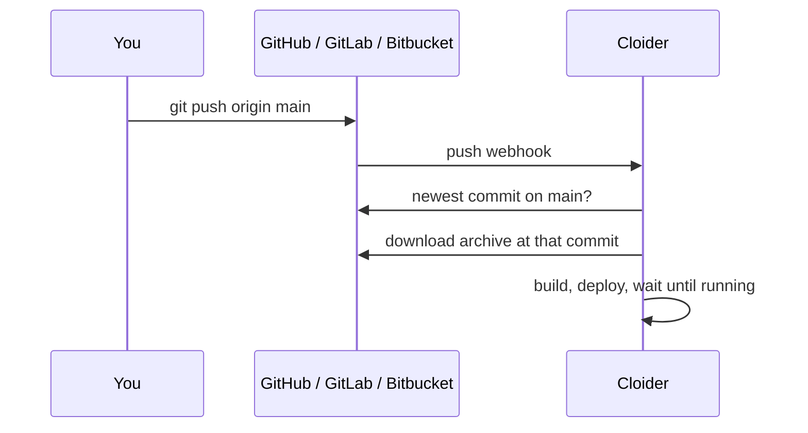

A Cloider app can deploy straight from a **GitHub**, **GitLab** or **Bitbucket** repository: you connect your git
account once, pick a repository and a branch, and Cloider builds the latest commit. With **auto deploy** on, every push
to that branch builds and deploys the next version, with no CI pipeline to write. This page covers connecting each
provider, creating the app, auto deploy, manual deploys, changing the branch, and what to do when something goes wrong.

## How git deploys work

A git app remembers its repository, its branch and the connection it reads them through. Each deploy, whether a push
or a click, does the same thing:

1. Cloider asks the provider for the newest commit on the app's branch.
2. It downloads the repository as an archive at exactly that commit, so a push that lands in the meantime can't change
   what is built.
3. It builds and deploys that archive like any other upload. The build records the commit SHA and the first line of
   its message, so the **Builds** tab says which commit each version is.



| | GitHub | GitLab | Bitbucket |
| --- | --- | --- | --- |
| **Where** | github.com | gitlab.com | bitbucket.org |
| **How you connect** | Install the Cloider GitHub App on your user or organization and choose its repositories | Authorize the Cloider application on GitLab | Authorize the Cloider consumer on Bitbucket |
| **What you can import** | The repositories the installation can see | Projects you are at least a **Reporter** on | Repositories you can read in your workspaces |
| **How pushes arrive** | The GitHub App's webhook, nothing to set up | A project webhook Cloider adds when the app is created | A repository webhook Cloider adds when the app is created |
| **Needed for auto deploy** | Nothing more | The **Maintainer** role on the project | Admin access to the repository |
| **Repository is matched by** | Repository id | Project id | Repository uuid |

Self-managed GitLab and Bitbucket Data Center aren't supported.

## Before you begin

- A Cloider account with a role that can create resources. See [Accounts and roles](/concepts/accounts-and-roles).
- Your code in a GitHub, GitLab or Bitbucket repository, with at least one commit on the branch you want to deploy.
- A project Cloider can build: a `Dockerfile` at the repository root, a project file a buildpack recognizes, or a
  static site. See [Build configuration](/apps/build-configuration).
- For the CLI, [install it and log in](/cli/install).

## Step 1: Connect your git provider

Connecting happens in the browser, logged in to the dashboard, because the provider sends you back to the dashboard
when you are done. You only do it once per git account.

<Tabs groupId="interface" queryString>
<TabItem value="dashboard" label="Dashboard" default>

1. Open **Apps** in the sidebar and click **Create App**.
2. Under **Import a Git repository**, click **GitHub**, **GitLab** or **Bitbucket**. A provider you haven't connected
   yet sends you to its authorization page.
3. Approve the request:
   - **GitHub**: authorize the app. If none of your accounts has it installed yet, GitHub then asks where to install
     it and which repositories it may see. Pick **All repositories** or only the ones Cloider should deploy.
   - **GitLab** and **Bitbucket**: approve Cloider's access request.
4. You land back on **Create App** with the import dialog open.

To add another GitHub organization or GitLab or Bitbucket user later, open the import dialog and click **Add account**.

</TabItem>
<TabItem value="cli" label="CLI">

```bash
cloider git connect github
```

```text title="Output"
Opening the browser to connect GitHub. If it doesn't open, visit:
  https://cloider.com/api/git/github/connect?return=%2Fdashboard%2Fapps%2Fnew-app
Once connected, `cloider git repos github` lists what apps can deploy from.
```

Finish in the browser, then check the connection:

```bash
cloider git installations github
```

```text title="Output"
ACCOUNT   TYPE           STATUS   CONNECTED
acme      Organization   Active   2026-10-20 09:02
```

Use `gitlab` or `bitbucket` in place of `github` for the other providers.

</TabItem>
<TabItem value="terraform" label="Terraform">

The Terraform provider can't connect git accounts or create apps. Connect the provider in the dashboard or with
`cloider git connect`.

</TabItem>
<TabItem value="api" label="API">

Connecting needs a browser session, so an API token can't start it: open
`https://cloider.com/api/git/github/connect` (or `gitlab`, `bitbucket`) in a browser where you are logged in to the
dashboard. Once connected, list the connections with a token:

```bash
curl https://cloider.com/api/git/github/installations \
  -H "Authorization: Bearer $CLOIDER_TOKEN"
```

```json title="Response"
{
  "configured": true,
  "installations": [
    {
      "hashed_id": "g8x2kd",
      "provider": "GitHub",
      "account_login": "acme",
      "account_type": "Organization",
      "avatar_url": "https://avatars.githubusercontent.com/u/1234567",
      "suspended_at": null,
      "created_at": "2026-10-20T09:02:11Z"
    }
  ]
}
```

</TabItem>
<TabItem value="mcp" label="MCP">

Ask your agent:

```text title="Prompt"
Connect my GitHub account to Cloider.
```

It calls the `connect_git_provider` tool, which opens the browser on your machine for you to finish:

```json title="Tool call: connect_git_provider"
{"provider": "github"}
```

</TabItem>
</Tabs>

:::info[Installing on a GitHub organization you don't own]
When you install the GitHub App on an organization where you aren't an owner, GitHub sends an approval request to the
owners instead. The dashboard shows **Waiting for approval**. Once an owner approves it, open **Create App** again and
the organization is there.
:::

## Step 2: Create the app from a repository

<Tabs groupId="interface" queryString>
<TabItem value="dashboard" label="Dashboard" default>

1. On **Create App**, click your provider under **Import a Git repository**.
2. In the dialog, pick the **Account** (the GitHub user or organization, or the GitLab or Bitbucket user), then the
   **Repository**. Type in **Search repositories** to filter a long list.
3. Pick the **Branch**. It defaults to the repository's default branch, and you can type a branch that isn't listed.
4. Click **Import**. Cloider fetches the repository (**Fetching your repository...**) and reads it (**Analyzing your
   code...**).
5. On **Configure your app**, check the **Deploying from** box (repository, branch and commit) and what was detected,
   then fill in **App Name**, **Port**, the optional **Start Command** and the **Subdomain**. Add environment variables,
   build variables or build arguments if the app needs them on its first build.
6. Click **Create App**.

<Screenshot
  src="/img/screenshots/apps/new-app-git.webp"
  url="/dashboard/apps/new-app"
  alt="The Import from GitHub dialog with the acme account, the acme/api repository and the main branch selected"
  caption="Pick the account, repository and branch to deploy from."
/>

</TabItem>
<TabItem value="cli" label="CLI">

```bash
cloider app create --git github --repo acme/api
```

```text title="Output"
Detected Go
✓ Created app api on port 8080
Downloading source for app k3m9tw...
No Dockerfile in the source, looking for a buildpack...
[buildpack output]
App k3m9tw built and pushed as registry.cloider.com/acme-apps/api-k3m9tw:1
Deploying the image...
Waiting for the app to start...
The app is up, watching it for 15s...
The app is running.
✓ Deployed version 1 of api
https://api-q2v8.cloider.app/
```

Useful flags: `--branch` (default: the repository's default branch), `--installation` when several accounts of the
provider are connected, `--name`, `--port`, `--start-command`, `--subdomain` or `--no-subdomain`, `--env` and
`--secret-env`, `--build-arg` and `--secret-build-arg`, `--build-env` and `--secret-build-env`, and `--detach` to return
once the build starts.

```bash
cloider app create --git gitlab --repo acme/web --branch main --name web --port 3000
```

To see what you can import first:

```bash
cloider git repos github
cloider git branches github acme/api
```

</TabItem>
<TabItem value="terraform" label="Terraform">

The Terraform provider has no app resource. Create the app with the dashboard, the CLI or the API, then route a
domain to it with [`cloider_target`](/terraform/resources/target) and its `app_id`.

</TabItem>
<TabItem value="api" label="API">

Creating a git app is three calls. First, stage the repository. GitHub and Bitbucket take `repo_full_name`, GitLab takes
the numeric `project_id` from the repository list:

```bash
curl -X POST https://cloider.com/api/apps/source/github \
  -H "Authorization: Bearer $CLOIDER_TOKEN" \
  -H "Content-Type: application/json" \
  -d '{"installation_hashed_id": "g8x2kd", "repo_full_name": "acme/api", "branch": "main"}'
```

```json title="Response"
{"token": "Wq3...staging-token"}
```

Then poll the staged source until `status` is `Done`, `Failed` or `Unavailable`. It moves through `Fetching` and
`Detecting` first:

```bash
curl https://cloider.com/api/apps/source/$TOKEN \
  -H "Authorization: Bearer $CLOIDER_TOKEN"
```

```json title="Response"
{
  "status": "Done",
  "app_name": "api",
  "language": "Go",
  "framework": "",
  "port": 8080,
  "message": "",
  "build_args": [],
  "git": {
    "provider": "GitHub",
    "repo_full_name": "acme/api",
    "repo_url": "https://github.com/acme/api",
    "branch": "main",
    "commit_sha": "9f2c1e7b4a0d8c6e5f3a2b1c0d9e8f7a6b5c4d3e",
    "commit_message": "Add health endpoint"
  }
}
```

Finally, create the app on the staged source:

```bash
curl -X POST https://cloider.com/api/apps \
  -H "Authorization: Bearer $CLOIDER_TOKEN" \
  -H "Content-Type: application/json" \
  -d '{
    "app_name": "api",
    "port": 8080,
    "source_token": "'"$TOKEN"'",
    "subdomain": "api-q2v8.cloider.app",
    "env_vars": [{"key": "LOG_LEVEL", "value": "info", "secret": false}]
  }'
```

```json title="Response"
{"hashed_id": "k3m9tw", "build_hashed_id": "b7n4xp", "version": "1"}
```

The [Git API reference](/api/endpoints/git) lists the repository and branch endpoints.

</TabItem>
<TabItem value="mcp" label="MCP">

Ask your agent:

```text title="Prompt"
Create a Cloider app from the GitHub repository acme/api on the main branch and tell me when it is live.
```

It calls the `create_app_from_git` tool, which follows the first build until the app is up:

```json title="Tool call: create_app_from_git"
{"provider": "github", "repo": "acme/api", "branch": "main"}
```

</TabItem>
</Tabs>

A git app is created with **auto deploy on**. The first build starts immediately on the commit that was fetched.

### What is imported from the repository?

Cloider downloads the whole repository at one commit, without its git history, and removes `.git`, `__MACOSX` and
`.DS_Store` entries. The archive must be 100 MB or smaller, and 500 MB or smaller once extracted. The build runs at the
repository root: a `Dockerfile` must be at the root to be used, and buildpacks look for project files such as
`package.json` or `go.mod` at the root. See [Monorepos and subfolders](#can-i-deploy-a-subfolder-of-a-monorepo).

## Auto deploy on push

With auto deploy on, a push to the app's branch starts a build of the newest commit on that branch. You see it appear on
the **Builds** tab with the commit SHA and message as its source.

Cloider ignores a push when:

- It is to another branch, or it pushes a tag.
- It deletes the branch.
- The app is paused or being deleted. Resume the app and click **Deploy latest commit** to catch up.
- A build of the app is already running. The push is skipped, not queued: push again, or click **Deploy latest commit**
  once the running build finishes.
- The account is suspended.
- The same delivery arrives twice. Providers retry deliveries, and each one builds at most once.

If two of your apps deploy from the same repository and branch, a push builds both.

### Auto deploy on GitLab and Bitbucket

GitHub delivers pushes through the Cloider GitHub App itself. GitLab and Bitbucket don't have that, so Cloider adds a
**webhook** to the project or repository when the app is created, and removes it when the app is deleted or the
connection is removed.

Creating that webhook needs the **Maintainer** role on a GitLab project, or admin access to a Bitbucket repository. If
the user who connected the provider doesn't have it, the webhook can't be created and Cloider turns auto deploy off
for that app. The app still works: deploy with **Deploy latest commit** or `cloider deploy --git`, or ask someone with
the right role to connect their account and turn auto deploy back on, which tries to create the webhook again.

## Deploy the latest commit manually

You can build the newest commit of the branch at any time, for example after a skipped push or with auto deploy off.

<Tabs groupId="interface" queryString>
<TabItem value="dashboard" label="Dashboard" default>

1. Open the app and go to the **Builds** tab.
2. Click **Deploy latest commit**.

A git app has no **Deploy new version** upload button: an upload would be a version the repository knows nothing about,
and the next push would replace it.

</TabItem>
<TabItem value="cli" label="CLI">

```bash
cloider deploy --git --app api
```

```text title="Output"
✓ Building version 4 of api from acme/api@main
...
✓ Deployed version 4 of api
https://api-q2v8.cloider.app/
```

In a directory linked to the app (see [`.cloider/app.json`](/apps/deploy-from-your-computer#how-does-a-directory-stay-linked-to-an-app)),
`cloider deploy --git` is enough.

</TabItem>
<TabItem value="terraform" label="Terraform">

The Terraform provider can't deploy apps. Use the dashboard, the CLI or the API.

</TabItem>
<TabItem value="api" label="API">

```bash
curl -X POST https://cloider.com/api/apps/k3m9tw/builds/git \
  -H "Authorization: Bearer $CLOIDER_TOKEN"
```

```json title="Response"
{
  "hashed_id": "c5r8ws",
  "version": "4",
  "attempt": 1,
  "status": "Pending",
  "source_filename": "api.zip",
  "source_size": 0,
  "uploaded": false,
  "commit_sha": "",
  "commit_message": "",
  "image_ref": "",
  "message": "",
  "started_at": null,
  "finished_at": null,
  "created_at": "2026-10-20T10:31:02Z"
}
```

The build answers at once and fills in the commit as it fetches it. Poll `GET /api/apps/k3m9tw/builds` to follow it.

</TabItem>
<TabItem value="mcp" label="MCP">

Ask your agent:

```text title="Prompt"
Deploy the latest commit of the api app.
```

```json title="Tool call: deploy_app"
{"app": "api", "git": true}
```

</TabItem>
</Tabs>

## Change the branch or turn auto deploy off

The branch and auto deploy are on the app's **Settings** tab. Changing them doesn't build anything by itself: the next
push or the next **Deploy latest commit** uses them. A branch that doesn't exist isn't checked when you save, it shows
up as a failed build on the next deploy.

<Tabs groupId="interface" queryString>
<TabItem value="dashboard" label="Dashboard" default>

1. Open the app and go to the **Settings** tab.
2. Under **Repository**, change **Branch**, or switch **Auto deploy on push** on or off.
3. Click **Save changes**.

</TabItem>
<TabItem value="cli" label="CLI">

```bash
cloider app git api --branch release --auto-deploy=false
```

```text title="Output"
✓ Saved, api deploys from release (auto deploy no)
```

</TabItem>
<TabItem value="terraform" label="Terraform">

The Terraform provider can't change apps. Use the dashboard, the CLI or the API.

</TabItem>
<TabItem value="api" label="API">

Send both fields, the branch is required:

```bash
curl -X PUT https://cloider.com/api/apps/k3m9tw/git \
  -H "Authorization: Bearer $CLOIDER_TOKEN" \
  -H "Content-Type: application/json" \
  -d '{"branch": "release", "auto_deploy": false}'
```

The response is an empty `200`.

</TabItem>
<TabItem value="mcp" label="MCP">

Ask your agent:

```text title="Prompt"
Make the api app deploy from the release branch and stop deploying on every push.
```

```json title="Tool call: update_app_git"
{"app": "api", "branch": "release", "auto_deploy": false}
```

</TabItem>
</Tabs>

## Manage your git connections

### What happens when I disconnect a git account?

Disconnecting removes the connection on Cloider's side and turns auto deploy off for every app that deploys through it.
The apps keep running and remember their repository and branch; their page shows the repository as **disconnected**
and they can't deploy from git until you connect the account again. For GitLab, Cloider also revokes its access token
and removes the webhooks it created. For Bitbucket, it removes its webhooks; revoke the grant itself in your Bitbucket
account settings. For GitHub, uninstall the Cloider app on GitHub to remove its access.

```bash
cloider git disconnect github acme
```

Connecting the same git account again creates a new connection. Apps that deployed through the removed one keep
showing it as **disconnected** and can't deploy from git any more, so create a new app from the repository, or deploy
the old one from your computer with `cloider deploy --app`. To pause deploys without losing the connection, turn
**Auto deploy on push** off instead.

### Changes you make on the provider

| You do this on the provider | Cloider does this |
| --- | --- |
| Rename or transfer the repository | Keeps deploying it. Repositories are matched by their id, and the new name is picked up from the next push |
| Remove the repository from the GitHub App's access | Turns auto deploy off for apps deploying from it |
| Suspend the GitHub App installation | Turns auto deploy off for its apps and marks the connection suspended |
| Unsuspend it | Clears the suspension. Auto deploy stays off until you turn it on |
| Uninstall the GitHub App | Removes the connection, as if you disconnected it |
| Revoke Cloider's access on GitLab or Bitbucket | Removes the connection the next time Cloider tries to use it |
| Delete the branch | The next deploy fails with a message naming the branch |

## Can I deploy a subfolder of a monorepo?

Not directly: Cloider always builds the repository root, and there is no setting for a subdirectory. Two ways around it:

- Put a `Dockerfile` at the repository root that copies and builds the subfolder you want:

  ```dockerfile title="Dockerfile"
  FROM node:22-alpine
  WORKDIR /app
  COPY services/web/package*.json ./
  RUN npm ci
  COPY services/web/ ./
  RUN npm run build
  CMD ["npm", "start"]
  ```

- Or deploy the subfolder from your computer or CI with `cloider deploy services/web`. See
  [Deploy from your computer](/apps/deploy-from-your-computer).

## Verify

- The **Builds** tab lists a build whose **Source** is the commit you pushed, and it reaches **Ready**.
- The **Overview** tab shows the repository, branch and commit under **Deployed source**.
- `cloider app builds api` lists the build with the short SHA and commit message.

## Troubleshooting

| Message | Cause and fix |
| --- | --- |
| **No repositories to show.** | GitHub: the installation can only see the repositories you granted it; change them on GitHub. GitLab: you need at least the Reporter role on the project. Bitbucket: you need read access in the workspace |
| **Only the first repositories are listed.** | The installation sees more than the list can load. Narrow the installation down on GitHub, or use `cloider app create --repo` with the exact name |
| **This installation is suspended on GitHub. Re-enable it there before importing from it.** | Unsuspend the Cloider app in the GitHub account or organization settings |
| `We could not read acme/api at main. The branch may be gone, or the repository may have no commits yet.` | Push a commit to the branch, or pick an existing branch |
| `acme/api is over the 100MB limit.` | The repository archive is too big. Remove large files from the repository, or deploy a smaller folder with `cloider deploy` |
| `GitHub no longer gives us acme/api at main` (on a build) | The branch was deleted or renamed, or the repository was removed from the installation. Change the branch on **Settings**, or grant access again |
| `The GitLab connection was revoked, reconnect GitLab` | Cloider's access was revoked on GitLab, so the connection was removed. See [What happens when I disconnect a git account?](#what-happens-when-i-disconnect-a-git-account) |
| **This app's GitHub connection is gone. Reconnect GitHub and try again.** | The connection is suspended or was removed. Unsuspend a suspended GitHub installation on GitHub. A removed connection can't be restored for an existing app, see [What happens when I disconnect a git account?](#what-happens-when-i-disconnect-a-git-account) |
| **This app is already building, wait for that build to finish!** | Only one build runs per app. Wait, then deploy again |
| **This app is paused. Resume it before deploying a new version!** | Resume the app first, see [Pause, resume and delete](/apps/pause-resume-and-delete) |
| Pushes don't deploy a GitLab or Bitbucket app | Auto deploy switched itself off because the webhook couldn't be created. Check **Auto deploy on push** on **Settings**; see [Auto deploy on GitLab and Bitbucket](#auto-deploy-on-gitlab-and-bitbucket) |
| **GitHub importing is not set up on this environment yet.** | The provider isn't available. Deploy from your computer instead |

For build failures after the source is fetched, see [Troubleshooting apps](/apps/troubleshooting).

## Next steps

- [Build configuration](/apps/build-configuration): how Cloider decides how to build your repository.
- [Environment variables](/apps/environment-variables): configure the app and its build.
- [Builds and deployments](/apps/builds-and-deployments): follow, read and retry builds.
- [CI/CD with GitHub Actions](/guides/ci-cd-with-github-actions): deploy from your own pipeline instead.

<FAQ items={[
  {q: 'Does Cloider deploy automatically when I push to GitHub?', a: 'Yes. An app created from a GitHub, GitLab or Bitbucket repository has auto deploy on: every push to its branch builds and deploys the newest commit. Pushes to other branches and tag pushes are ignored, and you can turn auto deploy off on the app\'s Settings tab.'},
  {q: 'Can I deploy from a private repository?', a: 'Yes. Cloider reads private repositories through the connection you authorize: the repositories the Cloider GitHub App can see, GitLab projects you are at least a Reporter on, or Bitbucket repositories you can read.'},
  {q: 'What happens if I push while a build is running?', a: 'The push is skipped, not queued, because an app builds one version at a time. Push again or click Deploy latest commit once the running build finishes.'},
  {q: 'Why did auto deploy turn itself off on my GitLab app?', a: 'Auto deploy on GitLab needs a project webhook, and creating one needs the Maintainer role. If the connected GitLab user lacks it, Cloider turns auto deploy off. Deploy manually, or have a Maintainer connect GitLab and turn auto deploy back on.'},
  {q: 'Can I deploy a branch other than main?', a: 'Yes. Pick any branch when you import the repository, and change it later on the Settings tab or with cloider app git <app> --branch <branch>.'},
  {q: 'Does Cloider support self-hosted GitLab?', a: 'No. Cloider connects to gitlab.com, github.com and bitbucket.org. For a self-hosted git server, deploy from your CI pipeline with cloider deploy.'},
  {q: 'Can I roll back to an earlier commit?', a: 'There is no rollback button. Revert the commit in git and push, or set the app\'s branch to one that points at the commit you want and click Deploy latest commit.'},
]} />
