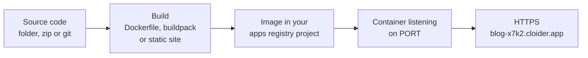

An **app** on Cloider is your source code running as a web service: you hand Cloider a folder, a zip file or a
GitHub, GitLab or Bitbucket repository, and Cloider builds it into a container image, runs it, and serves it over
HTTPS on a free `*.cloider.app` address or on your own domain. There are no servers, clusters or Kubernetes
manifests to manage. This page explains how App Engine works, what it costs, its limits, and where to go next.

## At a glance

| | |
| --- | --- |
| **What it is** | A managed container built from your source code and served over HTTPS |
| **Sources** | A folder, a `.zip` file or a single HTML file uploaded from the dashboard; a local directory with `cloider deploy`; a GitHub, GitLab or Bitbucket repository |
| **How it is built** | Your own `Dockerfile` if the project has one; otherwise Cloud Native Buildpacks; a plain folder of HTML is served as a static site |
| **Languages** | Node.js, Python, Go, Java, Scala, PHP, Ruby, .NET and static sites without a Dockerfile, anything with one. See [Supported languages](/apps/supported-languages) |
| **Address** | A free subdomain such as `https://blog-x7k2.cloider.app`, plus any [custom domain](/apps/domains) |
| **Instances** | One container per app |
| **Source size** | Up to 100 MB compressed and 500 MB extracted per deploy |
| **Billing** | Pay as you go for the CPU and memory the running container uses. A paused app uses none. See [Usage and billing](#how-is-an-app-billed) |
| **Managed with** | Dashboard, [`cloider` CLI](/cli/commands/app), [REST API](/api/endpoints/apps), [MCP server](/mcp/tools). Terraform can route a domain to an app with [`cloider_target`](/terraform/resources/target) |

<Screenshot
  src="/img/screenshots/apps/list.webp"
  url="/dashboard/apps"
  alt="The Apps page listing four apps, blog from a GitHub repository, api and web from uploads, and admin from a Docker image, with their source, version and status"
  caption="The Apps page lists every app in the account with its source, live version and status."
/>

## How does an app work?

An app goes from source code to a running service in four steps, and Cloider does all of them for you every time you
deploy:

1. **Upload or fetch the source.** The dashboard and the CLI zip your folder and upload it. A git app has its branch
   fetched as an archive at the latest commit.
2. **Build an image.** Cloider looks at the root of the source and picks a [build strategy](/apps/build-configuration):
   your `Dockerfile`, a buildpack for your language, or a static web server for plain HTML.
3. **Deploy it.** The image is pushed to a private registry project of your account and started as a container. The
   container is told which port to listen on through the `PORT` environment variable.
4. **Wait until it is really running.** A version only counts as deployed once something answers on the app's port and
   keeps running for 15 seconds. Until then the previous version keeps serving traffic.



Each deploy creates a new **build** with the next version number (1, 2, 3 and so on). The builds list on the app's
**Builds** tab is the history of every deploy, with its status, source, duration and logs. See
[Builds and deployments](/apps/builds-and-deployments).

### What runs inside an app?

Each app runs as one container from the image of its live build. The container:

- Gets the app's [environment variables](/apps/environment-variables), plain and secret, when it starts.
- Gets a `PORT` variable set to the app's port, which overrides any variable of the same name you set.
- Runs as a non-root user when it was built by a buildpack or as a static site. An image built from your own
  `Dockerfile` runs as the user the `Dockerfile` sets. Binding a port below 1024 (for example 80) works either way.
- Is reached from the internet through its domains, over HTTPS. Cloider terminates TLS and forwards plain HTTP to the
  app's port.
- Runs on `linux/amd64`.

### Where are an app's images stored?

Cloider pushes every image it builds to a private [container registry](/container-registry/overview) project that it
creates for your account with your first app. The project carries an **Apps** badge in the registry list. Cloider
manages it for you: you can browse its images, but you can't delete them or change its policies. Cloider keeps the
image the app is running and the one deployed before it, deletes older and failed images after each build, and
deletes an app's images when you delete the app.

An app [created from a Docker image](/apps/deploy-an-image) is the exception: Cloider doesn't build or copy its image,
it pulls the image from your registry on every start, pinned to the digest its tag pointed at when it was deployed.

## Ways to deploy an app

| Method | Best for | Later versions |
| --- | --- | --- |
| [Import a git repository](/apps/deploy-from-git) (GitHub, GitLab, Bitbucket) | Teams with code in git | Every push to the branch deploys automatically, or click **Deploy latest commit** |
| [`cloider deploy`](/apps/deploy-from-your-computer) from a directory | Developers, scripts, CI, AI agents | Run `cloider deploy` again in the same directory |
| [Upload in the dashboard](/apps/deploy-from-your-computer#upload-your-source-in-the-dashboard) | Quick tests, static sites, a zip from somewhere else | Click **Deploy new version** and upload again |
| [Deploy a Docker image](/apps/deploy-an-image) from any registry | Teams that build their own images in CI | Push to the tag, then click **Deploy**, run `cloider deploy --app`, or call the app's deploy hook |

You can create an app from a git repository with the CLI too (`cloider app create --git github --repo acme/api`), and
an AI agent can do all of the above through the [MCP server](/mcp/overview).

Any of these can also be a [cron job](/apps/cron-jobs): an app with no port or address that runs on a schedule, such
as every night at 03:00 UTC, and exits.

## Create your first app

The fastest path is a folder on your computer and the CLI. In the folder of a Node.js, Python, Go or any other
supported project, run:

<Tabs groupId="interface" queryString>
<TabItem value="dashboard" label="Dashboard" default>

1. Open **Apps** in the sidebar and click **Create App**.
2. Choose where the code comes from: connect GitHub, GitLab or Bitbucket and pick a repository and branch, or drop a
   folder, a `.zip` file or an HTML file.
3. Check what Cloider detected (language, framework and port), the app name and the free subdomain.
4. Click **Create App**. The app page opens and shows the first build as it runs.

<Screenshot
  src="/img/screenshots/apps/new-app.webp"
  url="/dashboard/apps/new-app"
  alt="The new app page offering GitHub, GitLab and Bitbucket imports, a Docker image, or a source upload"
  caption="Choose where the app's code comes from."
/>

</TabItem>
<TabItem value="cli" label="CLI">

```bash
cd blog
cloider deploy
```

```text title="Output"
Packaged 42 files (18.3 KB)
Detected JavaScript Express
✓ Created app blog on port 3000
Linked . to blog in .cloider/app.json, later deploys from here update it.
Downloading source for app a7c2mq...
No Dockerfile in the source, looking for a buildpack...
[buildpack output]
App a7c2mq built and pushed as registry.cloider.com/acme-apps/blog-a7c2mq:1
Deploying the image...
Waiting for the app to start...
The app is up, watching it for 15s...
The app is running.
✓ Deployed version 1 of blog
https://blog-x7k2.cloider.app/
```

Build output goes to stderr and the URL to stdout, so `URL=$(cloider deploy)` captures just the address.

</TabItem>
<TabItem value="terraform" label="Terraform">

The Terraform provider doesn't create or deploy apps. Deploy the app with the dashboard or `cloider deploy`, then
Terraform can route one of your domains to it with a `cloider_target`:

```hcl title="main.tf"
resource "cloider_domain" "blog" {
  name = "acme-blog.cloider.app"
}

# The app's id comes from `cloider app list -o wide`
resource "cloider_target" "blog" {
  domain = cloider_domain.blog.name
  app_id = "a7c2mq"
}
```

</TabItem>
<TabItem value="api" label="API">

Creating an app through the API is a few calls: stage the source, upload it, run detection, then create the app.
See [Deploy from your computer](/apps/deploy-from-your-computer#deploy-with-the-rest-api) for the full sequence. To
list your apps:

```bash
curl https://cloider.com/api/apps \
  -H "Authorization: Bearer $CLOIDER_TOKEN"
```

```json title="Response"
[
  {
    "hashed_id": "a7c2mq",
    "app_name": "blog",
    "app_label": "blog",
    "port": 3000,
    "start_command": "",
    "status": "Ready",
    "source_filename": "blog.zip",
    "source_size": 18734,
    "uploaded": true,
    "language": "JavaScript",
    "framework": "Express",
    "git_provider": "GitHub",
    "repo_full_name": "",
    "repo_url": "",
    "repo_branch": "",
    "auto_deploy": false,
    "git_connected": false,
    "image_ref": "registry.cloider.com/acme-apps/blog-a7c2mq:1",
    "dockerfile_args": [],
    "version": "1",
    "url": "https://blog-x7k2.cloider.app/",
    "domains": [{"domain_name": "blog-x7k2.cloider.app", "domain_type": "Subdomain"}],
    "created_at": "2026-10-20T09:12:44Z"
  }
]
```

</TabItem>
<TabItem value="mcp" label="MCP">

Ask your agent:

```text title="Prompt"
Deploy the project in /home/me/blog to Cloider and tell me its URL.
```

It calls the `deploy_app` tool:

```json title="Tool call: deploy_app"
{"dir": "/home/me/blog"}
```

</TabItem>
</Tabs>

For a guided walkthrough, see [Deploy your first app](/get-started/deploy-your-first-app).

## What does the app page show?

Every app has its own page in the dashboard with these tabs:

| Tab | What it does | Page |
| --- | --- | --- |
| **Overview** | Status, live version, address, port, start command, the deployed source or repository, what was detected, and the image | This page |
| **Insights** | CPU and memory charts | [Insights](/apps/insights) |
| **Builds** | Every build with its status, source, duration, logs and **Retry** for failed ones; **Deploy new version** or **Deploy latest commit** | [Builds and deployments](/apps/builds-and-deployments) |
| **Environment** | Environment variables, build variables and build arguments | [Environment variables](/apps/environment-variables) |
| **Settings** | Port, start command, and for a git app the branch and **Auto deploy on push** | [Settings](/apps/settings) |
| **Logs** | The running app's output, live | [Logs](/apps/logs) |
| **Terminal** | A shell inside the app's container | [Terminal and exec](/apps/terminal-and-exec) |

The **Logs** and **Terminal** tabs are hidden while the app is paused, and **Terminal** only appears once a version has
deployed. **Pause**, **Resume** and **Delete** are in the actions menu of each app on the Apps list.

<Screenshot
  src="/img/screenshots/apps/detail-overview.webp"
  url="/dashboard/apps/blog-a7c2mq"
  alt="The Overview tab of the blog app showing status Ready, version 1, its cloider.app address, port 3000 and the deployed source"
  caption="The Overview tab of a running app."
/>

## App statuses

An app's status follows the build that is running on it, so the Apps list shows how far a deploy has got.

| Status | Meaning |
| --- | --- |
| `Pending` | The source is still uploading |
| `Queued` | The build is waiting its turn |
| `Building` | The image is being built |
| `Deploying` | The image is being applied to the platform |
| `Starting` | The new container is starting; Cloider waits until it answers on the app's port and stays up |
| `Ready` | The app is running and serving its live version |
| `Failed` | The first build failed, so there is nothing to serve. Once an app has deployed a version, a failed build leaves it `Ready` on the previous version |
| `Pausing` / `Paused` | The app is being stopped, or is stopped |
| `Terminating` | The app is being deleted |

See [Status values](/reference/status-values) for every product's statuses.

## How is an app billed?

An app is billed for **compute only**: the CPU and memory its container uses, measured continuously and charged by
the time it runs. There is no charge for builds, requests or traffic.

- Usage is measured in **compute units**: for each moment, the larger of the CPU cores in use and the memory in use
  converted to cores at a fixed CPU to memory ratio.
- Usage is metered continuously, charged for the time the app runs, and summed per day. The current rate is on the
  [pricing page](/reference/pricing).
- A **paused** app has no running container, so it uses no compute and costs nothing.
- Your app's images live in the account's apps registry project, which is billed like any
  [registry project](/container-registry/usage-and-billing), by the image data it stores. Cloider keeps only the two
  most recently deployed images per app.

See an app's month to date cost and forecast with `cloider app usage blog`, on the [Usage](/account/usage) page, or in
the [billing model](/concepts/billing-model).

## Limits

| Limit | Value |
| --- | --- |
| App name | 2 to 64 characters: lowercase letters, digits and `-`, starting with a letter, not ending with `-` |
| Source archive | 100 MB compressed, 500 MB extracted |
| Files per deploy from the CLI | 2000 |
| Build time | 30 minutes for the whole build |
| Start time | 5 minutes for a new version to answer on its port |
| Builds at once | One per app. A second deploy is refused until the first finishes |
| Port | 1 to 65535 |
| Start command | One line, up to 1000 characters |
| Variables | 100 per list (environment, build variables, build arguments), 16 KB per value, 64 KB per list |
| Instances | One container per app |
| Build log kept | The last 64 KB of each build's output |

See [Limits and quotas](/reference/limits-and-quotas) for every product.

## Who can manage apps?

Every member of an account sees its apps. Members with read-only access can open the app's tabs and read its logs,
builds and variables, but they can't create, deploy, change, pause or delete apps, open a terminal or run commands. An API
token with read access has the same limits. See [Accounts and roles](/concepts/accounts-and-roles).

## Apps and other Cloider products

- **Databases.** An app can connect to a [managed database](/databases/overview). Add the app as a
  [trusted source](/databases/trusted-sources) of the database and put the connection string in a secret environment
  variable such as `DATABASE_URL`.
- **Object storage.** Store uploads and assets in an [S3 compatible bucket](/object-storage/overview) and give the app a
  [bucket access key](/object-storage/access-keys) through secret variables.
- **Domains.** Route any path of a [custom domain](/domains/add-a-custom-domain) to an app with a
  [target](/domains/targets).
- **Kubernetes.** When you outgrow one container, a [serverless Kubernetes cluster](/kubernetes/overview) runs any
  number of workloads with the standard Kubernetes API.

## Next steps

<Cards cols={2}>
  <Card title="Deploy from git" href="/apps/deploy-from-git" icon="source-branch">
    Connect GitHub, GitLab or Bitbucket and deploy on every push.
  </Card>
  <Card title="Deploy from your computer" href="/apps/deploy-from-your-computer" icon="console">
    `cloider deploy` a folder, or upload it in the dashboard.
  </Card>
  <Card title="Build configuration" href="/apps/build-configuration" icon="application-cog-outline">
    Detection, Dockerfile or buildpacks, port and build arguments.
  </Card>
  <Card title="Supported languages" href="/apps/supported-languages" icon="code-braces">
    Minimal projects that deploy as they are.
  </Card>
</Cards>

<FAQ items={[
  {q: 'What is a Cloider app?', a: 'A Cloider app is your source code built into a container image and run as a web service, served over HTTPS on a free cloider.app subdomain or your own domain. Cloider builds it with your Dockerfile, a buildpack for your language, or a static web server, and runs one container of it.'},
  {q: 'Do I need a Dockerfile to deploy an app?', a: 'No. Without a Dockerfile, Cloider builds Node.js, Python, Go, Java, Scala, PHP, Ruby and .NET projects with Cloud Native Buildpacks, and serves a folder of HTML files as a static site. With a Dockerfile at the root of the project, Cloider builds exactly that Dockerfile.'},
  {q: 'Which port should my app listen on?', a: 'Listen on the port in the PORT environment variable. Cloider sets PORT to the app\'s port, which is detected from the project or defaults to 8080, and only routes traffic to that port. You can change the port on the Settings tab.'},
  {q: 'How much does an app cost?', a: 'An app is billed for the CPU and memory its running container uses, for the time it runs. Builds, requests and traffic are free, and a paused app costs nothing for compute. The app\'s images are stored in a registry project billed by storage.'},
  {q: 'Can an app run more than one instance?', a: 'No. Each app runs one container. For several replicas or several services that talk to each other, use a Cloider Kubernetes cluster.'},
  {q: 'What happens to my running app when a new build fails?', a: 'Nothing. The version that is live keeps serving until a new version builds, starts and stays up. A failed build only marks that build Failed, and you can retry it or deploy again.'},
  {q: 'Can I manage apps with Terraform?', a: 'Not directly. The Terraform provider has no app resource, but a cloider_target can route one of your domains to an existing app by its id.'},
]} />
