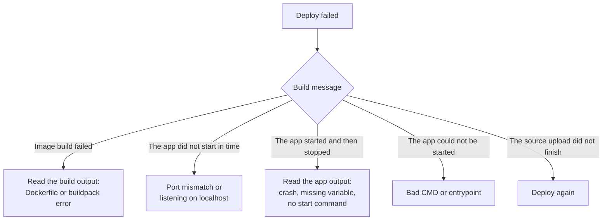

Most app problems fall into one of four phases: getting the **source** to Cloider, **building** it, **starting** it, or
**running** it. Each phase has its own messages, and the build output on the **Builds** tab almost always says what went
wrong. This page starts with a quick checklist, then goes through every message by phase with its cause and fix.

## Quick checklist

Run through these first; they fix most failed deploys:

1. **Read the build output.** Open the **Builds** tab and click **Logs** on the failed build, or run
   `cloider app build logs <app>`. The last lines say what failed. For a start failure, read what follows
   `--- app output ---`.
2. **Check the port.** The app must listen on `$PORT` (or the app's **Port** must match what it listens on), on
   `0.0.0.0`.
3. **Check how it starts.** A buildpack app needs a `start` script, a `Procfile` or a **Start command**; a `Dockerfile`
   needs a `CMD` or `ENTRYPOINT`, or a **Start command** to run in their place.
4. **Check its variables.** A crash right after start is often a missing environment variable such as `DATABASE_URL`.
5. **Run it locally the same way**: `PORT=8080 npm start`, `PORT=8080 gunicorn app:app --bind 0.0.0.0:$PORT`, or
   `docker build . && docker run -e PORT=8080 -p 8080:8080 <image>`.



## Source and upload problems

| Message | Cause | Fix |
| --- | --- | --- |
| `more than 2000 files to deploy, list what isn't needed in .cloiderignore` | Too many files, usually dependencies | Add `node_modules/`, `.venv/`, `vendor/`, build output and tests to `.gitignore` or `.cloiderignore` |
| `the archive is 140 MB, over the 100 MB limit; ...` | The zip is over 100 MB | Same, and move large media to [object storage](/object-storage/overview) |
| **Only up to 2000 files can be uploaded, zip your project first.** | The dashboard upload doesn't read `.gitignore` | Delete dependency folders before dropping the folder, or use `cloider deploy` |
| **The app source exceeded the allowed size of 100MB!** | The archive is over 100 MB | Make it smaller |
| **This upload has expired, upload your app again!** | Over 2 hours between upload and **Create App** | Start the upload again |
| **Your app source is no longer available, upload it again!** | The staged upload expired or was already used | Upload again |
| `We could not read your app's source` | Detection couldn't open the archive | Create the app anyway with your own name and port, or check the zip opens locally |
| `detection took too long, try again` | Detection is queued behind other work | Run the command again, or pass `--name` and `--port` |
| `the source archive contains absolute or parent paths` (build output) | The zip has `/...` or `../` entries | Re-create the zip from inside the project folder |
| `the extracted source is 612MB, over the 500MB limit` (build output) | The zip expands past 500 MB | Remove generated or binary files |
| `the source archive is empty` (build output) | Nothing was zipped | Check what you zipped |
| `The source upload did not finish` | The upload was interrupted or never confirmed | Deploy again |

See [Deploy from your computer](/apps/deploy-from-your-computer).

## Git problems

| Message | Cause | Fix |
| --- | --- | --- |
| **No repositories to show.** | The connection can't see the repository | GitHub: grant the installation access to it. GitLab: you need Reporter or higher. Bitbucket: you need read access |
| `We could not read acme/api at main. The branch may be gone, or the repository may have no commits yet.` | Empty repository or wrong branch | Push a commit, or pick an existing branch |
| `acme/api is over the 100MB limit.` | The repository archive is over 100 MB | Remove large files, or deploy a subfolder with `cloider deploy` |
| `GitHub no longer gives us acme/api at main` (build) | Branch deleted or renamed, or access removed | Fix the branch on **Settings**, or grant access again |
| **This app's GitHub connection is gone. Reconnect GitHub and try again.** | The connection was suspended or removed | See [What happens when I disconnect a git account?](/apps/deploy-from-git#what-happens-when-i-disconnect-a-git-account) |
| Pushes don't deploy | Auto deploy is off, the push was to another branch, a build was running, or the app is paused | Check **Settings**, then click **Deploy latest commit**. On GitLab and Bitbucket, see [auto deploy needs a webhook](/apps/deploy-from-git#auto-deploy-on-gitlab-and-bitbucket) |

## Build failures

The build message is **Image build failed** and the build output ends with the reason.

### Nothing to build

```text title="Build output"
nothing to build for a7c2mq: no Dockerfile, no buildpack matched, and not a static site (an .html page with no project files)
```

Cloider found no `Dockerfile`, no project file a buildpack recognizes, and no HTML. Usually the project is one folder
down, next to other folders, so its files aren't at the root. Fix it by deploying the project folder itself
(`cloider deploy ./backend`), moving the files to the root, or adding a `Dockerfile` at the root. See
[Supported languages](/apps/supported-languages).

### Dockerfile build failed

```text title="Build output"
build failed for registry.cloider.com/acme-apps/web-w4d8hz:5
```

The lines above it are the `docker build` output. Common causes:

- **A file isn't there.** `COPY` failed because the file is excluded by `.dockerignore`, `.gitignore` or
  `.cloiderignore`, or isn't in the repository. Remember that the build context is the source root.
- **A build argument is missing.** An `ARG` with no default that your build needs. Set it as a
  [build argument](/apps/environment-variables#build-arguments-and-build-variables); the dashboard lists the `ARG`s your
  `Dockerfile` declares under **Declared in your Dockerfile**.
- **A private package can't be installed.** Pass the token as a secret build argument and mount it with
  `RUN --mount=type=secret,id=NPM_TOKEN,env=NPM_TOKEN npm ci`. Environment variables don't reach a Dockerfile build.
- **Wrong platform.** Images build for `linux/amd64`. A base image or binary that only exists for `arm64` fails.
- **It works on my machine.** Run `docker build --platform linux/amd64 .` locally from the same folder to reproduce.

### Buildpack build failed

```text title="Build output"
buildpack build failed for registry.cloider.com/acme-apps/blog-a7c2mq:3
```

The buildpack's own output above says why. Common causes:

- **No lockfile, or a lockfile out of date.** Commit `package-lock.json`, `poetry.lock`, `Gemfile.lock` or
  `composer.lock`, generated from the current dependency list.
- **A runtime version that doesn't exist.** Check `engines.node`, `.python-version` or `system.properties`.
- **The build script failed.** For Node.js, the `build` script runs during the build: run `npm run build` locally.
- **Private packages.** Set the token as a secret [build variable](/apps/environment-variables#build-arguments-and-build-variables).
- **Dependencies uploaded from your machine.** A `node_modules/` or `.venv/` built on macOS can break a Linux build.
  Leave them out of the upload.

### The build did not finish in time

The whole build is limited to 30 minutes. Speed it up: commit lockfiles so the dependency cache is reused, avoid
building assets you don't serve, and use a multi-stage `Dockerfile` with small final images. Use **Retry** for a
one-off slowness.

## Start failures

The image built, was deployed, and then didn't come up. The previous version, if there is one, keeps serving.

### The app did not start in time

```text title="Build output"
Waiting for the app to start...
The app did not start within 300s.
--- app output ---
Server listening on http://127.0.0.1:3000
```

Nothing accepted connections on the app's port within 5 minutes. Causes, most common first:

1. **Port mismatch.** The app listens on another port than the app's **Port**. Listen on `$PORT`, or change the port on
   [Settings](/apps/settings). A Dockerfile image with a fixed port (nginx on 80, a Java server on 8080) needs the
   app's port set to that port.
2. **Listening on localhost.** `127.0.0.1` or `localhost` isn't reachable from outside the container. Listen on
   `0.0.0.0`: `app.listen(port, "0.0.0.0")`, `--bind 0.0.0.0:$PORT`, `--host 0.0.0.0`.
3. **Slow start.** Migrations or cache warm up before listening take more than 5 minutes. Start the server first, or run
   the slow work separately with [`cloider app exec`](/apps/terminal-and-exec).
4. **Development server.** A dev server (`npm run dev`, `flask run`) may bind localhost only. Use the production command.

### The app started and then stopped

```text title="Build output"
The app started and then stopped.
--- app output ---
Error: Missing required environment variable DATABASE_URL
```

The container exited or crashed within its first seconds. The app output under the marker is the last 100 lines it
printed. Usual causes:

- **A missing environment variable** or wrong credentials. Set it on the **Environment** tab.
- **A dependency that isn't installed.** `Cannot find module`, `ModuleNotFoundError`: add it to your dependency file, not
  only to your local environment.
- **No start command.** A buildpack image with nothing to run: add a `Procfile` with a `web:` line, a `start` script, or
  set the **Start command** on [Settings](/apps/settings).
- **The process exits on its own.** A script that finishes isn't a server. The app must keep running and serve HTTP.
- **A crash at startup** such as a failed database connection. Make sure the app is a
  [trusted source](/databases/trusted-sources) of the database it connects to.

### The app could not be started

The container couldn't be created at all, usually because its command doesn't exist in the image: a `CMD` naming a
binary that isn't there, a script without execute permission, or a start command with a typo. Check the `CMD`,
`ENTRYPOINT` or start command.

### The app image could not be pulled

The new image couldn't be pulled for 60 seconds. This is a platform side problem: **Retry** the build.

## Runtime problems

| Symptom | Cause and fix |
| --- | --- |
| The address shows an error page or `502` | The app isn't answering on its port: it crashed, or it is restarting. Check the [Logs](/apps/logs) tab. A crashed container is restarted automatically |
| The app works, then errors after a while | Look for crashes or memory growth on [Logs](/apps/logs) and [Insights](/apps/insights) |
| The address doesn't load at all | The app has no domain (**No domain connected** on Overview), the app is paused, or a custom domain's nameservers or its `A` or `CNAME` record aren't set. See [Domains](/apps/domains) |
| New environment variables aren't picked up | Saving the **Environment** tab restarts the app; build arguments and build variables need the rebuild that saving them starts |
| Redirect loops or `http://` links | Requests reach the app as plain HTTP behind HTTPS. Configure your framework to trust the proxy and generate `https://` URLs |
| App went `Failed` after a port change | Nothing answers on the new port. Put the right port back on **Settings** |
| A file the app wrote is gone | The container's filesystem is reset on every restart and deploy. Store files in a [bucket](/object-storage/overview) or a [database](/databases/overview) |

## Refused actions

| Message | Meaning |
| --- | --- |
| **This app is already building, wait for that build to finish before deploying a new version!** | One build per app at a time |
| **This app is paused. Resume it before deploying a new version!** | Builds and setting changes need a running app |
| **Only a failed build can be retried!** | Retry is only for `Failed` builds |
| **This build never received its source, deploy a new version instead!** | The build's upload never finished |
| **You have read-only access to this account, you can not deploy apps!** | Your role or token is read-only |
| **Your account is suspended. Upgrade to a paid plan to continue using our services.** | See [Billing](/account/billing) |
| **Couldn't prepare your app's registry, try again in a moment!** | A temporary registry problem when creating the app. Try again |

## Still stuck?

Collect the app name, the failed build's version and its output (`cloider app build logs <app> <version>`), and
[contact support](/account/support). For problems across products, see the general
[Troubleshooting](/reference/troubleshooting) page.

## Next steps

- [Builds and deployments](/apps/builds-and-deployments): build statuses and logs.
- [Build configuration](/apps/build-configuration): strategies, port and start command.
- [Supported languages](/apps/supported-languages): known-good minimal projects.

<FAQ items={[
  {q: 'Why does my Cloider build say "The app did not start in time"?', a: 'Nothing accepted connections on the app\'s port within 5 minutes of the deploy. Almost always the app listens on another port than the app\'s Port setting, or only on localhost. Listen on 0.0.0.0 and the PORT environment variable, or change the port on the Settings tab.'},
  {q: 'What does "no buildpack matched, and not a static site" mean?', a: 'Cloider found no Dockerfile, no project file it recognizes and no HTML at the root of your source. The project is usually one folder down; deploy that folder, move the files to the root, or add a Dockerfile.'},
  {q: 'My build succeeded but the app keeps crashing. Where do I look?', a: 'In the failed build\'s output, after the --- app output --- line, which holds the last 100 lines the app printed, and on the app\'s Logs tab. Missing environment variables and missing dependencies are the usual causes.'},
  {q: 'Does a failed deploy take my app offline?', a: 'No. A new version only replaces the running one once it is up and has stayed up for 15 seconds. Only an app\'s very first build leaves it Failed with nothing to serve. A port change that nothing answers on is the exception.'},
  {q: 'Why is my app returning 502?', a: 'The app is not answering on its port, usually because it crashed or is restarting. Check the Logs tab for the error; the platform restarts a crashed container automatically.'},
]} />
