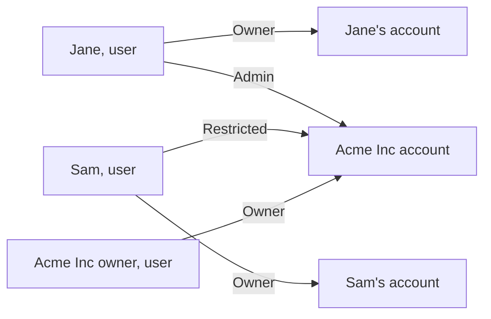

On Cloider, **resources belong to accounts** and **people reach accounts through roles**. Every user has their own account, where they are the Owner, and can be invited into other accounts as an Admin or a Restricted member. API tokens act inside one account with the role of the member who created them, or less.

## At a glance

| Term | What it is |
| --- | --- |
| **User** | A person, identified by the email address of their Google or GitHub sign in |
| **Account** | The container for resources, usage and invoices. Every user has one, named after them |
| **Owner** | The user whose account it is. Full access, including billing. Every account has exactly one |
| **Member** | Another user invited into the account by email, with the role **Admin** or **Restricted** |
| **Admin** | Full access to every resource and to members, but not to billing |
| **Restricted** | Read-only access to resources, with a few exceptions listed below |
| **API token** | A secret that acts in one account as the member who created it, either **Read** or **Read & Write** |

## Users and accounts

When you sign in for the first time, Cloider creates your **user** and your **account** together. They share your email address and your name, which is why the account menu shows your own name while you work in your own account.

- Your account is where your resources live and where their usage is billed.
- You are its **Owner**. Ownership can't be given away or shared: an account has exactly one Owner.
- You can be a **member** of any number of other accounts. In each one you have the role its Owner or an Admin gave you.

The account you are working in is shown in the top right corner of the dashboard. Moving between accounts is covered in [Switch accounts](/account/switch-accounts).



:::tip[Use a shared account for a team]
For a company, sign up with the address that should own the infrastructure and receive the invoices (for example `ops@acme.com`), then invite each person as a member. Everyone keeps their own personal account next to it.
:::

## Members

A **member** is a user invited into an account by email address. Owners and Admins invite members from **Access Control** in the dashboard (see [Access control](/account/access-control)).

A membership has one of three statuses:

| Status | Meaning |
| --- | --- |
| **Pending** | Invited, but the person hasn't opened the account yet. They receive an email titled *Invitation to Access a Cloider Account* |
| **Active** | The person has signed in with the invited email address and opened the account at least once |
| **Deactivated** | Access is switched off but the membership is kept, so it can be turned back on later |

The invitation is tied to the **email address**, not to a provider. The invited person signs in with Google or GitHub using that address, and the account appears on their **Select an account** screen. Opening it the first time makes the membership **Active**.

## Roles

### Owner

The Owner has full access to the account. They are the only one who can see **Billing** and its invoices, and the only one who can upgrade the account from the trial to the paid plan. The Owner is billed for every resource in the account, whoever created it.

### Admin

Admins can do everything the Owner can do with resources and members: create, change and delete every kind of resource, invite and remove members, change roles, and manage every API token in the account. They can't see **Billing** or invoices.

### Restricted

Restricted members have read-only access. They can see every resource, its status, settings, usage and logs, but they can't create, change or delete resources. The dashboard hides or disables the buttons that would. Restricted members can still:

- open the browser **terminal** of clusters, apps and databases, and download a cluster's **kubeconfig**,
- read connection details, such as a database's password and CA certificate, and the values of an app's secret variables,
- open and reply to **support requests**,
- generate **Read** API tokens for themselves,
- leave the account.

:::warning[Restricted is not "no secrets"]
A Restricted member can read credentials: kubeconfigs, database passwords and secret variables. A kubeconfig is a cluster admin credential, and a terminal is a shell. Give the Restricted role only to people you trust with that data, and remove members who no longer need access.
:::

When a request is refused because of the role, the error says so, for example:

```text
You have read-only access to this account, you can not create clusters!
```

## API tokens and roles

An **API token** belongs to one account and acts as the member who created it. Cloider looks up that member's current role on every request, so a token never does more than its creator can do right now:

- A **Read & Write** token has the creator's role.
- A **Read** token is held to read requests (`GET`), whatever the creator's role. Any other request is refused with `This API token is read only!`.
- Restricted members can only create **Read** tokens. If a member is changed to Restricted, their existing tokens are switched to **Read**.
- If the creator is **removed** or **deactivated**, their tokens stop working at once. Removing a member also deletes their tokens.

Some actions can't be done with any token, only from a signed in dashboard session: inviting and managing members, changing roles, generating, editing and deleting API tokens, connecting a Git provider, switching accounts and leaving an account. Those requests fail with `This endpoint can't be used with an API token!`. The one token action allowed is a token revoking itself (`cloider logout` does this).

Read [API tokens](/account/api-tokens) for how to create and manage them.

## Permission matrix

The matrix below shows who can do what. **Read token** and **Read & Write token** are API tokens; a Read & Write token has its creator's role, so the column assumes an Owner or Admin creator.

| Action | Owner | Admin | Restricted | Read token | Read & Write token |
| --- | --- | --- | --- | --- | --- |
| See every resource, its status and settings | Yes | Yes | Yes | Yes | Yes |
| See the **Usage** page and per resource usage | Yes | Yes | Yes | Yes | Yes |
| See **Billing** and invoices | Yes | No | No | No | Owner's token only |
| Upgrade from the trial to the paid plan | Yes | No | No | No | No |
| Create, pause, resume and delete clusters | Yes | Yes | No | No | Yes |
| Download a cluster's kubeconfig | Yes | Yes | Yes | Yes | Yes |
| Create, resize, rename, pause, resume, restore and delete databases | Yes | Yes | No | No | Yes |
| Read a database's password and CA certificate | Yes | Yes | Yes | Yes | Yes |
| Create, deploy, configure, pause, resume and delete apps | Yes | Yes | No | No | Yes |
| Change an app's variables, build arguments and build variables | Yes | Yes | No | No | Yes |
| Read an app's secret variable values and logs | Yes | Yes | Yes | Yes | Yes |
| Create and delete buckets, change visibility, versioning, policy and lifecycle | Yes | Yes | No | No | Yes |
| Upload, delete and restore files in buckets | Yes | Yes | No | No | Yes |
| List and download files in buckets | Yes | Yes | Yes | Yes | Yes |
| Create, update and delete S3 access keys | Yes | Yes | No | No | Yes |
| Create and delete registry projects, change settings and policies | Yes | Yes | No | No | Yes |
| Delete images, tags and repositories, run retention | Yes | Yes | No | No | Yes |
| Create, update and delete registry tokens | Yes | Yes | No | No | Yes |
| Add and delete domains, DNS records and targets | Yes | Yes | No | No | Yes |
| Open a browser terminal (cluster, app, database) | Yes | Yes | Yes | No | Yes |
| Run a command with `exec` | Yes | Yes | No | No | Yes |
| Connect or disconnect a Git provider | Yes (dashboard) | Yes (dashboard) | No | No | No |
| Open and reply to support requests | Yes | Yes | Yes | No | Yes |
| List members | Yes | Yes | Yes | Yes | Yes |
| Invite members, change roles, activate, deactivate and remove members | Yes (dashboard) | Yes (dashboard) | No | No | No |
| Leave the account | Not applicable | Yes (dashboard) | Yes (dashboard) | No | No |
| Generate API tokens | Yes (dashboard) | Yes (dashboard) | Read only (dashboard) | No | No |
| See API tokens | All in the account | All in the account | Their own | Per creator | Per creator |
| Edit and delete other members' API tokens | Yes (dashboard) | Yes (dashboard) | No | No | No |

"Per creator" means a token lists what its creator would see: every token for an Owner or Admin, their own for a Restricted member.

## Things that are not roles

- **Cloider has no per resource permissions.** A role applies to the whole account. To separate environments, use separate accounts (for example one for production that few people can reach) or separate API tokens with the least access they need.
- **Registry tokens and S3 access keys are not members.** They are credentials for one product (`docker` and S3 tools), scoped by what you choose when you create them. See [Registry tokens](/container-registry/tokens) and [Access keys](/object-storage/access-keys).
- **Kubernetes RBAC inside a cluster is yours.** The kubeconfig Cloider gives you is a cluster admin credential. Create service accounts and RoleBindings inside the cluster for finer access.

## Next steps

- [Access control](/account/access-control): invite members and change roles, step by step.
- [API tokens](/account/api-tokens): create tokens for the CLI, Terraform, CI and the API.
- [Switch accounts](/account/switch-accounts).
- [Security](/concepts/security).

<FAQ items={[
  {q: 'What roles does Cloider have?', a: 'Three: Owner, Admin and Restricted. The Owner is the user whose account it is and has full access including billing. Admins have full access except billing. Restricted members have read-only access to resources.'},
  {q: 'Can an Admin see invoices?', a: 'No. Billing and invoices are visible to the account Owner only. Admins and Restricted members do not see the Billing page, and the billing API refuses them.'},
  {q: 'Can I transfer ownership of a Cloider account?', a: 'No. An account belongs to the user it was created for. To hand over infrastructure, create the account with a shared company email address and invite people as members.'},
  {q: 'What can a Restricted member do?', a: 'See every resource, its usage and logs, open browser terminals, download kubeconfigs, read connection details and secret variables, open support requests and create Read API tokens. They cannot create, change or delete resources or run exec commands.'},
  {q: 'What happens to API tokens when I remove a member?', a: 'Removing a member deletes the API tokens they created in the account. Deactivating a member stops their tokens from working until the member is activated again.'},
  {q: 'Why can my API token not invite members?', a: 'Members and API tokens can only be managed from a signed in dashboard session, so that a leaked token cannot be used to give out more access. The API answers This endpoint can\'t be used with an API token!.'},
  {q: 'Does a role apply to one resource or the whole account?', a: 'The whole account. Cloider has no per resource permissions. Use separate accounts or separate API tokens to limit access further.'}
]} />
