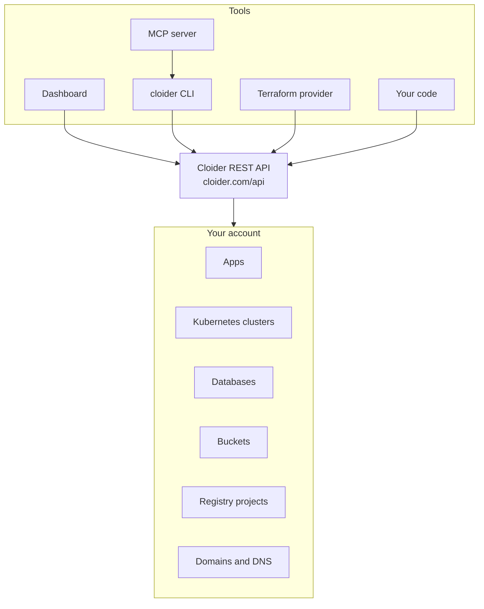

Cloider is a pay-as-you-go cloud platform that runs your applications, Kubernetes workloads, databases, files and container images on infrastructure that Cloider operates for you. You never pick a server size or patch an operating system: you create a resource, use it, and pay for what it uses.

This page explains the model behind the products, so you know what to expect from each one.

## At a glance

| Product | What you get | How it is billed | Managed with |
| --- | --- | --- | --- |
| [Apps](/apps/overview) | Your code built and run as a container, on a free HTTPS subdomain | CPU and memory used | Dashboard, CLI, API, MCP |
| [Kubernetes](/kubernetes/overview) | A cluster with a standard Kubernetes API, no nodes to manage | CPU and memory used, volume GiB, load balancer time | Dashboard, CLI, Terraform, API, MCP |
| [Databases](/databases/overview) | Managed PostgreSQL 18, MySQL 9, MongoDB 8 or Redis 8 on a plan | Flat monthly plan price, prorated; storage only while paused | Dashboard, CLI, Terraform, API, MCP |
| [Object Storage](/object-storage/overview) | S3 compatible buckets | GiB stored; requests and traffic are free | Dashboard, CLI, Terraform, API, MCP, any S3 tool |
| [Container Registry](/container-registry/overview) | Private projects at `registry.cloider.com` | GiB stored; pushes and pulls are free | Dashboard, CLI, Terraform, API, MCP, Docker |
| [Domains and DNS](/domains/overview) | Free `cloider.app` subdomains, your own domains, DNS records, routing | Not metered | Dashboard, CLI, Terraform, API, MCP |

## The serverless model

On a traditional cloud you rent machines and fit your software onto them. On Cloider you describe what you want to run and Cloider places it on shared, managed infrastructure:

- **No machines to size.** A Kubernetes cluster has no node pools. An app has no instance type. You set resource requests the Kubernetes way, or let Cloider run your app as built.
- **No idle machines to pay for.** Compute is metered from what your workloads request and use, sampled continuously, so a quiet workload costs little.
- **Standard interfaces.** Clusters speak the Kubernetes API, buckets speak S3, the registry speaks the Docker Registry HTTP API V2, databases speak their own wire protocols. Your existing tools work, and you can take your data and configuration elsewhere.
- **Everything in one account.** One account holds every product, one usage page shows what each resource costs, and one monthly invoice covers it all.

## One API underneath every tool

The dashboard, the CLI, the Terraform provider and the MCP server all use the same public REST API at `https://cloider.com/api`. Anything you can click, you can script, with the same validation and the same error messages.

- The **dashboard** authenticates with a session from your Google or GitHub sign in.
- Every other tool authenticates with an **API token** (`cldr_...`) that belongs to one account.
- A few actions are dashboard only on purpose: inviting members, changing roles, and creating or deleting API tokens. See [Security](/concepts/security).

Read [Choose a tool](/get-started/choose-a-tool) for when to use which.

## How each product runs

### Apps

An app is source code that Cloider turns into a running service:

1. **Source.** You upload a folder or zip (dashboard or `cloider deploy`), or import a GitHub, GitLab or Bitbucket repository. Git apps can deploy on every push.
2. **Detection.** Cloider inspects the code to find the language, framework and port.
3. **Build.** If the project has a Dockerfile, Cloider builds it. Otherwise it builds the code with buildpacks. A folder of static HTML is served as a static site.
4. **Image.** The image is stored in your account's own container registry project for apps.
5. **Run.** Cloider runs the image as containers and routes your free subdomain (for example `https://blog.cloider.app`) to it with HTTPS.

Each deploy is a numbered build (version 1, 2, 3...). You pay for the CPU and memory the app's containers use. A paused app runs no containers and accrues no compute. Read the [Apps overview](/apps/overview).

### Kubernetes clusters

Each Cloider cluster is a dedicated Kubernetes control plane (its own API server and cluster state) that Cloider runs for you on shared infrastructure. Your Pods, Services and volumes are scheduled onto Cloider's managed worker capacity. From `kubectl`'s point of view it is a normal cluster: you get a kubeconfig with admin credentials and can install anything that runs on Kubernetes.

- **Versions**: you choose a Kubernetes version when you create a cluster, from the versions currently offered (`GET /api/options` lists them). A cluster keeps its version; to move to a newer one, create a new cluster.
- **Reaching your workloads**: route a domain to a Service with a [target](/domains/targets), or create a Service of type `LoadBalancer` to get a public IP. Ingress objects in the cluster are not served.
- **Storage**: PersistentVolumeClaims get [persistent volumes](/kubernetes/persistent-volumes), billed per GiB of provisioned capacity.
- **Billing**: compute is metered per container as the larger of what it requests and what it uses, plus volumes and load balancers. The cluster's own control plane components are part of its metered usage.

Read the [Kubernetes overview](/kubernetes/overview).

### Databases

A managed database is a PostgreSQL, MySQL, MongoDB or Redis database that Cloider provisions, configures, backs up and keeps running.

- **Engines and versions**: PostgreSQL 18, MySQL 9, MongoDB 8 and Redis 8.
- **Plans**: Hobby, Starter, Basic, Standard, Plus and Pro, each with a fixed CPU, RAM and storage size. You can [resize](/databases/resize) to a larger plan.
- **Network access**: each database has a public endpoint under `db.cloider.com` and a list of [trusted sources](/databases/trusted-sources) that controls who can connect, plus optional [SSL/TLS](/databases/ssl-tls).
- **Backups**: databases get a full backup every 14 days, and every change in between is recorded, so they can be restored to any second of the last 14 days from the dashboard, CLI, API or MCP. See [Backups and restore](/databases/backups-and-restore).
- **Billing**: a flat monthly price per plan, prorated to the time the database is ready. While paused, only its storage is billed.

Read the [Databases overview](/databases/overview).

### Object storage

Buckets are S3 compatible object storage. Any S3 client, SDK or tool (AWS CLI, rclone, s3cmd, the AWS SDKs) works with them, using the endpoint of the bucket's region and an access key.

- **Region and endpoint**: buckets live in the `eu-central-2` region (Europe), at `https://s3.eu-central-2.cloider.com`. Both path style and virtual hosted style addressing work.
- **Access**: [access keys](/object-storage/access-keys) (S3 credentials) are managed per account in **Access Control**, and a bucket can be [public or private](/object-storage/public-and-private-buckets).
- **Features**: [versioning](/object-storage/versioning), [lifecycle rules](/object-storage/lifecycle-rules), [bucket policies](/object-storage/bucket-policies), [static websites](/object-storage/static-websites) and a file browser in the dashboard.
- **Billing**: GiB stored, averaged over time. Requests and data transfer are free.

Read the [Object Storage overview](/object-storage/overview).

### Container registry

The container registry stores Docker and OCI images in **projects** at `registry.cloider.com/<project>/<repository>:<tag>`. You log in with `cloider registry login` or a registry token, then use `docker push` and `docker pull` as usual.

- **Projects** have a storage limit you set (5 GB by default, 20 GB at most) that stops pushes beyond it.
- **Tokens** can be read only (pull) or read and write (push), for CI systems and clusters.
- **Policies**: [retention rules](/container-registry/retention-policies) delete old images, and [immutable tags](/container-registry/immutable-tags) protect tags from being overwritten.
- **Your apps' images** live in your account's apps project, which Cloider creates with your first app.
- **Billing**: GiB stored, averaged over time. Pushes and pulls are free.

Read the [Container Registry overview](/container-registry/overview).

### Domains and DNS

Cloider runs authoritative DNS for your domains and routes HTTP traffic to your apps, cluster services and bucket websites.

- **Free subdomains**: claim a name under `cloider.app`, such as `blog.cloider.app`, with HTTPS included.
- **Custom domains**: add a domain you own and point it at Cloider's nameservers, `ns1.cloider.com` to `ns4.cloider.com`, then manage its [DNS records](/domains/dns-records).
- **Targets**: a [target](/domains/targets) routes a path of a domain (for example `example.com/api`) to an app or to a Service in a cluster, or a whole domain to a bucket's static website.

Read the [Domains overview](/domains/overview).

## Regions

Object storage is the one product that names a region: buckets are created in `eu-central-2`, shown as **Europe** in the dashboard, and `GET /api/buckets/regions` lists the regions you can choose from with their endpoints. Apps, clusters, databases and the registry don't take a region parameter.

## Provisioning is asynchronous

Creating a cluster, a database or an app starts work that takes from seconds to a few minutes. The API answers straight away with the new resource's id, and the resource's status then moves from **Creating** (or **Pending** for an app) to **Ready**. Every tool can wait for you:

- the dashboard updates the status in place,
- the CLI has `--wait`,
- Terraform waits until the resource is ready before it continues,
- the MCP tools take a `wait` argument.

Read [Resource lifecycle](/concepts/resource-lifecycle) for every status and transition.

## Next steps

- [Accounts and roles](/concepts/accounts-and-roles)
- [Billing model](/concepts/billing-model)
- [Security](/concepts/security)

<FAQ items={[
  {q: 'Is Cloider serverless?', a: 'Yes, in the sense that you never manage servers or nodes. You create apps, clusters and databases, and Cloider runs them on managed infrastructure and bills you for the CPU, memory and storage they use.'},
  {q: 'Is a Cloider Kubernetes cluster real Kubernetes?', a: 'Yes. Each cluster has its own Kubernetes API server and state, and works with kubectl, Helm and the Terraform kubernetes and helm providers. You do not manage its nodes.'},
  {q: 'Which region are Cloider buckets in?', a: 'Buckets are created in the eu-central-2 region, shown as Europe, and served at https://s3.eu-central-2.cloider.com. GET /api/buckets/regions lists the regions on offer.'},
  {q: 'Does Cloider charge for traffic or egress?', a: 'Bucket requests and traffic are free, and so are registry pushes and pulls. Buckets and registry projects are billed only for the data they store.'},
  {q: 'Can I move my workloads off Cloider later?', a: 'Yes. Clusters use the standard Kubernetes API, buckets use the S3 API, the registry uses the Docker Registry API and databases are standard PostgreSQL, MySQL, MongoDB and Redis, so your manifests, data and images work elsewhere.'},
  {q: 'Which database versions does Cloider offer?', a: 'PostgreSQL 18, MySQL 9, MongoDB 8 and Redis 8. GET /api/options lists the versions offered right now.'}
]} />
