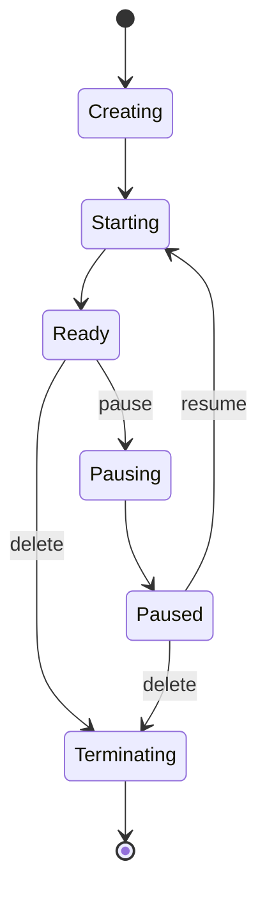

Every Cloider resource (a cluster, an app, a database, a bucket, a registry project, a domain) goes through the same broad life: it is **created**, **provisioned** in the background, becomes **Ready**, can be **paused** and **resumed** if it runs compute, and is finally **deleted**. Its **status** tells you where it is at any moment.

## At a glance

| Stage | Clusters | Databases | Apps | Buckets, registry projects |
| --- | --- | --- | --- | --- |
| Being created | **Creating**, then **Starting** | **Creating**, then **Starting** | **Pending**, **Queued**, **Building**, **Deploying**, **Starting** | **Creating** |
| Usable | **Ready** | **Ready** | **Ready** | **Ready** |
| Pausing | **Pausing**, then **Paused** | **Pausing**, then **Paused** | **Pausing**, then **Paused** | Can't be paused |
| Resuming | **Starting**, then **Ready** | **Starting**, then **Ready** | **Starting**, then **Ready** | |
| Changing size | | **Upgrading** (resize) | A new build | |
| Deleting | **Terminating**, then gone | **Terminating**, then gone | **Terminating**, then gone | **Terminating**, then gone |
| Couldn't be provisioned | | | **Failed** | **Failed** |

Every status value is listed with its meaning in [Status values](/reference/status-values).

## Creating and provisioning

Creating a resource is **asynchronous**. The API (and so the dashboard, the CLI, Terraform and the MCP tools) accepts the request, stores the resource and answers at once with its id. Cloider then provisions it in the background, which takes from a few seconds (a bucket) to a few minutes (a cluster).



While a resource is provisioning, some actions are disabled. For example, a cluster's **Kubeconfig**, **Terminal** and **Pause** menu items are greyed out until it is **Ready**.

### Waiting for a resource to be ready

<Tabs groupId="interface" queryString>
<TabItem value="dashboard" label="Dashboard" default>

List pages and detail pages poll the status while a resource is changing and update it in place. You don't need to reload.

</TabItem>
<TabItem value="cli" label="CLI">

`--wait` (`-w`) makes `create`, `pause`, `resume`, `resize` and `delete` wait until the change is done, for up to 15 minutes by default (`--timeout` changes it). The `status` subcommands print the current status:

```bash
cloider cluster create staging --wait
cloider db status orders-db
```

```text title="Output"
Ready
```

If a resource settles on **Failed**, `--wait` exits with an error.

</TabItem>
<TabItem value="terraform" label="Terraform">

Resources wait until they are ready before `terraform apply` moves on. Clusters wait up to 20 minutes by default, which you can change with a `timeouts` block:

```hcl
resource "cloider_cluster" "staging" {
  name = "staging"

  timeouts = {
    create = "30m"
  }
}
```

</TabItem>
<TabItem value="api" label="API">

Poll the resource's status endpoint, which answers with the status as plain text:

```bash
curl -H "Authorization: Bearer $CLOIDER_TOKEN" https://cloider.com/api/clusters/q7m2x/status
```

```text title="Response"
Starting
```

Status endpoints exist for clusters, databases, apps, buckets and registry projects: `GET /api/<clusters|databases|apps|buckets|registry/projects>/<id>/status`. Once deleted, a cluster, database or app answers `Terminated`, and a bucket or registry project answers `404`.

</TabItem>
<TabItem value="mcp" label="MCP">

Tools that start a long change take a `wait` argument, which waits up to 15 minutes:

```json title="Tool call: create_cluster"
{"name": "staging", "wait": true}
```

</TabItem>
</Tabs>

## Pausing and resuming

**Pausing** stops a resource's compute while keeping its data and configuration, so you stop paying for compute. Clusters, databases and apps can be paused. Buckets, registry projects and domains have no compute and can't be.

| Resource | What a pause keeps | What it stops | Billing while paused |
| --- | --- | --- | --- |
| Kubernetes cluster | Everything in the cluster: objects, configuration, persistent volumes | The control plane and all workloads. `kubectl` can't reach it | Persistent volumes only |
| Database | Its data, users and settings | The database server | The storage of its plan |
| App | Its image, environment variables and settings | The app's containers | Nothing |

Resuming starts everything again from where it was. Each resource goes through **Starting** before it is **Ready**.

<Tabs groupId="interface" queryString>
<TabItem value="dashboard" label="Dashboard" default>

In the product's list page, open the row menu (three dots) and click **Pause**, then confirm. **Resume** is in the same menu once the resource is paused.

<Screenshot
  src="/img/screenshots/kubernetes/pause-dialog.webp"
  url="/dashboard/clusters"
  alt="The pause confirmation dialog for a Kubernetes cluster"
  caption="Pausing asks for confirmation first."
/>

</TabItem>
<TabItem value="cli" label="CLI">

```bash
cloider cluster pause staging --wait
cloider cluster resume staging --wait
cloider db pause orders-db
cloider app pause blog
```

</TabItem>
<TabItem value="terraform" label="Terraform">

Clusters have a `paused` argument:

```hcl
resource "cloider_cluster" "staging" {
  name   = "staging"
  paused = true
}
```

</TabItem>
<TabItem value="api" label="API">

```bash
curl -X POST -H "Authorization: Bearer $CLOIDER_TOKEN" https://cloider.com/api/clusters/q7m2x/pause
curl -X POST -H "Authorization: Bearer $CLOIDER_TOKEN" https://cloider.com/api/clusters/q7m2x/resume
```

The same `pause` and `resume` endpoints exist under `/api/databases/<id>` and `/api/apps/<id>`.

</TabItem>
<TabItem value="mcp" label="MCP">

```json title="Tool call: pause_cluster"
{"cluster": "staging", "wait": true}
```

`pause_database`, `resume_database`, `pause_app`, `resume_app` and `resume_cluster` work the same way.

</TabItem>
</Tabs>

Product specific details are in [Pause and resume a cluster](/kubernetes/pause-and-resume), [Pause, resume and delete a database](/databases/pause-resume-and-delete) and [Pause, resume and delete an app](/apps/pause-resume-and-delete).

## Deleting

Deleting removes a resource **and everything in it**, permanently. A deleted cluster takes its workloads and volumes with it; a deleted database takes its data; a deleted bucket its files. There is no undo and no recycle bin.

- The dashboard asks you to confirm, and for clusters you type the name.
- The CLI asks you to type the name. In scripts, `--yes` skips the question; without a terminal, a delete without `--yes` fails instead of waiting.
- MCP delete tools are marked as destructive, so your agent's client can ask you first.

The status becomes **Terminating** while Cloider removes the resource, and the resource then disappears from lists. Billing stops when it is deleted. Its past usage stays visible on the [Usage](/account/usage) page for 60 days.

Deleting an app also releases its free subdomains unless you keep them (`cloider app delete blog --keep-domains`). Deleting a domain deletes its DNS records and targets.

:::danger[Back up before you delete]
Download what you need first: database backups or a dump, the files in a bucket, the images in a registry project. Once a delete has started it can't be stopped.
:::

## Names, labels and ids

Every resource has an **id**, and most have a **name** and a **label**:

| | What it is | Example | Unique? |
| --- | --- | --- | --- |
| **id** | Cloider's identifier, used in API paths | `q7m2x` | Yes |
| **name** | What you typed when you created it | `staging` | Not for clusters, databases and apps |
| **label** | The name shown in the dashboard and CLI. The name, with `-1`, `-2`... added when another resource of the same kind already uses it | `staging-1` | Yes, among the account's resources of that kind |

- **Clusters, databases and apps** can share a name. The second `staging` cluster gets the label `staging-1`. A database's label can be changed later (`cloider db rename orders-db orders`), which doesn't change its host, user or database name.
- **Buckets and registry projects** have names that are unique across all of Cloider, so they don't need labels: if `acme-assets` is taken by someone else, pick another name.
- **Domains** are identified by the domain name itself, such as `example.com`.
- **Ids** are short strings of lowercase letters and digits for resources (`q7m2x`). Support requests have uppercase ids.

### Referring to a resource in the CLI and MCP

The CLI and MCP tools accept a resource's **id, name or label** wherever they need one:

```bash
cloider cluster get staging      # by label or name
cloider cluster get q7m2x        # by id
```

If a name matches more than one resource, the CLI lists them and asks for the id:

```text title="Output"
Error: 2 clusters are named "staging", pick one by id:
  staging, staging (id q7m2x)
  staging-1, staging (id k3p9a)
```

Terraform and the API always use ids.

## Next steps

- [Status values](/reference/status-values): every status, per product.
- [Billing model](/concepts/billing-model): what each status costs.
- [Limits and quotas](/reference/limits-and-quotas): name rules and per account limits.

<FAQ items={[
  {q: 'Which Cloider resources can be paused?', a: 'Kubernetes clusters, databases and apps. Buckets, registry projects and domains have no compute and cannot be paused.'},
  {q: 'Does pausing a cluster delete my workloads?', a: 'No. A paused cluster keeps everything in it, including persistent volumes. Its control plane and workloads stop, and resuming starts them again.'},
  {q: 'Can I undo a delete?', a: 'No. Deleting a cluster, database, app, bucket or registry project removes it and everything in it permanently. Back up what you need first.'},
  {q: 'Why does my cluster have a -1 in its name?', a: 'Another cluster in the account already uses that name. Cloider keeps the name you typed and adds -1, -2 and so on to the label, so each label is unique.'},
  {q: 'How long does provisioning take?', a: 'From seconds for a bucket to a few minutes for a Kubernetes cluster or a database. Use --wait with the CLI, the wait argument with MCP, or watch the status in the dashboard.'},
  {q: 'What does Terminating mean?', a: 'The resource is being deleted. It disappears from lists once Cloider has removed it.'}
]} />
