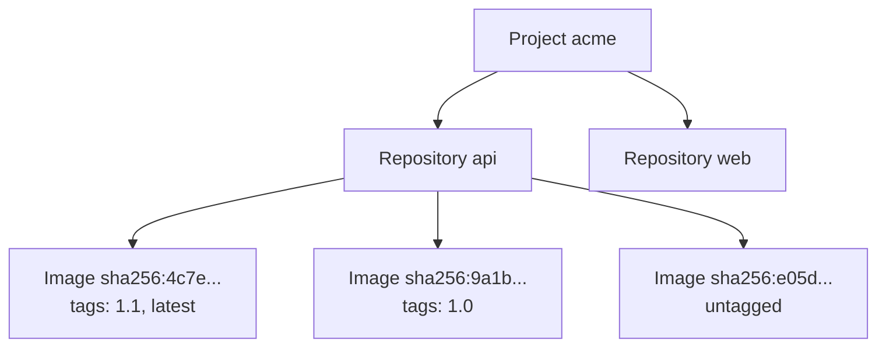

A project's images are grouped in **repositories**, and each image can carry any number of **tags**. This page shows how to browse them, and how to remove a tag, delete an image or delete a whole repository, with the dashboard, the CLI, the API and an AI agent. It also explains what happens to images that are left without a tag.

## How repositories, images and tags relate



- A **repository** is created by the first push to it, for example `docker push registry.cloider.com/acme/api:1.0` creates `api`. It holds every version of one image.
- An **image** (an **artifact** in the API) is identified by its **digest**. Pushing the same content twice gives the same digest.
- A **tag** is a name that points to one image. Pushing `api:latest` again moves `latest` to the new image; the old image stays, under its other tags or **untagged**.
- A **multi-platform image** is one entry (an index) that lists its platforms, such as `linux/amd64, linux/arm64`. Its per-platform images aren't listed separately.

## Browse repositories and images

<Tabs groupId="interface" queryString>
<TabItem value="dashboard" label="Dashboard" default>

1. Open **Registry** and click the project.
2. Go to the **Repositories** tab. The tab appears once the project is **Ready**.
3. The list shows each **Repository** with its number of **Images**, its **Pulls** and its **Last push**. Type in **Filter repositories** to narrow it down.
4. Click a repository to see its images: **Tags**, **Digest**, **Platforms**, **Size**, **Pushed** and **Last pulled**.

<Screenshot
  src="/img/screenshots/container-registry/detail-repositories.webp"
  url="/dashboard/registry/acme-r4t6yu"
  alt="The acme project's Repositories tab listing the api and web repositories with their image counts, pulls and last push"
  caption="The Repositories tab. Click a repository to see its images and tags."
/>

Useful buttons:

- **Copy image name** next to a repository copies `registry.cloider.com/acme/<repository>`.
- The copy icon on a tag, and **Copy pull command** on an image, copy a ready `docker pull` command.
- **Push commands** opens the login, build and push steps for this repository.
- A lock icon on a tag means an immutability rule protects it.

An empty project shows **This project is empty. Push an image to create its first repository** with an example `docker push` command.

</TabItem>
<TabItem value="cli" label="CLI">

List repositories, most recently pushed first, 25 a page:

```bash
cloider registry repos acme
```

```text title="Output"
NAME          IMAGES  PULLS  UPDATED
api           3       12     2026-10-20 09:41
web           1       4      2026-10-19 17:03
team/worker   2       0      2026-10-18 11:20
```

```bash
cloider registry repos acme --filter team      # names that contain "team"
cloider registry repos acme --page 2
cloider registry repos acme -o wide            # adds the full name
```

List the images in a repository, newest first:

```bash
cloider registry images acme api
```

```text title="Output"
DIGEST        TAGS         PLATFORMS                 SIZE      PUSHED            PULLED
4c7e3d1b9a8f  1.1, latest  linux/amd64, linux/arm64  98.4 MiB  2026-10-20 09:41  2 hours ago
9a1b2c3d4e5f  1.0          linux/amd64               47.9 MiB  2026-10-12 16:05  3 days ago
e05d6f7a8b9c  -            linux/amd64               47.8 MiB  2026-10-11 10:12  never
```

`-o wide` shows the full digest and the artifact type, `-o json` the API's answer. `cloider registry tags` is an alias of `images`.

</TabItem>
<TabItem value="terraform" label="Terraform">

The Terraform provider manages projects and tokens, not images. Use the dashboard, the CLI or the API to browse and delete images.

</TabItem>
<TabItem value="api" label="API">

Repositories, with `page` (from 1), `page_size` (1 to 100, default 25) and an optional filter `q`:

```bash
curl "https://cloider.com/api/registry/projects/r4t6yu/repositories?page=1&page_size=25&q=api" \
  -H "Authorization: Bearer $CLOIDER_TOKEN"
```

```json title="Response"
{
  "repositories": [
    {
      "name": "api",
      "artifact_count": 3,
      "pull_count": 12,
      "created_at": "2026-10-01T08:30:11Z",
      "updated_at": "2026-10-20T09:41:52Z"
    }
  ],
  "total": 1
}
```

Images in one repository:

```bash
curl "https://cloider.com/api/registry/projects/r4t6yu/artifacts?repository=api&page=1" \
  -H "Authorization: Bearer $CLOIDER_TOKEN"
```

```json title="Response"
{
  "artifacts": [
    {
      "digest": "sha256:4c7e3d1b9a8f6e5d4c3b2a1908f7e6d5c4b3a29180f7e6d5c4b3a2918f7e6d5c",
      "tags": [
        {"name": "1.1", "pushed_at": "2026-10-20T09:41:52Z", "immutable": false},
        {"name": "latest", "pushed_at": "2026-10-20T09:41:53Z", "immutable": false}
      ],
      "size": 103180288,
      "pushed_at": "2026-10-20T09:41:52Z",
      "pulled_at": "2026-10-20T11:02:10Z",
      "type": "IMAGE",
      "platforms": [
        {"os": "linux", "architecture": "amd64", "variant": ""},
        {"os": "linux", "architecture": "arm64", "variant": ""}
      ]
    }
  ],
  "total": 3
}
```

`pulled_at` is `null` for an image that was never pulled. `size` is in bytes.

</TabItem>
<TabItem value="mcp" label="MCP">

Ask your agent:

```text title="Prompt"
Which images are in the api repository of the acme registry project, and which ones were never pulled?
```

It calls the `list_registry_images` tool:

```json title="Tool call: list_registry_images"
{"project": "acme", "repository": "api"}
```

`list_registry_repositories` lists the repositories, with optional `filter` and `page`.

</TabItem>
</Tabs>

## Untagging vs deleting

Removing a tag and deleting an image are different operations:

| Action | What happens | Storage freed? |
| --- | --- | --- |
| **Remove a tag** (untag) | Only the name goes. The image stays under its other tags and its digest. An image left with no tag at all is removed by the nightly cleanup | Only once the image is removed |
| **Delete an image** | The image and **every** tag on it are deleted right away | Yes |
| **Delete a repository** | Every image in the repository is deleted | Yes |

Remove a tag when you want to stop a name from pointing somewhere (for example take `latest` off a broken build) but keep the image under its version tag. Delete the image when it should be gone under every name.

## Remove a tag

<Tabs groupId="interface" queryString>
<TabItem value="dashboard" label="Dashboard" default>

1. In the **Repositories** tab, open the repository.
2. Click the small **x** (**Remove tag**) on the tag.
3. In **Remove Tag**, click **Remove tag**.

A tag with a lock icon is protected by an immutability rule and can't be removed.

</TabItem>
<TabItem value="cli" label="CLI">

```bash
cloider registry untag acme api latest
```

```text title="Output"
✓ Removed tag latest from api
```

If it was the image's last tag, the CLI warns:

```text title="Output"
✓ Removed tag 1.0 from api
! That was the last tag of image 9a1b2c3d4e5f, the nightly cleanup removes it unless it is tagged again.
```

</TabItem>
<TabItem value="terraform" label="Terraform">

Terraform doesn't manage tags. Use the dashboard, the CLI or the API.

</TabItem>
<TabItem value="api" label="API">

The request names the image by its digest and the tag to remove:

```bash
curl -X POST https://cloider.com/api/registry/projects/r4t6yu/tags/delete \
  -H "Authorization: Bearer $CLOIDER_TOKEN" \
  -H "Content-Type: application/json" \
  -d '{"repository": "api", "digest": "sha256:4c7e3d1b9a8f6e5d4c3b2a1908f7e6d5c4b3a29180f7e6d5c4b3a2918f7e6d5c", "tag": "latest"}'
```

```json title="Response"
{"success": true}
```

</TabItem>
<TabItem value="mcp" label="MCP">

Ask your agent:

```text title="Prompt"
Take the latest tag off the api image in the acme registry project, but keep the image.
```

It calls the `untag_registry_image` tool:

```json title="Tool call: untag_registry_image"
{"project": "acme", "repository": "api", "tag": "latest"}
```

</TabItem>
</Tabs>

## Delete an image

Deleting an image removes it and every tag on it. Anything that pulls it afterwards fails, though containers already running it keep running.

<Tabs groupId="interface" queryString>
<TabItem value="dashboard" label="Dashboard" default>

1. In the **Repositories** tab, open the repository.
2. Click the trash icon (**Delete image**) on the image's row.
3. In **Delete Image**, click **Delete**.

The button is disabled on an image with an immutable tag (**An immutable tag protects this image**).

</TabItem>
<TabItem value="cli" label="CLI">

Name the image by one of its tags, or by its digest. A digest can be shortened to the 12 characters `cloider registry images` shows (at least 7):

```bash
cloider registry rm acme api 1.0
cloider registry rm acme api e05d6f7a8b9c --yes
```

```text title="Output"
✓ Deleted image 9a1b2c3d4e5f of api
```

The command asks for confirmation and lists the tags that go with the image; `--yes` skips the question in scripts. `rm-image` is an alias.

</TabItem>
<TabItem value="terraform" label="Terraform">

Terraform doesn't manage images. Use the dashboard, the CLI or the API.

</TabItem>
<TabItem value="api" label="API">

```bash
curl -X POST https://cloider.com/api/registry/projects/r4t6yu/artifacts/delete \
  -H "Authorization: Bearer $CLOIDER_TOKEN" \
  -H "Content-Type: application/json" \
  -d '{"repository": "api", "digest": "sha256:9a1b2c3d4e5f60718293a4b5c6d7e8f90a1b2c3d4e5f60718293a4b5c6d7e8f9"}'
```

```json title="Response"
{"success": true}
```

The API takes the full digest (`sha256:` and 64 hex characters).

</TabItem>
<TabItem value="mcp" label="MCP">

Ask your agent:

```text title="Prompt"
Delete the image tagged 1.0 in the api repository of the acme registry project.
```

It calls the `delete_registry_image` tool:

```json title="Tool call: delete_registry_image"
{"project": "acme", "repository": "api", "image": "1.0"}
```

</TabItem>
</Tabs>

:::note[Images inside a multi-platform image]
The per-platform images of a multi-platform index can't be deleted on their own while the index points to them. Deleting one fails with `This image is in use by another image in the repository, delete that one first.` Delete the index (the entry with several platforms) instead.
:::

## Delete a repository

Deleting a repository deletes every image in it.

<Tabs groupId="interface" queryString>
<TabItem value="dashboard" label="Dashboard" default>

1. In the **Repositories** tab, click the trash icon (**Delete repository**) on the repository's row.
2. In **Delete Repository**, which says how many images go with it, click **Delete**.

</TabItem>
<TabItem value="cli" label="CLI">

```bash
cloider registry rm-repo acme team/worker
```

The command asks you to type the repository name to confirm; add `--yes` in scripts.

```text title="Output"
✓ Deleted repository team/worker
```

</TabItem>
<TabItem value="terraform" label="Terraform">

Terraform doesn't manage repositories. Use the dashboard, the CLI or the API.

</TabItem>
<TabItem value="api" label="API">

```bash
curl -X POST https://cloider.com/api/registry/projects/r4t6yu/repositories/delete \
  -H "Authorization: Bearer $CLOIDER_TOKEN" \
  -H "Content-Type: application/json" \
  -d '{"repository": "team/worker"}'
```

```json title="Response"
{"success": true}
```

</TabItem>
<TabItem value="mcp" label="MCP">

Ask your agent:

```text title="Prompt"
Delete the team/worker repository from the acme registry project.
```

It calls the `delete_registry_repository` tool:

```json title="Tool call: delete_registry_repository"
{"project": "acme", "repository": "team/worker"}
```

</TabItem>
</Tabs>

A repository whose images are protected by an immutability rule can't be deleted until the rule is disabled or deleted.

## The nightly cleanup of untagged images

Images that have no tag left are removed automatically by the registry's **nightly garbage collection**. An image becomes untagged when:

- you remove its last tag,
- you push a tag that pointed to it (for example `latest`) again, to a new image, and it had no other tag.

An untagged image that a multi-platform index still points to is kept, because the index needs it. Until the cleanup runs, an untagged image can still be pulled by its digest and still counts toward the project's storage.

To keep an image, give it a tag before the cleanup runs:

```bash
docker pull registry.cloider.com/acme/api@sha256:e05d6f7a8b9c...
docker tag registry.cloider.com/acme/api@sha256:e05d6f7a8b9c... registry.cloider.com/acme/api:keep-1.0
docker push registry.cloider.com/acme/api:keep-1.0
```

Or copy the tag on without pulling, with `docker buildx imagetools create -t registry.cloider.com/acme/api:keep-1.0 registry.cloider.com/acme/api@sha256:...`.

## Deleting with a registry token

A token with **Pull & push** permission can also delete images, tags and repositories through the standard registry API, for example with `crane delete` or `skopeo delete`. **Pull only** tokens can't delete anything.

## The apps project

The **Repositories** tab of your apps project (the one with the **Apps** badge) shows your apps' images: **Your apps' images are built into this project and managed by Cloider. Each app keeps its last two deployed images, and deleting an app deletes its images.** You can browse and copy pull commands, but you can't remove tags or delete images or repositories there.

## Who can delete images?

Owners and Admins of the account can delete. Members with the **Restricted** role, and read-only API tokens, can browse but get `You have read-only access to this account, you can not delete images!`. See [Accounts and roles](/concepts/accounts-and-roles).

## Troubleshooting

| Error | Cause and fix |
| --- | --- |
| `A tag immutability rule protects this tag. Disable the rule in the Policy tab to delete it.` | The tag, or a tag on the image, is immutable. Disable or narrow the rule, or turn off **Immutable tags**. See [Immutable tags](/container-registry/immutable-tags) |
| `This image is in use by another image in the repository, delete that one first.` | A multi-platform index points to this image. Delete the index |
| `It doesn't exist any more, reload and try again!` | Someone, a retention run or the nightly cleanup deleted it already |
| `This project holds your apps' images and is managed by Cloider. Deleting an app deletes its images.` | You tried to delete in the apps project |
| `The project must be ready to browse its images.` | The project is still being created, failed, or is being deleted |
| `Couldn't reach the registry, try again in a moment!` | A temporary problem reaching the registry. Retry |
| `no image in api is tagged "1.0" or has that digest` (CLI) | Check the tag with `cloider registry images` |
| `N images in api have a digest starting with "4c7e", give more of it` (CLI) | Give more characters of the digest |

## Next steps

- [Delete old images automatically with retention policies](/container-registry/retention-policies).
- [Protect release tags](/container-registry/immutable-tags).
- [Follow the project's storage and cost](/container-registry/usage-and-billing).
