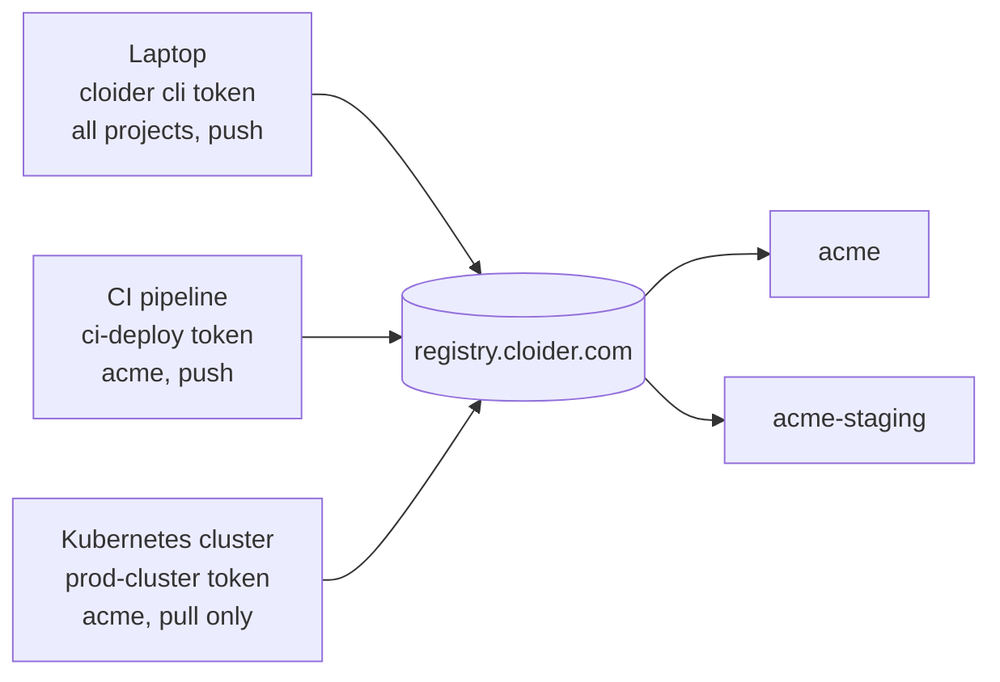

A **registry token** is the password that docker, your CI pipelines and your Kubernetes clusters use to log in to the [Cloider Container Registry](/container-registry/overview). Each token has a **scope** (all projects or only some), a **permission** (**Pull only** or **Pull & push**) and an optional **expiry**. This page explains how tokens work and how to create, use, change, rotate and delete them with every tool.

## At a glance

| | |
| --- | --- |
| **Username** | Your account's registry username, the same for every token |
| **Password** | The token's **secret**, shown once when the token is created |
| **Scope** | **All projects, including ones created later**, or **Only specific projects** |
| **Permission** | **Pull & push** (pull, push and delete images) or **Pull only** (pull images) |
| **Expiry** | Never, or 1 to 3650 days. Can't be changed after creation |
| **Limit** | 50 tokens per account |
| **Where to manage** | **Registry** page, **Tokens** tab, or **Access Control**, **Registry Tokens** tab. Also the CLI, Terraform, API and MCP |
| **Cost** | Free |

## How registry tokens work

A registry login is a username and a password. On Cloider:

- The **username** is your account's **registry username**. It is created the first time you need one, from the account's email address, and never changes. Every token of the account logs in with it.
- The **password** is a token's **secret**. The secret tells the registry which token is logging in, and so which projects it reaches and what it may do.

Docker and other clients keep one login per registry host. All projects share `registry.cloider.com`, so a machine is logged in with one token at a time. That's why a token can reach several projects: give each machine, pipeline or cluster one token that covers every project it needs, rather than one token per project.



### What each permission allows

| Action | Pull only | Pull & push |
| --- | --- | --- |
| Log in | Yes | Yes |
| Pull images, list repositories and tags | Yes | Yes |
| Push images and tags | No | Yes |
| Delete images, tags and repositories through the registry API | No | Yes |
| Change project settings, policies or create tokens | No | No |

Tokens never manage projects. Settings, policies and other tokens are changed with your Cloider login or an API token, so a leaked registry token can't make a project public, raise its storage limit or create more tokens.

### Which token for which job?

| Used by | Scope | Permission | Expiry | Example name |
| --- | --- | --- | --- | --- |
| Your computer | All projects | Pull & push | 30 days (`cloider registry login` does this for you) | `cloider cli (macbook)` |
| A CI pipeline that builds and pushes | The projects it pushes to | Pull & push | 90 days or 1 year, rotated | `ci-deploy` |
| A Kubernetes cluster or server that runs images | The projects it runs | Pull only | 1 year or never | `prod-cluster` |
| A deploy step that only pulls | The projects it deploys | Pull only | 90 days | `deploy-staging` |

## Create a token

<Tabs groupId="interface" queryString>
<TabItem value="dashboard" label="Dashboard" default>

1. Open **Registry** in the sidebar and go to the **Tokens** tab. (The same list is in **Access Control**, on the **Registry Tokens** tab.)
2. Click **Create Token**. The button is disabled until you have a project that is **Ready**.
3. In **Name**, describe what the token is for, for example `ci-deploy` or `prod-cluster`. Up to 64 characters.
4. Under **Projects**, choose **All projects, including ones created later**, or **Only specific projects** and pick them from the list.
5. Under **Permission**, choose **Pull & push** (pull, push and delete images) or **Pull only** (pull images, for clusters and deploys).
6. In **Expires**, choose **Never**, **7 days**, **30 days**, **90 days** or **1 year**. The expiry can't be changed later.
7. Click **Create token**.

The **Token created** dialog shows, once:

- **Registry host**, **Username** and **Secret**, each copied with a click,
- a **Docker login** command,
- a **Kubernetes pull secret** command,
- a **Download JSON** button that saves the login in Docker's `config.json` format, usable as `~/.docker/config.json`, as GitLab's `DOCKER_AUTH_CONFIG` or as a Kubernetes `.dockerconfigjson` secret.

Copy what you need, then click **I've saved the secret**. The secret can't be shown again.

<Screenshot
  src="/img/screenshots/container-registry/tokens.webp"
  url="/dashboard/access-control"
  alt="Access Control, Registry Tokens tab, listing tokens with their name, username, projects, permission and expiry"
  caption="Registry tokens with their scope, permission and expiry."
/>

</TabItem>
<TabItem value="cli" label="CLI">

```bash
cloider registry token create --label ci-deploy --project acme --expires-days 365
```

```text title="Output"
✓ Created registry token ci-deploy
Username:    acme
Secret:      xxxxxxxxxxxxxxxxxxxxxxxxxxxxxxxxxxxxxxxxxxxxxxxx
Host:        registry.cloider.com
Projects:    acme
Permission:  Pull & Push
Expires:     2027-10-20 09:55

Docker:
  echo 'xxxxxxxxxxxxxxxxxxxxxxxxxxxxxxxxxxxxxxxxxxxxxxxx' | docker login registry.cloider.com -u 'acme' --password-stdin
Kubernetes pull secret:
  kubectl create secret docker-registry cloider-registry --docker-server=registry.cloider.com --docker-username='acme' --docker-password='xxxxxxxxxxxxxxxxxxxxxxxxxxxxxxxxxxxxxxxxxxxxxxxx'
! The secret is not shown again, keep it now.
```

| Flag | Meaning |
| --- | --- |
| `--label <label>` | Required. What the token is for |
| `--project <project>` | A project the token reaches, by name or id. Repeat for several |
| `--all` | Every project of the account, including later ones. This is what you get without `--project` |
| `--read-only` | Pull only, never push or delete |
| `--expires-days <days>` | Days until it stops working, 1 to 3650, or `0` for never (the default) |

More examples:

```bash
# A pull-only token for a cluster, valid for a year
cloider registry token create --label prod-cluster --project acme --read-only --expires-days 365

# A token that reaches two projects
cloider registry token create --label ci-deploy --project acme --project acme-staging

# The API's answer as JSON ({"token": {...}, "secret": "..."}), for a script
cloider registry token create --label nightly-build --project acme -o json

# Only the username and the secret, one per line
cloider registry token create --label nightly-build --project acme -q
```

</TabItem>
<TabItem value="terraform" label="Terraform">

```hcl title="main.tf"
resource "cloider_registry" "acme" {
  name = "acme"
}

resource "cloider_registry_token" "ci" {
  label           = "ci-deploy"
  projects        = [cloider_registry.acme.id]
  read_only       = false
  expires_in_days = 365
}

output "registry_username" {
  value = cloider_registry_token.ci.username
}

output "registry_secret" {
  value     = cloider_registry_token.ci.secret
  sensitive = true
}
```

```bash
terraform apply
terraform output -raw registry_secret
```

| Attribute | Notes |
| --- | --- |
| `label` | Required |
| `projects` | Set of project ids. Set this or `all_projects` |
| `all_projects` | Every project, later ones included. Default `false` |
| `read_only` | Pull only. Default `false` |
| `expires_in_days` | 1 to 3650, or `0` for never (default). Changing it replaces the token |
| `username`, `secret`, `expires_at`, `id`, `created_at` | Read-only. `secret` is sensitive and only known for a token this configuration created |

Terraform keeps the secret in its state, so treat the state as sensitive. See [cloider_registry_token](/terraform/resources/registry-token).

</TabItem>
<TabItem value="api" label="API">

```bash
curl -X POST https://cloider.com/api/registry/tokens \
  -H "Authorization: Bearer $CLOIDER_TOKEN" \
  -H "Content-Type: application/json" \
  -d '{
    "label": "ci-deploy",
    "all_projects": false,
    "projects": ["r4t6yu"],
    "read_only": false,
    "expires_in_days": 365
  }'
```

`projects` takes project ids (`hashed_id`). `expires_in_days` is `0` for never.

```json title="Response"
{
  "token": {
    "hashed_id": "t9w1qe",
    "label": "ci-deploy",
    "username": "acme",
    "all_projects": false,
    "read_only": false,
    "expires_at": "2027-10-20T09:55:02Z",
    "projects": ["r4t6yu"],
    "status": "Ready",
    "created_at": "2026-10-20T09:55:02Z"
  },
  "secret": "xxxxxxxxxxxxxxxxxxxxxxxxxxxxxxxxxxxxxxxxxxxxxxxx"
}
```

The `secret` is in this response only. See [Registry token endpoints](/api/endpoints/registry-tokens).

</TabItem>
<TabItem value="mcp" label="MCP">

Ask your agent:

```text title="Prompt"
Create a pull-only registry token called prod-cluster for the acme project that expires in a year.
```

It calls the `create_registry_token` tool:

```json title="Tool call: create_registry_token"
{"label": "prod-cluster", "projects": ["acme"], "read_only": true, "expires_days": 365}
```

The answer holds the username and the secret. Ask the agent to put the secret where it is needed (a CI secret, a Kubernetes Secret) rather than in the chat, if you can.

</TabItem>
</Tabs>

## Use a token

### docker login

```bash
echo "$CLOIDER_REGISTRY_SECRET" | docker login registry.cloider.com -u acme --password-stdin
```

Podman, nerdctl, skopeo, crane and helm take the same username and secret; see [Push and pull images](/container-registry/push-and-pull-images).

### Kubernetes pull secret

```bash
kubectl create secret docker-registry cloider-registry \
  --docker-server=registry.cloider.com \
  --docker-username='acme' \
  --docker-password="$CLOIDER_REGISTRY_SECRET" \
  -n default
```

Secrets are per namespace: add `-n <namespace>` to create it where the pod runs. Then reference `cloider-registry` in `imagePullSecrets`. See [Use with Kubernetes](/container-registry/use-with-kubernetes).

### Docker config.json

The **Download JSON** button, or this command, gives the login in Docker's `config.json` format:

```bash
AUTH=$(printf '%s:%s' acme "$CLOIDER_REGISTRY_SECRET" | base64 | tr -d '\n')
cat > cloider-registry.json <<EOF
{
  "auths": {
    "registry.cloider.com": {
      "username": "acme",
      "password": "$CLOIDER_REGISTRY_SECRET",
      "auth": "$AUTH"
    }
  }
}
EOF
```

Use it as `~/.docker/config.json`, as a CI variable such as GitLab's `DOCKER_AUTH_CONFIG`, or as the `.dockerconfigjson` key of a Kubernetes Secret.

### `cloider registry login` for your own computer

For your own machine you don't need to create a token by hand: `cloider registry login` creates one labelled `cloider cli (<hostname>)` that reaches every project, with a 30 day expiry by default, and logs docker in with it. Running it again replaces that token. See [Push and pull images](/container-registry/push-and-pull-images#option-1-cloider-registry-login).

## List tokens

<Tabs groupId="interface" queryString>
<TabItem value="dashboard" label="Dashboard" default>

Open **Registry**, **Tokens** (or **Access Control**, **Registry Tokens**). The table shows each token's **Name**, **Username**, **Projects** (**All projects**, the project names, or **None left** when every project it named was deleted), **Permission** (**Pull & push** or **Pull only**), and **Expires** (a date, **Never**, or **Expired**).

</TabItem>
<TabItem value="cli" label="CLI">

```bash
cloider registry token list
```

```text title="Output"
USERNAME  LABEL                  PROJECTS             PERMISSION   EXPIRES           STATUS  CREATED
acme      ci-deploy              acme                 Pull & Push  2027-10-20 09:55  Ready   2026-10-20 09:55
acme      prod-cluster           acme                 Pull         never             Ready   2026-10-12 14:20
acme      cloider cli (macbook)  all projects         Pull & Push  2026-11-19 09:30  Ready   2026-10-20 09:30
```

`-o wide` adds the token ids, which `update`, `delete` and Terraform imports take.

</TabItem>
<TabItem value="terraform" label="Terraform">

Terraform reads the tokens it manages from state. To bring an existing token under Terraform, import it by id (its secret stays unknown):

```hcl title="import.tf"
import {
  to = cloider_registry_token.ci
  id = "t9w1qe"
}
```

</TabItem>
<TabItem value="api" label="API">

```bash
curl https://cloider.com/api/registry/tokens \
  -H "Authorization: Bearer $CLOIDER_TOKEN"
```

```json title="Response"
[
  {
    "hashed_id": "t9w1qe",
    "label": "ci-deploy",
    "username": "acme",
    "all_projects": false,
    "read_only": false,
    "expires_at": "2027-10-20T09:55:02Z",
    "projects": ["r4t6yu"],
    "status": "Ready",
    "created_at": "2026-10-20T09:55:02Z"
  }
]
```

Secrets are never returned after creation.

</TabItem>
<TabItem value="mcp" label="MCP">

Ask your agent:

```text title="Prompt"
Which registry tokens do we have, and which ones expire this year?
```

It calls the `list_registry_tokens` tool, which takes no arguments:

```json title="Tool call: list_registry_tokens"
{}
```

</TabItem>
</Tabs>

## Change a token

You can change a token's name, projects and permission. The change applies to the existing secret, so nothing has to log in again. The **expiry can't be changed**: create a new token instead.

<Tabs groupId="interface" queryString>
<TabItem value="dashboard" label="Dashboard" default>

1. In the token list, click the pencil (**Edit**) next to the token.
2. Change **Name**, **Projects** or **Permission**.
3. Click **Save changes**.

</TabItem>
<TabItem value="cli" label="CLI">

```bash
# Add a second project
cloider registry token update ci-deploy --project acme --project acme-staging

# Make it pull only
cloider registry token update prod-cluster --read-only

# All projects, with push again
cloider registry token update ci-deploy --all --read-only=false
```

```text title="Output"
✓ Updated registry token ci-deploy
```

`--project` replaces the token's projects with the ones you list. Options you leave out keep their value.

</TabItem>
<TabItem value="terraform" label="Terraform">

Change `label`, `projects`, `all_projects` or `read_only` and apply; the token is updated in place. Changing `expires_in_days` replaces the token with a new one and a new secret.

</TabItem>
<TabItem value="api" label="API">

The update takes the whole form (label, scope and permission):

```bash
curl -X PUT https://cloider.com/api/registry/tokens/t9w1qe \
  -H "Authorization: Bearer $CLOIDER_TOKEN" \
  -H "Content-Type: application/json" \
  -d '{"label": "ci-deploy", "all_projects": false, "projects": ["r4t6yu", "k2m8pz"], "read_only": false}'
```

The response is the full token list.

</TabItem>
<TabItem value="mcp" label="MCP">

Ask your agent:

```text title="Prompt"
Make the prod-cluster registry token pull only.
```

It calls the `update_registry_token` tool:

```json title="Tool call: update_registry_token"
{"token": "prod-cluster", "read_only": true}
```

</TabItem>
</Tabs>

## Delete a token

Deleting a token revokes it right away: anything still logged in with it can no longer pull or push. Clusters that already pulled an image keep running it, but can't pull again (for example on a new node or a restart).

<Tabs groupId="interface" queryString>
<TabItem value="dashboard" label="Dashboard" default>

1. In the token list, click the trash icon (**Delete**) next to the token.
2. In **Delete Token**, click **Delete**.

</TabItem>
<TabItem value="cli" label="CLI">

```bash
cloider registry token delete ci-deploy
```

The command asks you to type the token's label to confirm. In scripts, add `--yes`:

```bash
cloider registry token delete ci-deploy --yes
```

```text title="Output"
✓ Deleted registry token ci-deploy
```

</TabItem>
<TabItem value="terraform" label="Terraform">

Remove the `cloider_registry_token` resource and apply, or run:

```bash
terraform destroy -target=cloider_registry_token.ci
```

</TabItem>
<TabItem value="api" label="API">

```bash
curl -X DELETE https://cloider.com/api/registry/tokens/t9w1qe \
  -H "Authorization: Bearer $CLOIDER_TOKEN"
```

The response is the remaining token list.

</TabItem>
<TabItem value="mcp" label="MCP">

Ask your agent:

```text title="Prompt"
Delete the registry token called ci-deploy.
```

It calls the `delete_registry_token` tool:

```json title="Tool call: delete_registry_token"
{"token": "ci-deploy"}
```

</TabItem>
</Tabs>

## Rotate a token

To replace a token's secret without downtime:

1. Create a new token with the same scope and permission, for example `ci-deploy-2027`.
2. Put the new secret everywhere the old one is used: CI variables, Kubernetes Secrets, servers.
3. Check that pulls and pushes work with the new secret.
4. Delete the old token.

For a Kubernetes pull secret, replace it in place:

```bash
kubectl create secret docker-registry cloider-registry \
  --docker-server=registry.cloider.com \
  --docker-username='acme' \
  --docker-password="$NEW_SECRET" \
  -n default --dry-run=client -o yaml | kubectl apply -f -
```

With Terraform, the `time_rotating` resource and `create_before_destroy` rotate a token on a schedule; see [cloider_registry_token](/terraform/resources/registry-token).

## Expired tokens

When a token reaches its expiry, the registry stops accepting it, and pulls and pushes with it fail with `unauthorized`. The token stays in the list with an **Expired** tag until you delete it. Its expiry can't be extended: create a new token, swap the secret, and delete the expired one.

## Security best practices

- Give every machine, pipeline and cluster its **own** token, so you can revoke one without touching the others.
- Use **Pull only** wherever nothing is pushed: clusters, servers, deploy jobs.
- Scope tokens to **Only specific projects** when a consumer needs just one or two.
- Set an **expiry** on push tokens and rotate them.
- Store secrets in a secret manager or your CI's masked variables, never in a repository.
- Pass secrets with `--password-stdin`, never as `-p` on the command line, where they end up in shell history and process lists.

## Troubleshooting

| Error | Cause and fix |
| --- | --- |
| **Create Token** is disabled, or `Choose a project that is ready, or create one first` | A token needs at least one project that is **Ready** to reach. Create a project first |
| `Choose at least one project` | With **Only specific projects**, pick at least one |
| `One of the projects doesn't exist any more, reload and try again` | A chosen project was deleted. Reload and choose again |
| `An account can have up to 50 registry tokens, delete one you no longer use!` | Delete unused tokens |
| `Expiry must be between 1 and 3650 days, or never` | Choose an expiry in that range, or `0` for never |
| `Name must not be empty` or `Name must not exceed 64 characters` | Give the token a label of 1 to 64 characters |
| `You have read-only access to this account, you can not create registry tokens!` | Your role is **Restricted** or your API token is read-only |
| `The registry token must be ready to be changed.` | The token is being created or deleted. Wait a moment |
| `The registry token is busy, try again in a moment!` | The token is being created or deleted. Retry |
| `unauthorized` when logging in | The secret is wrong, the token expired or was deleted, or the username is not your registry username |
| Lost the secret | Secrets can't be recovered. Delete the token and create a new one |

## Next steps

- [Use a pull-only token from Kubernetes](/container-registry/use-with-kubernetes).
- [Push from GitHub Actions or GitLab CI](/container-registry/ci-cd).
- [API tokens](/account/api-tokens), which manage your Cloider account (not the registry login).
