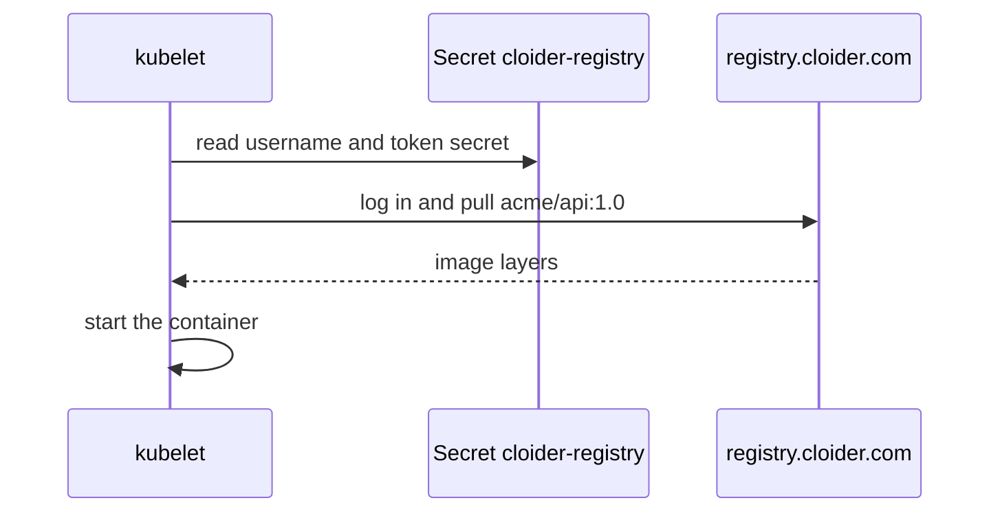

Kubernetes pulls images from the [Cloider Container Registry](/container-registry/overview) like from any private registry: you store a **pull-only registry token** in the cluster as a Secret of type `kubernetes.io/dockerconfigjson`, and reference it in your pods as an `imagePullSecret`. This page explains the pattern with complete YAML, and shows how to do the same on other platforms.

For a step-by-step walkthrough on a Cloider cluster, from the token to a running pod, with every tool, see [Pull private images](/kubernetes/pull-private-images) in the Kubernetes section.

## Before you begin

- A project with an image in it, for example `registry.cloider.com/acme/api:1.0`. See [Push and pull images](/container-registry/push-and-pull-images).
- A Kubernetes cluster and `kubectl` pointed at it. For a Cloider cluster, see [Connect with kubectl](/kubernetes/connect-with-kubectl).
- A [registry token](/container-registry/tokens) with the **Pull only** permission that covers the project.

:::tip[Public projects need no secret]
If the project has **Public pulls** turned on, Kubernetes can pull its images without any Secret. Everything below is for private projects.
:::

## How it works



1. A **registry token** (pull only) is the login.
2. A **Secret** of type `kubernetes.io/dockerconfigjson` holds that login in the cluster. Secrets are namespaced, so it must be in the namespace of the pods that use it.
3. **`imagePullSecrets`** in the pod spec, or on the namespace's ServiceAccount, tells the kubelet to use it when it pulls.

## Step 1: Create a pull-only token

Create a token with **Pull only** permission, scoped to the projects the cluster runs. For example with the CLI:

```bash
cloider registry token create --label prod-cluster --project acme --read-only --expires-days 365
```

The output, and the dashboard's **Token created** dialog, include a ready **Kubernetes pull secret** command. Copy the secret now: it is shown once. See [Registry tokens](/container-registry/tokens).

## Step 2: Create the image pull secret

Run the pull secret command against your cluster, and add `-n <namespace>` for the namespace your pods run in. Without `-n`, `kubectl` creates the Secret in the `default` namespace, where pods in other namespaces can't use it.

```bash
kubectl create secret docker-registry cloider-registry \
  --docker-server=registry.cloider.com \
  --docker-username='acme' \
  --docker-password="$CLOIDER_REGISTRY_SECRET" \
  -n shop
```

```text title="Output"
secret/cloider-registry created
```

Check it:

```bash
kubectl get secret cloider-registry -n shop
```

```text title="Output"
NAME               TYPE                             DATA   AGE
cloider-registry   kubernetes.io/dockerconfigjson   1      5s
```

### As a YAML manifest

To keep the Secret with your other manifests (encrypted with a tool like Sealed Secrets or SOPS, never in plain text in git), write it as YAML. The `.dockerconfigjson` value is the base64 of Docker's `config.json`, which the dashboard's **Download JSON** button gives you:

```bash
base64 < cloider-registry-prod-cluster.json | tr -d '\n'
```

```yaml title="cloider-registry-secret.yaml"
apiVersion: v1
kind: Secret
metadata:
  name: cloider-registry
  namespace: shop
type: kubernetes.io/dockerconfigjson
data:
  .dockerconfigjson: eyJhdXRocyI6eyJyZWdpc3RyeS5jbG9pZGVyLmNvbSI6eyJ1c2VybmFtZSI6ImFjbWUiLCJwYXNzd29yZCI6Inh4eHgiLCJhdXRoIjoiWVdOdFpUcDRlSGg0In19fQ==
```

Or let `kubectl` write the YAML for you without creating anything:

```bash
kubectl create secret docker-registry cloider-registry \
  --docker-server=registry.cloider.com \
  --docker-username='acme' \
  --docker-password="$CLOIDER_REGISTRY_SECRET" \
  -n shop --dry-run=client -o yaml > cloider-registry-secret.yaml
```

### In every namespace that needs it

A Secret is only visible in its own namespace. Create it in each namespace whose pods pull private images:

```bash
for ns in shop billing staging; do
  kubectl create secret docker-registry cloider-registry \
    --docker-server=registry.cloider.com \
    --docker-username='acme' \
    --docker-password="$CLOIDER_REGISTRY_SECRET" \
    -n "$ns" --dry-run=client -o yaml | kubectl apply -f -
done
```

## Step 3: Reference the secret in your pods

Add `imagePullSecrets` to the pod template. A complete Deployment and Service:

```yaml title="api.yaml"
apiVersion: apps/v1
kind: Deployment
metadata:
  name: api
  namespace: shop
spec:
  replicas: 2
  selector:
    matchLabels:
      app: api
  template:
    metadata:
      labels:
        app: api
    spec:
      imagePullSecrets:
        - name: cloider-registry
      containers:
        - name: api
          image: registry.cloider.com/acme/api:1.0
          ports:
            - containerPort: 8080
---
apiVersion: v1
kind: Service
metadata:
  name: api
  namespace: shop
spec:
  selector:
    app: api
  ports:
    - port: 80
      targetPort: 8080
```

```bash
kubectl apply -f api.yaml
kubectl rollout status deployment/api -n shop
```

```text title="Output"
deployment "api" successfully rolled out
```

The same `imagePullSecrets` block works in a Pod, StatefulSet, DaemonSet, Job or CronJob pod template.

### Pin images by digest

A tag can be moved to another image; a digest can't. For deployments that must never change under you, pin the digest (from `cloider registry images acme api -o wide` or the **Repositories** tab):

```yaml
image: registry.cloider.com/acme/api@sha256:4c7e3d1b9a8f6e5d4c3b2a1908f7e6d5c4b3a29180f7e6d5c4b3a2918f7e6d5c
```

Or protect release tags with [immutability rules](/container-registry/immutable-tags), so `api:1.0` always means the same image.

## Use the secret for every pod in a namespace

Instead of editing every Deployment, attach the Secret to the namespace's `default` ServiceAccount. Every pod that runs as that ServiceAccount then pulls with it:

```bash
kubectl patch serviceaccount default -n shop \
  -p '{"imagePullSecrets": [{"name": "cloider-registry"}]}'
```

Or declaratively:

```yaml title="serviceaccount.yaml"
apiVersion: v1
kind: ServiceAccount
metadata:
  name: default
  namespace: shop
imagePullSecrets:
  - name: cloider-registry
```

Pods created after the change pick it up. Pods that run under their own ServiceAccount need it on that ServiceAccount too.

## Helm charts

Most charts take pull secrets as a value, often named `imagePullSecrets`. Check the chart's `values.yaml`:

```yaml title="values.yaml"
image:
  repository: registry.cloider.com/acme/api
  tag: "1.0"
imagePullSecrets:
  - name: cloider-registry
```

```bash
helm upgrade --install api ./charts/api -n shop -f values.yaml
```

To install a chart that is itself stored in the registry as an OCI artifact:

```bash
echo "$CLOIDER_REGISTRY_SECRET" | helm registry login registry.cloider.com -u acme --password-stdin
helm install api oci://registry.cloider.com/acme/charts/api --version 0.1.0 -n shop
```

See [Helm on Cloider](/kubernetes/helm).

## Kustomize

Kustomize can generate the Secret from Docker's `config.json`, and set the image tag per environment:

```yaml title="kustomization.yaml"
namespace: shop
resources:
  - api.yaml
secretGenerator:
  - name: cloider-registry
    type: kubernetes.io/dockerconfigjson
    files:
      - .dockerconfigjson=cloider-registry.json
generatorOptions:
  disableNameSuffixHash: true
images:
  - name: registry.cloider.com/acme/api
    newTag: "1.1"
```

Keep `cloider-registry.json` out of git (add it to `.gitignore`) and create it in your pipeline.

## Terraform

The `cloider_registry_token` resource and the `kubernetes` provider create the token and the pull secret together:

```hcl title="main.tf"
resource "cloider_registry" "acme" {
  name = "acme"
}

resource "cloider_registry_token" "pull" {
  label     = "prod-cluster"
  projects  = [cloider_registry.acme.id]
  read_only = true
}

resource "kubernetes_secret_v1" "registry" {
  metadata {
    name      = "cloider-registry"
    namespace = "shop"
  }

  type = "kubernetes.io/dockerconfigjson"

  data = {
    ".dockerconfigjson" = jsonencode({
      auths = {
        (cloider_registry.acme.host) = {
          username = cloider_registry_token.pull.username
          password = cloider_registry_token.pull.secret
          auth     = base64encode("${cloider_registry_token.pull.username}:${cloider_registry_token.pull.secret}")
        }
      }
    })
  }
}
```

See [Kubernetes and Helm with Terraform](/terraform/guides/kubernetes-and-helm).

## Apps on Cloider App Engine

[Apps](/apps/overview) don't need any of this. Cloider builds each app's image into your account's **apps project** and gives your apps access to it automatically. You don't create a registry token or a pull secret for an app. To run an image you built yourself, deploy it to a [Kubernetes cluster](/kubernetes/deploy-a-workload).

## Other platforms

The registry works anywhere that can log in to a Docker registry with a username and password.

### k3s and RKE2 nodes

To let every pod on a k3s node pull from the registry without `imagePullSecrets`, configure the node's container runtime in `/etc/rancher/k3s/registries.yaml` (`/etc/rancher/rke2/registries.yaml` on RKE2) and restart the service:

```yaml title="/etc/rancher/k3s/registries.yaml"
configs:
  "registry.cloider.com":
    auth:
      username: acme
      password: xxxxxxxxxxxxxxxxxxxxxxxxxxxxxxxxxxxxxxxx
```

```bash
sudo systemctl restart k3s
```

Every workload on that node can then pull from the projects the token covers, so use a **Pull only** token.

### Docker Swarm

Log in on the manager and pass the login to the nodes with `--with-registry-auth`:

```bash
echo "$CLOIDER_REGISTRY_SECRET" | docker login registry.cloider.com -u acme --password-stdin
docker stack deploy -c compose.yaml --with-registry-auth shop
```

### HashiCorp Nomad

The Docker driver takes the login in the task's `auth` block:

```hcl title="api.nomad.hcl"
task "api" {
  driver = "docker"

  config {
    image = "registry.cloider.com/acme/api:1.0"

    auth {
      username = "acme"
      password = "xxxxxxxxxxxxxxxxxxxxxxxxxxxxxxxxxxxxxxxx"
    }
  }
}
```

In production, keep the secret out of the job file: Nomad can read it from Nomad Variables or Vault, or the Docker driver can use the node's own `docker login` through its plugin `auth` configuration.

### A plain server with Docker

```bash
echo "$CLOIDER_REGISTRY_SECRET" | docker login registry.cloider.com -u acme --password-stdin
docker run -d --name api -p 8080:8080 registry.cloider.com/acme/api:1.0
```

## Verify

```bash
kubectl get pods -n shop -l app=api
```

```text title="Output"
NAME                   READY   STATUS    RESTARTS   AGE
api-6d9f7c8b5d-4kq2x   1/1     Running   0          40s
api-6d9f7c8b5d-p8wzn   1/1     Running   0          40s
```

The image's **Last pulled** time in the project's **Repositories** tab, and the repository's **Pulls** count, go up when the cluster pulls.

## Troubleshooting

`ImagePullBackOff` or `ErrImagePull` means the kubelet couldn't pull the image. Read the pod's events:

```bash
kubectl describe pod -n shop -l app=api | grep -A8 Events
```

| Message in the events | Cause and fix |
| --- | --- |
| `unauthorized` or `authentication required` | The Secret is missing, in another namespace, not referenced in `imagePullSecrets`, or the token expired or was deleted. Check `kubectl get secret cloider-registry -n shop` and the pod spec |
| `denied` | The token doesn't cover this project. Edit the token's projects or use another token |
| `manifest unknown` or `not found` | The image name or tag is wrong. Compare with `cloider registry images acme api` |
| `no match for platform in manifest` | The image wasn't built for the node's CPU. Build for `linux/amd64` or as a multi-platform image |
| Pod pulled before, fails after a restart | The token was deleted or expired. Create a new token and replace the Secret |

See [Kubernetes troubleshooting](/kubernetes/troubleshooting) and [Registry troubleshooting](/container-registry/troubleshooting).

## Next steps

- [Pull private images on a Cloider cluster, step by step](/kubernetes/pull-private-images).
- [Deploy a workload](/kubernetes/deploy-a-workload).
- [Build, push and deploy from CI](/container-registry/ci-cd).
- [Protect release tags](/container-registry/immutable-tags).
