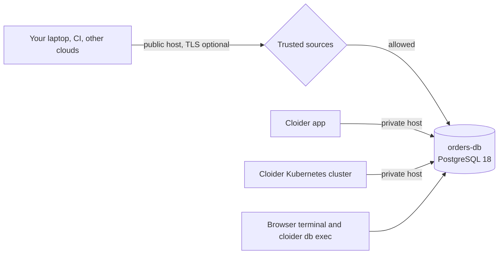

Cloider runs managed **PostgreSQL**, **MySQL**, **MongoDB** and **Redis** databases for you. You pick an engine and a plan, and Cloider provisions the server, its storage, a public and a private endpoint, TLS certificates, a firewall (trusted sources) and daily backups. You connect with the client or driver you already use.

This page explains what a Cloider database is, how to choose an engine and a plan, how databases are billed, and which tools manage them.

<Logos items={[{src: '/img/logos/postgresql.svg', alt: 'PostgreSQL'}, {src: '/img/logos/mysql.svg', alt: 'MySQL'}, {src: '/img/logos/mongodb.svg', alt: 'MongoDB'}, {src: '/img/logos/redis.svg', alt: 'Redis'}]} />

## At a glance

| | |
| --- | --- |
| **Engines and versions** | PostgreSQL 18, MySQL 9, MongoDB 8, Redis 8 |
| **Plans** | Hobby, Starter, Basic, Standard, Plus, Pro. Each plan is a fixed amount of CPU, RAM and storage |
| **Billing** | A monthly plan price, charged per second while the database is Ready. A paused database is charged only for its storage |
| **Endpoints** | A public host `<name>-<id>.db.cloider.com` and a private host `<name>-<id>.db.cloider.internal` for your Cloider apps and Kubernetes clusters, both on the database's own port |
| **Access control** | [Trusted sources](/databases/trusted-sources): anywhere, IPv4 addresses and CIDR ranges, your apps and your clusters |
| **Encryption** | Optional [SSL/TLS](/databases/ssl-tls) with a certificate signed by Cloider's CA, which you can download |
| **Backups** | [Daily backups](/databases/backups-and-restore), at least the last 7 kept, restored into a new database. PostgreSQL, MySQL and MongoDB can also be restored to [any second of the last 7 days](/databases/backups-and-restore#restore-to-a-point-in-time) |
| **Scaling** | [Resize](/databases/resize) to a larger plan at any time, with a short restart |
| **Built-in tools** | A [browser terminal and `cloider db exec`](/databases/terminal-and-exec), and [insights](/databases/insights) charts for CPU, memory, storage, disk, network and connections |
| **Managed with** | The dashboard, the `cloider db` CLI, the `cloider_database` Terraform resource, the REST API and the MCP server |

## What is a managed database?

A managed database is a database server that a cloud provider installs, runs, secures and backs up for you. You get connection details (a host, a port, a user, a password and a database name) and you use them from your application exactly as you would with a server you run yourself.

On Cloider, each database is its own isolated server with its own storage volume. It isn't shared with other customers' data, and its size is set by the plan you choose. Cloider takes care of:

- installing the engine and keeping its configuration sensible for the plan size,
- generating a strong 32 character password for your database user,
- exposing the database on a public endpoint and a private endpoint,
- filtering connections with your trusted sources list,
- issuing TLS certificates when you turn SSL on,
- taking a backup every day and keeping at least the last 7 of them,
- collecting usage metrics for the insights charts.

You are responsible for your schema, your data, your queries, and for keeping the password and trusted sources tight. See [security](/concepts/security) for the shared responsibility model.

## How a Cloider database works

Each database runs as a single server (one primary, no read replicas) with a persistent volume sized by its plan. Two hosts point at it:



- The **public host** (for example `orders-db-p0q9zm.db.cloider.com`) is reachable from the internet, from anywhere your [trusted sources](/databases/trusted-sources) allow.
- The **private host** (for example `orders-db-p0q9zm.db.cloider.internal`) is reachable from your Cloider [apps](/apps/overview) and [Kubernetes clusters](/kubernetes/overview), inside Cloider's network.
- Both use the same **port**, which Cloider assigns when the database is created and which never changes. It isn't the engine's default port, so always pass it explicitly.

The [connection details page](/databases/connect) shows every value and a connection string for each engine.

## Which database engine should I choose?

Choose PostgreSQL if you aren't sure: it is a general purpose relational database that fits most web applications. Choose MySQL when your application or framework expects it, MongoDB for document data with a flexible schema, and Redis for caching, sessions, queues and other fast key-value workloads.

| | PostgreSQL | MySQL | MongoDB | Redis |
| --- | --- | --- | --- | --- |
| **Type** | Relational (SQL) | Relational (SQL) | Document (JSON-like BSON) | In-memory key-value |
| **Version on Cloider** | 18 | 9 | 8 | 8 |
| **Query language** | SQL | SQL | MongoDB Query API, aggregation pipelines | Redis commands |
| **Best for** | Most web apps, analytics, geospatial, JSON plus relational data | WordPress, Laravel, Drupal, Magento, apps built for MySQL | Content, catalogs, event data, schemas that change often | Caches, sessions, rate limits, queues, leaderboards, pub/sub |
| **Data durability** | On disk, transactional | On disk, transactional (InnoDB) | On disk (WiredTiger) | Kept in memory, persisted to the plan's volume |
| **Command line client** | `psql` | `mysql` | `mongosh` | `redis-cli` |
| **Connection string scheme** | `postgresql://` | `mysql://` | `mongodb://` | `redis://`, or `rediss://` with TLS |
| **SSL default when created in the dashboard** | On | On | On | Off |

### PostgreSQL

[PostgreSQL](/databases/postgresql) is an open source relational database known for correctness, rich SQL, JSON support (`jsonb`), full text search and a large ecosystem of ORMs. It is the default choice for new projects with Django, Rails, Prisma, SQLAlchemy, GORM and most Node.js stacks.

### MySQL

[MySQL](/databases/mysql) is the most widely deployed open source relational database. Pick it when your software is built for MySQL, for example WordPress, Laravel apps that already use MySQL, or an existing application you are [migrating to Cloider](/guides/migrate-to-cloider).

### MongoDB

[MongoDB](/databases/mongodb) stores JSON-like documents in collections, so records in the same collection can have different fields. It suits catalogs, content management, user generated data and prototypes whose schema is still changing.

### Redis

[Redis](/databases/redis) keeps data in memory, which makes reads and writes take well under a millisecond. Use it next to a primary database for caching, sessions, background job queues, rate limiting and real time counters. Size Redis by RAM: your whole dataset has to fit in the plan's memory.

## Supported versions

Each engine is offered in one major version, the newest that Cloider supports. The version is fixed when the database is created.

| Engine | Version | `--engine` value (CLI) | `engine` value (Terraform) |
| --- | --- | --- | --- |
| PostgreSQL | 18 | `postgresql` (also `postgres`, `pg`) | `postgresql` |
| MySQL | 9 | `mysql` | `mysql` |
| MongoDB | 8 | `mongodb` (also `mongo`) | `mongodb` |
| Redis | 8 | `redis` | `redis` |

To see what can be created right now, run `cloider pricing`, read the `database_engines` of the [`cloider_options` data source](/terraform/data-sources/options), or call `GET https://cloider.com/api/options`.

## Plans and sizes

A plan sets how much CPU, RAM and storage the database gets. Every engine has the same six plan names, Hobby, Starter, Basic, Standard, Plus and Pro, but the sizes differ between engines. In the dashboard, the plan marked **Best value** is Standard for PostgreSQL and MySQL, and Basic for MongoDB and Redis.

### PostgreSQL and MySQL plans

| Plan | vCPU | RAM | Storage |
| --- | --- | --- | --- |
| Hobby | 0.25 | 0.25 GB | 1 GB |
| Starter | 0.25 | 0.5 GB | 2 GB |
| Basic | 0.5 | 1 GB | 4 GB |
| Standard | 1 | 1 GB | 6 GB |
| Plus | 1 | 2 GB | 8 GB |
| Pro | 2 | 4 GB | 16 GB |

### MongoDB plans

| Plan | vCPU | RAM | Storage |
| --- | --- | --- | --- |
| Hobby | 0.25 | 0.5 GB | 2 GB |
| Starter | 0.5 | 1 GB | 4 GB |
| Basic | 1 | 1 GB | 6 GB |
| Standard | 1 | 2 GB | 8 GB |
| Plus | 2 | 4 GB | 16 GB |
| Pro | 3 | 6 GB | 24 GB |

### Redis plans

| Plan | vCPU | RAM | Storage |
| --- | --- | --- | --- |
| Hobby | 0.25 | 0.25 GB | 1 GB |
| Starter | 0.25 | 0.5 GB | 2 GB |
| Basic | 0.5 | 1 GB | 4 GB |
| Standard | 1 | 2 GB | 8 GB |
| Plus | 1 | 4 GB | 16 GB |
| Pro | 2 | 8 GB | 32 GB |

Prices are shown next to each plan in the dashboard (monthly and hourly), by `cloider pricing`, and on the [pricing page](https://cloider.com/#pricing). See [pricing](/reference/pricing) for how they are calculated.

### How do I pick a plan?

Start small and [resize](/databases/resize) when the [insights](/databases/insights) charts show you need more. A resize moves to a larger plan in place, keeps your data and takes a short restart. A plan can only be made larger, never smaller, because a storage volume can grow but not shrink.

- **Hobby** fits development, staging, side projects and small sites.
- **Starter** and **Basic** fit small production apps.
- **Standard** and above fit production apps with steady traffic, larger working sets or many connections.

For Redis, choose the plan by the size of your dataset, since it is kept in RAM. For MySQL, the maximum number of connections also grows with the plan (20 on Hobby up to 200 on Pro), see [MySQL limits](/databases/mysql).

## How are Cloider databases billed?

A database is billed by its plan's monthly price, charged per second while the database is **Ready**. The monthly price covers 30 days, so a database that is Ready for 15 days costs half of it, and one that is Ready for a whole 31 day month costs 31/30 of it. The hourly price the dashboard shows is the monthly price divided by 720 hours (30 days).

What you pay depends only on the plan, not on how busy the database is. Queries, connections, network traffic and backups aren't charged separately, and the insights charts are informational only.

| State | What you pay |
| --- | --- |
| Ready | The plan's price |
| Creating, Starting, Upgrading, Pausing | Nothing |
| Paused | Only the plan's storage, at the same per GB rate as Kubernetes volumes |
| Deleted | Nothing from the moment it is deleted |

When you resize, the new plan's price starts once the resize is applied, so you are never billed for resources the database doesn't have yet. Each day's usage, split by plan and into running and paused time, is on the [Usage page](/account/usage).

:::note[Free plan accounts]
An account on the free plan can have one database at a time. Creating or restoring a second one fails with `Free plan users can not create more than one database. UPGRADE NOW!`. See the [billing model](/concepts/billing-model).
:::

### What does a paused database cost?

A paused database costs only its storage: the size of the plan's volume (for example 6 GB on a PostgreSQL Standard plan) charged at the per GB volume rate, for as long as it stays paused. CPU and RAM aren't charged while it is paused. The volume is charged at its full provisioned size, whether your data fills it or not. `cloider pricing` lists the monthly paused price of every plan in its `PAUSED` column. See [pause, resume and delete](/databases/pause-resume-and-delete).

## Database statuses

A database's status says what it is doing. You can only connect to a database whose status is `Ready`.

| Status | Meaning |
| --- | --- |
| `Creating` | The database is being provisioned. This usually takes a few minutes |
| `Starting` | The database is resuming, or restarting to apply an SSL change |
| `Ready` | The database is running and accepts connections |
| `Upgrading` | The database is being resized to a larger plan |
| `Pausing` | The database is shutting down to be paused |
| `Paused` | The database is stopped. Its data is kept, and nothing can connect to it |
| `Terminating` | The database and its backups are being deleted |
| `Failed` | A restored database whose restore didn't complete. Delete it and try again |

See [status values](/reference/status-values) for every resource.

## Tools that manage databases

Everything you can do with a database is available from five tools. They all use the same API, so a database created in one shows up in the others.

| Tool | How |
| --- | --- |
| Dashboard | **Databases** in the sidebar at [cloider.com/dashboard/databases](https://cloider.com/dashboard/databases) |
| CLI | [`cloider db`](/cli/commands/db): `list`, `create`, `get`, `delete`, `pause`, `resume`, `status`, `password`, `cert`, `connect`, `shell`, `exec`, `backups`, `restore`, `resize`, `rename`, `ssl`, `trusted-sources`, `insights` |
| Terraform | The [`cloider_database`](/terraform/resources/database) resource |
| REST API | `https://cloider.com/api/databases` and the endpoints in the [databases API reference](/api/endpoints/databases) |
| MCP | The `databases` toolset of the [MCP server](/mcp/tools), for AI agents such as Claude Code, Cursor and others |

<Screenshot
  src="/img/screenshots/databases/list.webp"
  url="/dashboard/databases"
  alt="The Databases page listing four databases: orders-db on PostgreSQL, shop-db on MySQL, catalog-db on MongoDB and cache on Redis, each with its plan and status"
  caption="The Databases page lists every database in the account with its engine, plan and status."
/>

The same list from the CLI:

```bash
cloider db list
```

```text title="Output"
NAME        ENGINE         PLAN      STATUS  CREATED
cache       Redis 8        Starter   Ready   2026-10-12 09:41
catalog-db  MongoDB 8      Basic     Ready   2026-10-08 16:05
shop-db     MySQL 9        Standard  Ready   2026-09-21 11:30
orders-db   PostgreSQL 18  Standard  Ready   2026-09-02 14:12
```

## Limits

- One engine version per engine is offered: PostgreSQL 18, MySQL 9, MongoDB 8 and Redis 8. The version can't be changed after creation.
- A database runs as a single server. Read replicas and multi-node clusters aren't offered.
- A plan can be resized up, never down.
- The database name, engine, version and user can't be changed after creation. The label (the name shown in the dashboard) can.
- Each database comes with one user, created with the database. Its password is generated by Cloider and can't be changed from the dashboard, CLI, Terraform or API.
- Trusted sources accept IPv4 addresses and ranges, plus your Cloider apps and clusters.

## Get started

<Cards cols={2}>
  <Card title="Create a database" href="/databases/create-a-database" icon="database-outline">
    Pick an engine, a plan and who may connect.
  </Card>
  <Card title="Connect to a database" href="/databases/connect" icon="link-variant">
    Hosts, ports, passwords and connection strings.
  </Card>
  <Card title="Trusted sources" href="/databases/trusted-sources" icon="shield-check-outline">
    Allow only your IPs, apps and clusters.
  </Card>
  <Card title="Backups and restore" href="/databases/backups-and-restore" icon="backup-restore">
    Daily backups and restoring into a new database.
  </Card>
</Cards>

## Frequently asked questions

<FAQ items={[
  {q: 'Which databases does Cloider offer?', a: 'Cloider offers managed PostgreSQL 18, MySQL 9, MongoDB 8 and Redis 8. Each database is its own server with its own storage, a public and a private endpoint, optional TLS, an IP allowlist and daily backups.'},
  {q: 'How much does a Cloider database cost?', a: 'A database is billed by its plan\'s monthly price, charged per second while it is Ready. Prices for each engine and plan are on cloider.com/#pricing and in the dashboard when you create a database. Connections, traffic and backups are not charged separately.'},
  {q: 'Do I pay for a paused database?', a: 'Yes, but only for its storage. A paused database is charged for its plan\'s volume size at the per GB volume rate, and not for CPU or RAM. A deleted database costs nothing.'},
  {q: 'Can I change the plan of a database later?', a: 'Yes, you can resize a database to a larger plan at any time from the Resize tab, with cloider db resize, Terraform or the API. The data is kept and the database restarts briefly. A database can\'t be moved to a smaller plan.'},
  {q: 'Are Cloider databases backed up?', a: 'Yes. Every database is backed up once a day, and at least the last 7 daily backups are kept. You can restore any of them into a new database from the Backups tab or with cloider db restore. Deleting a database also deletes its backups.'},
  {q: 'Can my Cloider app or Kubernetes cluster reach the database privately?', a: 'Yes. Every database has a private host ending in .db.cloider.internal that your Cloider apps and Kubernetes clusters can use. Add the app or cluster to the database\'s trusted sources.'},
  {q: 'Does Cloider support high availability or read replicas for databases?', a: 'No. Each Cloider database runs as a single server. Daily backups protect the data, and a backup can be restored into a new database.'}
]} />
