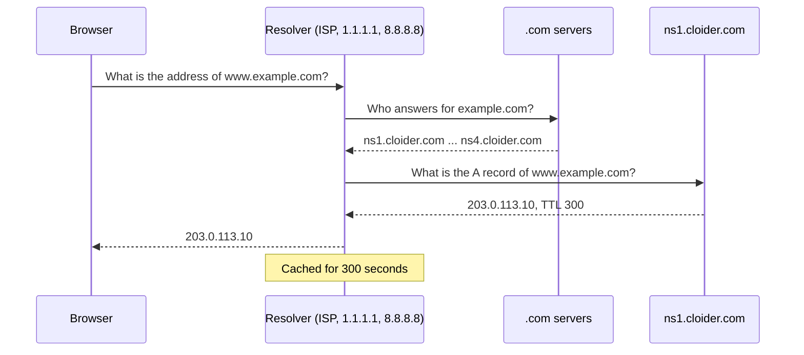

DNS (the Domain Name System) is the internet's phone book: it turns a name people can remember, such as `example.com`,
into the information computers need, such as the IP address `203.0.113.10` of the server that hosts it. This page
explains the handful of DNS ideas you need to put a domain on Cloider. If you already know DNS, skip to
[Add a custom domain](/domains/add-a-custom-domain).

## At a glance

| Term | In one sentence | Example |
| --- | --- | --- |
| **Domain** | A name you register and control | `example.com` |
| **Apex** (root, `@`) | The domain itself, with nothing in front | `example.com` |
| **Subdomain** | A name under a domain | `www.example.com`, `blog.cloider.app` |
| **Record** | One answer DNS gives for a name | `www.example.com A 203.0.113.10` |
| **TTL** | How long resolvers may cache an answer, in seconds | `300` (5 minutes) |
| **Registrar** | The company you bought the domain from | Namecheap, GoDaddy |
| **Nameservers** | The servers that hold a domain's records and answer for it | `ns1.cloider.com` |
| **Resolver** | The server your computer asks, which asks the nameservers for you | your ISP's resolver, `1.1.1.1`, `8.8.8.8` |
| **Propagation** | The wait while resolvers drop old cached answers | minutes to 48 hours |

## What is a domain name?

A domain name is a human readable address on the internet, made of labels separated by dots and read from right to
left. In `shop.example.com`:

- `com` is the **top level domain** (TLD), run by a registry.
- `example` is the name you registered under it. Together, `example.com` is your **domain**, also called the **apex**
  or **root** domain. DNS tools write it as `@`.
- `shop` is a **subdomain** label you create yourself. You can create as many subdomains as you like, at no cost, by
  adding DNS records for them.

A **fully qualified domain name** (FQDN) is the complete name, sometimes written with a trailing dot, as in
`shop.example.com.`. The trailing dot means "this name is complete, don't append anything to it". In Cloider's record
values the trailing dot is optional for MX, CNAME and SRV hosts, and required for NS values.

On Cloider, free subdomains such as `blog.cloider.app` are subdomains of Cloider's own domain `cloider.app`. You can't
add records to them, but you don't need to: they already resolve to Cloider.

## What is a DNS record?

A DNS record is one fact about a name, made of a **name**, a **type**, a **value** and a **TTL**. A record looks like this
in the standard zone file notation that DNS tools print:

```text
www.example.com.    300    IN    A    203.0.113.10
^ name              ^ TTL  ^ class ^ type ^ value
```

The common types, all supported by Cloider:

| Type | What it says | Example value |
| --- | --- | --- |
| `A` | The IPv4 address of a name | `203.0.113.10` |
| `AAAA` | The IPv6 address of a name | `2001:db8::10` |
| `CNAME` | This name is an alias of another name | `blog.cloider.app.` |
| `ALIAS` | Like `CNAME`, but allowed on the domain itself. Not a DNS type: Cloider answers it with the target's addresses | `myapp.herokuapp.com` |
| `MX` | Where email for the domain is delivered, with a priority | `10 mx1.mail.example.net.` |
| `TXT` | Free text, used for SPF, DKIM, DMARC and ownership checks | `v=spf1 include:mail.example.net ~all` |
| `NS` | Which nameservers answer for a name | `ns1.example.net.` |
| `CAA` | Which certificate authorities may issue certificates | `0 issue "letsencrypt.org"` |
| `SRV` | The host and port of a service | `10 60 5060 sip1.example.com.` |
| `HTTPS` | Connection hints for HTTPS clients | `1 . alpn="h2,h3"` |
| `SPF` | The retired SPF type. Use a TXT record for SPF | `v=spf1 -all` |
| `PTR` | The name of an IP address (reverse DNS) | `mail.example.com.` |

Each type, with its exact rules on Cloider, is described in [DNS records](/domains/dns-records). Email records have a
page of their own: [Email DNS records](/domains/email-dns-records).

### Can a name have several records?

Yes. A name can have records of different types, for example an `A`, an `AAAA`, an `MX` and a `TXT` record for
`example.com`. A record can also have several values, for example two IP addresses for `www`: resolvers get both and
clients pick one. On Cloider you put several values in one record, one value per line.

The one exception is `CNAME`: a name that has a CNAME can't have any other record, and the apex of a domain can't be a
CNAME. That is a rule of DNS itself, not of Cloider.

## What is TTL?

TTL (time to live) is how many seconds a resolver may keep an answer in its cache before asking again. A TTL of `300`
means that after you change a record, some visitors can still get the old answer for up to 5 minutes.

- **Low TTL** (`60` to `300`): changes reach everyone quickly. Use it for records you are about to change.
- **High TTL** (`3600` to `86400`): fewer lookups and slightly faster first visits. Use it for records that rarely change,
  such as MX.

On Cloider a record's TTL is between `60` and `172800` seconds (two days). The dashboard and the CLI suggest `300`.

:::tip[Lower the TTL before a move]
Planning to move a site to a new address? A day before, lower the TTL of its records to `300`. After the move, every
visitor sees the new address within 5 minutes. Raise the TTL again once things are stable.
:::

## What are nameservers?

Nameservers are the servers that hold a domain's records and answer questions about it. Every domain has a list of
nameservers stored at its registry, and you set that list at your registrar. Whoever runs those nameservers controls
the domain's DNS.

When you use Cloider's nameservers, `ns1.cloider.com`, `ns2.cloider.com`, `ns3.cloider.com` and `ns4.cloider.com`, the
records you add in Cloider become the domain's DNS. See [Nameservers](/domains/nameservers).

### Registrar, registry and DNS host: who does what?

People often mix these up, because one company can do all three:

| Role | What it does | Example |
| --- | --- | --- |
| **Registry** | Runs a TLD and its servers | Verisign runs `.com` |
| **Registrar** | Sells you the domain and lets you set its nameservers | Namecheap, GoDaddy, Cloudflare, Squarespace Domains, Route 53 |
| **DNS host** | Runs the nameservers that answer with your records | Cloider, or your registrar's own DNS |

Moving your DNS to Cloider changes the DNS host only. The domain stays registered at your registrar, and you keep
renewing it there.

## How does a DNS lookup work?

When a browser opens `https://www.example.com`, this happens in a few milliseconds:



1. The browser asks a **resolver**, usually run by your internet provider or a public service such as `1.1.1.1`.
2. If the resolver hasn't cached the answer, it asks the TLD's servers which nameservers answer for `example.com`.
3. It asks one of those nameservers, which answers **authoritatively** with the record.
4. The resolver caches the answer for the record's TTL and returns it to the browser.

## What is DNS propagation?

Propagation is the time it takes for a DNS change to be seen everywhere. Nothing is actually pushed around the
internet: resolvers keep cached answers until their TTL runs out, then ask again and get the new answer.

- **A record change** on Cloider: Cloider's nameservers answer with the new value right away. Visitors see it once
  their resolver's cached copy expires, so within the old TTL.
- **A nameserver change** at your registrar: the TLD's servers cache the old nameservers for up to 48 hours, and some
  resolvers keep them that long. Most changes are visible within an hour or two, but plan for up to 48 hours.

You can't speed up resolvers you don't control. You can check what the authoritative nameservers already answer, which
is what everyone will see eventually.

## How do I look up DNS records myself?

Use `dig` (macOS, Linux, and Windows with WSL) or `nslookup` (every system, including Windows). These commands are safe
to run: they only read.

<Tabs groupId="os">
<TabItem value="dig" label="dig" default>

```bash
# The A record of www.example.com, from your usual resolver
dig www.example.com A +short

# The same question, asked of Cloider's nameserver directly
dig @ns1.cloider.com www.example.com A +short

# Which nameservers the .com registry has for the domain
dig example.com NS @a.gtld-servers.net +noall +authority
```

```text title="Output"
203.0.113.10
203.0.113.10
example.com.		172800	IN	NS	ns1.cloider.com.
example.com.		172800	IN	NS	ns2.cloider.com.
example.com.		172800	IN	NS	ns3.cloider.com.
example.com.		172800	IN	NS	ns4.cloider.com.
```

For a domain outside `.com`, `dig +trace example.org` follows the lookup from the root and shows the nameservers each
level hands out.

</TabItem>
<TabItem value="nslookup" label="nslookup">

```bash
nslookup -type=A www.example.com
nslookup -type=A www.example.com ns1.cloider.com
```

```text title="Output"
Server:		1.1.1.1
Address:	1.1.1.1#53

Non-authoritative answer:
Name:	www.example.com
Address: 203.0.113.10
```

To see which nameservers a domain uses from Windows, look it up with your registrar or a `whois` service.

</TabItem>
</Tabs>

The answer `NXDOMAIN` ("non-existent domain") means the name has no records at all. An empty answer with status
`NOERROR` means the name exists but has no record of the type you asked for. More checks are in
[Troubleshooting](/domains/troubleshooting).

## Next steps

- [Free subdomains](/domains/free-subdomains): the quickest way to get a working HTTPS address.
- [Add a custom domain](/domains/add-a-custom-domain): bring your own domain to Cloider.
- [DNS records](/domains/dns-records): every record type and its rules on Cloider.

<FAQ items={[
  {q: 'What does DNS do?', a: 'DNS turns a domain name such as example.com into the information computers need to reach it, such as the IP address of a server or the mail servers for its email.'},
  {q: 'What is the difference between a domain and a subdomain?', a: 'A domain, such as example.com, is the name you register. A subdomain, such as www.example.com or shop.example.com, is a name under it that you create yourself by adding DNS records, at no extra cost.'},
  {q: 'What TTL should I use?', a: 'Use 300 seconds for records you may change soon, and 3600 seconds or more for records that rarely change, such as MX. Cloider accepts any TTL from 60 to 172800 seconds.'},
  {q: 'How long does DNS propagation take?', a: 'A record change is seen everywhere within the old record\'s TTL. A nameserver change at a registrar is usually visible within an hour or two, but can take up to 48 hours.'},
  {q: 'Do I have to transfer my domain to use Cloider DNS?', a: 'No. Your domain stays registered at your registrar. You only change its nameservers to ns1.cloider.com through ns4.cloider.com.'},
]} />
