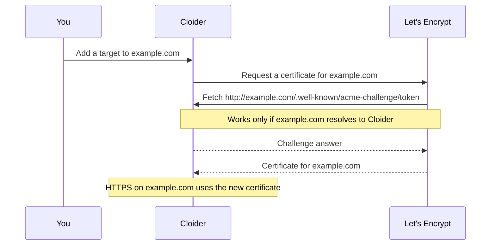

Every domain you route with a [target](/domains/targets) is served over HTTPS, and Cloider manages the certificate for
you: free `cloider.app` subdomains use Cloider's own certificate, and custom domains get a free certificate from
Let's Encrypt that is issued and renewed automatically. You never create, upload or renew a certificate. This page
explains when a certificate is issued, what it needs, and how to check it.

:::note[LoadBalancer targets get no certificate]
A [LoadBalancer target](/domains/targets#point-a-domain-at-a-loadbalancer) only points the domain at a
LoadBalancer's IP, so nothing on this page applies to it. You issue and renew its certificates yourself, for example
with cert-manager in your cluster.
:::

## At a glance

| | Free subdomain | Custom domain |
| --- | --- | --- |
| **Certificate** | Cloider's certificate for `*.cloider.app` | One for the host name, from Let's Encrypt |
| **Issued** | Already in place | Automatically, once the host name resolves to Cloider |
| **Time to HTTPS** | Immediate | Usually a minute or two after DNS resolves |
| **Renewal** | Managed by Cloider | Automatic, well before the certificate expires |
| **Validation** | None needed | HTTP challenge on port 80 (ACME HTTP-01) |
| **Your own certificate** | Not supported | Not supported |
| **Cost** | No charge | No charge |

## How does HTTPS work for a free subdomain?

Every name under `cloider.app` is covered by one wildcard certificate, `*.cloider.app`, that Cloider keeps up to date.
When you add a target to `acme-blog.cloider.app`, HTTPS works on the first request: there is nothing to issue and
nothing to wait for.

A wildcard certificate covers one level only, which is one reason free subdomains can't have dots in their label:
`*.cloider.app` covers `acme-blog.cloider.app` but would not cover `api.acme-blog.cloider.app`.

## How does HTTPS work for a custom domain?

When you add a target to a custom domain such as `example.com`, Cloider requests a certificate for that exact host
name from Let's Encrypt. Let's Encrypt proves that the name points at Cloider with an **HTTP-01 challenge**: it fetches
a temporary file from `http://example.com/.well-known/acme-challenge/...`, which Cloider answers. Once that check
passes, the certificate is issued and installed.



Some details worth knowing:

- **Each target gets its own certificate.** A certificate is issued for the target's host name, so
  `example.com` and `www.example.com` (two domains in Cloider) each get one, and every target on a domain requests its
  own.
- **Certificates are renewed automatically.** Let's Encrypt certificates are valid for 90 days, and Cloider renews them
  well before they expire, with the same HTTP challenge. Keep the domain pointing at Cloider so renewals keep passing.
- **Until a certificate is issued**, HTTPS on the custom domain is answered with Cloider's `*.cloider.app` certificate,
  so browsers show a warning that the certificate doesn't match the name, such as `NET::ERR_CERT_COMMON_NAME_INVALID`.
  This is expected while DNS propagates and goes away once the certificate is issued.

## What does a custom domain need for its certificate?

A certificate is issued only when every item below is true. If HTTPS on your custom domain shows a warning for more
than a few minutes, go through the list.

1. **The domain has a target.** No target, no certificate. Add one, see [Targets](/domains/targets).
2. **The host name resolves to Cloider.** For a subdomain such as `www`, a `CNAME` to a free subdomain you hold; for the
   apex, the `ALIAS` record it was added with, or an `A` record to `195.181.240.88` at another DNS
   provider. See
   [Point the host names you serve at Cloider](/domains/add-a-custom-domain#step-4-point-the-host-names-you-serve-at-cloider).
3. **Port 80 reaches Cloider.** The challenge runs over plain HTTP. Nothing in front of the domain, such as a proxy or
   CDN, may block, cache or redirect `/.well-known/acme-challenge/`.
4. **No CAA record forbids Let's Encrypt.** If the domain has `CAA` records, one of them must be
   `0 issue "letsencrypt.org"`. See [CAA record](/domains/dns-records#caa-record).
5. **DNSSEC isn't broken.** Let's Encrypt validates DNSSEC. A DS record at the registrar for a domain whose
   nameservers don't sign answers (Cloider's don't) makes validation fail. Remove the DS record.
6. **No proxy terminates HTTPS in front of Cloider.** With Cloudflare DNS, set the record to **DNS only** (grey cloud).

## Check the certificate a domain serves

Look at what a browser would get with `curl` or `openssl`:

```bash
curl -vI https://example.com 2>&1 | grep -E "subject:|issuer:|expire date:"
```

```text title="Output"
*  subject: CN=example.com
*  expire date: Jan 18 10:12:44 2027 GMT
*  issuer: C=US; O=Let's Encrypt; CN=R11
```

```bash
openssl s_client -connect example.com:443 -servername example.com </dev/null 2>/dev/null \
  | openssl x509 -noout -subject -issuer -dates
```

```text title="Output"
subject=CN=example.com
issuer=C=US, O=Let's Encrypt, CN=R11
notBefore=Oct 20 10:12:45 2026 GMT
notAfter=Jan 18 10:12:44 2027 GMT
```

The Let's Encrypt intermediate in `issuer` (`R11` in the example) changes over time. What matters is that `subject`
is your host name and the issuer is Let's Encrypt.

While the certificate is still pending, the same commands show the `*.cloider.app` certificate:

```text title="Output"
*  subject: CN=*.cloider.app
*  SSL: no alternative certificate subject name matches target host name 'example.com'
```

Every issued certificate is also published in public Certificate Transparency logs, so a search for your domain on a
log search site such as crt.sh shows when it was issued.

## How long does issuance take, and what if it fails?

Once the host name resolves to Cloider from the internet, issuance usually takes a minute or two. If the challenge
fails, for example because DNS still pointed elsewhere, Cloider retries on its own, waiting longer between attempts
each time, so a certificate can arrive an hour or more after you fixed the cause.

If it is still missing after you fixed DNS:

1. Check from outside your network that the name resolves to Cloider: `dig @1.1.1.1 example.com A +short` should print
   the same address as `dig +short acme-web.cloider.app`.
2. Check that the challenge path reaches Cloider over HTTP: `curl -I http://example.com/.well-known/acme-challenge/test`
   should be answered by Cloider (a `404` is fine), not time out or come from another server.
3. Check for CAA records: `dig example.com CAA +short`.
4. If all three are fine and an hour has passed, delete the target and add it again, which starts a fresh request.

:::warning[Don't recreate targets in a loop]
Let's Encrypt limits how many certificates it issues for the same host name per week (5 for the same exact set of
names) and how many failed validations it accepts per hour. Recreating a target over and over, or adding many targets
to the same custom domain in a short time, can hit these limits, and then no new certificate can be issued for the name
until the window passes. Fix DNS first, then retry once.
:::

## What does my app receive?

Cloider terminates HTTPS and forwards requests to your app or Service as **plain HTTP**:

- Don't configure TLS in your app for traffic that comes through a target, and route targets to a port that speaks
  HTTP, not HTTPS.
- The original scheme is passed in the standard `X-Forwarded-Proto` header (`https`). Frameworks that build absolute
  URLs or enforce HTTPS, such as Django (`SECURE_PROXY_SSL_HEADER`), Rails (`config.force_ssl` behind a proxy) or
  Express (`app.set('trust proxy', true)`), should be told to trust it, or they may redirect in a loop.
- Requests to `http://` are redirected to `https://` before they reach your app.

## Can I upload my own certificate?

No. Cloider issues and renews certificates for you, and there is no way to upload one. If you need a certificate from a
specific authority, such as an extended validation certificate, terminate TLS in your own Service and expose it with
a [LoadBalancer Service](/kubernetes/load-balancers) instead of a target.

## Next steps

- [Targets](/domains/targets): every route gets HTTPS this way.
- [Add a custom domain](/domains/add-a-custom-domain): the DNS that issuance depends on.
- [Troubleshooting](/domains/troubleshooting): certificate and DNS problems step by step.

<FAQ items={[
  {q: 'Is HTTPS free on Cloider?', a: 'Yes. Free subdomains use Cloider\'s certificate for *.cloider.app, and custom domains get free Let\'s Encrypt certificates that Cloider issues and renews automatically.'},
  {q: 'How long does it take to get a certificate for my custom domain?', a: 'Usually a minute or two after the domain resolves to Cloider. If an attempt failed while DNS was still propagating, Cloider retries with growing delays, which can take an hour or more.'},
  {q: 'Why does my custom domain show a certificate for *.cloider.app?', a: 'Its own certificate isn\'t issued yet. Check that the domain has a target, resolves to Cloider, is reachable on port 80, and has no CAA record that forbids Let\'s Encrypt.'},
  {q: 'Do I need to renew certificates?', a: 'No. Let\'s Encrypt certificates last 90 days and Cloider renews them automatically, as long as the domain keeps pointing at Cloider.'},
  {q: 'Does my app need to handle TLS?', a: 'No. Cloider terminates HTTPS and forwards plain HTTP to your app, with X-Forwarded-Proto set to https.'},
  {q: 'Can I use a wildcard certificate for my custom domain?', a: 'No. Cloider issues one certificate per host name you route with a target, using the HTTP challenge, which can\'t issue wildcard certificates.'},
]} />
