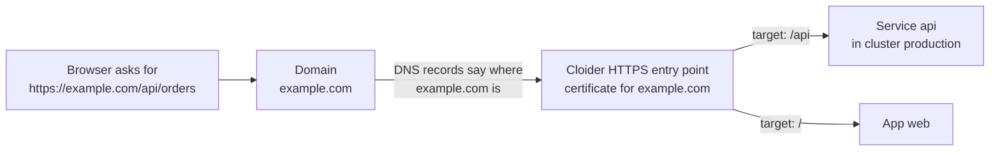

Cloider gives every account two kinds of domains: **free subdomains** such as `blog.cloider.app`, and **custom domains**
you already own, such as `example.com`. A custom domain can use Cloider's nameservers, which then answer for it with
the DNS records you add. Either kind is connected to your workloads with **targets**: routes from a path of the domain
to a [Cloider app](/apps/overview), to a Service in a [Kubernetes cluster](/kubernetes/overview), or to a bucket's
[static website](/object-storage/static-websites), served over HTTPS with a certificate Cloider manages.

## At a glance

| | Free subdomain | Custom domain |
| --- | --- | --- |
| **Example** | `blog.cloider.app` | `example.com`, `shop.example.com` |
| **How you get it** | Claim a free name under `cloider.app` | Buy it from any registrar, then add it to Cloider |
| **Cost** | No charge | No charge from Cloider. Your registrar bills the registration |
| **DNS records** | Not editable. Cloider answers for it | A, AAAA, CNAME, ALIAS, MX, TXT, NS, CAA, HTTPS, SPF, SRV and PTR records, once the domain uses Cloider's nameservers |
| **Targets** | Yes: route paths to apps and cluster Services, or the whole domain to a bucket's website | Yes: route paths to apps and cluster Services, or the whole domain to a bucket's website |
| **HTTPS** | Works immediately, with Cloider's certificate for `*.cloider.app` | A certificate is issued for the host name automatically, once it resolves to Cloider |
| **Nameservers** | Nothing to change | `ns1.cloider.com`, `ns2.cloider.com`, `ns3.cloider.com`, `ns4.cloider.com` |
| **Managed with** | Dashboard, CLI, Terraform, API, MCP | Dashboard, CLI, Terraform, API, MCP |

- Domains, DNS records and targets have no charge of their own. You pay for the [apps](/apps/overview) and
  [clusters](/kubernetes/overview) that serve the traffic, and a [bucket](/object-storage/overview) only for the data
  it stores. See [Billing model](/concepts/billing-model).
- Cloider doesn't register or sell domains. To use your own name, buy it from a registrar such as Namecheap, GoDaddy,
  Cloudflare, Squarespace Domains or Amazon Route 53, then [add it to Cloider](/domains/add-a-custom-domain).
- A domain belongs to one Cloider account. Once an account has added a name, no other account can add it.

<Screenshot
  src="/img/screenshots/domains/list.webp"
  url="/dashboard/domains"
  alt="The Domains page listing example.com as a Domain and blog.cloider.app as a Subdomain, both Active"
  caption="The Domains page lists your active free subdomains and custom domains."
/>

## The three building blocks

Everything in this section is built from three objects. Knowing which one does what makes the rest easy.

1. **Domain**: a name you hold in your account, either a free subdomain or a custom domain. Its **status** tells you
   whether anything routes to it.
2. **DNS records**: the answers Cloider's nameservers give for a custom domain, such as "`www.example.com` is
   `203.0.113.10`" or "mail for `example.com` goes to `mx1.mail.example.net`". Only custom domains have editable
   records. See [DNS records](/domains/dns-records).
3. **Targets**: routes from a path of a domain (`/`, `/api`, `/blog`) to an app or to a Service in a cluster, or from
   the whole domain to a bucket's static website. A target is what makes a domain serve something over HTTPS. See
   [Targets](/domains/targets).

If DNS is new to you, read [DNS basics](/domains/dns-basics) first. It explains domains, subdomains, records, TTL,
nameservers and propagation in plain words, with examples.

## Free subdomains

A free subdomain is a name under `cloider.app` that you claim for your account, such as `blog.cloider.app` or
`acme-shop.cloider.app`. It works the moment you claim it: there is nothing to configure at a registrar, and HTTPS is
covered by Cloider's own certificate. Every new app gets one by default.

Labels are 2 to 63 characters of lowercase letters, digits and hyphens, start with a letter, and can't contain dots.
See [Free subdomains](/domains/free-subdomains) for every rule and the availability check.

## Custom domains

A custom domain is a domain you own, or a subdomain of one, such as `example.com` or `shop.example.com`. You add it to
Cloider, then choose how its DNS is hosted:

- **Use Cloider's nameservers** (most common): change the nameservers at your registrar to `ns1.cloider.com` through
  `ns4.cloider.com`. Cloider then answers DNS for the domain with the records you add in the dashboard, CLI, Terraform
  or API. See [Nameservers](/domains/nameservers).
- **Keep your current DNS provider**: leave the nameservers alone and point the host names you route with targets at
  Cloider from your provider's dashboard. Records you add in Cloider aren't used in that case.

Then add a target, and Cloider serves the domain over HTTPS. The full walk through, with registrar instructions, is in
[Add a custom domain](/domains/add-a-custom-domain).

## Domain status values

Every domain has a status. It describes routing, not DNS: it changes when you add or remove targets.

| Status | Meaning |
| --- | --- |
| `Pending` | The domain was added and nothing routes to it yet. Add a target to activate it |
| `Active` | At least one target routes a path of the domain to an app, a cluster Service or a bucket's website |
| `Suspended` | The domain had targets, and the last one was deleted. Add a target to make it `Active` again |

The status only follows the domain's targets, so `Active` doesn't mean the domain resolves yet. Use [the checks in Troubleshooting](/domains/troubleshooting) to see what the internet sees.

## HTTPS for every domain

Every target is served over HTTPS, and you never upload a certificate:

- Free subdomains use Cloider's certificate for `*.cloider.app`, so HTTPS works as soon as the target exists.
- Custom domains get a certificate of their own from Let's Encrypt, issued automatically once the host name resolves
  to Cloider.

Requests reach your app or Service as plain HTTP, so your code doesn't handle TLS, and a bucket's website is served
straight from the bucket. See
[HTTPS certificates](/domains/https-certificates).

## Who can manage domains?

Every member of an account can see its domains, DNS records and targets. Members with read-only access can't add,
change or delete them: the API answers, for example, `You have read-only access to this account, you can not create
domains!`. API tokens with read access are limited the same way. See
[Accounts and roles](/concepts/accounts-and-roles) and [API tokens](/account/api-tokens).

A suspended account can't add domains, records or targets until it is back on a paid plan.

## Manage domains with any tool

Everything on these pages can be done from five tools. The pages show each task in all of them, in tabs.

| Task | Dashboard | CLI | Terraform | API | MCP tool |
| --- | --- | --- | --- | --- | --- |
| List domains | **Domains** | `cloider domain list` | | `GET /api/domains` | `list_domains` |
| Check a free subdomain | Live check on **Create App** | `cloider domain check` | | `GET /api/domains/availability` | `check_domain_availability` |
| Add a domain | **Add Domain** | `cloider domain create` | `cloider_domain` | `POST /api/domains` | `create_domain` |
| Delete a domain | **Delete domain** | `cloider domain delete` | `cloider_domain` | `DELETE /api/domains/<domain>` | `delete_domain` |
| Manage DNS records | **DNS records** | `cloider dns` | `cloider_dns_record` | `/api/domains/<domain>/dns-records`, `/api/dns-records/<id>` | `list_dns_records`, `create_dns_record`, `update_dns_record`, `delete_dns_record` |
| Manage targets | **Targets** | `cloider target` | `cloider_target` | `/api/targets` | `create_domain_target`, `update_domain_target`, `delete_domain_target` |

Command references: [`cloider domain`](/cli/commands/domain), [`cloider dns`](/cli/commands/dns) and
[`cloider target`](/cli/commands/target). Terraform: [`cloider_domain`](/terraform/resources/domain),
[`cloider_dns_record`](/terraform/resources/dns-record) and [`cloider_target`](/terraform/resources/target). API:
[Domains](/api/endpoints/domains), [DNS records](/api/endpoints/dns-records) and [Targets](/api/endpoints/targets).

## Next steps

<Cards cols={2}>
  <Card title="DNS basics" href="/domains/dns-basics" icon="school-outline">
    Domains, records, TTL, nameservers and propagation explained from scratch.
  </Card>
  <Card title="Claim a free subdomain" href="/domains/free-subdomains" icon="link-variant">
    Get a `cloider.app` name for an app or a cluster in a minute.
  </Card>
  <Card title="Add a custom domain" href="/domains/add-a-custom-domain" icon="web">
    Bring `example.com` to Cloider, with steps for popular registrars.
  </Card>
  <Card title="Route a domain with targets" href="/domains/targets" icon="sitemap-outline">
    Send paths of a domain to apps and Kubernetes Services, or a domain to a bucket's website.
  </Card>
</Cards>

<FAQ items={[
  {q: 'Does Cloider charge for domains or DNS?', a: 'No. Free subdomains, custom domains, DNS records and targets have no charge of their own. You pay for the apps and clusters that serve the traffic, a bucket that serves a website is billed only for its stored data, and your registrar bills the registration of a custom domain.'},
  {q: 'Can I buy a domain from Cloider?', a: 'No. Cloider doesn\'t register domains. Buy one from a registrar such as Namecheap, GoDaddy, Cloudflare, Squarespace Domains or Amazon Route 53, then add it to Cloider as a custom domain.'},
  {q: 'What are Cloider\'s nameservers?', a: 'ns1.cloider.com, ns2.cloider.com, ns3.cloider.com and ns4.cloider.com. Set all four at your registrar to have Cloider answer DNS for a custom domain.'},
  {q: 'What is the difference between a free subdomain and a custom domain?', a: 'A free subdomain is a name under cloider.app, such as blog.cloider.app, that works immediately and has no editable DNS records. A custom domain is a domain you own, such as example.com, that you point at Cloider and whose DNS records you manage.'},
  {q: 'Do I need a load balancer to put a cluster service on a domain?', a: 'No. A target routes a path of a domain to a Service in your cluster over HTTPS, with no load balancer and no Ingress object. Use a LoadBalancer Service only for traffic that isn\'t HTTP.'},
  {q: 'Why does my domain show Active but not load?', a: 'The status only says that a target routes to the domain. The domain also has to resolve to Cloider through DNS, and a custom domain needs its certificate issued. See the troubleshooting page for dig checks.'},
]} />
