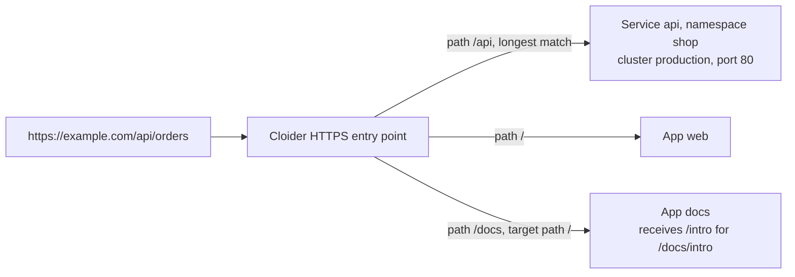

A target is a route from a domain, or a path of it, to a [Cloider app](/apps/overview), to a Service in a
[Kubernetes cluster](/kubernetes/overview), or to a bucket's [static website](/object-storage/static-websites). With
targets, `https://example.com/` can serve the `web` app, `https://example.com/api` a Service in your `production`
cluster, and `https://example.com/docs` another app, each over HTTPS, while `https://docs.example.com/` serves a
website straight from a bucket. This page is the complete reference for targets: how they route, every field, path
rewrites, and the errors you can hit.

For the same topic from the other side, see [Domains for apps](/apps/domains) and
[Expose Kubernetes services](/kubernetes/expose-services).

## At a glance

| | |
| --- | --- |
| **Routes** | A host name and a path prefix, such as `example.com/api` |
| **To** | An app, a Service port in one of your clusters, or a bucket's static website |
| **Types** | `App`, `Cluster` and `Bucket` |
| **Domains** | Free subdomains and custom domains |
| **Paths** | One target per path per domain. The longest matching path wins. A Bucket target always uses `/` |
| **Rewrites** | Optional `target_path` replaces the matched path before the request is forwarded |
| **Protocol to your code** | Plain HTTP. Cloider terminates HTTPS |
| **Certificates** | Automatic. See [HTTPS certificates](/domains/https-certificates) |
| **Cost** | No charge. Targets replace a load balancer and an Ingress controller |
| **Tools** | Dashboard, `cloider target`, `cloider_target`, `/api/targets`, MCP |

## How does a target route a request?



1. The browser looks up the host name. It must resolve to Cloider: free subdomains always do, and a custom domain does
   once you [point it at Cloider](/domains/add-a-custom-domain#step-4-point-the-host-names-you-serve-at-cloider).
2. Cloider terminates HTTPS with the certificate for that host name.
3. Among the host name's targets, the one with the longest `path` that matches the request wins. A path matches itself
   and everything below it: `/api` matches `/api` and `/api/orders`.
4. If the target has a `target_path` different from its `path`, the matched prefix is replaced.
5. The request is forwarded as plain HTTP to the app's port or to the Service's port. For a Bucket target, the
   bucket's website answers it, as described in [Static websites](/object-storage/static-websites).

Plain `http://` requests are redirected to `https://`.

## Target fields

| Field (API) | Dashboard | CLI flag | Terraform | Meaning |
| --- | --- | --- | --- | --- |
| `domain_name` | the domain's page | `<domain>` argument | `domain` | The domain to route. Its name is the host name served |
| `target_type` | **Target type** | `--app`, `--bucket` or `--cluster` | `app_id`, `bucket_id` or `cluster_id` | `App`, `Bucket` or `Cluster`. Defaults to `Cluster` in the API |
| `app_id` | **App** | `--app <name or id>` | `app_id` | The app's id. App targets only |
| `bucket_id` | **Bucket** | `--bucket <name or id>` | `bucket_id` | The bucket's id. Bucket targets only |
| `bucket_name` | set for you | set for you | set for you | The bucket's name, shown in lists. Bucket targets only |
| `cluster_id` | **Cluster** | `--cluster <name or id>` | `cluster_id` | The cluster's id. Cluster targets only |
| `cluster_name` | set for you | set for you | set for you | The cluster's name, shown in lists |
| `namespace` | **Namespace** | `--service <namespace>/<service>` | `namespace` | The Service's namespace. Cluster targets only |
| `service` | **Service** | `--service <namespace>/<service>` | `service` | The Service's name. Cluster targets only |
| `port` | **Port** | `--port` (default: the Service's only port) | `port` | The Service's port, which must speak HTTP |
| `protocol` | from the port | `--protocol` (default: the port's own) | `protocol` (default `TCP`) | `TCP` or `UDP`, as the Service declares the port |
| `path` | **Path** | `--path` (default `/`) | `path` (default `/`) | The path prefix on the domain. Always `/` for Bucket targets |
| `target_path` | **Target path** | `--target-path` (default: `--path`) | `target_path` (default: `path`) | The path the request is forwarded with. Always `/` for Bucket targets |

For an app target you only choose the app: Cloider routes to the app's port itself, and the response carries the app's `app_name` and `app_label`. For a bucket target you only choose the bucket, and the response carries its `bucket_name`. Every target has an id, `hashed_id`, such as
`t4k9vq`, and a `created_at` time.

## Before you begin

- A domain in your account: a [free subdomain](/domains/free-subdomains) or a
  [custom domain](/domains/add-a-custom-domain).
- **For an app target**: an app that has deployed. Its status must be `Ready` or `Paused`.
- **For a cluster target**: a cluster with a Service to route to. List them with `cloider cluster services <cluster>`
  or in the dashboard's target dialog. See [Deploy a workload](/kubernetes/deploy-a-workload).
- **For a bucket target**: a public bucket in the **Ready** state with its static website on. See
  [Static websites](/object-storage/static-websites).
- Write access to the account. Members with read-only access can see targets but not change them.

## Route a domain to an app

<Tabs groupId="interface" queryString>
<TabItem value="dashboard" label="Dashboard" default>

1. Open **Domains** in the sidebar and click the domain.
2. In the **Targets** section, click **Add target**. The **Add a new target** dialog opens.
3. Choose **App** as the **Target type** and pick the app in **App**.
4. Keep **Path** as `/` to route the whole domain, or type a path such as `/blog`.
5. Leave **Target path** empty to forward requests as they are made. See [Rewrite the path](#rewrite-the-path).
6. Click **Save**.

<Screenshot
  src="/img/screenshots/domains/targets.webp"
  url="/dashboard/domains/example.com"
  alt="The Targets section of example.com with an App target routing / to the web app and a Cluster target routing /api to the api Service in the shop namespace"
  caption="Targets on one domain can point at apps and at cluster Services."
/>

</TabItem>
<TabItem value="cli" label="CLI">

```bash
cloider target create example.com --app web
cloider target create example.com --app blog --path /blog
```

```text title="Output"
✓ Routed example.com/ to the app
✓ Routed example.com/blog to the app
```

`--app` takes the app's name, label or id.

</TabItem>
<TabItem value="terraform" label="Terraform">

```hcl title="main.tf"
resource "cloider_target" "web" {
  domain = "example.com"
  app_id = "w4d8hz" # from `cloider app list -o wide`
}

resource "cloider_target" "blog" {
  domain = "example.com"
  path   = "/blog"
  app_id = "a7c2mq"
}
```

</TabItem>
<TabItem value="api" label="API">

```bash
curl -X POST https://cloider.com/api/targets \
  -H "Authorization: Bearer $CLOIDER_TOKEN" \
  -H "Content-Type: application/json" \
  -d '{"domain_name": "example.com", "target_type": "App", "app_id": "w4d8hz", "path": "/"}'
```

```json title="Response"
{
  "hashed_id": "t4k9vq",
  "domain_name": "example.com",
  "message": "Target created successfully"
}
```

</TabItem>
<TabItem value="mcp" label="MCP">

```text title="Prompt"
Route example.com to the web app, and example.com/blog to the blog app.
```

```json title="Tool call: create_domain_target"
{"domain": "example.com", "app": "web"}
```

```json title="Tool call: create_domain_target"
{"domain": "example.com", "app": "blog", "path": "/blog"}
```

</TabItem>
</Tabs>

## Route a domain to a Service in a cluster

<Tabs groupId="interface" queryString>
<TabItem value="dashboard" label="Dashboard" default>

1. Open the domain under **Domains** and click **Add target**.
2. Choose **Cluster** as the **Target type**.
3. Pick the **Cluster**, then the **Namespace**, the **Service** and the **Port**. The lists show the Services that
   exist in the cluster right now.
4. Set **Path** and, if needed, **Target path**.
5. Click **Save**.

<Screenshot
  src="/img/screenshots/domains/target-form.webp"
  url="/dashboard/domains/example.com"
  alt="The Add a new target dialog with Target type Cluster, cluster production, namespace shop, Service api, port 80 and path /api"
  caption="A cluster target: pick the cluster, namespace, Service and port, then the path."
/>

</TabItem>
<TabItem value="cli" label="CLI">

```bash
cloider cluster services production
cloider target create example.com --cluster production --service shop/api --port 80 --path /api
```

```text title="Output"
✓ Routed example.com/api to production/shop/api:80
```

`--service` is `<namespace>/<service>`. `--port` can be left out when the Service has a single port.

</TabItem>
<TabItem value="terraform" label="Terraform">

```hcl title="main.tf"
resource "cloider_target" "api" {
  domain     = "example.com"
  path       = "/api"
  cluster_id = cloider_cluster.production.id
  namespace  = "shop"
  service    = "api"
  port       = 80
}
```

</TabItem>
<TabItem value="api" label="API">

Find the cluster's id and its Services with `GET /api/clusters/services`:

```bash
curl https://cloider.com/api/clusters/services -H "Authorization: Bearer $CLOIDER_TOKEN"
```

```json title="Response"
[
  {
    "id": "c8m2pd",
    "name": "production",
    "services": [
      {"service": "api", "namespace": "shop", "ports": [{"protocol": "TCP", "port": 80}]},
      {"service": "web", "namespace": "shop", "ports": [{"protocol": "TCP", "port": 80}]}
    ]
  }
]
```

Then create the target:

```bash
curl -X POST https://cloider.com/api/targets \
  -H "Authorization: Bearer $CLOIDER_TOKEN" \
  -H "Content-Type: application/json" \
  -d '{
    "domain_name": "example.com",
    "target_type": "Cluster",
    "cluster_id": "c8m2pd",
    "cluster_name": "production",
    "namespace": "shop",
    "service": "api",
    "port": 80,
    "protocol": "TCP",
    "path": "/api"
  }'
```

```json title="Response"
{
  "hashed_id": "t7p3xr",
  "domain_name": "example.com",
  "message": "Target created successfully"
}
```

Send `cluster_name` too: it is stored as given and shown in target lists.

</TabItem>
<TabItem value="mcp" label="MCP">

```text title="Prompt"
Route example.com/api to the api service in the shop namespace of my production cluster.
```

```json title="Tool call: create_domain_target"
{"domain": "example.com", "cluster": "production", "service": "shop/api", "port": 80, "path": "/api"}
```

The agent can first call `list_cluster_services` to find the namespace, Service and port.

</TabItem>
</Tabs>

## Route a domain to a bucket's website

A Bucket target serves a bucket's [static website](/object-storage/static-websites) on the domain. It takes the whole
domain: its path and target path are always `/`, and the website maps every request path to a file in the bucket.
Turn the bucket's website on first.

<Tabs groupId="interface" queryString>
<TabItem value="dashboard" label="Dashboard" default>

1. Open the domain under **Domains** and click **Add target**.
2. Choose **Bucket** as the **Target type** and pick the bucket in **Bucket**. Buckets whose website is off are marked
   **website off** and can't be picked.
3. **Path** and **Target path** stay `/`.
4. Click **Save**.

</TabItem>
<TabItem value="cli" label="CLI">

```bash
cloider target create docs.example.com --bucket acme-site
```

```text title="Output"
✓ Routed docs.example.com/ to the bucket's website
```

`--bucket` takes the bucket's name or id, and can't be combined with `--app` or `--cluster`.

</TabItem>
<TabItem value="terraform" label="Terraform">

```hcl title="main.tf"
resource "cloider_target" "docs" {
  domain    = "docs.example.com"
  bucket_id = cloider_bucket.site.id
}
```

The `cloider_bucket` needs `public = true` and `website = true`.

</TabItem>
<TabItem value="api" label="API">

```bash
curl -X POST https://cloider.com/api/targets \
  -H "Authorization: Bearer $CLOIDER_TOKEN" \
  -H "Content-Type: application/json" \
  -d '{"domain_name": "docs.example.com", "target_type": "Bucket", "bucket_id": "s3w8qn"}'
```

```json title="Response"
{
  "hashed_id": "t9b3ks",
  "domain_name": "docs.example.com",
  "message": "Target created successfully"
}
```

</TabItem>
<TabItem value="mcp" label="MCP">

```text title="Prompt"
Serve the acme-site bucket's website on docs.example.com.
```

```json title="Tool call: create_domain_target"
{"domain": "docs.example.com", "bucket": "acme-site"}
```

</TabItem>
</Tabs>

The route starts answering shortly after the target is saved, once Cloider has set it up. For a custom domain, HTTPS
works once its certificate is issued.

## List a domain's targets

<Tabs groupId="interface" queryString>
<TabItem value="dashboard" label="Dashboard" default>

The **Targets** section of the domain's page lists each target with its **Type** (**App**, **Bucket** or
**Cluster**), **Name**, **Namespace**, **Service**, **Port**, **Protocol**, **Path** (with a link that opens it) and
**Target path**. Namespace and Service are only shown for cluster targets, and Port and Protocol not for bucket
targets. Each row's **Actions** menu has **URL**, **Edit** and **Delete**.

</TabItem>
<TabItem value="cli" label="CLI">

```bash
cloider target list example.com
```

```text title="Output"
ROUTE              TARGET                    TARGET PATH   PROTOCOL
example.com/docs   app docs                  /             -
example.com/api    production/shop/api:80    /api          TCP
example.com/       app web                   /             -
```

A bucket target shows as `website of bucket <name>`. Add `-o wide` for the `ID` column, which `update` and `delete`
take.

</TabItem>
<TabItem value="terraform" label="Terraform">

Terraform has no data source for targets. Existing targets can be imported as `<domain>/<id>`:

```hcl title="import.tf"
import {
  to = cloider_target.api
  id = "example.com/t7p3xr"
}
```

</TabItem>
<TabItem value="api" label="API">

```bash
curl -G https://cloider.com/api/targets \
  -H "Authorization: Bearer $CLOIDER_TOKEN" \
  --data-urlencode "domain_name=example.com"
```

```json title="Response"
[
  {
    "hashed_id": "t7p3xr",
    "domain_name": "example.com",
    "target_type": "Cluster",
    "cluster_id": "c8m2pd",
    "cluster_name": "production",
    "app_id": "",
    "app_name": "",
    "app_label": "",
    "namespace": "shop",
    "service": "api",
    "port": 80,
    "protocol": "TCP",
    "path": "/api",
    "target_path": "/api",
    "created_at": "2026-10-20T11:20:03Z"
  }
]
```

Targets are listed newest first. `domain_name` is required, and a domain that isn't yours answers `403` with
`You don't have permission to access targets for this domain`.

</TabItem>
<TabItem value="mcp" label="MCP">

```text title="Prompt"
Which targets does example.com have?
```

No MCP tool lists a domain's targets with their ids. Find the id with `cloider target list example.com -o wide` or in
the dashboard, then pass it to `update_domain_target` or `delete_domain_target`.

</TabItem>
</Tabs>

## Route several paths of one domain

Each path of a domain routes to exactly one target, and the longest matching path wins. A typical layout:

| Path | Goes to | Requests it receives |
| --- | --- | --- |
| `/` | app `web` | everything no longer path matches: `/`, `/pricing`, `/about/team` |
| `/api` | Service `shop/api:80` in `production` | `/api`, `/api/orders`, `/api/orders/42` |
| `/docs` | app `docs`, target path `/` | `/docs/intro` arrives as `/intro` |

```bash
cloider target create example.com --app web
cloider target create example.com --cluster production --service shop/api --path /api
cloider target create example.com --app docs --path /docs --target-path /
```

A second target with a path the domain already routes is refused with
`This path is already in use on this domain. Please choose a different path.` Edit the existing target instead.

## Rewrite the path

By default a request reaches the app or Service with the exact path it was made with. Set a **target path** to replace
the matched `path` prefix before the request is forwarded:

| Path | Target path | Request | Forwarded as |
| --- | --- | --- | --- |
| `/api` | (empty, same as path) | `/api/orders` | `/api/orders` |
| `/api` | `/` | `/api/orders` | `/orders` |
| `/api` | `/` | `/api` | `/` |
| `/api` | `/v2` | `/api/orders` | `/v2/orders` |
| `/` | `/v1` | `/orders` | `/v1/orders` |
| `/docs` | `/` | `/docs/intro?lang=en` | `/intro?lang=en` |

```bash
cloider target create example.com --app docs --path /docs --target-path /
```

A trailing slash on the target path is ignored: `/v2/` and `/v2` behave the same.

:::warning[Apps under a path must know their base path]
A rewrite changes the path the app sees, not the links it generates. An app served at `/docs` with a target path of `/`
still writes links such as `/intro` or `/assets/app.js`, which the browser requests from `/`, not `/docs`. Configure
the app's base path (for example `basePath` in Next.js or `base` in Vite), or give it its own subdomain such as
`docs.example.com`.
:::

## Edit a target

Editing can change the path, the target path and what the target points at, including switching between an app, a
cluster Service and a bucket's website. Cloider replaces the route in one step. A target moved to a bucket must have
the path `/`.

<Tabs groupId="interface" queryString>
<TabItem value="dashboard" label="Dashboard" default>

Open the target's **Actions** menu, click **Edit**, change the fields in the **Edit target** dialog and click **Save**.

</TabItem>
<TabItem value="cli" label="CLI">

`cloider target update` keeps whatever you don't give:

```bash
cloider target list example.com -o wide                 # find the id
cloider target update example.com t7p3xr --path /v2      # move the route
cloider target update example.com t7p3xr --app api       # point it at an app instead
cloider target update example.com t7p3xr --port 8080     # another port of the same Service
cloider target update example.com t4k9vq --bucket acme-site  # serve a bucket's website at /
```

```text title="Output"
✓ Updated example.com/v2 to production/shop/api:80
```

When you change `--path` and the target path was the same as the old path, the target path moves with it.

</TabItem>
<TabItem value="terraform" label="Terraform">

Change the `cloider_target` and run `terraform apply`. Changing `domain` replaces the target; the other attributes are
updated in place.

</TabItem>
<TabItem value="api" label="API">

`PUT` replaces the target, so send every field, as for a new one:

```bash
curl -X PUT https://cloider.com/api/targets/t7p3xr \
  -H "Authorization: Bearer $CLOIDER_TOKEN" \
  -H "Content-Type: application/json" \
  -d '{"domain_name": "example.com", "target_type": "App", "app_id": "k2v9wd", "path": "/api", "target_path": "/"}'
```

```json title="Response"
{
  "hashed_id": "t7p3xr",
  "domain_name": "example.com",
  "message": "Target updated successfully"
}
```

</TabItem>
<TabItem value="mcp" label="MCP">

```text title="Prompt"
Move the /api target of example.com to the api app.
```

```json title="Tool call: update_domain_target"
{"domain": "example.com", "target_id": "t7p3xr", "app": "api"}
```

</TabItem>
</Tabs>

## Delete a target

Deleting a target stops its route right away. The domain, its DNS records and the app or Service stay. When a domain's
last target is deleted, its status becomes `Suspended`.

<Tabs groupId="interface" queryString>
<TabItem value="dashboard" label="Dashboard" default>

Open the target's **Actions** menu, click **Delete** and confirm **Are you sure you want to delete this target?** with
**Delete**.

</TabItem>
<TabItem value="cli" label="CLI">

```bash
cloider target delete t7p3xr
```

```text title="Output"
Delete target t7p3xr? Its route stops answering. [y/N] y
✓ Deleted target t7p3xr
```

Add `--yes` in scripts.

</TabItem>
<TabItem value="terraform" label="Terraform">

Remove the `cloider_target` resource and run `terraform apply`.

</TabItem>
<TabItem value="api" label="API">

```bash
curl -X DELETE https://cloider.com/api/targets/t7p3xr \
  -H "Authorization: Bearer $CLOIDER_TOKEN"
```

```json title="Response"
{"message": "Target deleted successfully"}
```

</TabItem>
<TabItem value="mcp" label="MCP">

```text title="Prompt"
Delete the target t7p3xr of example.com.
```

```json title="Tool call: delete_domain_target"
{"target_id": "t7p3xr"}
```

</TabItem>
</Tabs>

## Targets when an app, cluster or bucket changes

| Event | What happens to its targets |
| --- | --- |
| App or cluster **paused** | Targets stay. Requests fail until you resume it |
| App **redeployed** | Targets stay and keep routing to the new version |
| App's **port changed** | The route follows the app's port on the next deploy. The dashboard shows **App now listens on port 8080; edit and save this target to update it.** until you save the target |
| App **deleted** | Its targets are deleted with it. See [Domains for apps](/apps/domains) |
| Cluster **deleted**, or a Service removed | The targets stay and point at nothing. The dashboard shows **Orphaned targets detected!**. Delete them or point them elsewhere |
| Bucket's **website turned off** | Refused while targets point at it: `Domains still point at this website, remove their targets first.` |
| Bucket **made private** | Refused while its website is on: `The bucket's website needs it public, turn the website off first.` |
| Bucket **deleted** | Its website stops and its targets are deleted with it. The domains stay |

## Limits

| Limit | Message |
| --- | --- |
| `path` and `target_path` start with `/` and contain only letters, digits and `/ _ . -` | `Path must start with / and may only contain letters, numbers and / _ . -`, `Target path must start with / and may only contain letters, numbers and / _ . -` |
| One target per path per domain | `This path is already in use on this domain. Please choose a different path.` |
| Service, namespace and cluster names together at most 57 characters | `Service and namespace names are too long for this cluster (combined limit exceeded)` |
| An app name of 50 characters or fewer always works; a longer one can be refused | `This app's name is too long to be exposed on a domain.` |
| The app has deployed (`Ready` or `Paused`) | `This app is not ready yet. Wait until it finishes deploying, then add the target.` |
| A port is required for cluster targets | `Valid port is required` |
| A bucket target takes the whole domain: `path` and `target_path` are `/` | `A bucket website is served at the root of its domain, the path must be /`, `A bucket website is served at the root of its domain, the target path must be /` |
| The bucket is `Ready` with its website on | `This bucket is not ready yet. Wait until it is created, then add the target.`, `Turn on the bucket's website first, from its Settings.` |
| The port speaks HTTP | Not checked. An HTTPS or non-HTTP port answers with errors |
| Request bodies | Larger uploads may be refused with `413 Request Entity Too Large`. Upload big files straight to [object storage](/object-storage/overview) instead |

For raw TCP or UDP traffic, such as a database or a game server, use a
[LoadBalancer Service](/kubernetes/load-balancers) instead of a target.

## Troubleshooting

| Problem | Cause and fix |
| --- | --- |
| **Add target** is disabled | There is nothing to route to yet: **You have no apps yet. Create one under Apps before adding an app target.**, **No clusters found. You need to create at least one cluster before adding cluster targets.** or **You have no buckets yet. Create one under Buckets and turn on its website before adding a bucket target.** |
| **None of your buckets has its website on. ...** | Turn on the [static website](/object-storage/static-websites) in a bucket's **Settings** tab, then add the target |
| `Turn on the bucket's website first, from its Settings.` | The bucket's website is off. Turn it on, then add the target |
| `A bucket website is served at the root of its domain, the path must be /` | Bucket targets take the whole domain. Leave the path as `/`, or use a domain of its own such as `docs.example.com` |
| `This path is already in use on this domain. ...` | Edit or delete the target that has the path |
| `This app is not ready yet. ...` | Wait for the app's first deploy to finish |
| `App not found!`, `Bucket not found!` | The id is wrong or belongs to another account. Check `cloider app list -o wide` or `cloider bucket list -o wide` |
| `404 Not Found` from the API on create | The domain isn't in your account. Add it first; `www.example.com` is a domain of its own |
| `say where to route to with --app, --bucket or --cluster` (CLI) | Add `--app <app>`, `--bucket <bucket>` or `--cluster <cluster> --service <namespace>/<service>` |
| `shop/api has several ports (80/TCP, 9090/TCP), pick one with --port` (CLI) | Add `--port 80` |
| `no service shop/api in cluster production, see cloider cluster services` (CLI) | Check the namespace and the Service name |
| The page shows `404` | The host name reaches Cloider but no target's path matches. Add a target for `/` |
| `502 Bad Gateway` or `503` | Nothing answers behind the target: the app or cluster is paused, the pods aren't ready, or the port is wrong |
| Browser certificate warning on a custom domain | The certificate isn't issued yet. See [HTTPS certificates](/domains/https-certificates) |
| The domain doesn't resolve | Targets don't create DNS records. See [Point the host names you serve at Cloider](/domains/add-a-custom-domain#step-4-point-the-host-names-you-serve-at-cloider) |

More cases are in [Domains troubleshooting](/domains/troubleshooting).

## Next steps

- [HTTPS certificates](/domains/https-certificates): how targets get their certificates.
- [Expose Kubernetes services](/kubernetes/expose-services): targets from the cluster's point of view.
- [Static websites](/object-storage/static-websites): serve a bucket on a domain with a Bucket target.
- [`cloider target`](/cli/commands/target), [`cloider_target`](/terraform/resources/target) and the
  [Targets API](/api/endpoints/targets).

<FAQ items={[
  {q: 'What is a target on Cloider?', a: 'A target is a route from a domain, or a path of it, to a Cloider app, to a Service port in one of your Kubernetes clusters, or to a bucket\'s static website. Cloider serves it over HTTPS and forwards requests to apps and Services as plain HTTP.'},
  {q: 'Can a domain serve a bucket\'s static website?', a: 'Yes. Turn on the bucket\'s static website, then add a target of type Bucket that points the domain at it, for example cloider target create docs.example.com --bucket acme-site. A Bucket target takes the whole domain, at the path /.'},
  {q: 'Can one domain route to several apps?', a: 'Yes. Add one target per path, for example / to the web app, /api to a cluster Service and /docs to a docs app. The longest matching path wins.'},
  {q: 'How do I strip a path prefix before it reaches my app?', a: 'Set the target path. A target with path /api and target path / forwards /api/orders as /orders.'},
  {q: 'Do I need an Ingress or a load balancer?', a: 'No. Targets replace both for HTTP traffic. Ingress objects inside a Cloider cluster aren\'t served. Use a LoadBalancer Service only for traffic that isn\'t HTTP.'},
  {q: 'Does a target create DNS records?', a: 'No. A free subdomain already resolves to Cloider, and a custom domain comes with an ALIAS record for the domain itself, which the first target to an app points at the app\'s free subdomain. For other host names of a custom domain, add a CNAME or A record that points at Cloider.'},
  {q: 'What happens to a target when I pause my app or cluster?', a: 'The target stays, but requests fail until you resume the app or cluster. You don\'t need to recreate it.'},
]} />
