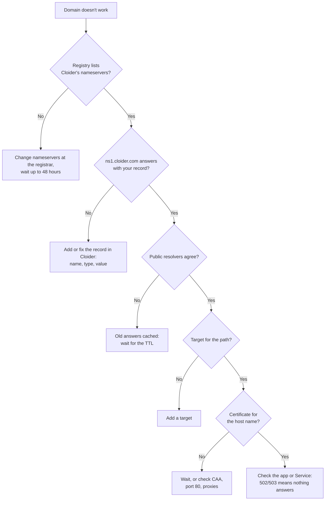

Most domain problems come down to one link in a short chain: the registry hands out the domain's nameservers, the
nameservers answer with records, the records point at Cloider, a target routes the request, and a certificate secures
it. This page shows how to check each link with `dig`, `nslookup` and `curl`, then covers the problems people actually
hit and every error message from the dashboard, the CLI and the API.

## Start here: find the broken link

Run these checks in order for the host name that doesn't work, here `example.com`. The first one that fails is where
the problem is.

| # | Check | Command | Expected |
| --- | --- | --- | --- |
| 1 | The registry uses Cloider's nameservers | `dig example.com NS @a.gtld-servers.net +noall +authority` (for `.com`) or `dig +trace example.com` | `ns1.cloider.com` to `ns4.cloider.com` |
| 2 | Cloider answers with your record | `dig @ns1.cloider.com example.com A +short` | Your record's value |
| 3 | The public sees the same answer | `dig @1.1.1.1 example.com A +short` | Same as check 2 |
| 4 | The name points at Cloider | Compare with `dig +short acme-web.cloider.app` | Same address |
| 5 | A target routes it | `cloider target list example.com` | A target for the path |
| 6 | HTTPS works | `curl -sSI https://example.com` | `HTTP/2 200` (or your app's status) |



### dig and nslookup, side by side

`dig` ships with macOS and Linux (`dnsutils` or `bind-utils` packages). On Windows, use `nslookup`, or `Resolve-DnsName`
in PowerShell.

| Question | dig | nslookup | PowerShell |
| --- | --- | --- | --- |
| A record from your resolver | `dig example.com A +short` | `nslookup -type=A example.com` | `Resolve-DnsName example.com -Type A` |
| A record from Cloider directly | `dig @ns1.cloider.com example.com A +short` | `nslookup -type=A example.com ns1.cloider.com` | `Resolve-DnsName example.com -Type A -Server ns1.cloider.com` |
| From a public resolver | `dig @1.1.1.1 example.com A +short` | `nslookup -type=A example.com 1.1.1.1` | `Resolve-DnsName example.com -Server 1.1.1.1` |
| MX records | `dig example.com MX +short` | `nslookup -type=MX example.com` | `Resolve-DnsName example.com -Type MX` |
| TXT records | `dig example.com TXT +short` | `nslookup -type=TXT example.com` | `Resolve-DnsName example.com -Type TXT` |
| Full answer with status | `dig example.com A` | `nslookup -debug example.com` | `Resolve-DnsName example.com -DnsOnly` |

Asking `ns1.cloider.com` directly shows what Cloider answers right now, with no cache in between. Asking a public
resolver shows what visitors get.

## NXDOMAIN for my domain

`NXDOMAIN` ("non-existent domain") means the nameserver that answered says the name has no records at all.

```bash
dig example.com A
```

```text title="Output"
;; ->>HEADER<<- opcode: QUERY, status: NXDOMAIN, id: 51723
;; flags: qr rd ra; QUERY: 1, ANSWER: 0, AUTHORITY: 0, ADDITIONAL: 1
```

Work through the causes:

1. **The name has no record in Cloider.** Cloider answers `NXDOMAIN` for a name of the domain that has no records.
   The domain itself gets an `ALIAS` record when it's added, but a target doesn't add records: add a `CNAME` for `www` and
   other subdomains. See
   [Point the host names you serve at Cloider](/domains/add-a-custom-domain#step-4-point-the-host-names-you-serve-at-cloider).
2. **The record name includes the domain.** A record named `www.example.com` on `example.com` answers for
   `www.example.com.example.com`. Edit it and set the name to `www`. Check with `cloider dns list example.com`.
3. **The name has a typo.** Compare `cloider domain list` with the name you query, and the record names with the host
   names you use.
4. **The domain was deleted from Cloider** while its nameservers still point at Cloider. Add it again with its
   records, or move the nameservers elsewhere.
5. **A resolver cached the earlier `NXDOMAIN`.** If you queried the name before adding the record, resolvers can keep
   the negative answer for up to 300 seconds, the time set by the `SOA` record that Cloider's negative answers carry. Check `dig @ns1.cloider.com`: if Cloider already
   answers, wait, or test with another resolver.

If `dig @ns1.cloider.com example.com A` answers but a public resolver says `NXDOMAIN`, the registry may not hand out
Cloider's nameservers yet: see the next section.

## My domain still points to the old nameservers

The registry, or resolvers, still use your previous DNS provider, so visitors get old answers or none.

```bash
# The registry's view, for .com and .net
dig example.com NS @a.gtld-servers.net +noall +authority

# For any TLD, follow the chain from the root
dig +trace example.com A | grep -E "IN\s+NS"
```

- **The registry lists the old nameservers**: the change wasn't saved or hasn't been published. Check the nameserver
  setting at your registrar, make sure all four Cloider names are there and the old ones are gone, and look for a
  confirmation email or a pending change. Most registries publish within minutes to a few hours.
- **The registry lists Cloider's nameservers, but your resolver still answers from the old provider**: your resolver
  cached the old delegation, for up to 48 hours. Test with another resolver (`dig @1.1.1.1`, `dig @8.8.8.8`), flush
  your computer's DNS cache, and wait.
- **The registrar refused the change**: some registrars or country registries test the new nameservers first. See
  [Country code domains](/domains/nameservers#change-the-nameservers-at-your-registrar).

Flush your own computer's cache:

<Tabs groupId="os">
<TabItem value="macos" label="macOS" default>

```bash
sudo dscacheutil -flushcache; sudo killall -HUP mDNSResponder
```

</TabItem>
<TabItem value="windows" label="Windows">

```bash
ipconfig /flushdns
```

</TabItem>
<TabItem value="linux" label="Linux">

```bash
# systemd-resolved
resolvectl flush-caches
```

</TabItem>
</Tabs>

## The record exists but the answer is empty

An empty answer with status `NOERROR` means the name exists but has no record of the type you asked for:

```text title="Output"
;; ->>HEADER<<- opcode: QUERY, status: NOERROR, id: 18802
;; flags: qr aa; QUERY: 1, ANSWER: 0, AUTHORITY: 1, ADDITIONAL: 0
```

- You asked for `AAAA` and the name has only an `A` record, or the reverse. That is normal.
- You asked for `TXT` at the apex but the record is on `_dmarc` or a DKIM selector. Ask for the full name:
  `dig _dmarc.example.com TXT`.

## CNAME at the apex is refused

```text
CNAME records cannot be used for the root domain (record name cannot be empty)
```

DNS doesn't allow a `CNAME` on the domain itself, because the apex must also hold other records (such as `MX` and
`NS`). The options:

- **Use an `ALIAS` record for the apex**, to your app's free subdomain (or `cloider.app`) for a domain served by
  Cloider, or to the target the `CNAME` would have had. Cloider's nameservers answer it with the target's current addresses. See
  [ALIAS record](/domains/dns-records#alias-record).
- **Use an `A` record for the apex** with Cloider's address, `195.181.240.88`, and a `CNAME` for `www`. See
  [Point the host names you serve at Cloider](/domains/add-a-custom-domain#step-4-point-the-host-names-you-serve-at-cloider).
- **Serve the site on `www`** and keep the apex for email and a simple redirect from your app.
- **Keep DNS at a provider with CNAME flattening**, such as Cloudflare, which accepts a CNAME at the apex. See
  [Keep your current DNS provider](/domains/add-a-custom-domain#keep-your-current-dns-provider).

The reverse also happens: a `CNAME` can't be added at a name that already has other records
(`CNAME record cannot coexist with other record types for the same name: www`), and other records can't be added at a
name that has a `CNAME` (`Cannot create TXT record: CNAME already exists for name: www`). Delete one of them.

## The browser shows a certificate warning

On a custom domain, a warning such as `NET::ERR_CERT_COMMON_NAME_INVALID` (Chrome) or `SSL_ERROR_BAD_CERT_DOMAIN`
(Firefox) means the domain's own certificate isn't issued yet, and Cloider is answering with its `*.cloider.app`
certificate:

```bash
curl -vI https://example.com 2>&1 | grep -E "subject:|issuer:"
```

```text title="Output"
*  subject: CN=*.cloider.app
```

Check, in order:

1. The domain has a target: `cloider target list example.com`.
2. The name resolves to Cloider from the public internet: `dig @1.1.1.1 example.com A +short`.
3. Port 80 reaches Cloider, with no proxy or CDN in front: `curl -I http://example.com/.well-known/acme-challenge/test`
   is answered by Cloider.
4. No `CAA` record blocks Let's Encrypt: `dig example.com CAA +short` is empty or includes `letsencrypt.org`.
5. No leftover DNSSEC: the registrar shows no DS record for the domain.

Then wait. Failed attempts are retried with growing delays, so issuance can take an hour or more after the fix. All
details are in [HTTPS certificates](/domains/https-certificates).

On a free `cloider.app` subdomain, a certificate warning usually means the name has more than one label in front of
`cloider.app`, which the certificate doesn't cover, or a local proxy or antivirus intercepting HTTPS.

## The domain loads a 404 page

The request reaches Cloider over HTTPS, but no target routes that host name and path.

- The domain has no target, or none for this path. Add one for `/`: `cloider target create example.com --app web`.
- You opened `www.example.com` but only `example.com` has a target. `www.example.com` is a domain of its own in Cloider:
  add it and give it a target. See
  [Serve both example.com and www.example.com](/domains/add-a-custom-domain#serve-both-examplecom-and-wwwexamplecom).
- The 404 comes from your app: the app runs but has no page at that path. Check the app's own logs, see
  [Logs](/apps/logs).

## 502 Bad Gateway or 503 Service Unavailable

The target matched, but nothing answered behind it.

- **App targets**: the app is paused, still deploying, or crashed. Check `cloider app status <app>` and its logs. The
  domain's page shows a warning icon such as **App is Paused - requests will fail until it is Ready.**
- **Cluster targets**: the cluster is paused, the Service has no ready pods
  (`kubectl get endpoints <service> -n <namespace>`), or the target uses the container port instead of the Service port.
- **The backend speaks HTTPS**: targets forward plain HTTP. Route to a port that serves HTTP.

See [Apps troubleshooting](/apps/troubleshooting) and [Kubernetes troubleshooting](/kubernetes/troubleshooting).

## Email stopped arriving after moving DNS

The `MX` record (or the SPF, DKIM and DMARC records) wasn't recreated in Cloider before the nameservers changed.

```bash
dig @ns1.cloider.com example.com MX +short
dig @ns1.cloider.com example.com TXT +short
```

If the answers are empty, add the records from your mail provider's admin console. See
[Email DNS records](/domains/email-dns-records). Mail servers retry for a few days, so most delayed mail still arrives
once the MX record is back.

## Other DNS answers you may see

| What you see | Meaning and fix |
| --- | --- |
| `status: REFUSED` from `ns1.cloider.com` | The domain isn't added to Cloider, so Cloider's nameservers don't answer for it. Check the spelling, or add the domain |
| `status: SERVFAIL` from a public resolver | Often leftover DNSSEC: a DS record at the registrar for a domain whose nameservers don't sign. Remove the DS record |
| `;; WARNING: recursion requested but not available` | Normal when asking Cloider's nameservers directly: they are authoritative only |

## Dashboard problems

| What you see | Cause and fix |
| --- | --- |
| The domain's page has no **DNS records** section | It is a free subdomain, which has no records |
| **Add target** is disabled | Nothing to route to yet. Create an app, or a cluster with a Service |
| **Orphaned targets detected!** | Targets point at a cluster, Service or app that no longer exists. Delete them or point them elsewhere |
| **App now listens on port 8080; edit and save this target to update it.** | The app's port changed. Open the target, click **Save** |
| **Check Availability** is disabled | Type a plain domain name such as `example.com`, without `https://` or a path |

## Error messages

Every message the API returns for domains, DNS records and targets, with what to do. The dashboard and the CLI show the
same text.

### Domains

| Message | Fix |
| --- | --- |
| `This subdomain is already taken. Please try another one.` | Choose another free subdomain |
| `You already own this subdomain. Connect it to the app from Domains instead.` | Add a target to it instead |
| `The domain already created by a different user, if you own this domain contact support` | Contact [support](/account/support) |
| `This domain is under ..., which belongs to another Cloider account` | Another account holds a domain above it. Contact [support](/account/support) if you own it |
| `A domain under this one belongs to another Cloider account` | Another account holds a name under it. Contact [support](/account/support) if you own the domain |
| `Domain name is a public suffix shared by many owners, add your own domain under it, such as example.co.uk` | Add the domain you registered, not the shared suffix |
| `Invalid root domain name` | A free subdomain must end in `.cloider.app` |
| `Disallowed domain name` | Cloider's own domains can't be added |
| `Invalid domain format` | Use a full name such as `example.com` |
| `Invalid domain type specified` | API: `domain_type` must be `Subdomain` or `CustomDomain` |
| `Your account is suspended. Upgrade to a paid plan to continue using our services.` | See [Billing](/account/billing) |
| `You have read-only access to this account, you can not create domains!` | Ask for write access |

### DNS records

| Message | Fix |
| --- | --- |
| `Can't add records on subdomains.` | Use a custom domain |
| `TTL must be between 60 and 172800 seconds` | Pick a TTL in range, such as `300` or `3600` |
| `... record already exists for '...'. Instead of creating separate records, edit the existing record and add multiple values on separate lines.` | Edit the existing record |
| `Duplicate record already exists with the same type, name, and value` | The record already exists |
| `Private IP address detected: ...` | Use a public address |
| `CNAME records cannot be used for the root domain (record name cannot be empty)` | See [CNAME at the apex](#cname-at-the-apex-is-refused) |
| `NS record should end with a dot: ...` | Add the trailing dot |
| `SPF record must start with 'v=spf1': ...` | Use a `TXT` record starting with `v=spf1` |
| `Operation failed, couldn't delete the DNS record!` | Nothing was deleted. Try again |

The rules for each type are in [DNS records](/domains/dns-records#record-types).

### Targets

| Message | Fix |
| --- | --- |
| `This path is already in use on this domain. Please choose a different path.` | Edit the existing target or use another path |
| `This app is not ready yet. Wait until it finishes deploying, then add the target.` | Wait for the first deploy |
| `This app's name is too long to be exposed on a domain.` | Create the app with a shorter name |
| `Service and namespace names are too long for this cluster (combined limit exceeded)` | Use shorter names |
| `Path must start with / and may only contain letters, numbers and / _ . -` | Fix the path |
| `App not found!` | Check the app id with `cloider app list -o wide` |
| `You don't have permission to access targets for this domain` | The domain isn't in this account. Check the account or profile you use |

## Still stuck?

Open a [support request](/account/support) with the domain name, the output of the six checks in
[Start here](#start-here-find-the-broken-link), and what you expected to see. Never include API tokens or passwords.

## Next steps

- [DNS basics](/domains/dns-basics): the concepts behind these checks.
- [Nameservers](/domains/nameservers): how Cloider's nameservers answer.
- [Reference troubleshooting](/reference/troubleshooting): problems across all products.

<FAQ items={[
  {q: 'Why does my domain return NXDOMAIN on Cloider?', a: 'Usually because the name has no record in Cloider. The domain itself gets an ALIAS record that points at Cloider when you add it, but a target doesn\'t create DNS records: add a CNAME for www and other subdomains. Also check that the registry lists ns1.cloider.com to ns4.cloider.com.'},
  {q: 'How do I check whether my nameserver change worked?', a: 'Ask the registry: dig example.com NS @a.gtld-servers.net +noall +authority for .com domains, or dig +trace example.com for any TLD. It should list ns1.cloider.com to ns4.cloider.com.'},
  {q: 'Why can\'t I add a CNAME for my root domain?', a: 'DNS doesn\'t allow a CNAME at the apex. Use an ALIAS record for example.com, which Cloider adds when you add the domain and points at your app\'s free subdomain once you route the domain to the app, and a CNAME for www.example.com. At a DNS provider without ALIAS records, use an A record to 195.181.240.88.'},
  {q: 'Why does my custom domain show a certificate warning?', a: 'Its certificate isn\'t issued yet, so Cloider answers with its *.cloider.app certificate. Check that the domain has a target, resolves to Cloider, is reachable on port 80 and has no CAA record that blocks Let\'s Encrypt.'},
]} />
