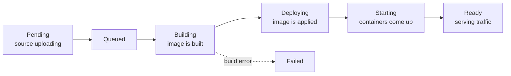

This tutorial deploys a small web app to Cloider and then walks through the everyday tasks around it: watching the build, opening the app on its free HTTPS address, setting an environment variable, reading the logs and deploying a new version. It takes about ten minutes.

An **app** on Cloider is your source code, built into a container image and run for you. You bring the code; Cloider detects the language, builds it (with your Dockerfile if the project has one, or with buildpacks if it doesn't), runs it and gives it a URL. You don't manage servers, clusters or certificates. Read the [Apps overview](/apps/overview) for the full picture.

## Before you begin

- A Cloider account. See [Create an account](/get-started/create-an-account).
- For the CLI path, the `cloider` CLI installed and logged in with **Read and write** access. See [Install the CLI](/get-started/install-the-cli).
- Some code to deploy. This tutorial uses a minimal Node.js server, but any language Cloider supports works (see [Supported languages](/apps/supported-languages)), and so does a folder of static HTML.

## What happens when you deploy

Every deploy creates a numbered **build** (version `1`, `2`, and so on). The app's status follows the build through these steps:



| Status | What is happening |
| --- | --- |
| **Pending** | The source archive is still being uploaded |
| **Queued** | The build is waiting for a builder |
| **Building** | Cloider is building a container image from your code |
| **Deploying** | The new image is being applied |
| **Starting** | The new containers are pulling the image and starting up |
| **Ready** | The new version is running and serving requests |
| **Failed** | The build or start failed. The build log says why, and you can retry it |

If an app already has a working version, a failed build doesn't take it down: the previous version keeps serving.

## Step 1: Prepare the code

Create a folder called `hello` with two files:

```json title="package.json"
{
  "name": "hello",
  "version": "1.0.0",
  "scripts": {
    "start": "node server.js"
  }
}
```

```js title="server.js"
const http = require('http');

const port = process.env.PORT || 8080;
const greeting = process.env.GREETING || 'Hello';

http
  .createServer((req, res) => {
    console.log(`${req.method} ${req.url}`);
    res.writeHead(200, {'Content-Type': 'text/plain'});
    res.end(`${greeting} from Cloider!\n`);
  })
  .listen(port, () => console.log(`Listening on ${port}`));
```

Two things matter for any app you deploy:

- **Listen on the port Cloider gives you.** An app built from source receives the port in the `PORT` environment variable. Use it, or make sure the port you set when you create the app is the one your code listens on.
- **Start with one command.** Cloider uses the project's own start script (here `npm start`) or Procfile. You can also set a **Start Command** yourself.

:::tip[Keep secrets and build output out of the upload]
The CLI leaves out everything `.gitignore` lists, plus `.git` and `.cloider`. To leave out more without changing `.gitignore`, list it in a `.cloiderignore` file with the same syntax. An upload can hold up to 2000 files and 100 MB.
:::

## Step 2: Deploy

<Tabs groupId="interface" queryString>
<TabItem value="dashboard" label="Dashboard" default>

1. Open **Apps** in the sidebar and click **Create App**.

   <Screenshot
     src="/img/screenshots/apps/new-app.webp"
     url="/dashboard/apps/new-app"
     alt="The Bring your own code step of Create App, with GitHub, GitLab and Bitbucket import buttons above an upload drop zone"
     caption="Step 1 of Create App: import a Git repository or upload your code."
   />

2. Under **Application source**, drag the `hello` folder onto the drop zone, or click **choose a folder**. A zip file or a single HTML file works too. To deploy from a repository instead, click **GitHub**, **GitLab** or **Bitbucket** under **Import a Git repository** (see [Deploy from Git](/apps/deploy-from-git)).
3. Cloider uploads the code and looks at it. The **Configure your app** step opens with what it detected under *We had a look at your code*.
4. Fill in the form:
   - **App Name**: `hello`. Lowercase letters, digits and dashes, 2 to 64 characters, starting with a letter.
   - **Port**: `8080`.
   - **Start Command**: leave empty, so `npm start` runs.
   - **Give this app a free subdomain**: leave on, and type `hello-acme` in **Subdomain**. Wait for *hello-acme.cloider.app is available*.
   - **Environment variables**, **Build variables** and **Build arguments**: leave empty for now.
5. Click **Create App**.

</TabItem>
<TabItem value="cli" label="CLI">

From inside the `hello` folder:

```bash
cloider deploy --name hello --subdomain hello-acme
```

```text title="Output"
Packaged 2 files (0.6 KB)
Detected JavaScript
✓ Created app hello on port 8080
Linked . to hello in .cloider/app.json, later deploys from here update it.
...
✓ Deployed version 1 of hello
https://hello-acme.cloider.app
```

The CLI streams the build output while it waits. Pass `--detach` (`-d`) to return as soon as the build starts, then follow it with `cloider app build logs hello`.

</TabItem>
<TabItem value="terraform" label="Terraform">

The Terraform provider doesn't manage apps. Use the **Dashboard** or **CLI** tab to deploy, and Terraform for the [resources it supports](/terraform/overview), such as a database the app connects to.

</TabItem>
<TabItem value="api" label="API">

An API deploy is four calls: `POST /api/apps/source` (answers with a `token` and a `presigned_url`), a `PUT` of your zip to the `presigned_url`, `POST /api/apps/source/<token>/detect`, and `POST /api/apps` with `app_name`, `port`, `subdomain` and `source_token`. The request and response shapes are in [Apps endpoints](/api/endpoints/apps). The CLI's `cloider deploy` does exactly this for you.

</TabItem>
<TabItem value="mcp" label="MCP">

```text title="Prompt"
Deploy /Users/jane/hello as an app called hello on the subdomain hello-acme.
```

```json title="Tool call: deploy_app"
{"dir": "/Users/jane/hello", "name": "hello", "subdomain": "hello-acme"}
```

The tool follows the build and answers with the app's URL.

</TabItem>
</Tabs>

## Step 3: Watch the build

The first build turns your code into a container image, so it takes a little while. You can follow it live.

<Tabs groupId="interface" queryString>
<TabItem value="dashboard" label="Dashboard" default>

The app page opens after **Create App**. Its status moves through **Queued**, **Building**, **Deploying** and **Starting** to **Ready**. Open the **Builds** tab and click **Logs** on the build to see the build output as it happens.

<Screenshot
  src="/img/screenshots/apps/build-logs.webp"
  url="/dashboard/apps/hello"
  alt="The Builds tab of an app with the latest build's log output open"
  caption="Build logs show every step of the build."
/>

</TabItem>
<TabItem value="cli" label="CLI">

```bash
cloider app builds hello
cloider app build logs hello
cloider app status hello
```

`cloider app build logs` follows a running build until it ends, and prints the whole log of a finished one.

</TabItem>
<TabItem value="terraform" label="Terraform">

Not available in Terraform. Use the Dashboard or CLI tab.

</TabItem>
<TabItem value="api" label="API">

```bash
curl -H "Authorization: Bearer $CLOIDER_TOKEN" https://cloider.com/api/apps/<app-id>/status
curl -H "Authorization: Bearer $CLOIDER_TOKEN" https://cloider.com/api/apps/<app-id>/builds
```

See [App builds endpoints](/api/endpoints/app-builds) for build logs.

</TabItem>
<TabItem value="mcp" label="MCP">

```text title="Prompt"
Show me the build log of the latest build of hello.
```

```json title="Tool call: get_app_build_logs"
{"app": "hello"}
```

</TabItem>
</Tabs>

## Step 4: Open the app

When the status is **Ready**, the app answers on its URL. The URL is on the app's **Overview** tab, printed by `cloider deploy`, and opened in your browser by `cloider app open hello`.

```bash
curl https://hello-acme.cloider.app
```

```text title="Output"
Hello from Cloider!
```

HTTPS is set up for you. You can add your own domain later, see [App domains](/apps/domains).

## Step 5: Set an environment variable

Environment variables configure the running app without changing the code. Changing them restarts the app with the new values; no new build is needed. Mark a value as **secret** to keep it out of every listing.

<Tabs groupId="interface" queryString>
<TabItem value="dashboard" label="Dashboard" default>

1. Open the app and go to the **Environment** tab.
2. Under **Environment variables**, click **Add variable**.
3. Type `GREETING` as the name and `Hi` as the value. To store a value as a secret, click the lock icon next to it.
4. Click **Save changes**.

</TabItem>
<TabItem value="cli" label="CLI">

```bash
cloider app env set hello GREETING=Hi
```

```text title="Output"
✓ Saved, hello restarts with 1 variable(s)
```

Add `--secret` to store values as secrets: `cloider app env set hello --secret API_KEY=...`.

</TabItem>
<TabItem value="terraform" label="Terraform">

Not available in Terraform. Use the Dashboard or CLI tab.

</TabItem>
<TabItem value="api" label="API">

`PUT /api/apps/<app-id>/env` replaces the whole environment with the list you send, so include every variable you want to keep:

```bash
curl -X PUT https://cloider.com/api/apps/<app-id>/env \
  -H "Authorization: Bearer $CLOIDER_TOKEN" \
  -H "Content-Type: application/json" \
  -d '{"env_vars": [{"key": "GREETING", "value": "Hi", "secret": false}]}'
```

```json title="Response"
{"success": true}
```

</TabItem>
<TabItem value="mcp" label="MCP">

```text title="Prompt"
Set GREETING to Hi on the app hello.
```

```json title="Tool call: set_app_variables"
{"app": "hello", "variables": {"GREETING": "Hi"}}
```

</TabItem>
</Tabs>

After the restart, `curl https://hello-acme.cloider.app` answers `Hi from Cloider!`. Read [Environment variables](/apps/environment-variables) for build time variables and secrets.

## Step 6: Read the logs

Everything your app prints to standard output and standard error is in its logs. The example server prints one line per request.

<Tabs groupId="interface" queryString>
<TabItem value="dashboard" label="Dashboard" default>

Open the app's **Logs** tab. New lines appear as they are printed.

</TabItem>
<TabItem value="cli" label="CLI">

```bash
cloider app logs hello -f
```

```text title="Output"
Listening on 8080
GET /
GET /favicon.ico
```

`-n` sets how much history to print first: 100, 200 (the default), 500 or 1000 lines.

</TabItem>
<TabItem value="terraform" label="Terraform">

Not available in Terraform. Use the Dashboard or CLI tab.

</TabItem>
<TabItem value="api" label="API">

Logs are streamed from `GET /api/apps/<app-id>/logs/stream`. See [Apps endpoints](/api/endpoints/apps).

</TabItem>
<TabItem value="mcp" label="MCP">

```json title="Tool call: get_app_logs"
{"app": "hello", "lines": 200}
```

</TabItem>
</Tabs>

More in [Logs](/apps/logs).

## Step 7: Deploy a new version

Change the code, for example the text in `server.js`, and deploy again.

<Tabs groupId="interface" queryString>
<TabItem value="dashboard" label="Dashboard" default>

Open the app's **Builds** tab, click **Deploy new version** and upload the folder again. An app imported from Git shows **Deploy latest commit** instead, and also deploys on every push to its branch unless you turn that off.

</TabItem>
<TabItem value="cli" label="CLI">

Run the same command in the same folder. The folder is linked to the app in `.cloider/app.json`, so it builds version 2 of `hello`:

```bash
cloider deploy
```

```text title="Output"
Packaged 2 files (0.6 KB)
✓ Uploaded version 2 of hello
...
✓ Deployed version 2 of hello
https://hello-acme.cloider.app
```

</TabItem>
<TabItem value="terraform" label="Terraform">

Not available in Terraform. Use the Dashboard or CLI tab.

</TabItem>
<TabItem value="api" label="API">

A new version is a `POST /api/apps/<app-id>/builds`, an upload to the presigned URL it returns, then `POST /api/apps/<app-id>/builds/<build-id>/uploaded`. See [App builds endpoints](/api/endpoints/app-builds).

</TabItem>
<TabItem value="mcp" label="MCP">

```text title="Prompt"
Deploy my changes in /Users/jane/hello.
```

```json title="Tool call: deploy_app"
{"dir": "/Users/jane/hello"}
```

</TabItem>
</Tabs>

The current version keeps serving while the new one builds, and if the new build fails, the current version stays up. When a new version reaches **Ready**, the one before it is marked **Superseded** in the build history. Read [Builds and deployments](/apps/builds-and-deployments).

## Verify

- The app's status is **Ready** in the dashboard, or `cloider app status hello` prints `Ready`.
- `curl https://hello-acme.cloider.app` answers with your text.
- The **Builds** tab, or `cloider app builds hello`, lists versions 1 and 2, with version 2 live.

## Troubleshooting

| Symptom | Likely cause and fix |
| --- | --- |
| The build is **Failed** | Read the build log. Common causes are a missing start script, a dependency that fails to install, or a Dockerfile error. Fix it and deploy again, or retry the build. |
| The app never gets past **Starting** | The app isn't listening on its port, or it crashes on start. Check the **Logs** tab and that the code listens on `PORT`. |
| *Only up to 2000 files can be uploaded, zip your project first.* | The folder has too many files, usually `node_modules`. Leave it out (the CLI follows `.gitignore`) or upload a zip. |
| `You have read-only access to this account, you can not create apps!` | Your role is Restricted, or you logged the CLI in with a read only token. Ask an owner or admin, or run `cloider login` again with **Read and write**. |
| The subdomain is taken | Pick another name. Free subdomains are unique across all of Cloider. |

More in [Apps troubleshooting](/apps/troubleshooting).

## Next steps

- [Build configuration](/apps/build-configuration): Dockerfile or buildpacks, ports, build arguments.
- [Deploy from Git](/apps/deploy-from-git): deploy on every push to GitHub, GitLab or Bitbucket.
- [Full stack app with PostgreSQL](/guides/full-stack-app-with-postgresql): connect the app to a database.
- [Create your first cluster](/get-started/create-your-first-cluster): when you need full Kubernetes.

<FAQ items={[
  {q: 'How do I deploy an app to Cloider?', a: 'In the dashboard, open Apps, click Create App, upload your code or import a Git repository, and click Create App. From a terminal, run cloider deploy in the project folder.'},
  {q: 'Does my app need a Dockerfile?', a: 'No. Without a Dockerfile, Cloider builds your code with buildpacks. If the project has a Dockerfile, Cloider builds that instead and uses its CMD to start the app.'},
  {q: 'Which port should my app listen on?', a: 'The port you set when you create the app, 8080 by default with the CLI. An app built from source also gets that port in the PORT environment variable, so listening on process.env.PORT or the equivalent always works.'},
  {q: 'Does changing an environment variable rebuild my app?', a: 'No. Changing environment variables restarts the app with the new values. Changing build arguments or build variables builds the app again.'},
  {q: 'What happens to the running version if a new build fails?', a: 'It keeps running. A failed build only takes an app down when the app has no other version to serve.'},
  {q: 'How big can an app upload be?', a: 'Up to 2000 files and 100 MB. Leave out dependencies and build output, which Cloider installs and builds itself.'}
]} />
