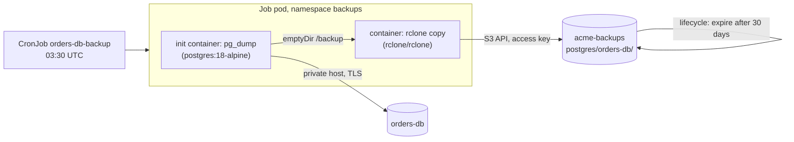

Cloider already backs up every managed database once a day and keeps at least the last 7 backups, which you can
restore into a new database. This guide adds backups that **you** own: a nightly logical dump (`pg_dump` for
PostgreSQL, `mysqldump` for MySQL) that runs as a Kubernetes **CronJob** on a Cloider cluster and is uploaded to a
Cloider **bucket**, kept as long as you decide, downloadable as a file, and restorable anywhere. You also test a
restore, because a backup is only proven by restoring it.

**At a glance**

| | |
| --- | --- |
| **You will build** | A CronJob `orders-db-backup` in the namespace `backups` of the cluster `production` that writes `orders-db-<time>.dump` to `acme-backups/postgres/orders-db/` every night at 03:30 UTC, with backups expiring after 30 days |
| **Products** | [Databases](/databases/overview), [Kubernetes](/kubernetes/overview), [Object Storage](/object-storage/overview) |
| **Tools** | The `cloider` CLI, `kubectl`. For local restores, `pg_restore` (PostgreSQL 18 client) or `mysql` |
| **Difficulty** | Intermediate. You should know what a Kubernetes Secret and a Job are |
| **Time** | About 45 minutes |
| **Cost** | A few minutes of cluster compute per night, bucket storage for the dumps. See [What it costs](#what-it-costs) |

## Why back up a database yourself?

| | Cloider's daily backups | Your own dumps in a bucket (this guide) |
| --- | --- | --- |
| **Setup** | None | One CronJob |
| **Retention** | At least the last 7 daily backups | As long as you decide, with a lifecycle rule |
| **Restore** | Into a new Cloider database, in one click or command | Anywhere: a Cloider database, another provider, your laptop |
| **Download a file** | No | Yes |
| **Survives deleting the database** | No, backups are deleted with it | Yes, they are in a separate bucket |
| **Schedule** | Once a day | Any cron schedule |

Use both: the built-in backups for a quick restore of yesterday's data, and your own dumps for long retention,
compliance, migrations and protection against deleting the database by mistake. See
[Backups and restore](/databases/backups-and-restore).

## What you'll build



1. At 03:30 UTC Kubernetes starts a Job pod.
2. The **init container** runs `pg_dump` against the database's private host and writes a compressed dump to a
   scratch volume, then checks that the file is a readable archive.
3. The **main container** runs only if the dump succeeded, and uploads it to the bucket with
   [rclone](https://rclone.org).
4. A **lifecycle rule** on the bucket deletes dumps older than 30 days.

## Before you begin

- A Cloider account and the CLI, logged in with **Read & Write** access, and `kubectl`. See
  [Install the CLI](/get-started/install-the-cli).
- A database to back up. This guide uses the PostgreSQL database `orders-db` and shows the MySQL database `shop-db` in
  the MySQL tabs. To follow along from scratch:

  ```bash
  cloider db create orders-db --engine postgresql --wait
  ```

- A Kubernetes cluster for the CronJob. To create one:

  ```bash
  cloider cluster create production --wait
  cloider cluster kubeconfig production --merge --use
  ```

  On the free trial (one cluster, one database, one bucket at a time) this guide fits exactly, except the restore
  test in part 6, which creates a second database. On the trial, restore into a PostgreSQL or MySQL server on your
  own computer instead, with the same commands.

## Part 1: Create the backup bucket and its key

Create a private, versioned bucket for the dumps. Versioning keeps a dump that is overwritten or deleted by mistake
recoverable:

```bash
cloider bucket create acme-backups --versioning --wait
```

```text title="Output"
✓ Created bucket acme-backups
✓ Bucket acme-backups is ready
```

Bucket names are shared by every Cloider account: choose your own if `acme-backups` is taken, and use it everywhere
below.

Add a **lifecycle rule** that deletes dumps 30 days after they are written, removes replaced versions after 7 days, and
cleans up unfinished uploads:

```json title="backup-rules.json"
[
  {"id": "expire-dumps", "prefix": "postgres/", "enabled": true, "expire_days": 30, "noncurrent_days": 7, "abort_multipart_days": 1},
  {"id": "expire-mysql-dumps", "prefix": "mysql/", "enabled": true, "expire_days": 30, "noncurrent_days": 7, "abort_multipart_days": 1}
]
```

```bash
cloider bucket lifecycle set acme-backups -f backup-rules.json
```

```text title="Output"
✓ acme-backups now has 2 lifecycle rule(s)
```

Then create an access key that only reaches this bucket. `--print-env` prints the key as shell variables, which you load
straight into this shell for part 3:

```bash
eval "$(cloider bucket key create --label backup-cronjob --bucket acme-backups --print-env)"
echo "$AWS_ENDPOINT_URL $AWS_REGION $AWS_ACCESS_KEY_ID"
```

```text title="Output"
! The secret key is not shown again, keep it now.
https://s3.eu-central-2.cloider.com eu-central-2 CLDRZ8Q4M2X7KD1PLW0B
```

The secret key is in `AWS_SECRET_ACCESS_KEY` in this shell only. See [Lifecycle rules](/object-storage/lifecycle-rules)
and [Access keys](/object-storage/access-keys).

### Verify

```bash
cloider bucket lifecycle get acme-backups
cloider bucket key list
```

```text title="Output"
PREFIX     ENABLED  EXPIRE  NONCURRENT  ABORT UPLOADS
postgres/  yes      30d     7d          1d
mysql/     yes      30d     7d          1d
ACCESS KEY            LABEL           BUCKETS       PERMISSION    STATUS  CREATED
CLDRZ8Q4M2X7KD1PLW0B  backup-cronjob  acme-backups  Read & Write  Ready   2026-10-21 09:12
```

## Part 2: Let the cluster reach the database

The CronJob connects to the database's **private host** from the cluster, so the database must trust the cluster:

<Tabs groupId="engine">
<TabItem value="postgresql" label="PostgreSQL" default>

```bash
cloider db trusted-sources orders-db --add cluster:production
```

</TabItem>
<TabItem value="mysql" label="MySQL">

```bash
cloider db trusted-sources shop-db --add cluster:production
```

</TabItem>
</Tabs>

```text title="Output"
✓ Updated who may connect to orders-db
SOURCE   TYPE      NAME
x8f2kq   Cluster   production
```

If the list was `*` (anywhere), adding the cluster replaces it, so the database now accepts only the cluster. Add other
sources your apps need with more `--add` flags. See [Trusted sources](/databases/trusted-sources).

### Verify

`cloider db get orders-db` shows `cluster:production` under **Trusted sources**.

## Part 3: Store the credentials in the cluster

Create the namespace and two Secrets: the database login for the dump, and the bucket key for rclone. The password is
read straight from the CLI, and the key from the variables part 1 set, so nothing is pasted by hand.

<Tabs groupId="engine">
<TabItem value="postgresql" label="PostgreSQL" default>

```bash
kubectl create namespace backups

DB_JSON=$(cloider db get orders-db -o json)
kubectl create secret generic orders-db-login -n backups \
  --from-literal=PGHOST="$(echo "$DB_JSON" | jq -r .private_host)" \
  --from-literal=PGPORT="$(echo "$DB_JSON" | jq -r .database_port)" \
  --from-literal=PGUSER="$(echo "$DB_JSON" | jq -r .database_user)" \
  --from-literal=PGDATABASE="$(echo "$DB_JSON" | jq -r .database_name)" \
  --from-literal=PGPASSWORD="$(cloider db password orders-db)"

kubectl create secret generic backup-bucket -n backups \
  --from-literal=RCLONE_CONFIG_CLOIDER_ACCESS_KEY_ID="$AWS_ACCESS_KEY_ID" \
  --from-literal=RCLONE_CONFIG_CLOIDER_SECRET_ACCESS_KEY="$AWS_SECRET_ACCESS_KEY" \
  --from-literal=RCLONE_CONFIG_CLOIDER_ENDPOINT="$AWS_ENDPOINT_URL" \
  --from-literal=RCLONE_CONFIG_CLOIDER_REGION="$AWS_REGION"
```

`PGHOST`, `PGPORT`, `PGUSER`, `PGDATABASE` and `PGPASSWORD` are the standard variables every PostgreSQL client reads,
so `pg_dump` needs no connection flags.

</TabItem>
<TabItem value="mysql" label="MySQL">

```bash
kubectl create namespace backups

DB_JSON=$(cloider db get shop-db -o json)
kubectl create secret generic shop-db-login -n backups \
  --from-literal=MYSQL_HOST="$(echo "$DB_JSON" | jq -r .private_host)" \
  --from-literal=MYSQL_TCP_PORT="$(echo "$DB_JSON" | jq -r .database_port)" \
  --from-literal=MYSQL_USER="$(echo "$DB_JSON" | jq -r .database_user)" \
  --from-literal=MYSQL_DATABASE="$(echo "$DB_JSON" | jq -r .database_name)" \
  --from-literal=MYSQL_PWD="$(cloider db password shop-db)"

kubectl create secret generic backup-bucket -n backups \
  --from-literal=RCLONE_CONFIG_CLOIDER_ACCESS_KEY_ID="$AWS_ACCESS_KEY_ID" \
  --from-literal=RCLONE_CONFIG_CLOIDER_SECRET_ACCESS_KEY="$AWS_SECRET_ACCESS_KEY" \
  --from-literal=RCLONE_CONFIG_CLOIDER_ENDPOINT="$AWS_ENDPOINT_URL" \
  --from-literal=RCLONE_CONFIG_CLOIDER_REGION="$AWS_REGION"
```

`MYSQL_HOST`, `MYSQL_TCP_PORT` and `MYSQL_PWD` are read by the MySQL client tools. `MYSQL_USER` and `MYSQL_DATABASE`
are passed as arguments in the manifest.

</TabItem>
</Tabs>

The `RCLONE_CONFIG_CLOIDER_*` variables define an rclone remote called `cloider` without a config file. See
[S3 tools](/object-storage/s3-tools).

### Verify

```bash
kubectl get secrets -n backups
```

```text title="Output"
NAME              TYPE     DATA   AGE
backup-bucket     Opaque   4      8s
orders-db-login   Opaque   5      9s
```

## Part 4: Create the CronJob

<Tabs groupId="engine">
<TabItem value="postgresql" label="PostgreSQL" default>

```yaml title="orders-db-backup.yaml"
apiVersion: batch/v1
kind: CronJob
metadata:
  name: orders-db-backup
  namespace: backups
spec:
  schedule: "30 3 * * *"
  timeZone: "Etc/UTC"
  # Never run two backups at once
  concurrencyPolicy: Forbid
  successfulJobsHistoryLimit: 3
  failedJobsHistoryLimit: 3
  jobTemplate:
    spec:
      backoffLimit: 2
      activeDeadlineSeconds: 3600
      template:
        spec:
          restartPolicy: Never
          volumes:
            - name: backup
              emptyDir: {}
          initContainers:
            # 1. Dump the database. pg_dump's major version must be at least the server's (18).
            - name: dump
              image: postgres:18-alpine
              envFrom:
                - secretRef:
                    name: orders-db-login
              env:
                - name: PGSSLMODE
                  value: require
              command: ["/bin/sh", "-c"]
              args:
                - |
                  set -eu
                  FILE="/backup/orders-db-$(date -u +%Y-%m-%dT%H-%M-%SZ).dump"
                  pg_dump --format=custom --no-owner --no-privileges --file="$FILE"
                  # Fail here if the archive can't be read back
                  pg_restore --list "$FILE" > /dev/null
                  ls -l "$FILE"
              volumeMounts:
                - name: backup
                  mountPath: /backup
              resources:
                requests:
                  cpu: 100m
                  memory: 128Mi
          containers:
            # 2. Upload it. Runs only if the dump succeeded.
            - name: upload
              image: rclone/rclone:1.71
              envFrom:
                - secretRef:
                    name: backup-bucket
              env:
                - name: RCLONE_CONFIG_CLOIDER_TYPE
                  value: s3
                - name: RCLONE_CONFIG_CLOIDER_PROVIDER
                  value: Other
                - name: RCLONE_CONFIG_CLOIDER_NO_CHECK_BUCKET
                  value: "true"
              args: ["copy", "/backup", "cloider:acme-backups/postgres/orders-db/", "-v"]
              volumeMounts:
                - name: backup
                  mountPath: /backup
              resources:
                requests:
                  cpu: 50m
                  memory: 64Mi
```

</TabItem>
<TabItem value="mysql" label="MySQL">

```yaml title="shop-db-backup.yaml"
apiVersion: batch/v1
kind: CronJob
metadata:
  name: shop-db-backup
  namespace: backups
spec:
  schedule: "30 3 * * *"
  timeZone: "Etc/UTC"
  concurrencyPolicy: Forbid
  successfulJobsHistoryLimit: 3
  failedJobsHistoryLimit: 3
  jobTemplate:
    spec:
      backoffLimit: 2
      activeDeadlineSeconds: 3600
      template:
        spec:
          restartPolicy: Never
          volumes:
            - name: backup
              emptyDir: {}
          initContainers:
            # 1. Dump the database with a client of the server's major version (9)
            - name: dump
              image: mysql:9
              envFrom:
                - secretRef:
                    name: shop-db-login
              command: ["/bin/sh", "-c"]
              args:
                - |
                  set -eu
                  FILE="/backup/shop-db-$(date -u +%Y-%m-%dT%H-%M-%SZ).sql"
                  mysqldump --user="$MYSQL_USER" --ssl-mode=REQUIRED \
                    --single-transaction --no-tablespaces --routines --triggers \
                    --set-gtid-purged=OFF --result-file="$FILE" "$MYSQL_DATABASE"
                  # A complete dump ends with this line
                  tail -n 1 "$FILE" | grep -q "Dump completed"
                  ls -l "$FILE"
              volumeMounts:
                - name: backup
                  mountPath: /backup
              resources:
                requests:
                  cpu: 100m
                  memory: 256Mi
          containers:
            # 2. Compress and upload it
            - name: upload
              image: rclone/rclone:1.71
              envFrom:
                - secretRef:
                    name: backup-bucket
              env:
                - name: RCLONE_CONFIG_CLOIDER_TYPE
                  value: s3
                - name: RCLONE_CONFIG_CLOIDER_PROVIDER
                  value: Other
                - name: RCLONE_CONFIG_CLOIDER_NO_CHECK_BUCKET
                  value: "true"
              command: ["/bin/sh", "-c"]
              args:
                - gzip /backup/*.sql && rclone copy /backup cloider:acme-backups/mysql/shop-db/ -v
              volumeMounts:
                - name: backup
                  mountPath: /backup
              resources:
                requests:
                  cpu: 50m
                  memory: 64Mi
```

`--single-transaction` takes a consistent snapshot of InnoDB tables without locking them, and `--no-tablespaces`
avoids a privilege the database user doesn't have. See [MySQL](/databases/mysql).

</TabItem>
</Tabs>

Why it is built this way:

- **Init container, then main container.** Kubernetes runs the upload only after the dump exits successfully, so a
  failed dump never uploads a half written file, and the Job fails visibly instead.
- **`emptyDir`** is scratch space that lives as long as the pod. It is billed as part of the pod, not as a persistent
  volume. For very large databases, see [Troubleshooting](#troubleshooting).
- **A timestamp in every file name**, so each run adds a new object and nothing is overwritten.
- **`concurrencyPolicy: Forbid`** skips a run if the previous one is still going. **`activeDeadlineSeconds`** stops a
  stuck backup after an hour.
- **`timeZone: Etc/UTC`** makes the schedule read the same everywhere. Pick any time, ideally one when the database
  is quiet.

Apply it:

```bash
kubectl apply -f orders-db-backup.yaml
```

```text title="Output"
cronjob.batch/orders-db-backup created
```

### Verify

```bash
kubectl get cronjob -n backups
```

```text title="Output"
NAME               SCHEDULE     TIMEZONE   SUSPEND   ACTIVE   LAST SCHEDULE   AGE
orders-db-backup   30 3 * * *   Etc/UTC    False     0        <none>          5s
```

## Part 5: Run a backup now

Don't wait for the night: start a Job from the CronJob's template and follow it.

```bash
kubectl create job orders-db-backup-manual --from=cronjob/orders-db-backup -n backups
kubectl wait --for=condition=complete job/orders-db-backup-manual -n backups --timeout=15m
kubectl logs job/orders-db-backup-manual -n backups -c dump
kubectl logs job/orders-db-backup-manual -n backups -c upload
```

```text title="Output"
job.batch/orders-db-backup-manual created
job.batch/orders-db-backup-manual condition met
-rw-r--r--    1 root     root       4817203 Oct 21 09:31 /backup/orders-db-2026-10-21T09-30-58Z.dump
2026/10/21 09:31:04 INFO  : orders-db-2026-10-21T09-30-58Z.dump: Copied (new)
2026/10/21 09:31:04 INFO  :
Transferred:   	    4.594 MiB / 4.594 MiB, 100%, 0 B/s, ETA -
Transferred:            1 / 1, 100%
Elapsed time:         1.2s
```

### Verify

The dump is in the bucket:

```bash
cloider bucket ls acme-backups postgres/orders-db/
```

```text title="Output"
KEY                                                    SIZE     MODIFIED
postgres/orders-db/orders-db-2026-10-21T09-30-58Z.dump 4.6 MB   2026-10-21 09:31
```

You can also browse it in the dashboard, on the bucket's **Files** tab.

<Screenshot
  src="/img/screenshots/object-storage/detail-files.webp"
  url="/dashboard/buckets/acme-backups"
  alt="The Files tab of a bucket listing folders and files with their size and modification date"
  caption="Backups appear in the bucket's Files tab."
/>

Clean up the manual Job when you are done looking at it: `kubectl delete job orders-db-backup-manual -n backups`.

## Part 6: Restore a backup

Practice a restore now, while nothing is on fire, and repeat it regularly (for example monthly). There are three ways,
from safest to most invasive.

### Restore into a new database (recommended)

Create an empty database, download the dump, and load it. Your production database is never touched, and you can
compare the two before switching anything over.

<Tabs groupId="engine">
<TabItem value="postgresql" label="PostgreSQL" default>

```bash
# A new database, reachable from this computer
cloider db create orders-db-restore --engine postgresql --allow-my-ip --wait

# The newest dump
KEY=$(cloider bucket ls acme-backups postgres/orders-db/ -o json | jq -r '.objects | map(.key) | sort | last')
cloider bucket download acme-backups "$KEY" -d ./

# Load it, as the new database's user
RESTORE_JSON=$(cloider db get orders-db-restore -o json)
PGPASSWORD="$(cloider db password orders-db-restore)" PGSSLMODE=require \
  pg_restore --no-owner --no-privileges --jobs 4 \
    -h "$(echo "$RESTORE_JSON" | jq -r .host)" \
    -p "$(echo "$RESTORE_JSON" | jq -r .database_port)" \
    -U "$(echo "$RESTORE_JSON" | jq -r .database_user)" \
    -d "$(echo "$RESTORE_JSON" | jq -r .database_name)" \
    "$(basename "$KEY")"
```

`pg_restore` must be version 18 or later, the version of the dump. `--no-owner --no-privileges` makes every object
belong to the new database's user.

</TabItem>
<TabItem value="mysql" label="MySQL">

```bash
cloider db create shop-db-restore --engine mysql --allow-my-ip --wait

KEY=$(cloider bucket ls acme-backups mysql/shop-db/ -o json | jq -r '.objects | map(.key) | sort | last')
cloider bucket download acme-backups "$KEY" -d ./

RESTORE_JSON=$(cloider db get shop-db-restore -o json)
gunzip -c "$(basename "$KEY")" | \
  MYSQL_PWD="$(cloider db password shop-db-restore)" mysql --ssl-mode=REQUIRED \
    -h "$(echo "$RESTORE_JSON" | jq -r .host)" \
    -P "$(echo "$RESTORE_JSON" | jq -r .database_port)" \
    -u "$(echo "$RESTORE_JSON" | jq -r .database_user)" \
    "$(echo "$RESTORE_JSON" | jq -r .database_name)"
```

A small dump (under 2 MiB uncompressed) can also be loaded without any local client:
`gunzip -c dump.sql.gz | cloider db exec -i shop-db-restore`.

</TabItem>
</Tabs>

`cloider bucket ls -o json` prints the folder's `objects` with their `key`, `size` and `last_modified`, and the timestamp in each file name makes the newest one sort last. If you have `aws` or `rclone` set up with a
key for the bucket, they download just as well. See [Manage files](/object-storage/manage-files).

### Restore inside the cluster

For large dumps, or without the client tools on your computer, run the restore as a Job in the cluster. It downloads
the dump with rclone into scratch space and runs `pg_restore` there, against a target database the cluster can reach:

```bash
# The target's login, like orders-db-login in part 3
DB_JSON=$(cloider db get orders-db-restore -o json)
cloider db trusted-sources orders-db-restore --add cluster:production
kubectl create secret generic orders-db-restore-login -n backups \
  --from-literal=PGHOST="$(echo "$DB_JSON" | jq -r .private_host)" \
  --from-literal=PGPORT="$(echo "$DB_JSON" | jq -r .database_port)" \
  --from-literal=PGUSER="$(echo "$DB_JSON" | jq -r .database_user)" \
  --from-literal=PGDATABASE="$(echo "$DB_JSON" | jq -r .database_name)" \
  --from-literal=PGPASSWORD="$(cloider db password orders-db-restore)"
```

```yaml title="orders-db-restore-job.yaml"
apiVersion: batch/v1
kind: Job
metadata:
  name: orders-db-restore
  namespace: backups
spec:
  backoffLimit: 0
  template:
    spec:
      restartPolicy: Never
      volumes:
        - name: backup
          emptyDir: {}
      initContainers:
        - name: download
          image: rclone/rclone:1.71
          envFrom:
            - secretRef:
                name: backup-bucket
          env:
            - name: RCLONE_CONFIG_CLOIDER_TYPE
              value: s3
            - name: RCLONE_CONFIG_CLOIDER_PROVIDER
              value: Other
            - name: RCLONE_CONFIG_CLOIDER_NO_CHECK_BUCKET
              value: "true"
          # The dump to restore, as listed by cloider bucket ls
          args: ["copyto", "cloider:acme-backups/postgres/orders-db/orders-db-2026-10-21T09-30-58Z.dump", "/backup/restore.dump", "-v"]
          volumeMounts:
            - name: backup
              mountPath: /backup
      containers:
        - name: restore
          image: postgres:18-alpine
          envFrom:
            - secretRef:
                name: orders-db-restore-login
          env:
            - name: PGSSLMODE
              value: require
          command: ["pg_restore", "--no-owner", "--no-privileges", "--jobs=4", "--dbname=$(PGDATABASE)", "/backup/restore.dump"]
          volumeMounts:
            - name: backup
              mountPath: /backup
```

```bash
kubectl apply -f orders-db-restore-job.yaml
kubectl wait --for=condition=complete job/orders-db-restore -n backups --timeout=30m
kubectl logs job/orders-db-restore -n backups -c restore
```

### Restore over the original database (last resort)

To put the data back into `orders-db` itself, run the same `pg_restore` against it with `--clean --if-exists`, which
drops each object before recreating it. Everything written since the dump is lost, so stop the apps that write to it
first, and take a fresh dump right before you start. Most of the time, restoring into a new database and pointing the
app at it is the safer move.

### Verify

Compare the restored data with production:

```bash
cloider db exec orders-db "SELECT count(*), max(created_at) FROM orders"
cloider db exec orders-db-restore "SELECT count(*), max(created_at) FROM orders"
```

The counts match the time of the dump: rows written after 09:30 UTC are only in production.

## Watch for failed backups

A backup job that fails quietly is worse than none. Check it from time to time, or wire it into your monitoring:

```bash
kubectl get jobs -n backups
kubectl get cronjob orders-db-backup -n backups -o jsonpath='{.status.lastSuccessfulTime}{"\n"}'
```

- A Job whose `COMPLETIONS` stays `0/1` failed. `kubectl logs job/<name> -n backups -c dump` shows why.
- `lastSuccessfulTime` older than a day means the last nights failed.
- For alerts, add a last step to the upload container that calls a dead man's switch service (a URL that alerts you
  when it is *not* called), for example `&& wget -q -O- https://hc.example.com/ping/<uuid>` after the `rclone copy`.

## Harden the backups

- **A key that can't delete.** The `backup-cronjob` key only needs to add files. A bucket policy can deny it
  `s3:DeleteObject`, and deny everyone deleting versions or changing versioning, so a leaked key can't destroy the
  backups. The full recipe is in [Data protection](/object-storage/data-protection).
- **More engines.** MongoDB works the same way with `mongodump --uri ... --gzip --archive=/backup/...` in a `mongo`
  image; Redis with `redis-cli --rdb /backup/dump.rdb`. Use the database's private host and, with SSL on, its CA
  certificate (`cloider db cert <database> -f ca.crt`, stored in the Secret). See [MongoDB](/databases/mongodb) and
  [Redis](/databases/redis).
- **Several databases.** Add one CronJob per database, each with its own login Secret and its own prefix in the bucket.

## What it costs

| Resource | How it is billed |
| --- | --- |
| Backup pods | Cluster compute units while the Job runs, usually a few minutes a night. Each container counts the larger of its request and its use |
| Bucket `acme-backups` | Per GiB stored per month, averaged over the month. The lifecycle rule keeps about 30 dumps; replaced versions add a little for 7 days. Requests and traffic are free |
| Database `orders-db-restore` | Its plan's monthly price, prorated, for as long as it exists. Delete it after the restore test |
| Cluster `production` | Its own compute, if you created it for this guide |

See [Pricing](/reference/pricing) and [Bucket usage and billing](/object-storage/usage-and-billing).

## Clean up

```bash
# The restore test database
cloider db delete orders-db-restore --yes --wait

# The CronJob, its Jobs and Secrets
kubectl delete namespace backups

# The bucket key, then the bucket with every backup in it
cloider bucket key delete backup-cronjob --yes
cloider bucket delete acme-backups --yes --wait

# What you created only for this guide
cloider db trusted-sources orders-db --remove cluster:production
cloider cluster delete production --yes --wait
cloider db delete orders-db --yes --wait
```

Deleting the bucket deletes every dump in it. Download the ones you want to keep first.

## Troubleshooting

| Symptom | Cause and fix |
| --- | --- |
| The `dump` container logs `connection to server ... timed out` | The database doesn't trust the cluster, or `PGHOST` is the public host. Run part 2 and check the Secret |
| `server version: 18.0; pg_dump version: 17...` and `aborting because of server version mismatch` | The image's `pg_dump` is older than the server. Use `postgres:18-alpine` |
| `password authentication failed` | The password in the Secret is wrong. Recreate `orders-db-login` |
| `mysqldump: Got error: 1045: Access denied` | Wrong user or password in `shop-db-login` |
| `mysqldump: Error: 'Access denied; you need (at least one of) the PROCESS privilege(s)'` | `--no-tablespaces` is missing |
| The `upload` container logs `AccessDenied` | The key doesn't reach `acme-backups`, or a bucket policy denies it. Check `cloider bucket key list` |
| The `upload` container logs `NoSuchBucket` | The bucket name in the `copy` destination is wrong |
| The pod is `OOMKilled` or evicted during a large dump | Raise the dump container's memory request. For dumps of many GiB, mount a PersistentVolumeClaim instead of `emptyDir`, see [Persistent volumes](/kubernetes/persistent-volumes) |
| `pg_restore: error: unsupported version (1.16) in file header` | Your local `pg_restore` is older than the dump. Install the PostgreSQL 18 client, or restore inside the cluster |
| The CronJob never runs | `kubectl describe cronjob orders-db-backup -n backups` shows events. A paused cluster runs no Jobs |

More in [Database troubleshooting](/databases/troubleshooting) and [Kubernetes troubleshooting](/kubernetes/troubleshooting).

## Next steps

- [Backups and restore](/databases/backups-and-restore): Cloider's own daily backups and one-click restores.
- [Data protection](/object-storage/data-protection): make the backup bucket safe from leaked keys.
- [Lifecycle rules](/object-storage/lifecycle-rules): tiered retention per prefix.
- [Migrate to Cloider](/guides/migrate-to-cloider): the same dump and restore tools for moving databases.

<FAQ items={[
  {q: 'Does Cloider back up my database automatically?', a: 'Yes. Every managed database is backed up once a day, and at least the last 7 backups are kept. You restore one into a new database from the Backups tab or with cloider db restore. The backups can\'t be downloaded and are deleted with the database, which is why you may want your own dumps as well.'},
  {q: 'How do I run pg_dump on a schedule on Cloider?', a: 'Create a Kubernetes CronJob on a Cloider cluster with a postgres image whose version matches the server, give it the database\'s private host, port, user, password and database name through a Secret, and add the cluster to the database\'s trusted sources.'},
  {q: 'How do I upload a database dump to a Cloider bucket?', a: 'Use any S3 tool with a bucket access key, the endpoint https://s3.eu-central-2.cloider.com and the region eu-central-2. This guide uses rclone, configured with RCLONE_CONFIG_CLOIDER_* environment variables, to copy the dump into the bucket.'},
  {q: 'How long are my own backups kept?', a: 'As long as you decide. A lifecycle rule on the bucket deletes objects under a prefix a number of days after they were written, for example 30. Without a rule, dumps are kept until you delete them, and billed by the GiB stored.'},
  {q: 'How do I restore a pg_dump backup into a Cloider database?', a: 'Download the dump from the bucket, then run pg_restore --no-owner --no-privileges against the database\'s public host with its user and password, with your IP in its trusted sources. For large dumps, run pg_restore in a Job inside a Cloider cluster instead.'},
]} />
