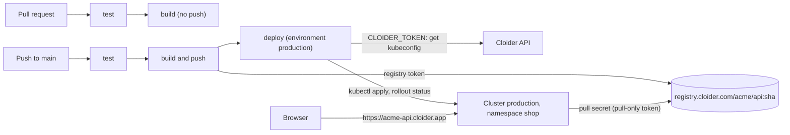

In this guide you build a complete continuous delivery pipeline with GitHub Actions: every pull request is tested and
its image is built, and every push to `main` is tested, built into a container image, pushed to the
[Cloider Container Registry](/container-registry/overview) with a registry token, and rolled out to a
[Cloider Kubernetes cluster](/kubernetes/overview) with `kubectl`. A second, shorter workflow shows the alternative for
[Cloider apps](/apps/overview): one `cloider deploy` command with a `CLOIDER_TOKEN`.

**At a glance**

| | |
| --- | --- |
| **You will build** | A Node.js API `api`, built into `registry.cloider.com/acme/api:<commit>`, running as two pods in the `shop` namespace of the cluster `production`, at `https://acme-api.cloider.app` |
| **Products** | [Container Registry](/container-registry/overview), [Kubernetes](/kubernetes/overview), [Domains](/domains/overview), and [Apps](/apps/overview) for the alternative |
| **Tools** | GitHub Actions, the `cloider` CLI, `kubectl`, Docker. Optional: the GitHub CLI `gh` |
| **Difficulty** | Intermediate. You should know git, Docker and basic Kubernetes |
| **Time** | About 40 minutes |
| **Cost** | A registry project (storage), a cluster (compute), nothing for GitHub's own runners beyond your GitHub plan. See [What it costs](#what-it-costs) |

## What you'll build



The pipeline uses three credentials, each with the least access it needs:

| Credential | Where it lives | What it can do |
| --- | --- | --- |
| Registry token `github-actions` (**Pull & push**, project `acme`, 1 year) | GitHub secrets `CLOIDER_REGISTRY_USERNAME`, `CLOIDER_REGISTRY_PASSWORD` | Push and pull images in `acme`, nothing else |
| Registry token `production-pull` (**Pull only**) | Kubernetes Secret `cloider-registry` in the cluster | Pull images from `acme` |
| API token (**Read**) | GitHub secret `CLOIDER_TOKEN` | Read your Cloider account, including the cluster's kubeconfig. It can't create, change or delete anything in Cloider |

The kubeconfig itself is never stored in GitHub: the deploy job fetches it with the API token on every run.

## Before you begin

- A Cloider account and the CLI, logged in with **Read & Write** access, see [Install the CLI](/get-started/install-the-cli).
- `kubectl` and Docker on your computer, for the one-time setup.
- A GitHub repository for the code, here `acme/api`, and permission to add Actions secrets and environments to it.
- Optional: the [GitHub CLI](https://cli.github.com/) (`gh`), to set secrets from the terminal.

## Part 1: Create the registry project

A registry project holds your images at `registry.cloider.com/<project>/<repository>:<tag>`. Project names are shared by
every Cloider account, so pick your own if `acme` is taken.

```bash
cloider registry create acme --wait
```

```text title="Output"
✓ Created project acme
✓ Project acme is ready
Push images to registry.cloider.com/acme/<repository>:<tag>, after `cloider registry login`.
```

See [Create a project](/container-registry/create-a-project) for the options (public pulls, storage limit, immutable
tags).

### Verify

```bash
cloider registry get acme
```

The project is `Ready`.

## Part 2: Prepare the cluster

Create the cluster, connect `kubectl`, create the namespace, and give the namespace a pull secret so its pods can pull
private images from `acme`.

```bash
cloider cluster create production --wait
cloider cluster kubeconfig production --merge --use
kubectl create namespace shop
```

Create a **pull-only** registry token for the cluster. `-q` prints only the username and the secret, one per line, so
you can feed them straight into the Secret without copying:

```bash
{ read -r REG_USER; read -r REG_SECRET; } < <(
  cloider registry token create --label production-pull --project acme --read-only -q
)

kubectl create secret docker-registry cloider-registry \
  --docker-server=registry.cloider.com \
  --docker-username="$REG_USER" \
  --docker-password="$REG_SECRET" \
  -n shop
```

```text title="Output"
secret/cloider-registry created
```

The `-n shop` matters: a Secret only works for pods in its own namespace. See
[Pull private images](/kubernetes/pull-private-images).

### Verify

```bash
kubectl get secret cloider-registry -n shop
cloider registry token list
```

```text title="Output"
NAME               TYPE                             DATA   AGE
cloider-registry   kubernetes.io/dockerconfigjson   1      12s
USERNAME  LABEL            PROJECTS  PERMISSION  EXPIRES  STATUS  CREATED
acme      production-pull  acme      Pull        never    Ready   2026-10-20 10:02
```

## Part 3: Create the pipeline's credentials

### A registry token for pushing

```bash
cloider registry token create --label github-actions --project acme --expires-days 365
```

```text title="Output"
✓ Created registry token github-actions
Username:    acme
Secret:      xxxxxxxxxxxxxxxxxxxxxxxxxxxxxxxxxxxxxxxxxxxxxxxx
Host:        registry.cloider.com
Projects:    acme
Permission:  Pull & Push
Expires:     2027-10-20 10:04
...
! The secret is not shown again, keep it now.
```

### An API token for the deploy job

API tokens are created in the dashboard only, so a leaked token can't create more tokens:

1. Open **Access Control** in the sidebar and choose the **API Tokens** tab.
2. Click **Generate API token**.
3. **Description**: `GitHub Actions acme/api`. **Permissions**: **Read**.
4. Click **Generate API token**, copy the `cldr_...` token, and click **I've saved the token**.

<Screenshot
  src="/img/screenshots/account/api-token-create.webp"
  url="/dashboard/access-control"
  alt="The Generate API token dialog with a Description field and the Read or Read & Write permission choice"
  caption="A Read token is enough to fetch a kubeconfig."
/>

A **Read** token is enough here: downloading a kubeconfig is a read. Everything the deploy job then does inside the
cluster is authorized by the kubeconfig, not by the API token. See [API tokens](/account/api-tokens).

### Store them as GitHub secrets

In the repository on GitHub, open **Settings**, **Secrets and variables**, **Actions**, and add three repository
secrets. With the GitHub CLI:

```bash
gh secret set CLOIDER_REGISTRY_USERNAME --repo acme/api --body "acme"
gh secret set CLOIDER_REGISTRY_PASSWORD --repo acme/api     # paste the registry token's secret
gh secret set CLOIDER_TOKEN --repo acme/api                 # paste the cldr_... API token
```

Then create an **environment** called `production` (**Settings**, **Environments**, **New environment**). The deploy job
runs in it, so you can add required reviewers or restrict it to the `main` branch later.

### Verify

```bash
gh secret list --repo acme/api
```

```text title="Output"
CLOIDER_REGISTRY_PASSWORD   Updated 2026-10-20
CLOIDER_REGISTRY_USERNAME   Updated 2026-10-20
CLOIDER_TOKEN               Updated 2026-10-20
```

## Part 4: Add the application and its manifests

The application is a tiny HTTP API with a health check and a test, so the pipeline has something real to test, build
and deploy. Any language works the same way: the pipeline only cares about the `Dockerfile` and the manifests.

```text
api/
  .dockerignore
  .github/workflows/deploy.yml     part 5
  Dockerfile
  k8s/api.yaml
  package.json
  package-lock.json                created by npm install
  app.js
  server.js
  test/app.test.js
```

```json title="package.json"
{
  "name": "api",
  "version": "1.0.0",
  "private": true,
  "scripts": {
    "start": "node server.js",
    "test": "node --test"
  },
  "engines": {
    "node": "22.x"
  }
}
```

```js title="app.js"
// The request handler, kept apart from server.js so tests can start it on any port.
function handler(req, res) {
  const json = (status, body) => {
    res.writeHead(status, { "Content-Type": "application/json" });
    res.end(JSON.stringify(body));
  };
  if (req.url === "/healthz") return json(200, { status: "ok" });
  if (req.url === "/") return json(200, { service: "api", version: process.env.APP_VERSION || "dev" });
  return json(404, { error: "not found" });
}

module.exports = { handler };
```

```js title="server.js"
const http = require("node:http");
const { handler } = require("./app");

const port = Number(process.env.PORT) || 8080;
const server = http.createServer(handler);
server.listen(port, "0.0.0.0", () => console.log(`api listening on port ${port}`));

// Finish open requests when Kubernetes stops the pod during a rollout
process.on("SIGTERM", () => server.close(() => process.exit(0)));
```

```js title="test/app.test.js"
const test = require("node:test");
const assert = require("node:assert");
const http = require("node:http");
const { handler } = require("../app");

test("health check answers ok", async () => {
  const server = http.createServer(handler).listen(0);
  const { port } = server.address();
  try {
    const res = await fetch(`http://127.0.0.1:${port}/healthz`);
    assert.strictEqual(res.status, 200);
    assert.deepStrictEqual(await res.json(), { status: "ok" });
  } finally {
    server.close();
  }
});
```

```dockerfile title="Dockerfile"
FROM node:22-alpine
WORKDIR /app
COPY package*.json ./
RUN npm ci --omit=dev
COPY . .
# The commit being built, shown by GET /
ARG APP_VERSION=dev
ENV APP_VERSION=$APP_VERSION NODE_ENV=production
USER node
EXPOSE 8080
CMD ["node", "server.js"]
```

```text title=".dockerignore"
node_modules
.git
.github
test
```

The Kubernetes manifest uses the placeholder `IMAGE`, which the deploy job replaces with the exact image it just
pushed:

```yaml title="k8s/api.yaml"
apiVersion: apps/v1
kind: Deployment
metadata:
  name: api
  namespace: shop
  labels:
    app: api
spec:
  replicas: 2
  selector:
    matchLabels:
      app: api
  strategy:
    type: RollingUpdate
    rollingUpdate:
      maxUnavailable: 0
      maxSurge: 1
  template:
    metadata:
      labels:
        app: api
    spec:
      imagePullSecrets:
        - name: cloider-registry
      containers:
        - name: api
          image: IMAGE
          ports:
            - name: http
              containerPort: 8080
          resources:
            requests:
              cpu: 50m
              memory: 64Mi
            limits:
              memory: 128Mi
          readinessProbe:
            httpGet:
              path: /healthz
              port: http
            periodSeconds: 5
          livenessProbe:
            httpGet:
              path: /healthz
              port: http
            initialDelaySeconds: 10
            periodSeconds: 20
---
apiVersion: v1
kind: Service
metadata:
  name: api
  namespace: shop
spec:
  selector:
    app: api
  ports:
    - name: http
      port: 80
      targetPort: http
```

`maxUnavailable: 0` keeps both old pods serving until a new one is ready, and the readiness probe decides when that is,
so a broken image never takes the API down.

Create the lockfile and run the test once locally:

```bash
npm install
npm test
```

```text title="Output"
✔ health check answers ok (12.3ms)
ℹ tests 1
ℹ pass 1
ℹ fail 0
```

### Verify

`npm test` passes and `docker build -t api-local .` builds the image on your computer.

## Part 5: Write the workflow

```yaml title=".github/workflows/deploy.yml"
name: Test, build and deploy

on:
  pull_request:
  push:
    branches: [main]

env:
  REGISTRY: registry.cloider.com
  IMAGE: registry.cloider.com/acme/api
  CLUSTER: production
  NAMESPACE: shop

jobs:
  test:
    runs-on: ubuntu-latest
    steps:
      - uses: actions/checkout@v4
      - uses: actions/setup-node@v4
        with:
          node-version: 22
          cache: npm
      - run: npm ci
      - run: npm test

  build:
    needs: test
    runs-on: ubuntu-latest
    permissions:
      contents: read
    steps:
      - uses: actions/checkout@v4

      - uses: docker/setup-buildx-action@v3

      - name: Log in to the Cloider registry
        if: github.event_name == 'push'
        uses: docker/login-action@v3
        with:
          registry: ${{ env.REGISTRY }}
          username: ${{ secrets.CLOIDER_REGISTRY_USERNAME }}
          password: ${{ secrets.CLOIDER_REGISTRY_PASSWORD }}

      - name: Build, and push on main
        uses: docker/build-push-action@v6
        with:
          context: .
          platforms: linux/amd64
          push: ${{ github.event_name == 'push' }}
          tags: ${{ env.IMAGE }}:sha-${{ github.sha }}
          build-args: APP_VERSION=${{ github.sha }}
          cache-from: type=gha
          cache-to: type=gha,mode=max

  deploy:
    needs: build
    if: github.event_name == 'push' && github.ref == 'refs/heads/main'
    runs-on: ubuntu-latest
    environment: production
    # One rollout at a time; a newer push waits for the running one
    concurrency:
      group: deploy-production
      cancel-in-progress: false
    env:
      CLOIDER_TOKEN: ${{ secrets.CLOIDER_TOKEN }}
    steps:
      - uses: actions/checkout@v4

      - uses: azure/setup-kubectl@v4

      - name: Install the Cloider CLI
        run: |
          curl -fsSL https://cloider.com/install.sh | CLOIDER_INSTALL_DIR="$HOME/.local/bin" sh
          echo "$HOME/.local/bin" >> "$GITHUB_PATH"

      - name: Get the kubeconfig
        run: |
          mkdir -p "$HOME/.kube"
          cloider cluster kubeconfig "$CLUSTER" -f "$HOME/.kube/config"
          kubectl version

      - name: Roll out the new image
        run: |
          sed "s|image: IMAGE|image: $IMAGE:sha-$GITHUB_SHA|" k8s/api.yaml | kubectl apply -f -
          if ! kubectl rollout status deployment/api -n "$NAMESPACE" --timeout=5m; then
            echo "Rollout failed, rolling back"
            kubectl rollout undo deployment/api -n "$NAMESPACE"
            exit 1
          fi
```

How it fits together:

- **Pull requests** run `test` and `build` without logging in or pushing, so a pull request from a fork never sees
  your secrets.
- **Pushes to `main`** push `registry.cloider.com/acme/api:sha-<commit>`. A unique tag per commit means every
  rollout is traceable, and it works even if you turn on [immutable tags](/container-registry/immutable-tags) later.
- **The deploy job** installs the CLI into `~/.local/bin`, fetches the kubeconfig with the Read API token (the `.kube`
  folder has to exist before `-f` writes into it), and applies the manifest with the new image. If the new pods don't
  become ready within 5 minutes, it rolls back and fails the run.
- **Automatic CLI updates** are off when the `CI` variable is set, which GitHub Actions does, so each run uses the CLI
  it installed. See [Install the CLI](/cli/install).

Commit everything and push:

```bash
git add .
git commit -m "API with CI/CD"
git push origin main
```

### Verify

On GitHub, open **Actions**: the run shows `test`, `build` and `deploy` in green. Then check the cluster and the
registry:

```bash
kubectl get pods -n shop
kubectl get deployment api -n shop -o jsonpath='{.spec.template.spec.containers[0].image}{"\n"}'
cloider registry images acme api
```

```text title="Output"
NAME                   READY   STATUS    RESTARTS   AGE
api-7f9c6d5b8d-4qzkp   1/1     Running   0          41s
api-7f9c6d5b8d-v8m2n   1/1     Running   0          33s
registry.cloider.com/acme/api:sha-4f2a9c1e8b7d6a5f4e3d2c1b0a9f8e7d6c5b4a39
```

`cloider registry images acme api` lists the image with its `sha-...` tag.

## Part 6: Put the API on the internet

Route a free subdomain to the `api` Service with a target. Cloider terminates HTTPS and forwards plain HTTP to port 80
of the Service:

```bash
cloider domain create acme-api.cloider.app
cloider target create acme-api.cloider.app --cluster production --service shop/api
```

```text title="Output"
✓ Claimed acme-api.cloider.app
Route it with `cloider target create acme-api.cloider.app --app <app>`.
✓ Routed acme-api.cloider.app/ to production/shop/api:80
```

### Verify

```bash
curl -s https://acme-api.cloider.app/
```

```text title="Output"
{"service":"api","version":"4f2a9c1e8b7d6a5f4e3d2c1b0a9f8e7d6c5b4a39"}
```

Push another commit to `main`, and once the run is green the `version` changes to the new commit. To serve the API on
your own domain, see [Expose services](/kubernetes/expose-services).

## Alternative: deploy a Cloider app with cloider deploy

If you don't need Kubernetes, a [Cloider app](/apps/overview) is simpler: Cloider builds the code (with your
`Dockerfile`, or a buildpack) and runs it, and the pipeline only has to run `cloider deploy`. You don't need a registry
project, registry tokens or a kubeconfig.

**1. Create the app once**, from your computer, in the repository folder. The first deploy creates the app and links
the folder to it:

```bash
cloider deploy --name api --port 8080
```

```text title="Output"
Packaged 9 files (6.1 KB)
Detected JavaScript
✓ Created app api on port 8080
Linked . to api in .cloider/app.json, later deploys from here update it.
...
✓ Deployed version 1 of api
https://api-x7k2.cloider.app/
```

**2. Create a Read & Write API token** in **Access Control**, **API Tokens**, described `GitHub Actions deploy`, and
store it as the `CLOIDER_TOKEN` secret (replace the Read token from part 3 if you use the same repository).

**3. Add the workflow:**

```yaml title=".github/workflows/app.yml"
name: Test and deploy the app

on:
  push:
    branches: [main]

concurrency:
  group: deploy-app
  cancel-in-progress: false

jobs:
  test:
    runs-on: ubuntu-latest
    steps:
      - uses: actions/checkout@v4
      - uses: actions/setup-node@v4
        with:
          node-version: 22
          cache: npm
      - run: npm ci
      - run: npm test

  deploy:
    needs: test
    runs-on: ubuntu-latest
    environment: production
    env:
      CLOIDER_TOKEN: ${{ secrets.CLOIDER_TOKEN }}
    steps:
      - uses: actions/checkout@v4

      - name: Install the Cloider CLI
        run: |
          curl -fsSL https://cloider.com/install.sh | CLOIDER_INSTALL_DIR="$HOME/.local/bin" sh
          echo "$HOME/.local/bin" >> "$GITHUB_PATH"

      - name: Deploy
        id: deploy
        run: echo "url=$(cloider deploy --app api)" >> "$GITHUB_OUTPUT"

      - name: Smoke test
        run: curl -fsS "${{ steps.deploy.outputs.url }}healthz"
```

- `cloider deploy --app api` zips the checkout (leaving out what `.gitignore` and `.cloiderignore` list), uploads it,
  streams the build log into the job log, and fails the step if the build fails or the app doesn't start. Build output
  goes to stderr and the URL to stdout, which is why `$(...)` captures only the URL.
- `--app api` deploys to the app by name, so the `.cloider/app.json` link file doesn't need to be committed.
- To run database migrations after a deploy, add a step such as
  `cloider app exec --timeout 15m api -- npm run migrate`. See [Terminal and exec](/apps/terminal-and-exec).
- An app builds one version at a time. The `concurrency` group makes a second push wait instead of failing with
  `This app is already building, wait for that build to finish before deploying a new version!`.

:::tip[Git deploys need no workflow at all]
An app created from a GitHub repository with `cloider app create --git github --repo acme/api` deploys every push to
its branch by itself. Use a workflow with `cloider deploy` when you want tests or other checks to gate the deploy,
and don't mix the two on one app. See [Deploy from git](/apps/deploy-from-git).
:::

### Verify

The run is green, the `Deploy` step's log ends with `✓ Deployed version 2 of api`, and:

```bash
cloider app builds api
```

lists the new version as `Ready`.

## What it costs

| Resource | How it is billed |
| --- | --- |
| Registry project `acme` | Per GiB of image data stored per month. Every commit adds an image: keep it in check with a [retention policy](/container-registry/retention-policies). Pushes and pulls are free |
| Cluster `production` | Compute units for its running containers, including its control plane. The two `api` pods are billed for at least their `50m` CPU and `64Mi` memory requests |
| App `api` (alternative) | Compute units for its one container while it runs. Builds are free |
| Domains, targets, registry tokens, API tokens | Free |
| GitHub Actions minutes | Billed by GitHub under your GitHub plan, not by Cloider |

See [Pricing](/reference/pricing) and the [billing model](/concepts/billing-model).

## Clean up

```bash
# The route and the subdomain
cloider domain delete acme-api.cloider.app --yes

# The workload, then the cluster
kubectl delete namespace shop
cloider cluster delete production --yes --wait

# The registry tokens and the project with all its images
cloider registry token delete github-actions --yes
cloider registry token delete production-pull --yes
cloider registry delete acme --yes --wait

# The app, if you followed the alternative
cloider app delete api --yes
```

Then delete the API token in **Access Control**, **API Tokens**, and the three secrets and the `production` environment
in the GitHub repository's settings (`gh secret delete CLOIDER_TOKEN --repo acme/api`, and so on).

## Troubleshooting

| Error in the run | Cause and fix |
| --- | --- |
| `unauthorized` at **Log in to the Cloider registry** | Wrong username or secret, or the token expired or was deleted. The username is your registry username (`acme` here), shown with the token |
| `denied: requested access to the resource is denied` on push | The token is **Pull only**, or doesn't cover the project in the image name |
| `not logged in` or exit code `3` at **Get the kubeconfig** | `CLOIDER_TOKEN` is missing, mistyped or deleted. Check the secret's name and generate a new token |
| `open /home/runner/.kube/config: no such file or directory` | The `.kube` folder doesn't exist. Keep the `mkdir -p "$HOME/.kube"` line |
| `cloider: command not found` | `~/.local/bin` isn't on the `PATH` of later steps. Keep the `echo ... >> "$GITHUB_PATH"` line |
| Pods stay in `ImagePullBackOff` | The `cloider-registry` Secret is missing from the `shop` namespace, or its token was deleted. Run `kubectl describe pod -n shop` and recreate the Secret with `-n shop` |
| `error: deployment "api" exceeded its progress deadline` | The new pods never became ready. `kubectl logs -n shop deploy/api` shows why. The job rolled back to the previous version |
| `exit code 5` or `This API token is read only!` in the app workflow | `cloider deploy` needs a **Read & Write** token |
| `This app is already building...` | Two deploys overlapped. Keep the `concurrency` group |

More in [Container registry troubleshooting](/container-registry/troubleshooting),
[Kubernetes troubleshooting](/kubernetes/troubleshooting) and [Output and scripting](/cli/output-and-scripting).

## Next steps

- [CI/CD with GitLab](/guides/ci-cd-with-gitlab): the same pipeline as a `.gitlab-ci.yml`.
- [Retention policies](/container-registry/retention-policies): delete old `sha-*` images on a schedule.
- [Infrastructure as code with Terraform](/guides/infrastructure-as-code-with-terraform): create the cluster, the
  project and the tokens with Terraform, and write the GitHub secrets from it.
- [Registry CI/CD reference](/container-registry/ci-cd): multi-platform builds, other CI systems.

<FAQ items={[
  {q: 'How do I push to the Cloider registry from GitHub Actions?', a: 'Create a registry token with Pull & push permission for the project, store its username and secret as repository secrets, log in with docker/login-action to registry.cloider.com, and push with docker/build-push-action to registry.cloider.com/<project>/<repository>:<tag>.'},
  {q: 'How does GitHub Actions get the kubeconfig of a Cloider cluster?', a: 'Install the cloider CLI in the job, set CLOIDER_TOKEN from a secret, create the ~/.kube folder and run cloider cluster kubeconfig <cluster> -f ~/.kube/config. A Read API token is enough, because downloading a kubeconfig is a read.'},
  {q: 'Should I store the kubeconfig as a GitHub secret?', a: 'You can, but fetching it with a Read API token keeps one fewer long-lived admin credential in GitHub. The kubeconfig grants full admin access to the cluster and stays valid for the cluster\'s lifetime.'},
  {q: 'How do I deploy a Cloider app from GitHub Actions?', a: 'Install the CLI, set CLOIDER_TOKEN to a Read & Write API token, and run cloider deploy --app <app>. It uploads the checkout, streams the build log, fails the job if the build fails, and prints the app\'s URL on stdout.'},
  {q: 'How do I roll back a bad deploy?', a: 'For Kubernetes, kubectl rollout undo deployment/<name> -n <namespace> returns to the previous ReplicaSet; the workflow in this guide does it automatically when the rollout fails. For an app, push a revert commit or redeploy an earlier commit.'},
]} />
