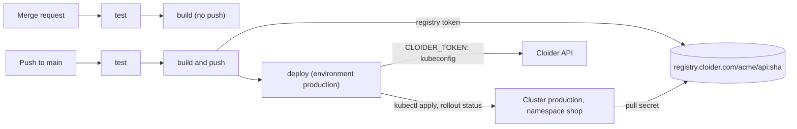

In this guide you build a GitLab CI/CD pipeline that tests every merge request, builds a container image, pushes it to
the [Cloider Container Registry](/container-registry/overview) with a registry token, and rolls it out to a
[Cloider Kubernetes cluster](/kubernetes/overview) with `kubectl`, with a GitLab environment and an optional manual
approval for production. A second, shorter pipeline deploys a [Cloider app](/apps/overview) with `cloider deploy` and a
`CLOIDER_TOKEN`.

**At a glance**

| | |
| --- | --- |
| **You will build** | A pipeline for the project `acme/api` that pushes `registry.cloider.com/acme/api:sha-<commit>` and runs it in the `shop` namespace of the cluster `production`, at `https://acme-api.cloider.app` |
| **Products** | [Container Registry](/container-registry/overview), [Kubernetes](/kubernetes/overview), [Domains](/domains/overview), and [Apps](/apps/overview) for the alternative |
| **Tools** | GitLab CI/CD (gitlab.com or self-managed), the `cloider` CLI, `kubectl`, Docker |
| **Difficulty** | Intermediate |
| **Time** | About 40 minutes |
| **Cost** | A registry project (storage) and a cluster (compute). See [What it costs](#what-it-costs) |

## What you'll build



The pipeline uses three credentials, each with the least access it needs:

| Credential | Where it lives | What it can do |
| --- | --- | --- |
| Registry token `gitlab-ci` (**Pull & push**, project `acme`) | CI/CD variables `CLOIDER_REGISTRY_USERNAME`, `CLOIDER_REGISTRY_PASSWORD` | Push and pull images in `acme` |
| Registry token `production-pull` (**Pull only**) | Kubernetes Secret `cloider-registry` in the `shop` namespace | Pull images from `acme` |
| API token (**Read**) | CI/CD variable `CLOIDER_TOKEN` | Read the account, including the cluster's kubeconfig. Nothing in Cloider can be created, changed or deleted with it |

## Before you begin

- A Cloider account and the CLI, logged in with **Read & Write** access, see [Install the CLI](/get-started/install-the-cli).
- `kubectl` on your computer for the one-time setup.
- A GitLab project for the code, here `acme/api`, with at least the **Maintainer** role (to add CI/CD variables).
- A GitLab runner that can run Docker in Docker (privileged mode). GitLab.com's shared Linux runners can. On runners
  that can't, use the [Buildah variant](#build-without-docker-in-docker).

## Part 1: Create the registry project, the cluster and the pull secret

These are the same one-time steps as in the GitHub Actions guide, in short:

```bash
# A registry project for the images (pick your own name if acme is taken)
cloider registry create acme --wait

# The cluster, kubectl, and the namespace the API runs in
cloider cluster create production --wait
cloider cluster kubeconfig production --merge --use
kubectl create namespace shop

# A pull-only token for the cluster, stored as a pull secret in the namespace
{ read -r REG_USER; read -r REG_SECRET; } < <(
  cloider registry token create --label production-pull --project acme --read-only -q
)
kubectl create secret docker-registry cloider-registry \
  --docker-server=registry.cloider.com \
  --docker-username="$REG_USER" \
  --docker-password="$REG_SECRET" \
  -n shop
```

`-q` prints the token's username and secret on two lines, and `-n shop` puts the Secret in the namespace whose pods
use it. See [Create a project](/container-registry/create-a-project) and
[Pull private images](/kubernetes/pull-private-images).

### Verify

```bash
cloider registry get acme
cloider cluster status production
kubectl get secret cloider-registry -n shop
```

The project and the cluster are `Ready`, and the Secret exists with type `kubernetes.io/dockerconfigjson`.

## Part 2: Create the pipeline's credentials

**A registry token for pushing**, valid for a year:

```bash
cloider registry token create --label gitlab-ci --project acme --expires-days 365
```

Copy the `Username` and `Secret` from the output. The secret isn't shown again.

**A Read API token for the deploy job.** API tokens are created in the dashboard only:

1. Open **Access Control** in the sidebar and choose the **API Tokens** tab.
2. Click **Generate API token**, describe it `GitLab CI acme/api`, choose **Read** and click **Generate API token**.
3. Copy the `cldr_...` token and click **I've saved the token**.

A Read token can download the kubeconfig, which is all the deploy job asks Cloider for. See
[API tokens](/account/api-tokens).

**Store the three values in GitLab.** In the project, open **Settings**, **CI/CD**, **Variables**, and add:

| Key | Value | Flags |
| --- | --- | --- |
| `CLOIDER_REGISTRY_USERNAME` | The registry username, `acme` here | **Protect variable** |
| `CLOIDER_REGISTRY_PASSWORD` | The `gitlab-ci` token's secret | **Mask variable**, **Protect variable** |
| `CLOIDER_TOKEN` | The `cldr_...` API token | **Mask variable**, **Protect variable** |

**Protected** variables are only given to pipelines on protected branches and tags, such as `main`, so a merge request
from a feature branch can never read them. **Masked** variables are hidden in job logs.

### Verify

The three variables are listed under **Settings**, **CI/CD**, **Variables**, each marked protected.

## Part 3: Add the application

Use the application from the GitHub Actions guide unchanged: `package.json`, `app.js`, `server.js`,
`test/app.test.js`, the `Dockerfile`, `.dockerignore` and the Kubernetes manifest `k8s/api.yaml` with its `IMAGE`
placeholder. They are listed in full in
[CI/CD with GitHub Actions, part 4](/guides/ci-cd-with-github-actions#part-4-add-the-application-and-its-manifests).
Run `npm install` once to create `package-lock.json`.

### Verify

`npm test` passes on your computer.

## Part 4: Write the pipeline

```yaml title=".gitlab-ci.yml"
stages:
  - test
  - build
  - deploy

variables:
  REGISTRY: registry.cloider.com
  IMAGE: registry.cloider.com/acme/api
  CLUSTER: production
  NAMESPACE: shop

# Run for merge requests and for the default branch, not twice for a branch with an open MR
workflow:
  rules:
    - if: $CI_PIPELINE_SOURCE == "merge_request_event"
    - if: $CI_COMMIT_BRANCH == $CI_DEFAULT_BRANCH

test:
  stage: test
  image: node:22-alpine
  cache:
    key:
      files: [package-lock.json]
    paths: [.npm/]
  script:
    - npm ci --cache .npm --prefer-offline
    - npm test

build:
  stage: build
  image: docker:27
  services:
    - docker:27-dind
  variables:
    DOCKER_TLS_CERTDIR: "/certs"
  script:
    - |
      if [ "$CI_COMMIT_BRANCH" = "$CI_DEFAULT_BRANCH" ]; then
        echo "$CLOIDER_REGISTRY_PASSWORD" | docker login "$REGISTRY" -u "$CLOIDER_REGISTRY_USERNAME" --password-stdin
        docker build --build-arg APP_VERSION="$CI_COMMIT_SHA" -t "$IMAGE:sha-$CI_COMMIT_SHA" .
        docker push "$IMAGE:sha-$CI_COMMIT_SHA"
      else
        # Merge requests only check that the image builds
        docker build -t api-check .
      fi

deploy:
  stage: deploy
  image: alpine:3.20
  environment:
    name: production
    url: https://acme-api.cloider.app
  resource_group: production
  rules:
    - if: $CI_COMMIT_BRANCH == $CI_DEFAULT_BRANCH
  before_script:
    - apk add --no-cache curl kubectl
    - curl -fsSL https://cloider.com/install.sh | CLOIDER_INSTALL_DIR=/usr/local/bin sh
  script:
    - mkdir -p "$HOME/.kube"
    - cloider cluster kubeconfig "$CLUSTER" -f "$HOME/.kube/config"
    - sed "s|image: IMAGE|image: $IMAGE:sha-$CI_COMMIT_SHA|" k8s/api.yaml | kubectl apply -f -
    - |
      if ! kubectl rollout status deployment/api -n "$NAMESPACE" --timeout=5m; then
        echo "Rollout failed, rolling back"
        kubectl rollout undo deployment/api -n "$NAMESPACE"
        exit 1
      fi
```

How it fits together:

- **`workflow: rules`** runs the pipeline for merge requests and for the default branch only.
- **`test`** runs the tests with npm's cache kept between pipelines.
- **`build`** uses Docker in Docker. On the default branch it logs in with the registry token and pushes
  `sha-<commit>`, a unique tag per commit. In a merge request it only builds, and never sees the protected variables.
- **`deploy`** runs on the default branch in the `production` **environment**, so GitLab shows each deployment under
  **Operate**, **Environments** with its commit and a link. `resource_group: production` makes deploys run one at a
  time, in order.
- The job installs the CLI into `/usr/local/bin`, fetches the kubeconfig with `CLOIDER_TOKEN` (the CLI reads it from
  the environment, and the `.kube` folder must exist before `-f` writes into it), applies the manifest with the new
  image, and rolls back if the new pods don't become ready.
- Automatic CLI updates are off when the `CI` variable is set, which GitLab does. See [Install the CLI](/cli/install).

Commit and push to `main`:

```bash
git add .
git commit -m "API with GitLab CI/CD"
git push origin main
```

### Verify

In GitLab, open **Build**, **Pipelines**: `test`, `build` and `deploy` are green. Then:

```bash
kubectl get pods -n shop
cloider registry images acme api
```

Two `api` pods are `Running`, and the registry lists the image tagged `sha-<commit>`.

### Require a manual approval for production

To make a person press **Run** before each production rollout, add `when: manual` to the deploy job's rule:

```yaml title=".gitlab-ci.yml (deploy job)"
  rules:
    - if: $CI_COMMIT_BRANCH == $CI_DEFAULT_BRANCH
      when: manual
```

The pipeline then stops at `deploy` with a play button. On GitLab Premium and Ultimate, protected environments can
also restrict who may press it.

### Build without Docker in Docker

On runners that don't allow privileged containers, build and push with Buildah instead, which needs no Docker daemon:

```yaml title=".gitlab-ci.yml (Buildah build job)"
build:
  stage: build
  image: quay.io/buildah/stable:latest
  variables:
    STORAGE_DRIVER: vfs
    BUILDAH_FORMAT: docker
  script:
    - |
      if [ "$CI_COMMIT_BRANCH" = "$CI_DEFAULT_BRANCH" ]; then
        echo "$CLOIDER_REGISTRY_PASSWORD" | buildah login -u "$CLOIDER_REGISTRY_USERNAME" --password-stdin "$REGISTRY"
        buildah build --build-arg APP_VERSION="$CI_COMMIT_SHA" -t "$IMAGE:sha-$CI_COMMIT_SHA" .
        buildah push "$IMAGE:sha-$CI_COMMIT_SHA"
      else
        buildah build -t api-check .
      fi
```

## Part 5: Put the API on the internet

```bash
cloider domain create acme-api.cloider.app
cloider target create acme-api.cloider.app --cluster production --service shop/api
```

```text title="Output"
✓ Claimed acme-api.cloider.app
Route it with `cloider target create acme-api.cloider.app --app <app>`.
✓ Routed acme-api.cloider.app/ to production/shop/api:80
```

### Verify

```bash
curl -s https://acme-api.cloider.app/
```

```text title="Output"
{"service":"api","version":"4f2a9c1e8b7d6a5f4e3d2c1b0a9f8e7d6c5b4a39"}
```

The `version` is the commit the pipeline deployed. The environment's link in GitLab opens the same address.

## Alternative: deploy a Cloider app with cloider deploy

Without Kubernetes, a [Cloider app](/apps/overview) builds and runs the code for you, and the pipeline is one command.

1. Create the app once from your computer, in the project folder:

   ```bash
   cloider deploy --name api --port 8080
   ```

2. Generate a **Read & Write** API token in **Access Control**, **API Tokens**, and store it as the masked, protected
   variable `CLOIDER_TOKEN` (replacing the Read token if you use the same project).

3. Use this pipeline:

```yaml title=".gitlab-ci.yml"
stages:
  - test
  - deploy

test:
  stage: test
  image: node:22-alpine
  script:
    - npm ci
    - npm test

deploy:
  stage: deploy
  image: debian:bookworm-slim
  environment:
    name: production
  resource_group: production
  rules:
    - if: $CI_COMMIT_BRANCH == $CI_DEFAULT_BRANCH
  before_script:
    - apt-get update && apt-get install -y --no-install-recommends curl ca-certificates
    - curl -fsSL https://cloider.com/install.sh | CLOIDER_INSTALL_DIR=/usr/local/bin sh
  script:
    - cloider whoami
    - APP_URL=$(cloider deploy --app api)
    - curl -fsS "${APP_URL}healthz"
```

`cloider deploy --app api` uploads the checkout (without what `.gitignore` and `.cloiderignore` list), streams the build
log into the job, fails the job if the build fails, and prints the app's URL on stdout. `resource_group` keeps two
deploys from overlapping, since an app builds one version at a time. Add
`cloider app exec --timeout 15m api -- npm run migrate` after the deploy if your app has migrations.

:::tip[Or let Cloider deploy from GitLab directly]
An app created with `cloider app create --git gitlab --repo acme/api` deploys every push to its branch without any
pipeline, through a project webhook Cloider adds (it needs the **Maintainer** role). Use a pipeline when tests should
gate the deploy, and don't use both on one app. See [Deploy from git](/apps/deploy-from-git).
:::

### Verify

The `deploy` job's log ends with `✓ Deployed version 2 of api` and the URL, and `cloider app builds api` lists the
version as `Ready`.

## What it costs

| Resource | How it is billed |
| --- | --- |
| Registry project `acme` | Per GiB of image data stored per month. Add a [retention policy](/container-registry/retention-policies) so old `sha-*` images don't pile up |
| Cluster `production` | Compute units for its running containers, including its control plane, at least each container's requests |
| App `api` (alternative) | Compute units for its container while it runs. Builds are free |
| Domains, targets and tokens | Free |
| GitLab CI minutes | Billed by GitLab under your plan, not by Cloider |

See [Pricing](/reference/pricing) and the [billing model](/concepts/billing-model).

## Clean up

```bash
cloider domain delete acme-api.cloider.app --yes
kubectl delete namespace shop
cloider cluster delete production --yes --wait
cloider registry token delete gitlab-ci --yes
cloider registry token delete production-pull --yes
cloider registry delete acme --yes --wait
cloider app delete api --yes     # if you followed the alternative
```

Then delete the API token in **Access Control**, **API Tokens**, and the three CI/CD variables in GitLab.

## Troubleshooting

| Error in the job | Cause and fix |
| --- | --- |
| `Cannot connect to the Docker daemon at tcp://docker:2375` | The `docker:dind` service is missing or the runner doesn't run privileged containers. Use the Buildah job |
| `unauthorized` at `docker login` | The registry variables are wrong, expired, or not given to this pipeline. Protected variables only reach protected branches |
| `denied: requested access to the resource is denied` on push | The token is **Pull only**, or doesn't cover the project in the image name |
| `not logged in` (exit code `3`) at `cloider cluster kubeconfig` | `CLOIDER_TOKEN` is empty in this pipeline (it isn't protected-branch only, or it's misnamed) or the token was deleted |
| `open /root/.kube/config: no such file or directory` | Keep the `mkdir -p "$HOME/.kube"` line before writing the kubeconfig |
| Pods in `ImagePullBackOff` | The `cloider-registry` Secret isn't in the `shop` namespace, or its token was deleted. `kubectl describe pod -n shop` says which |
| `This API token is read only!` (exit code `5`) in the app pipeline | `cloider deploy` needs a **Read & Write** token |
| The variable can't be masked | GitLab only masks values that meet its format rules. Store it unmasked but protected, or check GitLab's masking requirements |

More in [Container registry troubleshooting](/container-registry/troubleshooting) and
[Kubernetes troubleshooting](/kubernetes/troubleshooting).

## Next steps

- [CI/CD with GitHub Actions](/guides/ci-cd-with-github-actions): the same pipeline on GitHub.
- [Registry CI/CD reference](/container-registry/ci-cd): multi-platform builds with buildx and private job images.
- [Retention policies](/container-registry/retention-policies): clean up old images automatically.
- [Terraform CI/CD](/terraform/guides/ci-cd): plan and apply infrastructure from GitLab.

<FAQ items={[
  {q: 'How do I push to the Cloider registry from GitLab CI?', a: 'Create a registry token with Pull & push permission, store its username and secret as protected CI/CD variables, then in a docker:dind job run docker login registry.cloider.com with --password-stdin, docker build and docker push registry.cloider.com/<project>/<repository>:<tag>.'},
  {q: 'How does a GitLab job deploy to a Cloider Kubernetes cluster?', a: 'Install the cloider CLI in the job, provide CLOIDER_TOKEN as a CI/CD variable, create ~/.kube and run cloider cluster kubeconfig <cluster> -f ~/.kube/config, then use kubectl as usual. A Read API token is enough to download the kubeconfig.'},
  {q: 'Can I build images on GitLab without Docker in Docker?', a: 'Yes. Buildah builds and pushes without a Docker daemon or privileged mode: buildah login, buildah build and buildah push to registry.cloider.com.'},
  {q: 'Does Cloider work with self-managed GitLab for CI/CD?', a: 'Yes. A pipeline only talks to Cloider over HTTPS with tokens, so it works on any GitLab. Cloider\'s built-in git deploys connect to gitlab.com only.'},
]} />
