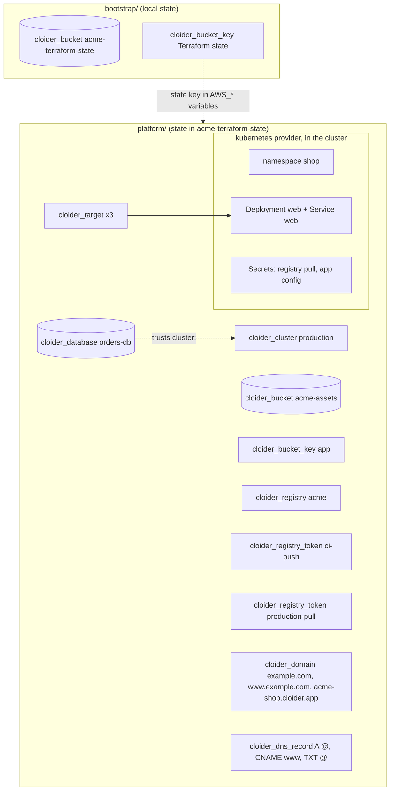

In this guide you describe a complete production environment as code with the [Cloider Terraform
provider](/terraform/overview): a Kubernetes cluster, a PostgreSQL database that only the cluster can reach, a bucket
with an access key, a registry project with a push token for CI and a pull token for the cluster, and a custom domain
with its DNS records and a target. Terraform's state lives in a Cloider bucket with locking, and the
[`kubernetes` provider](https://registry.terraform.io/providers/hashicorp/kubernetes/latest/docs) deploys the
workload into the cluster from the same configuration, wired to the database, the bucket and the registry.

**At a glance**

| | |
| --- | --- |
| **You will build** | Two Terraform configurations: `bootstrap/` (the state bucket) and `platform/` (everything else), producing `https://example.com` served from the cluster `production` |
| **Resources** | `cloider_cluster`, `cloider_database`, `cloider_bucket`, `cloider_bucket_key`, `cloider_registry`, `cloider_registry_token`, `cloider_domain`, `cloider_dns_record`, `cloider_target`, plus `kubernetes_*` resources |
| **Tools** | Terraform 1.10 or later (or OpenTofu 1.10 or later), `kubectl`, `dig`, optionally Docker |
| **Difficulty** | Advanced. You should know Terraform's plan and apply cycle |
| **Time** | About 60 minutes, plus the time your registrar takes to switch nameservers |
| **Cost** | A cluster, a database, two buckets and a registry project. See [What it costs](#what-it-costs) |

:::note[Free trial accounts]
A trial account can hold one bucket at a time, and this guide uses two: one for Terraform's state and one for the
app. On the trial, skip [part 2](#part-2-create-the-state-bucket), leave out the `backend "s3"` block (the state then
stays in a local file) and keep the rest.
:::

## What you'll build



Splitting the configuration in two follows a simple rule: the bucket that holds Terraform's state can't be described in
a configuration whose state it holds, or a mistake there could destroy its own state.

## Before you begin

- A Cloider account and an API token. Generate one in the dashboard under **Access Control**, **API Tokens**, with
  **Read & Write** access (Terraform's plan only needs **Read**, apply needs **Read & Write**). See
  [API tokens](/account/api-tokens).
- [Terraform](https://developer.hashicorp.com/terraform/install) 1.10 or later, or [OpenTofu](https://opentofu.org)
  1.10 or later, for state locking with `use_lockfile`.
- `kubectl` to look at the cluster, and `dig` to check DNS.
- A domain you own, here `example.com`, and access to its registrar to change its nameservers.

Give Terraform the token through the environment. The provider block can then stay empty:

```bash
export CLOIDER_TOKEN=cldr_xxxxxxxxxxxxxxxxxxxxxxxx
```

On your own computer, `cloider login` is enough as well: the provider uses the token the CLI saved. See
[Provider configuration](/terraform/provider-configuration).

## Part 1: Lay out the project

```text
infra/
  bootstrap/
    main.tf
  platform/
    versions.tf
    backend.tf
    variables.tf
    main.tf
    dns.tf
    kubernetes.tf
    outputs.tf
    terraform.tfvars
```

Add Terraform's local files to `.gitignore`, and commit `.terraform.lock.hcl`:

```text title=".gitignore"
.terraform/
*.tfstate
*.tfstate.backup
kubeconfig*.yaml
```

## Part 2: Create the state bucket

The `bootstrap` configuration creates a versioned bucket for the state, so every earlier state can be recovered, and an
access key that only reaches that bucket. Its own state stays in a local file, which you keep safe or commit to a
private repository.

```hcl title="bootstrap/main.tf"
terraform {
  required_version = ">= 1.10"

  required_providers {
    cloider = {
      source  = "cloider/cloider"
      version = "~> 0.1"
    }
  }
}

provider "cloider" {}

resource "cloider_bucket" "state" {
  name       = "acme-terraform-state"
  versioning = true

  lifecycle {
    prevent_destroy = true
  }
}

resource "cloider_bucket_key" "state" {
  label   = "Terraform state"
  buckets = [cloider_bucket.state.id]
}

output "state_bucket" {
  value = cloider_bucket.state.name
}

output "state_endpoint" {
  value = cloider_bucket.state.endpoint
}

output "state_access_key" {
  value = cloider_bucket_key.state.access_key
}

output "state_secret_key" {
  value     = cloider_bucket_key.state.secret_key
  sensitive = true
}
```

Bucket names are shared by every Cloider account, so choose your own if `acme-terraform-state` is taken.

```bash
cd infra/bootstrap
terraform init
terraform apply
```

```text title="Output"
Plan: 2 to add, 0 to change, 0 to destroy.
...
cloider_bucket.state: Creation complete after 4s [id=b7r2xw]
cloider_bucket_key.state: Creation complete after 1s [id=k3m8vd]

Apply complete! Resources: 2 added, 0 changed, 0 destroyed.

Outputs:

state_access_key = "CLDRZ8Q4M2X7KD1PLW0B"
state_bucket = "acme-terraform-state"
state_endpoint = "https://s3.eu-central-2.cloider.com"
state_secret_key = <sensitive>
```

Export the key for the `s3` backend, which reads the standard AWS variables:

```bash
export AWS_ACCESS_KEY_ID="$(terraform output -raw state_access_key)"
export AWS_SECRET_ACCESS_KEY="$(terraform output -raw state_secret_key)"
```

### Verify

```bash
cloider bucket get acme-terraform-state
cloider bucket versioning acme-terraform-state
```

The bucket is `Ready` and versioning is `Enabled`. See [State backend](/terraform/guides/state-backend) for every
backend setting.

## Part 3: Write the platform configuration

### versions.tf and backend.tf

```hcl title="platform/versions.tf"
terraform {
  required_version = ">= 1.10"

  required_providers {
    cloider = {
      source  = "cloider/cloider"
      version = "~> 0.1"
    }
    kubernetes = {
      source  = "hashicorp/kubernetes"
      version = "~> 3.0"
    }
  }
}

# Reads CLOIDER_TOKEN, or the token `cloider login` saved
provider "cloider" {}

# Configured from the cluster this configuration creates
provider "kubernetes" {
  host                   = cloider_cluster.main.kube_config.host
  cluster_ca_certificate = cloider_cluster.main.kube_config.cluster_ca_certificate
  client_certificate     = cloider_cluster.main.kube_config.client_certificate
  client_key             = cloider_cluster.main.kube_config.client_key
}
```

```hcl title="platform/backend.tf"
terraform {
  backend "s3" {
    bucket = "acme-terraform-state"
    key    = "production/terraform.tfstate"
    region = "eu-central-2"

    endpoints = {
      s3 = "https://s3.eu-central-2.cloider.com"
    }
    use_path_style = true
    use_lockfile   = true

    # Cloider isn't AWS: there is no AWS account or instance metadata to check
    skip_credentials_validation = true
    skip_requesting_account_id  = true
    skip_metadata_api_check     = true
  }
}
```

The backend block can't use variables, and the access key stays out of it on purpose: Terraform saves the backend
settings in plain text under `.terraform/`. The key comes from `AWS_ACCESS_KEY_ID` and `AWS_SECRET_ACCESS_KEY`.

### variables.tf and terraform.tfvars

```hcl title="platform/variables.tf"
variable "domain" {
  description = "A domain you own, served by the app."
  type        = string
}

variable "subdomain" {
  description = "A free subdomain label, served before and after the custom domain works, e.g. acme-shop."
  type        = string
}

variable "apex_ipv4" {
  description = "Addresses for the apex A record. Empty keeps the A record the domain was added with, which points at Cloider."
  type        = list(string)
  default     = []
}

variable "registry_project" {
  description = "The registry project's name, unique across every Cloider account."
  type        = string
}

variable "assets_bucket" {
  description = "The app's bucket name, unique across every Cloider account."
  type        = string
}

variable "database_plan" {
  description = "hobby, starter, basic, standard, plus or pro."
  type        = string
  default     = "hobby"
}

variable "app_image" {
  description = "The image the web Deployment runs."
  type        = string
  default     = "nginxdemos/hello:plain-text"
}

variable "replicas" {
  type    = number
  default = 2
}
```

```hcl title="platform/terraform.tfvars"
domain           = "example.com"
subdomain        = "acme-shop"
registry_project = "acme"
assets_bucket    = "acme-assets"
database_plan    = "standard"
```

`app_image` starts as a small public demo image that answers on port 80, so the whole environment works before you
have pushed anything. [Part 7](#part-7-deploy-your-own-image-from-the-registry) switches it to your own image.

### main.tf: the Cloider resources

```hcl title="platform/main.tf"
data "cloider_options" "current" {}

# Kubernetes
resource "cloider_cluster" "main" {
  name = "production"
}

# PostgreSQL, reachable only from the cluster, over the private host
resource "cloider_database" "orders" {
  name            = "orders-db"
  engine          = "postgresql"
  plan            = var.database_plan
  trusted_sources = ["cluster:${cloider_cluster.main.id}"]
}

# Object storage for the app, with a key that only reaches this bucket
resource "cloider_bucket" "assets" {
  name = var.assets_bucket
}

resource "cloider_bucket_key" "app" {
  label   = "production app"
  buckets = [cloider_bucket.assets.id]
}

# Container registry
resource "cloider_registry" "main" {
  name             = var.registry_project
  storage_limit_gi = 10
}

# For CI to push with, expiring in a year
resource "cloider_registry_token" "ci_push" {
  label           = "ci-push"
  projects        = [cloider_registry.main.id]
  expires_in_days = 365
}

# For the cluster to pull with
resource "cloider_registry_token" "cluster_pull" {
  label     = "production-pull"
  projects  = [cloider_registry.main.id]
  read_only = true
}
```

- `trusted_sources` uses `cluster:<id>`, so the database accepts connections from this cluster to its private host,
  and from nowhere else. See [`cloider_database`](/terraform/resources/database).
- Moving `database_plan` to a **larger** plan later resizes the database in place, with a restart. A **smaller** plan
  replaces it, so Terraform's plan shows a replacement: read it before you apply.
- Bucket and registry project names are global across Cloider: replace `acme-assets` and `acme` with your own.

### dns.tf: the domains, records and targets

```hcl title="platform/dns.tf"
# The custom domain, delegated to Cloider's nameservers at the registrar
resource "cloider_domain" "apex" {
  name = var.domain
}

# www is a domain of its own for targets; its DNS record stays on the apex domain
resource "cloider_domain" "www" {
  name = "www.${var.domain}"
}

# A free subdomain: works at once, and is what www points at
resource "cloider_domain" "free" {
  name = "${var.subdomain}.${data.cloider_options.current.subdomain_roots[0]}"
}

# The domain comes with an A record that points at Cloider; this one takes its place when apex_ipv4 is set
resource "cloider_dns_record" "apex" {
  count = length(var.apex_ipv4) > 0 ? 1 : 0

  domain = cloider_domain.apex.name
  type   = "A"
  values = var.apex_ipv4
  ttl    = 300
}

resource "cloider_dns_record" "www" {
  domain = cloider_domain.apex.name
  type   = "CNAME"
  name   = "www"
  values = ["${cloider_domain.free.name}."]
  ttl    = 3600
}

resource "cloider_dns_record" "spf" {
  domain = cloider_domain.apex.name
  type   = "TXT"
  values = ["v=spf1 -all"]
  ttl    = 3600
}

# Route each name to the web Service in the cluster
resource "cloider_target" "web" {
  for_each = {
    apex = cloider_domain.apex.name
    www  = cloider_domain.www.name
    free = cloider_domain.free.name
  }

  domain     = each.value
  cluster_id = cloider_cluster.main.id
  namespace  = kubernetes_service_v1.web.metadata[0].namespace
  service    = kubernetes_service_v1.web.metadata[0].name
  port       = 80
}
```

- The `www` record is a `CNAME` to the free subdomain, so it follows Cloider's entry point automatically. The apex
  can't have a `CNAME` (a rule of DNS). It keeps the `A` record it was added with, which points at Cloider, unless you
  set `apex_ipv4`.
- The SPF record `v=spf1 -all` says the domain sends no email. Replace it with your mail provider's value if it does,
  and add `MX` records the same way. See [Email DNS records](/domains/email-dns-records).
- A target references the Service through `kubernetes_service_v1.web`, so Terraform creates the Service first.

### kubernetes.tf: the workload

```hcl title="platform/kubernetes.tf"
resource "kubernetes_namespace_v1" "shop" {
  metadata {
    name = "shop"
  }
}

# Lets the pods pull from the registry project with the pull-only token
resource "kubernetes_secret_v1" "registry" {
  metadata {
    name      = "cloider-registry"
    namespace = kubernetes_namespace_v1.shop.metadata[0].name
  }

  type = "kubernetes.io/dockerconfigjson"

  data = {
    ".dockerconfigjson" = jsonencode({
      auths = {
        (cloider_registry.main.host) = {
          username = cloider_registry_token.cluster_pull.username
          password = cloider_registry_token.cluster_pull.secret
          auth     = base64encode("${cloider_registry_token.cluster_pull.username}:${cloider_registry_token.cluster_pull.secret}")
        }
      }
    })
  }
}

# Everything the app needs to reach the database and the bucket
resource "kubernetes_secret_v1" "web" {
  metadata {
    name      = "web-config"
    namespace = kubernetes_namespace_v1.shop.metadata[0].name
  }

  data = {
    DATABASE_URL          = "postgresql://${cloider_database.orders.user}:${urlencode(cloider_database.orders.password)}@${cloider_database.orders.private_host}:${cloider_database.orders.port}/${cloider_database.orders.name}?sslmode=require"
    DATABASE_CA_CERT      = cloider_database.orders.ca_certificate
    AWS_ACCESS_KEY_ID     = cloider_bucket_key.app.access_key
    AWS_SECRET_ACCESS_KEY = cloider_bucket_key.app.secret_key
    AWS_REGION            = cloider_bucket.assets.region
    AWS_ENDPOINT_URL_S3   = cloider_bucket.assets.endpoint
    S3_BUCKET             = cloider_bucket.assets.name
  }
}

resource "kubernetes_deployment_v1" "web" {
  metadata {
    name      = "web"
    namespace = kubernetes_namespace_v1.shop.metadata[0].name
  }

  spec {
    replicas = var.replicas

    selector {
      match_labels = {
        app = "web"
      }
    }

    template {
      metadata {
        labels = {
          app = "web"
        }
      }

      spec {
        image_pull_secrets {
          name = kubernetes_secret_v1.registry.metadata[0].name
        }

        container {
          name  = "web"
          image = var.app_image

          port {
            container_port = 80
          }

          env_from {
            secret_ref {
              name = kubernetes_secret_v1.web.metadata[0].name
            }
          }

          resources {
            requests = {
              cpu    = "50m"
              memory = "64Mi"
            }
            limits = {
              memory = "256Mi"
            }
          }

          readiness_probe {
            http_get {
              path = "/"
              port = 80
            }
          }
        }
      }
    }
  }
}

resource "kubernetes_service_v1" "web" {
  metadata {
    name      = "web"
    namespace = kubernetes_namespace_v1.shop.metadata[0].name
  }

  spec {
    selector = {
      app = "web"
    }

    port {
      port        = 80
      target_port = 80
    }
  }
}
```

Every secret value comes from a Cloider resource's attributes: the database's `private_host`, `port`, `user`,
`password` and `ca_certificate`, and the bucket key's `access_key` and `secret_key`. Nothing is copied by hand, and a
rotated key reaches the pods on the next apply (followed by a `kubectl rollout restart`, since pods read environment
variables at start). The `password` is URL encoded, in case it contains a character a URL doesn't allow.

### outputs.tf

```hcl title="platform/outputs.tf"
output "urls" {
  value = [for t in cloider_target.web : "https://${t.domain}"]
}

output "nameservers" {
  description = "Set these at the registrar of the custom domain."
  value       = data.cloider_options.current.nameservers
}

output "domain_status" {
  value = cloider_domain.apex.status
}

output "kubeconfig" {
  value     = cloider_cluster.main.kube_config.raw
  sensitive = true
}

output "database_host" {
  value = cloider_database.orders.host
}

output "database_private_host" {
  value = cloider_database.orders.private_host
}

output "registry_url" {
  description = "Push images as <registry_url>/<repository>:<tag>."
  value       = cloider_registry.main.url
}

output "registry_push_username" {
  value = cloider_registry_token.ci_push.username
}

output "registry_push_password" {
  value     = cloider_registry_token.ci_push.secret
  sensitive = true
}

output "assets_bucket_url" {
  value = cloider_bucket.assets.url
}
```

### Verify

```bash
cd ../platform
terraform init
terraform validate
```

```text title="Output"
Initializing the backend...

Successfully configured the backend "s3"! Terraform will automatically
use this backend unless the backend configuration changes.

Initializing provider plugins...
- Finding cloider/cloider versions matching "~> 0.1"...
- Finding hashicorp/kubernetes versions matching "~> 3.0"...
...
Terraform has been successfully initialized!
Success! The configuration is valid.
```

`init` needs `AWS_ACCESS_KEY_ID` and `AWS_SECRET_ACCESS_KEY` from part 2 in the same shell.

## Part 4: Apply in two steps

The `kubernetes` provider is configured from `cloider_cluster.main`, so it can't plan anything before the cluster
exists. Create the cluster on its own first, then everything else. Later applies need only `terraform apply`.

```bash
terraform apply -target=cloider_cluster.main
```

```text title="Output"
cloider_cluster.main: Creating...
cloider_cluster.main: Still creating... [1m0s elapsed]
cloider_cluster.main: Creation complete after 2m41s [id=x8f2kq]

Apply complete! Resources: 1 added, 0 changed, 0 destroyed.
```

Terraform warns that `-target` is meant for exceptional cases. Creating a cluster before configuring a provider from it
is one of them. Then apply the rest:

```bash
terraform apply
```

```text title="Output"
Plan: 19 to add, 0 to change, 0 to destroy.
...
cloider_database.orders: Creation complete after 1m52s [id=p0q9zm]
kubernetes_deployment_v1.web: Creation complete after 21s [id=shop/web]
cloider_target.web["free"]: Creation complete after 1s [id=t4k9vq]
...
Apply complete! Resources: 19 added, 0 changed, 0 destroyed.

Outputs:

assets_bucket_url = "https://acme-assets.s3.eu-central-2.cloider.com"
database_host = "orders-db-p0q9zm.db.cloider.com"
database_private_host = "orders-db-p0q9zm.db.cloider.internal"
domain_status = "Pending"
kubeconfig = <sensitive>
nameservers = tolist([
  "ns1.cloider.com",
  "ns2.cloider.com",
  "ns3.cloider.com",
  "ns4.cloider.com",
])
registry_push_password = <sensitive>
registry_push_username = "acme"
registry_url = "registry.cloider.com/acme"
urls = [
  "https://example.com",
  "https://acme-shop.cloider.app",
  "https://www.example.com",
]
```

`domain_status` shows the status when the domain was created. A domain turns `Active` once a target routes to it,
which the next `terraform apply` or `cloider domain list` shows. Creating a cluster or a database waits until it is
`Ready`, up to 20 minutes by default. Set
`timeouts = { create = "40m" }` on the resource to change that.

### Verify

```bash
terraform output -raw kubeconfig > kubeconfig-production.yaml
chmod 600 kubeconfig-production.yaml
export KUBECONFIG="$PWD/kubeconfig-production.yaml"

kubectl get pods -n shop
curl -s https://acme-shop.cloider.app/
```

```text title="Output"
NAME                   READY   STATUS    RESTARTS   AGE
web-5d8f7c9b6d-7xk2p   1/1     Running   0          1m
web-5d8f7c9b6d-q4m9z   1/1     Running   0          1m
Server address: 10.42.0.17:80
Server name: web-5d8f7c9b6d-7xk2p
Date: 21/Oct/2026:10:14:02 +0000
URI: /
Request ID: 6c1d0e2f3a4b5c6d7e8f9a0b1c2d3e4f
```

The free subdomain works at once. The kubeconfig grants full admin access to the cluster: keep the file private and
out of git.

## Part 5: Point the domain at Cloider

The apex already points at Cloider with the `A` record the domain was added with, and `www` with its `CNAME`.

1. **Recreate your existing records** (email, verification) as `cloider_dns_record` resources before the switch, or
   they stop resolving. See [Add a custom domain](/domains/add-a-custom-domain). If your website stays elsewhere, set
   `apex_ipv4` to its addresses.

2. **Change the nameservers** at your registrar to the four in `terraform output nameservers`. See
   [Nameservers](/domains/nameservers).

Once the domain resolves to Cloider, Cloider issues a certificate for each name, usually within a minute or two.

### Verify

```bash
dig example.com NS +short
dig @ns1.cloider.com example.com A +short
dig @ns1.cloider.com www.example.com +short
curl -sSI https://www.example.com/ | head -n 1
```

```text title="Output"
ns1.cloider.com.
ns2.cloider.com.
ns3.cloider.com.
ns4.cloider.com.
203.0.113.80
acme-shop.cloider.app.
HTTP/2 200
```

`dig @ns1.cloider.com` answers as soon as the records exist, even before the registrar switch has spread.

## Part 6: Look at the environment from other tools

Everything Terraform created is an ordinary Cloider resource, visible in the dashboard and the CLI:

```bash
cloider cluster list
cloider db get orders-db
cloider bucket key list
cloider registry token list
cloider target list example.com
```

Change things through Terraform from now on. A change made in the dashboard shows up as drift in the next
`terraform plan`, which then proposes to undo it.

## Part 7: Deploy your own image from the registry

Push an image with the CI token, then switch the Deployment to it:

```bash
terraform output -raw registry_push_password | \
  docker login registry.cloider.com -u "$(terraform output -raw registry_push_username)" --password-stdin

docker build -t registry.cloider.com/acme/web:1.0.0 .
docker push registry.cloider.com/acme/web:1.0.0
```

Your image must listen on port 80, as the Deployment and the Service in `kubernetes.tf` expect, or change both ports.
Then:

```bash
terraform apply -var app_image=registry.cloider.com/acme/web:1.0.0
```

The kubelet pulls it with the `cloider-registry` Secret, made from the pull-only token. In a pipeline, store
`registry_push_username` and `registry_push_password` as CI secrets, or write them straight into your CI system with its
Terraform provider. See [CI/CD with GitHub Actions](/guides/ci-cd-with-github-actions) and
[Terraform in CI/CD](/terraform/guides/ci-cd).

### Verify

```bash
kubectl get deployment web -n shop -o jsonpath='{.spec.template.spec.containers[0].image}{"\n"}'
cloider registry images acme web
```

The Deployment runs `registry.cloider.com/acme/web:1.0.0`, and the registry lists the image with its `1.0.0` tag.

## Day 2 operations

| Task | Change | What happens |
| --- | --- | --- |
| Give the database more resources | `database_plan = "plus"` | Resized in place, with a restart. A smaller plan would replace it |
| Stop paying for cluster compute at night | `paused = true` on `cloider_cluster.main` | The cluster pauses and keeps its state; volumes stay billed. Targets answer with errors until it resumes |
| Rotate the app's bucket key | `terraform apply -replace=cloider_bucket_key.app`, then `kubectl rollout restart deployment/web -n shop` | A new key and Secret; the old key is deleted |
| Rotate the CI push token | `terraform apply -replace=cloider_registry_token.ci_push` | A new secret, readable with `terraform output -raw registry_push_password` |
| Bring a resource created in the dashboard under Terraform | An `import` block with its id | See [Import existing resources](/terraform/guides/import-existing-resources) |
| A second environment | Another `key` in the backend, or a module per environment | See [Multiple environments](/terraform/guides/multiple-environments) |

:::warning[Secrets in the state]
The state holds every sensitive attribute in plain text: the database password, the kubeconfig, the bucket key's
secret and the registry token's secret. That is why it lives in a private, versioned bucket reached by a key of its
own. Give that key only to the people and pipelines that run Terraform.
:::

## What it costs

| Resource | How it is billed |
| --- | --- |
| `cloider_cluster.main` | Compute units for its running containers, including its control plane, at least each container's requests |
| `cloider_database.orders` | The flat monthly price of its plan, prorated while it is `Ready` |
| `cloider_bucket.state`, `cloider_bucket.assets` | Per GiB stored per month. The state files are tiny; versioning keeps every earlier state, which adds up slowly |
| `cloider_registry.main` | Per GiB of image data stored per month |
| Domains, DNS records, targets, keys and tokens | Free |

Prices are on the [pricing page](/reference/pricing), and current spend per resource on the [Usage](/account/usage)
page. See [the billing model](/concepts/billing-model).

## Clean up

Destroy the platform first, then the state bucket.

```bash
cd infra/platform
terraform destroy
```

```text title="Output"
Plan: 0 to add, 0 to change, 20 to destroy.
...
Destroy complete! Resources: 20 destroyed.
```

Deleting the bucket deletes every file in it, and deleting the database deletes its backups. Set your registrar's
nameservers back before you destroy, if `example.com` still points at Cloider.

The state bucket is protected by `prevent_destroy`. To remove it too, delete the `lifecycle` block from
`bootstrap/main.tf`, then:

```bash
cd ../bootstrap
terraform destroy
```

Finally delete the API token in **Access Control**, **API Tokens** if you made one for this guide.

## Troubleshooting

| Error | Cause and fix |
| --- | --- |
| `No valid credential sources found` at `terraform init` | `AWS_ACCESS_KEY_ID` and `AWS_SECRET_ACCESS_KEY` aren't set in this shell. Export them from the bootstrap outputs |
| `Unsupported argument "use_lockfile"` | Terraform or OpenTofu is older than 1.10. Upgrade |
| A checksum error when the state is saved | Newer AWS SDKs add checksums Cloider's storage doesn't accept. Recent Terraform versions have `skip_s3_checksum = true` for the `s3` backend; add it to `backend.tf` |
| `Error acquiring the state lock` | Another run holds the lock, or a killed run left it. Wait, or `terraform force-unlock <lock id>` once nothing else runs |
| `Get "http://localhost/api/v1/namespaces/shop": dial tcp ... connection refused` | The `kubernetes` provider ran before the cluster existed. Apply `-target=cloider_cluster.main` first |
| `This API token is read only!` | Apply needs a **Read & Write** token. Plan works with **Read** |
| A bucket or registry name is refused as taken | Names are global across Cloider. Pick another in `terraform.tfvars` |
| The pods can't connect to the database | The database trusts `cluster:<id>`: the pods must use `private_host`, which `DATABASE_URL` does |
| `ImagePullBackOff` after switching `app_image` | The image wasn't pushed, the tag is wrong, or it's in another project than the pull token covers |
| Certificate warning on `example.com` | The nameservers haven't switched yet, or `apex_ipv4` is empty. Check with `dig` |
| A create is refused on a trial account | The trial allows one cluster, database, bucket and registry project at a time. See the note at the top |

More in the [Terraform provider overview](/terraform/overview) and [Domains troubleshooting](/domains/troubleshooting).

## Next steps

- [Kubernetes and Helm with Terraform](/terraform/guides/kubernetes-and-helm): the `helm` provider, and two
  configurations instead of one.
- [Multiple environments](/terraform/guides/multiple-environments): staging and production from one module.
- [Terraform in CI/CD](/terraform/guides/ci-cd): plan merge requests with a Read token, apply `main` with a
  Read & Write one.
- [Back up a database to a bucket](/guides/back-up-a-database-to-a-bucket): add a backup CronJob to the cluster.

<FAQ items={[
  {q: 'Is there a Terraform provider for Cloider?', a: 'Yes. cloider/cloider on the Terraform Registry manages clusters, databases, buckets and bucket keys, registry projects and tokens, domains, DNS records and targets. It works with Terraform and OpenTofu, and reads its API token from CLOIDER_TOKEN or the cloider CLI\'s login.'},
  {q: 'Can I store Terraform state in a Cloider bucket?', a: 'Yes. Use the s3 backend with the bucket, a key, region eu-central-2, endpoints = { s3 = "https://s3.eu-central-2.cloider.com" }, use_path_style, use_lockfile and the three skip_ settings, with a Cloider bucket key in AWS_ACCESS_KEY_ID and AWS_SECRET_ACCESS_KEY. Create that bucket in a separate configuration.'},
  {q: 'How do I deploy into a Cloider cluster with the Kubernetes provider?', a: 'Configure the kubernetes provider with host, cluster_ca_certificate, client_certificate and client_key from the cloider_cluster resource\'s kube_config, or from the cloider_cluster data source in another configuration. In one configuration, apply -target=cloider_cluster.<name> first.'},
  {q: 'Why does Terraform need two applies the first time?', a: 'The kubernetes provider is configured from the cluster\'s kube_config, which doesn\'t exist until the cluster is created. Creating the cluster with -target first lets the second apply plan the Kubernetes resources. Later applies need only terraform apply.'},
  {q: 'Does a target create the DNS record for my domain?', a: 'No. A custom domain comes with an A record for the domain itself that points at Cloider, but a target adds nothing, so add a cloider_dns_record for every other name: a CNAME to a free cloider.app subdomain for www and other subdomains.'},
]} />
