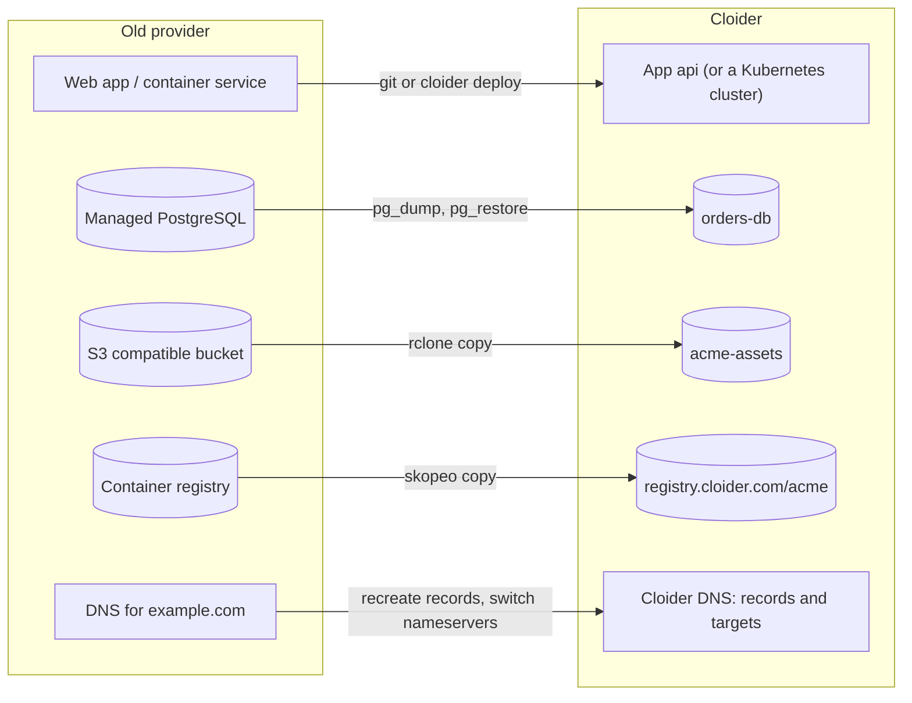

This guide moves a typical production setup from another provider to Cloider: the **app**, its **database** (with a
dump and restore), its **files** in object storage (with rclone or the AWS CLI), its **container images** (with skopeo
or Docker), and finally its **domain**. It is written so you can rehearse everything while the old setup keeps
serving, then switch over in a short, planned window, and it ends with a checklist to print.

**At a glance**

| | |
| --- | --- |
| **You will move** | The app `api`, the PostgreSQL database `orders-db`, the bucket `acme-assets`, the images of `acme/api`, and `example.com` |
| **Products** | [Apps](/apps/overview) or [Kubernetes](/kubernetes/overview), [Databases](/databases/overview), [Object Storage](/object-storage/overview), [Container Registry](/container-registry/overview), [Domains](/domains/overview) |
| **Tools** | The `cloider` CLI, `pg_dump` and `pg_restore` (or `mysqldump`, `mongodump`), rclone or the AWS CLI, skopeo or Docker, `dig` |
| **Difficulty** | Intermediate |
| **Time** | 1 to 3 hours of work, plus your data transfer, plus 24 to 48 hours of DNS preparation |
| **Downtime** | A few minutes of read-only time for the final database copy, if you follow the cutover plan |

## What you'll move



### What maps to what

| You have | On Cloider | Notes |
| --- | --- | --- |
| A web service built from git or a Dockerfile (Heroku, Render, Railway, App Runner, Cloud Run, a VM) | An [app](/apps/overview) | Built with your Dockerfile or a buildpack. One container per app, which must answer on its port |
| Several services, workers, cron jobs, or prebuilt images | A [Kubernetes cluster](/kubernetes/overview) | Standard Kubernetes: Deployments, CronJobs, Services |
| Managed PostgreSQL, MySQL, MongoDB or Redis | A [managed database](/databases/overview) | Same engines, one primary server, daily backups |
| S3, Spaces, R2, B2 or another S3 compatible store | A [bucket](/object-storage/overview) | S3 API at `https://s3.eu-central-2.cloider.com` |
| Docker Hub, GHCR, ECR, GitLab registry | A [registry project](/container-registry/overview) | `registry.cloider.com/<project>/<repository>:<tag>` |
| DNS at your registrar or a DNS host | [Cloider DNS](/domains/overview), or keep your current DNS | Targets route names to apps and Services with automatic HTTPS |

## Before you begin

- A Cloider account and the CLI, logged in with **Read & Write** access. See [Install the CLI](/get-started/install-the-cli).
- Admin access to the old provider: its database connection string, an access key for its storage, a login for its
  registry, and its DNS records.
- The client tools of your database engine, at the version of the Cloider server or newer: the PostgreSQL 18 client
  (`pg_dump`, `pg_restore`), the MySQL 9 client (`mysqldump`, `mysql`), or the MongoDB database tools.
- [rclone](https://rclone.org/install/) or the AWS CLI v2, and [skopeo](https://github.com/containers/skopeo) or
  Docker.

:::note[Free trial accounts]
A trial account holds one cluster, one database, one bucket and one registry project at a time. A typical migration
fits; if you are moving several databases or buckets, upgrade first. See [the billing model](/concepts/billing-model).
:::

## Part 1: Take inventory and prepare DNS

Write down everything the app depends on, because whatever you forget breaks after the switch:

```bash
# Example: export the old app's environment (Heroku shown; other providers have a similar export)
heroku config --shell --app acme-api > old.env

# Example: list the old DNS records (use your DNS host's export or API where you can)
dig +noall +answer example.com ANY
dig +noall +answer www.example.com
dig +noall +answer example.com MX
dig +noall +answer example.com TXT
```

`old.env` holds secrets: keep it out of git and delete it when you are done.

**Lower the TTL of the records you will change** (the apex and `www`) to 300 seconds at your current DNS host, **at
least 24 to 48 hours before the cutover**. Resolvers cache a record for its old TTL, so a lower TTL in advance makes
the switch take minutes instead of a day.

### Verify

```bash
dig +noall +answer example.com A
```

```text title="Output"
example.com.		300	IN	A	198.51.100.10
```

The second column, the TTL, shows `300` or less once the change is live.

## Part 2: Move the container images

Skip this part if the old provider builds your app from git: Cloider will build it the same way.

Create the registry project and a short-lived token for the migration:

```bash
cloider registry create acme --wait
cloider registry token create --label migration --project acme --expires-days 7
```

Copy the `Username` and `Secret` from the output. Then copy the images. **skopeo** copies straight from registry to
registry, with every platform of a multi-platform image, without a Docker daemon:

```bash
skopeo login ghcr.io -u acme-bot
skopeo login registry.cloider.com -u acme        # paste the migration token's secret

skopeo copy --all \
  docker://ghcr.io/acme/api:1.4.0 \
  docker://registry.cloider.com/acme/api:1.4.0
```

To copy every tag of a repository:

```bash
for tag in $(skopeo list-tags docker://ghcr.io/acme/api | jq -r '.Tags[]'); do
  skopeo copy --all "docker://ghcr.io/acme/api:$tag" "docker://registry.cloider.com/acme/api:$tag"
done
```

With **Docker** instead (only the platform of your machine is copied):

```bash
docker pull ghcr.io/acme/api:1.4.0
docker tag ghcr.io/acme/api:1.4.0 registry.cloider.com/acme/api:1.4.0
echo "$MIGRATION_SECRET" | docker login registry.cloider.com -u acme --password-stdin
docker push registry.cloider.com/acme/api:1.4.0
```

Then point your CI at the new registry, see [CI/CD with GitHub Actions](/guides/ci-cd-with-github-actions) or
[CI/CD with GitLab](/guides/ci-cd-with-gitlab).

### Verify

```bash
cloider registry images acme api
```

Every tag you copied is listed, with the same digest as on the old registry (`skopeo inspect` shows it on both
sides). See [Push and pull images](/container-registry/push-and-pull-images).

## Part 3: Move the files

Create the bucket (with `--public` if the old one served files publicly) and a key for it, then copy.

```bash
cloider bucket create acme-assets --wait
cloider bucket key create --label migration --bucket acme-assets
```

Bucket names are shared by every Cloider account, so the old bucket's name may be taken: choose another one and update
the name in your app's configuration.

### With rclone (recommended)

rclone copies between two remotes directly, in parallel, and checks the result. Configure both, here with environment
variables:

```bash
# The old provider (an S3 compatible example; rclone supports most providers)
export RCLONE_CONFIG_OLD_TYPE=s3
export RCLONE_CONFIG_OLD_PROVIDER=Other
export RCLONE_CONFIG_OLD_ACCESS_KEY_ID=OLDKEY...
export RCLONE_CONFIG_OLD_SECRET_ACCESS_KEY=OLDSECRET...
export RCLONE_CONFIG_OLD_ENDPOINT=https://s3.old-provider.example
export RCLONE_CONFIG_OLD_REGION=us-east-1

# Cloider
export RCLONE_CONFIG_CLOIDER_TYPE=s3
export RCLONE_CONFIG_CLOIDER_PROVIDER=Other
export RCLONE_CONFIG_CLOIDER_ACCESS_KEY_ID=CLDRZ8Q4M2X7KD1PLW0B
export RCLONE_CONFIG_CLOIDER_SECRET_ACCESS_KEY=7hT2kV9qWm4LxR8zNc3PbY6sJd1FgA5eUo0iKlMn
export RCLONE_CONFIG_CLOIDER_ENDPOINT=https://s3.eu-central-2.cloider.com
export RCLONE_CONFIG_CLOIDER_REGION=eu-central-2
export RCLONE_CONFIG_CLOIDER_NO_CHECK_BUCKET=true

rclone copy old:legacy-assets cloider:acme-assets --metadata --transfers 16 --progress
```

`--metadata` carries each file's `Content-Type`, `Cache-Control` and other metadata across. Run the same command again
at cutover: it only copies what is new or changed since the first run.

### With the AWS CLI

The AWS CLI can't copy between two providers in one command, so it goes through a local folder:

```bash
aws s3 sync s3://legacy-assets ./assets-export --profile old
aws s3 sync ./assets-export s3://acme-assets --profile cloider
```

The `cloider` profile needs the endpoint and the checksum setting from [S3 tools](/object-storage/s3-tools). Content
types are guessed again from the file extensions, and other metadata such as `Cache-Control` isn't carried over:
pass `--cache-control` as in [Static assets on object storage](/guides/static-assets-on-object-storage).

### Verify

```bash
rclone check old:legacy-assets cloider:acme-assets --one-way
rclone size old:legacy-assets
rclone size cloider:acme-assets
```

```text title="Output"
2026/10/21 11:20:44 NOTICE: S3 bucket acme-assets: 0 differences found
2026/10/21 11:20:44 NOTICE: S3 bucket acme-assets: 18342 matching files
Total objects: 18342
Total size: 7.912 GiB (8495346291 Byte)
Total objects: 18342
Total size: 7.912 GiB (8495346291 Byte)
```

If the app wrote public URLs of the old storage into its database, those rows still point at the old provider. Plan a
search and replace for them, or store keys instead of URLs from now on.

## Part 4: Move the database

Rehearse the copy now, with the old database still in use, so you know how long it takes. You repeat it for real at
cutover.

<Tabs groupId="engine">
<TabItem value="postgresql" label="PostgreSQL" default>

```bash
# 1. The new database, reachable from this computer
cloider db create orders-db --engine postgresql --plan standard --allow-my-ip --wait

# 2. Dump the old one: custom format, without the old server's owners and grants
pg_dump "$OLD_DATABASE_URL" --format=custom --no-owner --no-privileges --file=app.dump

# 3. Load it, four tables at a time
NEW=$(cloider db get orders-db -o json)
PGPASSWORD="$(cloider db password orders-db)" PGSSLMODE=require \
  pg_restore --no-owner --no-privileges --jobs 4 \
    -h "$(echo "$NEW" | jq -r .host)" -p "$(echo "$NEW" | jq -r .database_port)" \
    -U "$(echo "$NEW" | jq -r .database_user)" -d "$(echo "$NEW" | jq -r .database_name)" \
    app.dump
```

`--no-owner --no-privileges` makes every object belong to your Cloider database user, because the old server's roles
don't exist on Cloider. Extensions that need a superuser can't be created; check what the old database uses with
`SELECT extname FROM pg_extension;` and what Cloider offers with
`cloider db exec orders-db "SELECT name FROM pg_available_extensions ORDER BY name"`. See [PostgreSQL](/databases/postgresql).

</TabItem>
<TabItem value="mysql" label="MySQL">

```bash
cloider db create shop-db --engine mysql --plan standard --allow-my-ip --wait

# Dump one database consistently, without tablespaces, with routines and triggers
mysqldump -h old-db.example.com -u app -p --single-transaction --no-tablespaces \
  --routines --triggers --set-gtid-purged=OFF app > app.sql

# DEFINER clauses need privileges the Cloider user doesn't have
sed -E 's/DEFINER=`[^`]+`@`[^`]+`//g' app.sql > app-clean.sql

NEW=$(cloider db get shop-db -o json)
MYSQL_PWD="$(cloider db password shop-db)" mysql --ssl-mode=REQUIRED \
  -h "$(echo "$NEW" | jq -r .host)" -P "$(echo "$NEW" | jq -r .database_port)" \
  -u "$(echo "$NEW" | jq -r .database_user)" "$(echo "$NEW" | jq -r .database_name)" < app-clean.sql
```

See [MySQL](/databases/mysql).

</TabItem>
<TabItem value="mongodb" label="MongoDB">

```bash
cloider db create catalog-db --engine mongodb --plan standard --allow-my-ip --wait
cloider db cert catalog-db -f ca.crt

mongodump --uri "$OLD_MONGODB_URI" --gzip --archive=catalog.archive

NEW=$(cloider db get catalog-db -o json)
mongorestore --uri "mongodb://$(echo "$NEW" | jq -r .database_user):$(cloider db password catalog-db)@$(echo "$NEW" | jq -r .host):$(echo "$NEW" | jq -r .database_port)/catalog-db?directConnection=true&tls=true" \
  --tlsCAFile ca.crt --gzip --archive=catalog.archive \
  --nsFrom 'catalog.*' --nsTo 'catalog-db.*'
```

`--nsFrom` and `--nsTo` load the old `catalog` database into `catalog-db`. Leave users and roles out. See
[MongoDB](/databases/mongodb).

</TabItem>
<TabItem value="redis" label="Redis">

Redis usually holds a cache, sessions or queues that the app rebuilds. Create the new database and let it fill up
after the switch:

```bash
cloider db create cache --engine redis --wait
```

Plan for users being logged out if sessions live in Redis. If Redis holds data you must keep, copy the keys before the
switch with a migration tool that reads each key with `DUMP` and writes it with `RESTORE`, and keep data you can't
lose in PostgreSQL, MySQL or MongoDB from then on. See [Redis](/databases/redis).

</TabItem>
</Tabs>

For a small database, `cloider db exec -i orders-db < schema.sql` loads a plain SQL script of up to 2 MiB without any
local client and without opening the database to your IP.

### Verify

Compare row counts of your most important tables on both sides:

```bash
psql "$OLD_DATABASE_URL" -Atc "SELECT count(*) FROM orders"
cloider db exec orders-db "SELECT count(*) FROM orders"
```

The numbers match (as of the dump). Note how long the dump and the restore took: that is the read-only window you
will need at cutover.

## Part 5: Move the app

<Tabs groupId="target">
<TabItem value="app" label="Cloider app" default>

**From git.** If the old provider deployed from GitHub, GitLab or Bitbucket, create the app from the same repository:

```bash
cloider git connect github
```

Split the exported environment into plain settings (`config.env`) and secrets (`secrets.env`, one `KEY=VALUE` per line,
without quotes), and update the values that change: the database URL (use the new database's **private** host), the
bucket name, endpoint and key, and the registry if the app pulls images. Then create the app with them, so its very
first version starts with the right configuration:

```bash
SECRETS=()
while IFS= read -r line; do
  [ -z "$line" ] || [ "${line#\#}" != "$line" ] && continue
  SECRETS+=(--secret-env "$line")
done < secrets.env

cloider app create --git github --repo acme/api --branch main --name api --port 3000 \
  --env-file config.env "${SECRETS[@]}"
```

**From a folder.** Without git, deploy the folder with the same flags:

```bash
cloider deploy --name api --port 3000 --env-file config.env "${SECRETS[@]}"
```

Things that work differently from some providers:

- **Release phase or migrations on deploy**: run them yourself after a deploy with
  `cloider app exec --timeout 15m api -- npm run migrate`, or in your CI pipeline.
- **Workers and cron jobs**: an app runs one container that must answer HTTP on its port to go live. Run background
  workers and scheduled jobs as Deployments and CronJobs in a [cluster](/kubernetes/overview), or give a worker a tiny
  health endpoint on `$PORT`.
- **Procfile**: a `web:` line starts the app, as on Heroku.

See [Deploy from git](/apps/deploy-from-git) and [Environment variables](/apps/environment-variables).

</TabItem>
<TabItem value="kubernetes" label="Kubernetes cluster">

```bash
cloider cluster create production --wait
cloider cluster kubeconfig production --merge --use
kubectl create namespace shop
```

Then apply your existing manifests or Helm charts, with these changes:

- **Images** point at `registry.cloider.com/acme/...`, with a pull secret in each namespace, see
  [Pull private images](/kubernetes/pull-private-images).
- **Ingress objects aren't served.** Route your domains to Services with [targets](/kubernetes/expose-services), and
  turn the chart's ingress off (often `ingress.enabled: false`). Raw TCP and UDP use `type: LoadBalancer`.
- **Storage** comes from the cluster's default storage class: drop provider specific `storageClassName` values. Copy
  volume data with a Job that downloads it from a bucket, see [Persistent volumes](/kubernetes/persistent-volumes).
- **The database** is reached on its private host; add the cluster as a trusted source with
  `cloider db trusted-sources orders-db --add cluster:production`.

</TabItem>
</Tabs>

Finally, close the database to everyone but the app (and your own IP while you migrate):

```bash
cloider db trusted-sources orders-db --set app:api --add-my-ip
```

### Verify

The app runs on its free `cloider.app` address against the Cloider database, while the domain still points at the old
provider:

```bash
cloider app get api
curl -s https://api-q2v8.cloider.app/healthz
cloider app logs api --lines 100
```

Click through the main flows of your app on that address: sign in, read data, write data, upload a file. Writes you make
now go to the rehearsal copy, which you replace at cutover.

## Part 6: Prepare Cloider DNS

Add the domain and recreate **every** record from part 1 in Cloider, so nothing breaks when the nameservers switch.
Then add the records and targets that send your web traffic to Cloider:

```bash
cloider domain create example.com

# Records you keep, recreated as they were (examples)
cloider dns create example.com --type MX --value "10 mx1.mail.example.net." --ttl 3600
cloider dns create example.com --type TXT --value "v=spf1 include:mail.example.net ~all" --ttl 3600

# Web traffic to the app: www by CNAME. The apex already has an A record that points at Cloider, added with the domain
cloider dns create example.com --type CNAME --name www --value api-q2v8.cloider.app. --ttl 300

cloider target create example.com --app api
cloider domain create www.example.com
cloider target create www.example.com --app api
```

Nothing changes for visitors yet: the domain's nameservers still point at the old DNS host. To keep your current DNS
host instead of moving to Cloider's nameservers, add only the web records there at cutover: the `www` CNAME, and an `A`
record for the apex with the address `dig +short api-q2v8.cloider.app A` prints. See
[Add a custom domain](/domains/add-a-custom-domain).

### Verify

Ask Cloider's nameservers directly, before the switch:

```bash
dig @ns1.cloider.com example.com MX +short
dig @ns1.cloider.com example.com A +short
dig @ns1.cloider.com www.example.com +short
```

Every record answers as it does on the old DNS host today, except the web records, which point at Cloider.

## Part 7: Cut over

With everything rehearsed, the switch is short. Announce a maintenance window of about twice the time the rehearsal
dump and restore took.

1. **Stop writes on the old side.** Turn on maintenance mode or read-only mode in the old app, or scale its web and
   worker processes to zero.
2. **Copy the final data.** Recreate the Cloider database's content from a fresh dump: drop the rehearsal copy and
   restore again (for PostgreSQL, `pg_restore --clean --if-exists` replaces the objects; or delete and recreate the
   database). Copy files once more with `rclone copy old:legacy-assets cloider:acme-assets --metadata`, which only
   transfers what changed.
3. **Check** row counts as in part 4, and the app on its `cloider.app` address.
4. **Switch DNS.** Change the nameservers at your registrar to `ns1.cloider.com` through `ns4.cloider.com` (or update
   the `A` and `CNAME` records at your current DNS host). With the low TTLs from part 1, most visitors arrive at Cloider
   within minutes. Cloider issues the HTTPS certificates as soon as the names resolve to it.
5. **Watch** the app's logs (`cloider app logs api -f`) and errors for the first hour.

Keep the old setup running, read-only, for a few days, in case you need to compare something or roll back by switching
DNS back.

### Verify

```bash
dig example.com NS +short
curl -sSI https://example.com/ | head -n 1
cloider domain list
```

The domain uses Cloider's nameservers, answers `200` over HTTPS, and is `Active` in Cloider.

## Part 8: Tidy up

- Raise the TTLs of the web records back to 3600 with `cloider dns update <record-id> --ttl 3600`.
- Delete the `migration` registry token and bucket key: `cloider registry token delete migration --yes`,
  `cloider bucket key delete migration --yes`.
- Remove your own IP from the database: `cloider db trusted-sources orders-db --remove <your-ip>`.
- Delete `old.env`, `secrets.env`, `app.dump` and other local copies of data and secrets.
- After a few quiet days, take a last backup of the old database, then shut down and delete the old resources so you
  stop paying for them.

## Migration checklist

Copy this into your ticket and tick it off.

**Days before**

- [ ] Inventory: services, workers, cron jobs, environment variables, databases, buckets, images, domains, DNS records
- [ ] TTL of the apex and `www` lowered to 300 seconds, at least 24 to 48 hours before
- [ ] Registry project created and images copied, CI pushing to `registry.cloider.com`
- [ ] Bucket created and files copied, `rclone check` clean
- [ ] Database created, rehearsal dump and restore done, timing noted, extensions checked
- [ ] App (or cluster workloads) running on Cloider with the new configuration, tested on its `cloider.app` address
- [ ] Domain added in Cloider, every DNS record recreated, web records and targets in place, checked with `dig @ns1.cloider.com`
- [ ] Maintenance window announced

**Cutover**

- [ ] Writes stopped on the old side
- [ ] Final database dump and restore, final file sync
- [ ] Row counts and a smoke test on the `cloider.app` address
- [ ] Nameservers (or records) switched
- [ ] HTTPS works on every name, logs are clean

**After**

- [ ] TTLs raised again, migration tokens and keys deleted, your IP removed from trusted sources
- [ ] Local dumps and env files deleted
- [ ] Old resources backed up one last time, then deleted

## What it costs

During the migration you pay for both setups at once, so plan the cutover soon after the rehearsal. On Cloider,
everything is billed by the second at the rates on the [pricing page](/reference/pricing):

| Resource | How it is billed |
| --- | --- |
| App or cluster | Compute units while it runs |
| Database | Its plan's monthly price, prorated while it is `Ready` |
| Bucket and registry project | Per GiB stored per month. Uploads, downloads and requests are free, so copying data in costs nothing beyond the storage |
| Domains, DNS records, targets, certificates | Free |

The old provider may charge for data transferred out of it. Check its egress pricing before copying large buckets.

## Clean up

If you were only rehearsing and want to remove everything from Cloider again:

```bash
cloider domain delete www.example.com --yes
cloider domain delete example.com --yes
cloider app delete api --yes
cloider db delete orders-db --yes --wait
cloider bucket delete acme-assets --yes --wait
cloider registry delete acme --yes --wait
```

Leave the nameservers at your registrar untouched until you really cut over.

## Troubleshooting

| Problem | Cause and fix |
| --- | --- |
| `pg_dump: error: aborting because of server version mismatch` | Your `pg_dump` is older than the old server. Install a newer PostgreSQL client (18 works for every older server) |
| `pg_restore` reports `role "..." does not exist` | Add `--no-owner --no-privileges` |
| `permission denied to create extension` | The extension needs a superuser, which isn't available. Find an alternative or drop its use |
| MySQL `ERROR 1227 (42000): Access denied; you need (at least one of) the SUPER ... privilege(s)` | `DEFINER` clauses are still in the dump. Run the `sed` line again |
| The restore can't connect | Your IP isn't a trusted source. `cloider db trusted-sources orders-db --add-my-ip` |
| `skopeo` or `docker push` says `unauthorized` | Log in to `registry.cloider.com` with the token's username and secret; check it covers the project and isn't expired |
| rclone `AccessDenied` on Cloider | The key doesn't reach the bucket, or `RCLONE_CONFIG_CLOIDER_NO_CHECK_BUCKET=true` is missing |
| The app can't reach the new database | It uses the public host or isn't a trusted source. Use the private host and `--add app:api` |
| Some visitors still reach the old app after the switch | Their resolver cached the old record. It expires after the old TTL; that's why TTLs are lowered days before |
| Email stopped working after the switch | An `MX`, SPF, DKIM or DMARC record wasn't recreated in Cloider. See [Email DNS records](/domains/email-dns-records) |
| Certificate warning on the domain | The names don't resolve to Cloider yet, or a proxying DNS provider sits in front. See [HTTPS certificates](/domains/https-certificates) |

More in [Troubleshooting](/reference/troubleshooting).

## Next steps

- [Back up a database to a bucket](/guides/back-up-a-database-to-a-bucket): keep your own dumps from day one.
- [Infrastructure as code with Terraform](/guides/infrastructure-as-code-with-terraform): describe the new setup as
  code, or [import](/terraform/guides/import-existing-resources) what you just created.
- [CI/CD with GitHub Actions](/guides/ci-cd-with-github-actions): deploy to Cloider from your pipeline.
- [Support](/account/support): ask the Cloider team about a large or unusual migration.

<FAQ items={[
  {q: 'How do I migrate a PostgreSQL database to Cloider?', a: 'Create a Cloider PostgreSQL database with your IP as a trusted source, dump the old database with pg_dump --format=custom --no-owner --no-privileges, and load it with pg_restore --no-owner --no-privileges --jobs 4 against the new database\'s public host, port, user and password, with sslmode=require.'},
  {q: 'How do I copy files from S3 to a Cloider bucket?', a: 'Configure rclone with one remote for the old provider and one for Cloider (endpoint https://s3.eu-central-2.cloider.com, region eu-central-2, a bucket access key, no_check_bucket = true) and run rclone copy old:bucket cloider:bucket --metadata, then rclone check to compare.'},
  {q: 'How do I move Docker images to the Cloider registry?', a: 'Create a registry token with Pull & push permission, log in to registry.cloider.com, and copy each image with skopeo copy --all docker://<old image> docker://registry.cloider.com/<project>/<repository>:<tag>, or pull, tag and push it with Docker.'},
  {q: 'How do I migrate to Cloider without downtime?', a: 'Rehearse every step while the old setup serves, lower DNS TTLs days ahead, and keep only the final database copy for the cutover window. The read-only time is roughly how long the dump and restore take; for databases too large for that, contact support.'},
  {q: 'Can I keep my DNS provider when moving to Cloider?', a: 'Yes. Add the domain to Cloider for its targets, and at your current DNS provider point www with a CNAME to the app\'s cloider.app subdomain and the apex with an A record. Cloider issues the HTTPS certificate once the names resolve to it.'},
]} />
