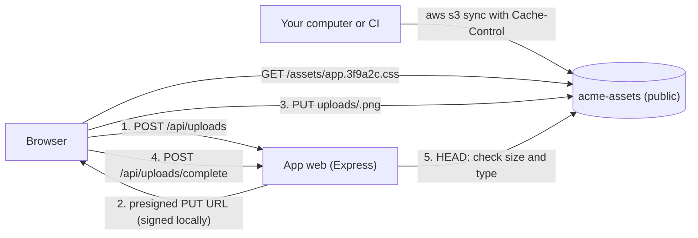

Serving images, stylesheets, scripts and user uploads from object storage keeps them out of your app's container, so
deploys stay small and the app's CPU goes to requests instead of file transfers. In this guide you put a website's
static files in a **public Cloider bucket** with the right `Content-Type` and `Cache-Control` headers, then build a small
Node.js app that lets users upload images **directly from the browser to the bucket** with presigned URLs, so large
files never pass through your app.

**At a glance**

| | |
| --- | --- |
| **You will build** | The public bucket `acme-assets` with your site's assets under `assets/`, and the app `web` that issues presigned upload URLs and stores user images under `uploads/` |
| **Products** | [Object Storage](/object-storage/overview), [Apps](/apps/overview) |
| **Tools** | The `cloider` CLI, the AWS CLI v2, Node.js 22 |
| **Difficulty** | Beginner |
| **Time** | About 30 minutes |
| **Cost** | Bucket storage per GiB, the app's compute. Requests and traffic to the bucket are free. See [What it costs](#what-it-costs) |

## What you'll build



- **Static assets** (CSS, JavaScript, fonts, images that ship with your site) are uploaded once per release, under file
  names that change when their content changes, and cached by browsers for a year.
- **User uploads** go from the browser straight to the bucket. Your app only signs a URL that allows one `PUT` of one
  key for a few minutes, then checks the result.
- Every file is served at `https://acme-assets.s3.eu-central-2.cloider.com/<key>`.

:::info[What a public bucket is and isn't]
A public bucket lets anyone **download** a file whose exact URL they know. Listing the bucket, uploading, overwriting
and deleting still need an access key. In this guide the HTML comes from an [app](/apps/overview) and only the assets
from the bucket. A site with no server-side code can live entirely in a bucket instead: see
[Static websites](/object-storage/static-websites) for index and error documents and serving it on your own domain.
See [Public and private buckets](/object-storage/public-and-private-buckets).
:::

## Before you begin

- A Cloider account and the CLI, logged in with **Read & Write** access. See [Install the CLI](/get-started/install-the-cli).
- The [AWS CLI](https://aws.amazon.com/cli/) version 2.13 or later, for `sync` with cache headers.
- Node.js 22 for the upload app.

## Part 1: Create a public bucket and a key

```bash
cloider bucket create acme-assets --public --wait
```

```text title="Output"
✓ Created bucket acme-assets
✓ Bucket acme-assets is ready
```

Bucket names are shared by every Cloider account: pick your own if `acme-assets` is taken, and use it everywhere below.

Create an access key that only reaches this bucket, for uploading from your computer, CI and the app:

```bash
cloider bucket key create --label assets --bucket acme-assets
```

```text title="Output"
✓ Created access key assets
Access key:  CLDRZ8Q4M2X7KD1PLW0B
Secret key:  7hT2kV9qWm4LxR8zNc3PbY6sJd1FgA5eUo0iKlMn
Endpoint:    https://s3.eu-central-2.cloider.com
Region:      eu-central-2
Buckets:     acme-assets
Permission:  Read & Write
! The secret key is not shown again, keep it now.
```

Configure the AWS CLI with a `cloider` profile, including the checksum setting Cloider's storage needs with recent AWS
tools:

```bash
aws configure set aws_access_key_id CLDRZ8Q4M2X7KD1PLW0B --profile cloider
aws configure set aws_secret_access_key 7hT2kV9qWm4LxR8zNc3PbY6sJd1FgA5eUo0iKlMn --profile cloider
aws configure set region eu-central-2 --profile cloider
aws configure set endpoint_url https://s3.eu-central-2.cloider.com --profile cloider
aws configure set request_checksum_calculation when_required --profile cloider
aws configure set response_checksum_validation when_required --profile cloider
```

See [Access keys](/object-storage/access-keys) and [S3 tools](/object-storage/s3-tools).

### Verify

```bash
cloider bucket get acme-assets
aws s3 ls s3://acme-assets --profile cloider
```

```text title="Output"
Name:      acme-assets
Region:    eu-central-2
Status:    Ready
Access:    public
Size:      0 B
Endpoint:  https://s3.eu-central-2.cloider.com
URL:       https://acme-assets.s3.eu-central-2.cloider.com
Policy:    none
Created:   2026-10-21 10:02
```

The `aws` command prints nothing and exits without an error: the bucket is empty, and the key works.

## Part 2: Upload your site's assets with cache headers

### Choose a caching strategy

Browsers and proxies cache a file for as long as its `Cache-Control` header allows. The safe pattern is to cache files
whose name changes with their content **forever**, and everything else **briefly**:

| Files | Example key | `Cache-Control` | Why |
| --- | --- | --- | --- |
| Fingerprinted build output (bundlers add a content hash) | `assets/app.3f9a2c.css`, `assets/main.8d1e4b.js` | `public, max-age=31536000, immutable` | A new version gets a new name, so the old one can be cached for a year |
| Files with a fixed name | `assets/logo.svg`, `assets/favicon.ico`, `downloads/catalog.pdf` | `public, max-age=3600` | They may change under the same name, so browsers check again after an hour |
| User uploads with a random name | `uploads/2f6c...e1.png` | `public, max-age=31536000, immutable` | A changed image is uploaded under a new key |

Vite, webpack, Next.js, Nuxt and most other build tools write fingerprinted files to a folder such as `dist/assets/`.

### Upload with the AWS CLI

`aws s3 sync` uploads only what changed and sets the `Content-Type` from each file's extension. Run it twice, once per
caching class:

```bash
# Fingerprinted files: cached for a year
aws s3 sync ./dist/assets s3://acme-assets/assets \
  --exclude "*" --include "*.*.css" --include "*.*.js" --include "*.*.woff2" \
  --cache-control "public, max-age=31536000, immutable" \
  --profile cloider

# Everything else in assets/: cached for an hour
aws s3 sync ./dist/assets s3://acme-assets/assets \
  --exclude "*.*.css" --exclude "*.*.js" --exclude "*.*.woff2" \
  --cache-control "public, max-age=3600" \
  --profile cloider
```

```text title="Output"
upload: dist/assets/app.3f9a2c.css to s3://acme-assets/assets/app.3f9a2c.css
upload: dist/assets/main.8d1e4b.js to s3://acme-assets/assets/main.8d1e4b.js
upload: dist/assets/logo.svg to s3://acme-assets/assets/logo.svg
```

Adjust the patterns to your build tool's naming. `sync` doesn't delete files that are gone from your folder, which is
what you want for assets: pages cached in browsers may still reference the previous release's files. Add `--delete`
only if you are sure nothing references them, or let a [lifecycle rule](/object-storage/lifecycle-rules) clean up
an old prefix.

:::tip[Without the AWS CLI]
`cloider bucket upload acme-assets ./dist/assets -r --prefix assets/` uploads a folder with the right `Content-Type`,
but sets no `Cache-Control`. It is fine for a few files; for releases, use a tool that sets cache headers. See
[Manage files](/object-storage/manage-files).
:::

### Reference the files in your pages

```html title="index.html"
<link rel="stylesheet" href="https://acme-assets.s3.eu-central-2.cloider.com/assets/app.3f9a2c.css">
<script type="module" src="https://acme-assets.s3.eu-central-2.cloider.com/assets/main.8d1e4b.js"></script>

```

Most build tools take a base URL for assets, so they write these URLs for you: `base` in Vite,
`output.publicPath` in webpack, `assetPrefix` in Next.js, `app.cdnURL` in Nuxt. Set it to
`https://acme-assets.s3.eu-central-2.cloider.com/` and upload the build's `assets` folder as above.

### Verify

```bash
curl -sI https://acme-assets.s3.eu-central-2.cloider.com/assets/app.3f9a2c.css
```

```text title="Output"
HTTP/1.1 200 OK
Content-Type: text/css
Content-Length: 18342
Cache-Control: public, max-age=31536000, immutable
ETag: "9b2cf535f27731c974343645a3985328"
Last-Modified: Wed, 21 Oct 2026 10:12:41 GMT
```

Check that the content type is right for each kind of file (`text/css`, `text/javascript`, `image/svg+xml`): a wrong
one makes browsers ignore a stylesheet or download an image instead of showing it.

## Part 3: Build the upload app

The app has three endpoints: one that signs an upload URL, one that checks a finished upload, and a page with an upload
form. It keeps the access key on the server: the browser only ever sees a URL that allows one upload of one key.

```text
web/
  package.json
  package-lock.json     created by npm install
  server.js
  public/
    index.html
```

```json title="package.json"
{
  "name": "web",
  "version": "1.0.0",
  "private": true,
  "scripts": {
    "start": "node server.js"
  },
  "engines": {
    "node": "22.x"
  },
  "dependencies": {
    "@aws-sdk/client-s3": "^3.729.0",
    "@aws-sdk/s3-request-presigner": "^3.729.0",
    "express": "^4.21.2"
  }
}
```

```js title="server.js"
const path = require("node:path");
const { randomUUID } = require("node:crypto");
const express = require("express");
const { S3Client, PutObjectCommand, HeadObjectCommand, DeleteObjectCommand } = require("@aws-sdk/client-s3");
const { getSignedUrl } = require("@aws-sdk/s3-request-presigner");

const BUCKET = process.env.S3_BUCKET;
const PUBLIC_URL = process.env.S3_PUBLIC_URL; // https://acme-assets.s3.eu-central-2.cloider.com
const MAX_BYTES = 5 * 1024 * 1024;
const TYPES = { "image/png": "png", "image/jpeg": "jpg", "image/webp": "webp", "image/gif": "gif" };
const CACHE_CONTROL = "public, max-age=31536000, immutable";

// One client for the whole app. The checksum settings stop recent SDKs from adding
// checksums Cloider's storage doesn't accept.
const s3 = new S3Client({
  region: process.env.AWS_REGION,
  endpoint: process.env.AWS_ENDPOINT_URL_S3,
  credentials: {
    accessKeyId: process.env.AWS_ACCESS_KEY_ID,
    secretAccessKey: process.env.AWS_SECRET_ACCESS_KEY,
  },
  requestChecksumCalculation: "WHEN_REQUIRED",
  responseChecksumValidation: "WHEN_REQUIRED",
});

const app = express();
app.set("trust proxy", true);
app.use(express.json());
app.use(express.static(path.join(__dirname, "public")));

// 1. Sign a URL that allows one PUT of one new key, for 5 minutes
app.post("/api/uploads", async (req, res, next) => {
  const type = req.body?.contentType;
  const size = Number(req.body?.size);
  if (!TYPES[type]) return res.status(400).json({ error: "only PNG, JPEG, WebP and GIF images" });
  if (!Number.isInteger(size) || size < 1 || size > MAX_BYTES) {
    return res.status(400).json({ error: "images up to 5 MB" });
  }
  // A real app checks here that the user is logged in and may upload
  try {
    const key = `uploads/${randomUUID()}.${TYPES[type]}`;
    const headers = { "Content-Type": type, "Cache-Control": CACHE_CONTROL };
    const url = await getSignedUrl(
      s3,
      new PutObjectCommand({ Bucket: BUCKET, Key: key, ContentType: type, CacheControl: CACHE_CONTROL }),
      { expiresIn: 300 }
    );
    // The browser must send exactly these headers, they are part of the signature
    res.json({ url, key, headers });
  } catch (err) {
    next(err);
  }
});

// 2. Check what was really uploaded, and remove it if it breaks the rules
app.post("/api/uploads/complete", async (req, res, next) => {
  const key = String(req.body?.key ?? "");
  if (!/^uploads\/[0-9a-f-]{36}\.(png|jpg|webp|gif)$/.test(key)) {
    return res.status(400).json({ error: "unknown key" });
  }
  try {
    const head = await s3.send(new HeadObjectCommand({ Bucket: BUCKET, Key: key }));
    if (head.ContentLength > MAX_BYTES || !TYPES[head.ContentType]) {
      await s3.send(new DeleteObjectCommand({ Bucket: BUCKET, Key: key }));
      return res.status(400).json({ error: "the upload was rejected" });
    }
    // Store the key in your database here, not the URL
    res.json({ key, url: `${PUBLIC_URL}/${key}`, size: head.ContentLength });
  } catch (err) {
    if (err.name === "NotFound") return res.status(404).json({ error: "nothing was uploaded" });
    next(err);
  }
});

app.use((err, req, res, next) => {
  console.error(err);
  res.status(500).json({ error: "internal error" });
});

const port = Number(process.env.PORT) || 3000;
app.listen(port, "0.0.0.0", () => console.log(`web listening on port ${port}`));
```

```html title="public/index.html"
<!doctype html>
<html lang="en">
<head>
  <meta charset="utf-8">
  <meta name="viewport" content="width=device-width, initial-scale=1">
  <title>Upload an image</title>
</head>
<body>
  <h1>Upload an image</h1>
  <input type="file" id="file" accept="image/png,image/jpeg,image/webp,image/gif">
  <p id="status"></p>
  

  <script>
    const status = document.getElementById("status");

    async function post(path, body) {
      const res = await fetch(path, {
        method: "POST",
        headers: { "Content-Type": "application/json" },
        body: JSON.stringify(body),
      });
      const data = await res.json();
      if (!res.ok) throw new Error(data.error);
      return data;
    }

    document.getElementById("file").onchange = async (event) => {
      const file = event.target.files[0];
      if (!file) return;
      try {
        status.textContent = "Preparing...";
        const { url, key, headers } = await post("/api/uploads", { contentType: file.type, size: file.size });

        status.textContent = "Uploading...";
        const put = await fetch(url, { method: "PUT", headers, body: file });
        if (!put.ok) throw new Error(`upload failed with ${put.status}`);

        const done = await post("/api/uploads/complete", { key });
        status.textContent = `Uploaded ${done.size} bytes`;
        document.getElementById("preview").src = done.url;
      } catch (err) {
        status.textContent = err.message;
      }
    };
  </script>
</body>
</html>
```

How the upload stays safe:

- The **access key never leaves the server**. A presigned URL is signed locally by the SDK, works for one `PUT` of one
  key, and expires after 5 minutes (`expiresIn: 300`).
- The **key is random** (`uploads/<uuid>.png`), so users can't overwrite each other's files or guess names.
- The **signed headers** (`Content-Type` and `Cache-Control`) must be sent exactly as signed, or the storage answers
  `SignatureDoesNotMatch`. That pins the type the browser can store.
- The **size can't be enforced by a presigned PUT**, so the app checks the real size with `HeadObject` after the
  upload and deletes anything too large.

See [Create a presigned URL](/object-storage/sdks) in the SDK guide for the same pattern in other languages.

## Part 4: Deploy the app

Install the dependencies (which writes the lockfile), then deploy the folder as an app with the bucket settings as
environment variables, the secret key as a secret:

```bash
cd web
npm install

cloider deploy --name web --port 3000 \
  --env S3_BUCKET=acme-assets \
  --env S3_PUBLIC_URL=https://acme-assets.s3.eu-central-2.cloider.com \
  --env AWS_REGION=eu-central-2 \
  --env AWS_ENDPOINT_URL_S3=https://s3.eu-central-2.cloider.com \
  --env AWS_ACCESS_KEY_ID=CLDRZ8Q4M2X7KD1PLW0B \
  --secret-env AWS_SECRET_ACCESS_KEY=7hT2kV9qWm4LxR8zNc3PbY6sJd1FgA5eUo0iKlMn
```

```text title="Output"
Packaged 4 files (5.2 KB)
Detected JavaScript Express
✓ Created app web on port 3000
Linked . to web in .cloider/app.json, later deploys from here update it.
...
✓ Deployed version 1 of web
https://web-x7k2.cloider.app/
```

`node_modules/` is left out of the upload when your `.gitignore` lists it, and the build installs the dependencies
again. See [Deploy from your computer](/apps/deploy-from-your-computer) and
[Environment variables](/apps/environment-variables).

### Verify

1. Open the app's URL and pick an image. The page shows **Uploaded ... bytes** and the image itself, loaded from the
   bucket.
2. The file is in the bucket, with its headers:

```bash
cloider bucket ls acme-assets uploads/
curl -sI "$(cloider bucket get acme-assets -o json | jq -r .url)/$(cloider bucket ls acme-assets uploads/ -o json | jq -r '.objects[0].key')"
```

```text title="Output"
KEY                                              SIZE     MODIFIED
uploads/2f6c1b9e-4d7a-4c3e-9a1f-8e5d2c7b0a41.png 182.4 KB 2026-10-21 10:31
HTTP/1.1 200 OK
Content-Type: image/png
Cache-Control: public, max-age=31536000, immutable
```

## Private files: presigned downloads

Files that only some users may see (invoices, exports, private documents) belong in a **private** bucket. Your app then
hands out a short-lived presigned **GET** URL each time a user is allowed to download a file:

```js title="Download link (server.js)"
const { GetObjectCommand } = require("@aws-sdk/client-s3");

app.get("/api/invoices/:id/download", async (req, res, next) => {
  // Check here that the user owns this invoice
  try {
    const url = await getSignedUrl(
      s3,
      new GetObjectCommand({
        Bucket: "acme-private",
        Key: `invoices/${req.params.id}.pdf`,
        ResponseContentDisposition: `attachment; filename="invoice-${req.params.id}.pdf"`,
      }),
      { expiresIn: 600 }
    );
    res.redirect(302, url);
  } catch (err) {
    next(err);
  }
});
```

The link works for 10 minutes and can't be revoked one by one; it stops working when the key that signed it is
deleted. On the free trial an account has one bucket at a time, so a second, private bucket needs a paid account.

## What it costs

| Resource | How it is billed |
| --- | --- |
| Bucket `acme-assets` | Per GiB stored per month, averaged over the month. **Requests and traffic are free**, so popular assets don't raise the bill |
| App `web` | Compute units for its one container while it runs. Builds are free |
| Access keys | Free |

See [Bucket usage and billing](/object-storage/usage-and-billing) and [Pricing](/reference/pricing).

## Clean up

```bash
cloider app delete web --yes
cloider bucket key delete assets --yes
cloider bucket delete acme-assets --yes --wait
```

Deleting the bucket deletes every file in it, uploads included. Remove the `[cloider]` sections from `~/.aws/credentials`
and `~/.aws/config` if you no longer need the profile.

## Troubleshooting

| Symptom | Cause and fix |
| --- | --- |
| `403 Access Denied` when loading a file | The bucket is private, or the key in the URL is wrong (keys are case sensitive). Check with `cloider bucket visibility acme-assets` |
| A stylesheet is ignored, or an image downloads instead of showing | The file was stored with the wrong `Content-Type`. Upload it again with `--content-type`, or let `aws s3 sync` detect it from the extension |
| Visitors see an old version after a release | The file kept its name and was cached with a long `max-age`. Fingerprint file names, or use a short `max-age` for fixed names |
| `SignatureDoesNotMatch` on the browser's `PUT` | The browser sent different headers than the URL was signed for. Send exactly the `headers` the app returned |
| A CORS error in the browser console on upload | Usually the request itself is wrong (expired URL, different headers); a failed upload often shows up as a CORS error. Compare the request in the network tab with the example. See [Object storage troubleshooting](/object-storage/troubleshooting) |
| `XAmzContentSHA256Mismatch` or another checksum error from the SDK or AWS CLI | Recent AWS tools add checksums Cloider's storage doesn't accept. Set `requestChecksumCalculation: "WHEN_REQUIRED"` in the SDK, or `request_checksum_calculation = when_required` in the AWS CLI profile |
| `AccessDenied` from the app | The key doesn't reach the bucket, or it is read only. Check `cloider bucket key list` |
| `making a bucket public needs confirming, pass --yes when not running in a terminal` | `cloider bucket visibility <bucket> public` asks for confirmation. Add `--yes` in scripts |

## Next steps

- [SDKs](/object-storage/sdks): the same client setup in Python, Go, PHP, Java, Ruby and .NET.
- [Bucket policies](/object-storage/bucket-policies): make only one prefix public, or deny deletes.
- [Lifecycle rules](/object-storage/lifecycle-rules): expire temporary uploads automatically.
- [Full stack app with PostgreSQL](/guides/full-stack-app-with-postgresql): store each upload's key in a database.

<FAQ items={[
  {q: 'Can I serve images and CSS from a Cloider bucket?', a: 'Yes. Make the bucket public and reference each file at https://<bucket>.s3.eu-central-2.cloider.com/<key>. Upload files with the right Content-Type and a Cache-Control header so browsers cache them. Listing and writing still need an access key.'},
  {q: 'How do I set Cache-Control on files in a Cloider bucket?', a: 'Set it when uploading: aws s3 sync or aws s3 cp with --cache-control "public, max-age=31536000, immutable", CacheControl in the AWS SDKs, or a signed Cache-Control header on a presigned upload. The storage returns it with every download.'},
  {q: 'How do users upload files directly to a Cloider bucket?', a: 'Your server creates a presigned PUT URL for one key and content type with an AWS SDK, using a bucket access key, and the browser PUTs the file to that URL with the same headers. The file never passes through your server, and the key never reaches the browser.'},
  {q: 'Does Cloider charge for bucket traffic or requests?', a: 'No. Buckets are billed for the data stored, per GiB per month. Requests and traffic are free.'},
  {q: 'Can I put my own domain in front of a Cloider bucket?', a: 'Yes. Turn on the bucket\'s static website and add a Bucket target that points the domain at it. The target takes the whole domain, so for assets next to an app on example.com use a domain of their own, such as assets.example.com, or keep the bucket\'s own address.'},
]} />
