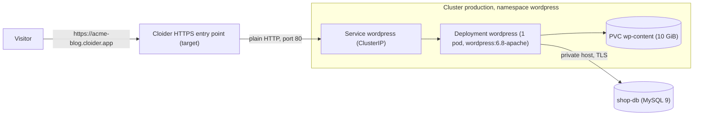

In this guide you run WordPress on a Cloider Kubernetes cluster the production friendly way: the WordPress container
runs as a Kubernetes Deployment, its data lives in a **managed MySQL database** (backed up daily by Cloider), its
uploads, plugins and themes live on a **PersistentVolumeClaim**, and visitors reach it over **HTTPS** through a domain
target, with no load balancer to pay for. You get complete manifests you can apply as they are.

**At a glance**

| | |
| --- | --- |
| **You will build** | WordPress at `https://acme-blog.cloider.app` (and optionally `https://blog.example.com`), on the cluster `production`, with the MySQL database `shop-db` |
| **Products** | [Kubernetes](/kubernetes/overview), [Databases](/databases/overview), [Domains and DNS](/domains/overview) |
| **Tools** | The `cloider` CLI and `kubectl` |
| **Difficulty** | Intermediate. You should know what a Deployment, a Service and a Secret are, or read [Deploy a workload](/kubernetes/deploy-a-workload) first |
| **Time** | About 40 minutes |
| **Cost** | Cluster compute, one volume and one database plan, prorated by the second. See [What it costs](#what-it-costs) |

## What you'll build



- **WordPress** runs from the official `wordpress` image, which configures itself from environment variables. One pod
  is enough for most sites, and a `ReadWriteOnce` volume can only be mounted by one pod at a time.
- **wp-content** (uploads, plugins, themes) is on a 10 GiB PersistentVolumeClaim, so it survives restarts and new
  versions. WordPress core comes from the image, so upgrading WordPress is changing the image tag.
- **MySQL** is a Cloider managed database. Only the cluster may connect to it, over its private host and TLS.
- **A target** routes the free subdomain `acme-blog.cloider.app` to the `wordpress` Service, with HTTPS handled by
  Cloider. Kubernetes `Ingress` objects aren't served on Cloider; targets replace them. See
  [Expose services](/kubernetes/expose-services).

## Before you begin

- A Cloider account and the CLI, logged in with **Read & Write** access. See [Install the CLI](/get-started/install-the-cli).
- [`kubectl`](https://kubernetes.io/docs/tasks/tools/) on your computer. Without it, every `kubectl` command below
  can run through `cloider cluster exec production -- kubectl ...` instead.
- `openssl` and `jq`, to generate WordPress's secret keys and read JSON from the CLI.
- Optional, for the last part: a domain on Cloider's nameservers, here `example.com`. See
  [Add a custom domain](/domains/add-a-custom-domain).

## Part 1: Create the cluster and connect kubectl

Create a cluster called `production`, wait until it is ready, and add it to your kubeconfig as the current context:

```bash
cloider cluster create production --wait
cloider cluster kubeconfig production --merge --use
```

```text title="Output"
✓ Creating cluster production (Kubernetes 1.34)
✓ Cluster production is ready. Get its kubeconfig with `cloider cluster kubeconfig production --merge`.
✓ Added context cloider-production to /Users/you/.kube/config
```

A Cloider cluster is serverless: there are no nodes to size, and you pay for the CPU and memory your pods request or
use. See [Create a cluster](/kubernetes/create-a-cluster) and [Connect with kubectl](/kubernetes/connect-with-kubectl).

### Verify

```bash
kubectl get nodes
kubectl get storageclass
```

The first command lists the cluster's nodes. The second lists the storage classes, one of them marked `(default)`,
which the volume in part 4 uses.

## Part 2: Create the MySQL database

Create a MySQL database called `shop-db` that only the `production` cluster may connect to:

```bash
cloider db create shop-db --engine mysql --trusted-source cluster:production --wait
```

```text title="Output"
✓ Creating MySQL 9 database shop-db (plan Hobby)
✓ Database shop-db is ready. Connect with `cloider db connect shop-db`.
```

- `--trusted-source cluster:production` allows connections from the cluster to the database's **private host**, and
  nothing else. See [Trusted sources](/databases/trusted-sources).
- The **Hobby** plan allows 20 connections, enough for a small site with one WordPress pod. For a busy site, choose a
  larger plan with `--plan`, see [MySQL](/databases/mysql) and [Resize](/databases/resize).
- SSL is on by default. MySQL 9 authenticates with `caching_sha2_password`, which works without extra settings over
  TLS.

Read the connection details you need for WordPress:

```bash
DB_JSON=$(cloider db get shop-db -o json)
DB_HOST=$(echo "$DB_JSON" | jq -r .private_host)
DB_PORT=$(echo "$DB_JSON" | jq -r .database_port)
DB_USER=$(echo "$DB_JSON" | jq -r .database_user)
DB_NAME=$(echo "$DB_JSON" | jq -r .database_name)
echo "$DB_HOST:$DB_PORT $DB_USER $DB_NAME"
```

```text title="Output"
shop-db-k7x2wd.db.cloider.internal:22861 shop_db_user shop-db
```

### Verify

```bash
cloider db exec shop-db "SELECT @@character_set_server, @@max_connections"
```

```text title="Output"
@@character_set_server	@@max_connections
utf8mb4	20
```

`cloider db exec` runs `mysql` next to the database, so it works even though your own IP isn't a trusted source.

## Part 3: Store the database password and WordPress keys in a Secret

WordPress needs the database login and eight random secret keys, which sign its login cookies. Keep them in a
Kubernetes Secret, never in the manifest file.

```bash
kubectl create namespace wordpress

kubectl create secret generic wordpress -n wordpress \
  --from-literal=WORDPRESS_DB_HOST="$DB_HOST:$DB_PORT" \
  --from-literal=WORDPRESS_DB_USER="$DB_USER" \
  --from-literal=WORDPRESS_DB_PASSWORD="$(cloider db password shop-db)" \
  --from-literal=WORDPRESS_DB_NAME="$DB_NAME" \
  --from-literal=WORDPRESS_AUTH_KEY="$(openssl rand -base64 48)" \
  --from-literal=WORDPRESS_SECURE_AUTH_KEY="$(openssl rand -base64 48)" \
  --from-literal=WORDPRESS_LOGGED_IN_KEY="$(openssl rand -base64 48)" \
  --from-literal=WORDPRESS_NONCE_KEY="$(openssl rand -base64 48)" \
  --from-literal=WORDPRESS_AUTH_SALT="$(openssl rand -base64 48)" \
  --from-literal=WORDPRESS_SECURE_AUTH_SALT="$(openssl rand -base64 48)" \
  --from-literal=WORDPRESS_LOGGED_IN_SALT="$(openssl rand -base64 48)" \
  --from-literal=WORDPRESS_NONCE_SALT="$(openssl rand -base64 48)"
```

```text title="Output"
namespace/wordpress created
secret/wordpress created
```

- `WORDPRESS_DB_HOST` takes the port after a colon. The port is your database's own, not MySQL's usual 3306.
- The keys must stay the same across restarts. Without them, the image generates new random keys each time the pod
  starts, and everyone is logged out.

### Verify

```bash
kubectl get secret wordpress -n wordpress -o jsonpath='{.data}' | jq 'keys'
```

The output lists the twelve keys, from `WORDPRESS_AUTH_KEY` to `WORDPRESS_SECURE_AUTH_SALT`.

## Part 4: Deploy WordPress

Save this file. It holds the volume claim, the Deployment and the Service:

```yaml title="wordpress.yaml"
# Uploads, plugins and themes, kept across restarts
apiVersion: v1
kind: PersistentVolumeClaim
metadata:
  name: wp-content
  namespace: wordpress
spec:
  accessModes:
    - ReadWriteOnce
  resources:
    requests:
      storage: 10Gi
---
apiVersion: apps/v1
kind: Deployment
metadata:
  name: wordpress
  namespace: wordpress
  labels:
    app: wordpress
spec:
  replicas: 1
  # A ReadWriteOnce volume is mounted by one pod at a time: stop the old pod first
  strategy:
    type: Recreate
  selector:
    matchLabels:
      app: wordpress
  template:
    metadata:
      labels:
        app: wordpress
    spec:
      securityContext:
        # www-data, the user Apache runs as, can write to the volume
        fsGroup: 33
      containers:
        - name: wordpress
          image: wordpress:6.8-apache
          ports:
            - name: http
              containerPort: 80
          envFrom:
            - secretRef:
                name: wordpress
          env:
            - name: WP_HOME
              value: https://acme-blog.cloider.app
            - name: WORDPRESS_CONFIG_EXTRA
              value: |
                define('MYSQL_CLIENT_FLAGS', MYSQLI_CLIENT_SSL);
                define('WP_HOME', getenv('WP_HOME'));
                define('WP_SITEURL', getenv('WP_HOME'));
          volumeMounts:
            - name: wp-content
              mountPath: /var/www/html/wp-content
          resources:
            requests:
              cpu: 100m
              memory: 256Mi
            limits:
              memory: 512Mi
          readinessProbe:
            httpGet:
              path: /wp-login.php
              port: http
            initialDelaySeconds: 10
            periodSeconds: 10
          livenessProbe:
            tcpSocket:
              port: http
            initialDelaySeconds: 30
            periodSeconds: 20
      volumes:
        - name: wp-content
          persistentVolumeClaim:
            claimName: wp-content
---
apiVersion: v1
kind: Service
metadata:
  name: wordpress
  namespace: wordpress
spec:
  type: ClusterIP
  selector:
    app: wordpress
  ports:
    - name: http
      port: 80
      targetPort: http
```

What the important settings do:

| Setting | Why |
| --- | --- |
| `mountPath: /var/www/html/wp-content` | Only `wp-content` is on the volume. WordPress core is copied from the image at every start, so a new image tag upgrades it |
| `strategy: Recreate` | The old pod releases the `ReadWriteOnce` volume before the new pod mounts it |
| `MYSQL_CLIENT_FLAGS` with `MYSQLI_CLIENT_SSL` | WordPress connects to MySQL over TLS, which the database requires with SSL on |
| `WP_HOME` and `WP_SITEURL` | The address WordPress builds its links with, read from the `WP_HOME` variable so you can change it without editing the database |
| `fsGroup: 33` | Gives the volume to the `www-data` group, so WordPress can write uploads and install plugins |
| `resources.requests` | What the pod is billed for at least. Cloider bills the larger of a container's request and its actual use |
| `readinessProbe` | The Service only sends traffic once WordPress answers |

The image also sets `HTTPS` on when a request arrives with `X-Forwarded-Proto: https`, which is how Cloider forwards
requests through a target, so WordPress generates `https://` links and the admin works without redirect loops.

Apply it:

```bash
kubectl apply -f wordpress.yaml
```

```text title="Output"
persistentvolumeclaim/wp-content created
deployment.apps/wordpress created
service/wordpress created
```

### Verify

```bash
kubectl rollout status deployment/wordpress -n wordpress --timeout=5m
kubectl get pods,svc -n wordpress
kubectl get pvc -n wordpress -o custom-columns=NAME:.metadata.name,STATUS:.status.phase,CAPACITY:.status.capacity.storage
```

```text title="Output"
deployment "wordpress" successfully rolled out
NAME                             READY   STATUS    RESTARTS   AGE
pod/wordpress-6d9c7f8b5c-x2k4m   1/1     Running   0          58s

NAME                TYPE        CLUSTER-IP     EXTERNAL-IP   PORT(S)   AGE
service/wordpress   ClusterIP   10.43.118.27   <none>        80/TCP    58s
NAME         STATUS   CAPACITY
wp-content   Bound    10Gi
```

If the pod stays `Pending` or the claim isn't `Bound`, see [Troubleshooting](#troubleshooting).

## Part 5: Serve WordPress over HTTPS with a target

Claim a free subdomain and route it to the `wordpress` Service. A target is the right tool for a website: Cloider
terminates HTTPS with a certificate it manages, forwards plain HTTP to the Service, and there is no load balancer
charge.

```bash
cloider domain create acme-blog.cloider.app
cloider target create acme-blog.cloider.app --cluster production --service wordpress/wordpress
```

```text title="Output"
✓ Claimed acme-blog.cloider.app
Route it with `cloider target create acme-blog.cloider.app --app <app>`.
✓ Routed acme-blog.cloider.app/ to production/wordpress/wordpress:80
```

`--service` is `<namespace>/<service>`, and the Service's only port (80) is used. `cloider cluster services production`
lists what a target can route to. The same steps in the dashboard are under **Domains**, your domain, **Add target**,
**Target type** **Cluster**. See [Expose services](/kubernetes/expose-services).

<Screenshot
  src="/img/screenshots/domains/targets.webp"
  url="/dashboard/domains/acme-blog.cloider.app"
  alt="A domain page with targets that route paths to an app and to a cluster service"
  caption="Targets route a domain, or a path of it, to a Service in your cluster."
/>

<details>
<summary>Alternative: a LoadBalancer Service with a public IP</summary>

A Service of type `LoadBalancer` gets its own public IP address and passes any TCP port through. For a website it has
two drawbacks: TLS is passed through untouched, so WordPress would be served on plain `http://` unless you terminate
TLS in the pod yourself, and each load balancer is billed per month. Use it only when you need a raw port.

```yaml title="wordpress-lb.yaml"
apiVersion: v1
kind: Service
metadata:
  name: wordpress-public
  namespace: wordpress
spec:
  type: LoadBalancer
  selector:
    app: wordpress
  ports:
    - name: http
      port: 80
      targetPort: http
```

```bash
kubectl apply -f wordpress-lb.yaml
kubectl get svc wordpress-public -n wordpress
```

Set `WP_HOME` to `http://<EXTERNAL-IP>` to match. See [Load balancers](/kubernetes/load-balancers).

</details>

### Verify

```bash
curl -sI https://acme-blog.cloider.app/
```

```text title="Output"
HTTP/2 302
location: https://acme-blog.cloider.app/wp-admin/install.php
```

The redirect to `install.php` means WordPress reached the database and found it empty, which is what you expect
before the installation.

## Part 6: Install WordPress and test uploads

1. Open `https://acme-blog.cloider.app/wp-admin/install.php`.
2. Pick a language, then fill in **Site Title**, **Username**, a strong **Password** and **Your Email**.
3. Click **Install WordPress**, then **Log In**.
4. In the admin, open **Media**, **Add New Media File**, and upload a small image.

### Verify

The tables are in the managed database:

```bash
cloider db exec shop-db "SHOW TABLES"
```

```text title="Output"
Tables_in_shop-db
wp_commentmeta
wp_comments
wp_links
wp_options
wp_postmeta
wp_posts
wp_term_relationships
wp_term_taxonomy
wp_termmeta
wp_terms
wp_usermeta
wp_users
```

The image is on the volume, and stays there when the pod is replaced:

```bash
kubectl exec -n wordpress deploy/wordpress -- find wp-content/uploads -type f
kubectl rollout restart deployment/wordpress -n wordpress
kubectl rollout status deployment/wordpress -n wordpress
kubectl exec -n wordpress deploy/wordpress -- find wp-content/uploads -type f
```

Both `find` commands list the same file, for example `wp-content/uploads/2026/10/logo.png`, and you are still logged in
to the admin after the restart, because the keys come from the Secret.

## Part 7: Use your own domain (optional)

To serve the site on `https://blog.example.com`, the domain `example.com` must be on Cloider's nameservers. Then add a
DNS record for `blog`, add `blog.example.com` as a domain of its own, and route it to the same Service:

```bash
cloider dns create example.com --type CNAME --name blog --value acme-blog.cloider.app. --ttl 3600
cloider domain create blog.example.com
cloider target create blog.example.com --cluster production --service wordpress/wordpress
```

A target doesn't add a DNS record, which is why the `CNAME` comes first. See
[Add a custom domain](/domains/add-a-custom-domain) for adding `example.com` and pointing its nameservers.

Then tell WordPress its new address. The pod restarts with the new value:

```bash
kubectl set env deployment/wordpress -n wordpress WP_HOME=https://blog.example.com
```

`WP_HOME` changes the address WordPress builds links with. Links already saved inside posts still point at the old
address: update them with a search and replace plugin, or with WP-CLI if you add it to your image.

### Verify

```bash
dig blog.example.com +short
curl -sI https://blog.example.com/ | head -n 1
```

```text title="Output"
acme-blog.cloider.app.
203.0.113.80
HTTP/2 200
```

The certificate for `blog.example.com` is issued once the name resolves to Cloider, usually within a minute or two.
See [HTTPS certificates](/domains/https-certificates).

## Run it in production

- **Upgrade WordPress** by changing the image tag (for example to a newer `wordpress:6.x-apache`) and running
  `kubectl apply -f wordpress.yaml`. Back up first. Plugins and themes on the volume are updated from the admin as
  usual.
- **Backups**: Cloider backs up `shop-db` once a day and keeps at least the last 7 backups, see
  [Backups and restore](/databases/backups-and-restore). The volume isn't backed up for you. Copy `wp-content` to a
  bucket on a schedule, as in [Back up a database to a bucket](/guides/back-up-a-database-to-a-bucket), or keep media
  in object storage with an offload plugin.
- **Connections**: every PHP worker can hold a database connection. Keep an eye on the
  [Insights](/databases/insights) tab, and resize the database before it reaches the plan's limit.
- **One replica**: a `ReadWriteOnce` volume can't be shared by several pods. To run several WordPress pods, move
  uploads to object storage first.
- **Pause** the cluster to stop paying for compute while the site isn't needed, see
  [Pause and resume](/kubernetes/pause-and-resume). A paused cluster's targets answer with errors until you resume it.

## What it costs

Each resource is billed while it exists, by the second, at the monthly rates on the [pricing page](/reference/pricing):

| Resource | How it is billed |
| --- | --- |
| Cluster `production` | Compute units for its running containers, including its Kubernetes control plane. Each container counts the larger of its request and its use, so the `100m` CPU and `256Mi` memory requests set a floor for WordPress |
| Volume `wp-content` | Per GiB of provisioned size per month: 10 GiB is billed as 10 GiB however full it is. Also billed while the cluster is paused |
| Database `shop-db` | The flat monthly price of its plan, prorated while it is **Ready** |
| Domains, DNS records, targets, certificates | Free. A target has no load balancer charge |
| LoadBalancer Service (alternative only) | Per load balancer per month, while it has an external IP |

See [the billing model](/concepts/billing-model) and watch the cost on the [Usage](/account/usage) page.

## Clean up

Deleting is permanent. Export anything you want to keep first.

```bash
# The routes and the free subdomain (and blog.example.com if you added it)
cloider domain delete acme-blog.cloider.app --yes
cloider domain delete blog.example.com --yes

# WordPress, its Secret, and the volume with your uploads
kubectl delete namespace wordpress

# The database, its data and its backups
cloider db delete shop-db --yes --wait

# The cluster and everything still in it
cloider cluster delete production --yes --wait
```

Remove the `blog` record from `example.com` with `cloider dns list example.com` and `cloider dns delete <record-id>`
if you added it. Deleting the cluster alone also removes the namespace and its volume.

## Troubleshooting

| Symptom | Cause and fix |
| --- | --- |
| **Error establishing a database connection** | The cluster isn't a trusted source (`cloider db trusted-sources shop-db` must list `production`), `WORDPRESS_DB_HOST` uses the public host or lacks the port, or the password is wrong. Check the Secret with `kubectl get secret wordpress -n wordpress -o jsonpath='{.data.WORDPRESS_DB_HOST}' \| base64 -d` |
| The pod logs `Authentication requires secure connection` | `MYSQL_CLIENT_FLAGS` is missing from `WORDPRESS_CONFIG_EXTRA`, so WordPress connects without TLS. Keep the `define('MYSQL_CLIENT_FLAGS', MYSQLI_CLIENT_SSL);` line |
| The pod stays `Pending` | The claim isn't bound. `kubectl describe pvc wp-content -n wordpress` says why. See [Persistent volumes](/kubernetes/persistent-volumes) |
| `Multi-Attach error` when the pod is replaced | Two pods want the same `ReadWriteOnce` volume. Keep `strategy: Recreate` and `replicas: 1` |
| `502 Bad Gateway` or `503` on the site | The pod isn't ready or the target points at the wrong port. Check `kubectl get endpoints wordpress -n wordpress` and `cloider target list acme-blog.cloider.app` |
| Redirect loop, or the admin redirects to `http://` | `WP_HOME` doesn't start with `https://`. Set it with `kubectl set env` |
| Uploads fail with **Unable to create directory** | WordPress can't write to the volume. Keep `fsGroup: 33` in the pod's `securityContext` |
| Uploads of large files fail with `413 Request Entity Too Large` | The upload was refused before it reached WordPress: requests through a target currently accept bodies up to 1 MB. Resize images before uploading them, or serve the site through a [LoadBalancer Service](/kubernetes/load-balancers) |
| Everyone is logged out after each restart | The eight `WORDPRESS_*_KEY` and `WORDPRESS_*_SALT` values are missing from the Secret |
| `Too many connections` | The plan's connection limit is reached. [Resize](/databases/resize) the database |

More in [Kubernetes troubleshooting](/kubernetes/troubleshooting) and [Database troubleshooting](/databases/troubleshooting).

## Next steps

- [Back up a database to a bucket](/guides/back-up-a-database-to-a-bucket): keep your own MySQL dumps on a schedule.
- [Helm](/kubernetes/helm): install other applications from charts.
- [Pull private images](/kubernetes/pull-private-images): run a custom WordPress image with your own plugins baked in.
- [CI/CD with GitHub Actions](/guides/ci-cd-with-github-actions): build and roll out that image automatically.

<FAQ items={[
  {q: 'Can I run WordPress on Cloider Kubernetes with a managed MySQL database?', a: 'Yes. Run the official wordpress image as a Deployment, give it the database\'s private host and port, user, password and name through a Secret, set MYSQL_CLIENT_FLAGS to MYSQLI_CLIENT_SSL so it connects over TLS, and add the cluster to the database\'s trusted sources.'},
  {q: 'How do I keep WordPress uploads when the pod restarts?', a: 'Mount a PersistentVolumeClaim at /var/www/html/wp-content. Uploads, plugins and themes are written there and survive restarts and new versions, while WordPress core comes from the image.'},
  {q: 'Do I need an Ingress controller for WordPress on Cloider?', a: 'No. Ingress objects aren\'t served on Cloider clusters. Route a domain to the WordPress Service with a target, and Cloider terminates HTTPS with a certificate it manages, without a load balancer charge.'},
  {q: 'Can I run more than one WordPress pod?', a: 'Not with a ReadWriteOnce volume, which only one pod can mount at a time. To scale out, move uploads to object storage with an offload plugin so the pods share nothing on disk.'},
  {q: 'Why does WordPress log everyone out after a restart?', a: 'The official image generates random secret keys when they aren\'t set. Store the eight WORDPRESS_*_KEY and WORDPRESS_*_SALT values in a Secret so they stay the same.'},
  {q: 'Is my WordPress database backed up?', a: 'Yes. Cloider backs up every managed MySQL database once a day and keeps at least the last 7 backups, which you can restore into a new database. The wp-content volume isn\'t backed up automatically.'},
]} />
