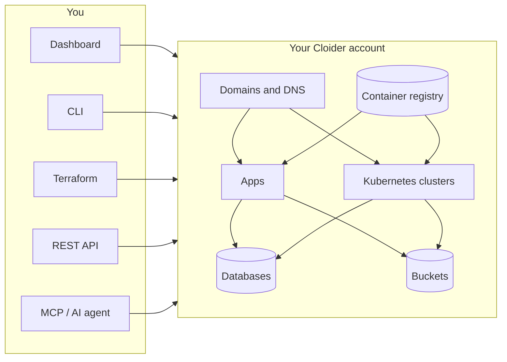

Cloider is a cloud platform where you build, deploy and scale applications without managing servers. It gives you serverless Kubernetes clusters, an App Engine that turns a git repository or a folder into a live HTTPS URL, managed PostgreSQL, MySQL, MongoDB and Redis, S3 compatible object storage, a private container registry, and domains with authoritative DNS. You pay only for what your resources use, and you can drive all of it from the dashboard, the `cloider` CLI, Terraform, a REST API or an AI agent over MCP.

These docs explain every product and every tool, from your first deploy to the exact field of an API response. Each how-to shows the same task in every tool, so you can follow along in the one you prefer.

## At a glance

| | |
| --- | --- |
| **What it is** | An all-in-one cloud platform: compute, data, storage and networking on one account and one bill |
| **Pricing** | True pay-as-you-go, metered on what you actually use. Every account starts with a 14 day free trial and $25 in free credit. See [pricing](/reference/pricing) |
| **Products** | [Apps](/apps/overview), [Kubernetes](/kubernetes/overview), [Databases](/databases/overview), [Object Storage](/object-storage/overview), [Container Registry](/container-registry/overview), [Domains and DNS](/domains/overview) |
| **Tools** | [Dashboard](/get-started/dashboard-tour), [CLI](/cli/overview), [Terraform](/terraform/overview), [REST API](/api/overview), [MCP server](/mcp/overview) |
| **Standards** | Standard Kubernetes API, S3 compatible storage, OCI container images, plain PostgreSQL, MySQL, MongoDB and Redis wire protocols. No lock-in and no egress fees |
| **Who it is for** | Developers and teams who want production infrastructure without a DevOps team, and coding agents that deploy on their behalf |

## Products

<Cards cols={3}>
  <Card title="Apps" href="/apps/overview" icon="rocket-launch-outline">
    Push code, get a live HTTPS URL. Cloider detects your stack and builds it with your Dockerfile or buildpacks, and can redeploy on every push.
  </Card>
  <Card title="Kubernetes" href="/kubernetes/overview" icon="kubernetes">
    Fully managed clusters ready in a few minutes. No nodes to size or patch, billed on the CPU and memory your workloads use.
  </Card>
  <Card title="Databases" href="/databases/overview" icon="database-outline">
    PostgreSQL, MySQL, MongoDB and Redis with daily backups, SSL and trusted source allowlists.
  </Card>
  <Card title="Object Storage" href="/object-storage/overview" icon="bucket-outline">
    S3 compatible buckets for files, backups, static assets and static websites, with versioning and lifecycle rules.
  </Card>
  <Card title="Container Registry" href="/container-registry/overview" icon="docker">
    Private images at registry.cloider.com, with scoped tokens, retention policies and immutable tags.
  </Card>
  <Card title="Domains and DNS" href="/domains/overview" icon="web">
    Free subdomains or your own domain, authoritative DNS, and automatic HTTPS for apps, cluster services and bucket websites.
  </Card>
</Cards>

## Tools

Everything you can do in the dashboard you can also do from code. Pick the tool that fits the job, or mix them: a resource created in one shows up in all of them.

<Cards cols={3}>
  <Card title="Dashboard" href="/get-started/dashboard-tour" icon="application-cog-outline">
    The web console at cloider.com/dashboard. The fastest way to start and to see everything at once.
  </Card>
  <Card title="CLI" href="/cli/overview" icon="console">
    The `cloider` command for your terminal, scripts and CI. One command deploys a folder.
  </Card>
  <Card title="Terraform" href="/terraform/overview" icon="terraform">
    The `cloider/cloider` provider for Terraform and OpenTofu. Infrastructure as code, reviewed in pull requests.
  </Card>
  <Card title="REST API" href="/api/overview" icon="api">
    JSON over HTTPS with API tokens. Build your own integrations and automation.
  </Card>
  <Card title="MCP server" href="/mcp/overview" icon="robot-outline">
    `cloider mcp` lets Claude, Cursor, Copilot and other AI agents manage your infrastructure, with read only modes.
  </Card>
  <Card title="Guides" href="/guides" icon="school-outline">
    End to end tutorials: a full stack app, WordPress on Kubernetes, CI/CD, Terraform and more.
  </Card>
</Cards>

## How Cloider fits together

An account holds every resource you create. Members of the account sign in to the dashboard, while the CLI, Terraform, the API and the MCP server act with an API token that belongs to the account. Apps and clusters are reached through domains, and they talk to databases, buckets and the registry over the network like any other client.

Read [how Cloider works](/concepts/how-cloider-works) for the full picture, and [the billing model](/concepts/billing-model) for how usage turns into an invoice.

## Where to start

- **New to Cloider?** Follow the [quick start](/quick-start). In about five minutes you sign up, deploy an app to a live URL and, if you like, create a Kubernetes cluster.
- **Moving an existing project?** Read [migrate to Cloider](/guides/migrate-to-cloider).
- **Automating?** Install the [CLI](/cli/install), create an [API token](/account/api-tokens), then use [Terraform](/terraform/get-started) or the [API](/api/overview).
- **Working with an AI coding agent?** Connect it with the [MCP server](/mcp/setup) and point it at [llms.txt](/mcp/ai-coding-agents).

## How to read these docs

- **Interface tabs.** Tasks are shown in tabs for the Dashboard, CLI, Terraform, API and MCP. Pick one and every page remembers your choice.
- **Beginner friendly.** Concepts are explained the first time they appear, and the [glossary](/reference/glossary) defines every term.
- **Copy and paste.** Every example is complete. Names like `blog`, `staging` or `orders-db` are examples you can replace with your own.
- **Built for AI.** Every page has a Markdown version at the same URL plus `.md`, the whole site is in [`/llms.txt`](pathname:///llms.txt) and [`/llms-full.txt`](pathname:///llms-full.txt), and the buttons under each title copy the page or open it in Claude or ChatGPT.

<FAQ
  items={[
    {
      q: 'What is Cloider?',
      a: 'Cloider is a pay-as-you-go cloud platform that provides serverless Kubernetes clusters, an App Engine for deploying code from git or a folder, managed PostgreSQL, MySQL, MongoDB and Redis databases, S3 compatible object storage, a private container registry, and domains with DNS, all on one account and one bill.',
    },
    {
      q: 'How much does Cloider cost?',
      a: 'Cloider charges only for the resources you use, metered by usage rather than by reserved servers. Every new account gets a 14 day free trial and $25 in free credit. Current prices are on cloider.com/#pricing, and the billing model page explains what is metered for each product.',
    },
    {
      q: 'Do I need to know Kubernetes to use Cloider?',
      a: 'No. Apps deploy straight from a git repository or a folder with no Kubernetes knowledge, and databases, buckets, the registry and domains are managed from the dashboard or the CLI. Kubernetes clusters are there when you want full control over containers.',
    },
    {
      q: 'Can I manage Cloider with infrastructure as code?',
      a: 'Yes. The cloider/cloider Terraform provider manages clusters, databases, buckets and their keys, registry projects and tokens, domains, DNS records and targets, and it also works with OpenTofu. The CLI and the REST API cover everything else.',
    },
    {
      q: 'Can AI agents use Cloider?',
      a: 'Yes. The cloider mcp command runs a Model Context Protocol server that gives Claude, Cursor, GitHub Copilot and other MCP clients a tool for each CLI command, with read only and toolset options to limit what an agent can do.',
    },
    {
      q: 'Is there vendor lock-in?',
      a: 'No. Cloider runs standard open interfaces: the Kubernetes API, S3 compatible storage, OCI container images and the native protocols of PostgreSQL, MySQL, MongoDB and Redis, so your manifests, data and images move with standard tools, and there are no egress fees.',
    },
  ]}
/>
