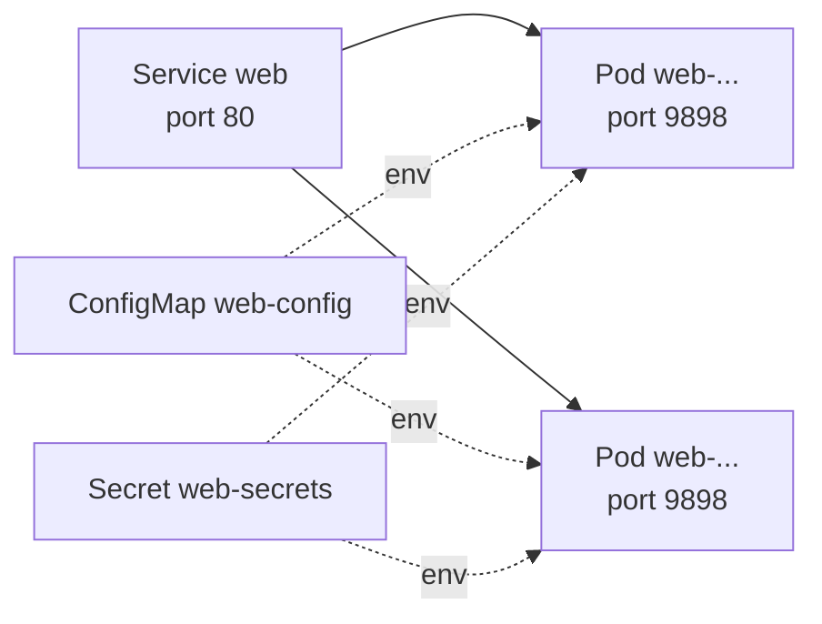

This tutorial deploys a small web application to a Cloider cluster with five standard Kubernetes objects: a Namespace, a ConfigMap, a Secret, a Deployment and a Service. You apply them with `kubectl` (or any tool in the tabs below), check that the pods are running, open the app, and finally publish it on a domain with HTTPS. Every manifest is complete and can be copied as is.

## Before you begin

- A cluster in the `Ready` status. See [Create a cluster](/kubernetes/create-a-cluster).
- One way to run `kubectl`: locally with the cluster's kubeconfig ([Connect with kubectl](/kubernetes/connect-with-kubectl)), or the [browser terminal or `cloider cluster exec`](/kubernetes/web-terminal-and-exec), which need nothing installed.

The example app is [podinfo](https://github.com/stefanprodan/podinfo), a tiny open source web server often used to test Kubernetes clusters. It listens on port `9898`, shows a message you can configure, and has health endpoints for probes.

## What you are going to create

| Object | Name | What it does |
| --- | --- | --- |
| Namespace | `shop` | A folder for the app's objects, so they don't mix with others |
| ConfigMap | `web-config` | Non-secret settings, passed to the container as environment variables |
| Secret | `web-secrets` | Credentials, passed to the container as environment variables |
| Deployment | `web` | Runs 2 replicas of the container and replaces them on updates |
| Service | `web` | A stable address in the cluster (`web.shop.svc.cluster.local:80`) in front of the pods |



## Step 1: Write the manifests

Save the following as `shop.yaml`. The comments explain each part.

```yaml title="shop.yaml"
# 1. A namespace for everything that belongs to the app
apiVersion: v1
kind: Namespace
metadata:
  name: shop
---
# 2. Plain settings. Anyone who can read the namespace can read these
apiVersion: v1
kind: ConfigMap
metadata:
  name: web-config
  namespace: shop
data:
  PODINFO_UI_MESSAGE: "Hello from Cloider Kubernetes"
  PODINFO_UI_COLOR: "#34577c"
---
# 3. Credentials. stringData takes plain text; Kubernetes stores it base64 encoded
apiVersion: v1
kind: Secret
metadata:
  name: web-secrets
  namespace: shop
type: Opaque
stringData:
  API_KEY: "change-me"
---
# 4. Two replicas of the container, with resources and health checks
apiVersion: apps/v1
kind: Deployment
metadata:
  name: web
  namespace: shop
  labels:
    app: web
spec:
  replicas: 2
  selector:
    matchLabels:
      app: web
  template:
    metadata:
      labels:
        app: web
    spec:
      containers:
        - name: web
          image: ghcr.io/stefanprodan/podinfo:6.7.0
          ports:
            - name: http
              containerPort: 9898
          envFrom:
            - configMapRef:
                name: web-config
            - secretRef:
                name: web-secrets
          resources:
            requests:
              cpu: 50m
              memory: 64Mi
            limits:
              memory: 128Mi
          readinessProbe:
            httpGet:
              path: /readyz
              port: http
            initialDelaySeconds: 2
            periodSeconds: 5
          livenessProbe:
            httpGet:
              path: /healthz
              port: http
            initialDelaySeconds: 5
            periodSeconds: 10
---
# 5. A stable address for the pods, inside the cluster
apiVersion: v1
kind: Service
metadata:
  name: web
  namespace: shop
spec:
  type: ClusterIP
  selector:
    app: web
  ports:
    - name: http
      port: 80
      targetPort: http
      protocol: TCP
```

A few things to note:

- **Requests drive scheduling and billing.** `requests` is what each container reserves. On Cloider every running container is billed on the larger of its request and its actual use, so set requests close to what the app really needs. Here 2 replicas reserve 100 millicores and 128 MiB in total. See [How is a cluster billed?](/kubernetes/overview#how-is-a-cluster-billed).
- **The memory limit protects you from leaks.** A container that goes over `limits.memory` is restarted instead of growing forever.
- **Probes keep traffic away from broken pods.** A pod only receives traffic from the Service once its readiness probe passes, and it is restarted when its liveness probe fails.
- **The Service is `ClusterIP`.** It is only reachable inside the cluster. You publish it on a domain in step 5, or with a public IP in [Load balancers](/kubernetes/load-balancers).

## Step 2: Apply the manifests

<Tabs groupId="interface" queryString>
<TabItem value="dashboard" label="Dashboard" default>

1. Open **Kubernetes** in the sidebar and click the cluster's name to open its terminal.
2. Create the file in the terminal with a heredoc: type `cat > shop.yaml <<'EOF'`, press Enter, paste the manifest, press Enter, type `EOF` and press Enter.
3. Apply it:

```bash
kubectl apply -f shop.yaml
```

```text title="Output"
namespace/shop created
configmap/web-config created
secret/web-secrets created
deployment.apps/web created
service/web created
```

The terminal's files are temporary, so keep the original `shop.yaml` on your computer or in git.

</TabItem>
<TabItem value="cli" label="CLI">

With `kubectl` and the cluster's kubeconfig:

```bash
kubectl apply -f shop.yaml
```

Or without a kubeconfig, by piping the file into the cluster's terminal:

```bash
cloider cluster exec -i staging -- kubectl apply -f - < shop.yaml
```

```text title="Output"
namespace/shop created
configmap/web-config created
secret/web-secrets created
deployment.apps/web created
service/web created
```

</TabItem>
<TabItem value="terraform" label="Terraform">

Use the `kubernetes` provider with the cluster's `kube_config`. This is the same app as `shop.yaml`, as Terraform resources:

```hcl title="main.tf"
terraform {
  required_providers {
    cloider    = { source = "cloider/cloider" }
    kubernetes = { source = "hashicorp/kubernetes" }
  }
}

data "cloider_cluster" "staging" {
  name = "staging"
}

provider "kubernetes" {
  host                   = data.cloider_cluster.staging.kube_config.host
  cluster_ca_certificate = data.cloider_cluster.staging.kube_config.cluster_ca_certificate
  client_certificate     = data.cloider_cluster.staging.kube_config.client_certificate
  client_key             = data.cloider_cluster.staging.kube_config.client_key
}

resource "kubernetes_namespace_v1" "shop" {
  metadata {
    name = "shop"
  }
}

resource "kubernetes_config_map_v1" "web" {
  metadata {
    name      = "web-config"
    namespace = kubernetes_namespace_v1.shop.metadata[0].name
  }
  data = {
    PODINFO_UI_MESSAGE = "Hello from Cloider Kubernetes"
  }
}

resource "kubernetes_secret_v1" "web" {
  metadata {
    name      = "web-secrets"
    namespace = kubernetes_namespace_v1.shop.metadata[0].name
  }
  data = {
    API_KEY = var.api_key
  }
}

resource "kubernetes_deployment_v1" "web" {
  metadata {
    name      = "web"
    namespace = kubernetes_namespace_v1.shop.metadata[0].name
  }
  spec {
    replicas = 2
    selector {
      match_labels = { app = "web" }
    }
    template {
      metadata {
        labels = { app = "web" }
      }
      spec {
        container {
          name  = "web"
          image = "ghcr.io/stefanprodan/podinfo:6.7.0"
          port {
            name           = "http"
            container_port = 9898
          }
          env_from {
            config_map_ref {
              name = kubernetes_config_map_v1.web.metadata[0].name
            }
          }
          env_from {
            secret_ref {
              name = kubernetes_secret_v1.web.metadata[0].name
            }
          }
          resources {
            requests = { cpu = "50m", memory = "64Mi" }
            limits   = { memory = "128Mi" }
          }
        }
      }
    }
  }
}

resource "kubernetes_service_v1" "web" {
  metadata {
    name      = "web"
    namespace = kubernetes_namespace_v1.shop.metadata[0].name
  }
  spec {
    selector = { app = "web" }
    port {
      port        = 80
      target_port = "http"
    }
  }
}

variable "api_key" {
  type      = string
  sensitive = true
}
```

The provider's `data` values are plain text; it encodes them for you. See [Kubernetes and Helm with Terraform](/terraform/guides/kubernetes-and-helm) for when to create the cluster in the same configuration.

</TabItem>
<TabItem value="api" label="API">

The API applies manifests through the cluster's exec endpoint: send `kubectl apply -f -` as the command and the manifest, base64 encoded, as `stdin` (up to 2 MiB):

```bash
curl -N -X POST https://cloider.com/api/clusters/x8f2kq/exec \
  -H "Authorization: Bearer $CLOIDER_TOKEN" \
  -H "Content-Type: application/json" \
  -d "{\"command\": [\"kubectl\", \"apply\", \"-f\", \"-\"], \"stdin\": \"$(base64 < shop.yaml | tr -d '\n')\"}"
```

```text title="Response"
: open

event: stdout
data: bmFtZXNwYWNlL3Nob3AgY3JlYXRlZApjb25maWdtYXAvd2ViLWNvbmZpZyBjcmVhdGVkCi4uLgo=

event: exit
data: 0

event: end
data: 1
```

The `stdout` data is base64; decoded, it is `kubectl apply`'s usual output. Or talk to the cluster's own Kubernetes API directly with the kubeconfig. See [Web terminal and exec](/kubernetes/web-terminal-and-exec).

</TabItem>
<TabItem value="mcp" label="MCP">

Ask your agent, with `shop.yaml` in your project:

```text title="Prompt"
Apply shop.yaml to the staging cluster and tell me when the web pods are ready.
```

It calls `cluster_exec` with the manifest on stdin:

```json title="Tool call: cluster_exec"
{"cluster": "staging", "command": "kubectl apply -f -", "stdin": "apiVersion: v1\nkind: Namespace\nmetadata:\n  name: shop\n---\n..."}
```

Then it checks the rollout:

```json title="Tool call: cluster_exec"
{"cluster": "staging", "command": "kubectl rollout status deploy/web -n shop --timeout=120s"}
```

</TabItem>
</Tabs>

## Step 3: Check that it is running

Wait for the rollout to finish:

```bash
kubectl rollout status deployment/web -n shop
```

```text title="Output"
deployment "web" successfully rolled out
```

List everything in the namespace:

```bash
kubectl get all -n shop
```

```text title="Output"
NAME                       READY   STATUS    RESTARTS   AGE
pod/web-6d8f7b9c5d-2kq9x   1/1     Running   0          40s
pod/web-6d8f7b9c5d-8hj2p   1/1     Running   0          40s

NAME          TYPE        CLUSTER-IP     EXTERNAL-IP   PORT(S)   AGE
service/web   ClusterIP   10.43.118.27   <none>        80/TCP    40s

NAME                  READY   UP-TO-DATE   AVAILABLE   AGE
deployment.apps/web   2/2     2            2           40s

NAME                             DESIRED   CURRENT   READY   AGE
replicaset.apps/web-6d8f7b9c5d   2         2         2       40s
```

Check that the ConfigMap and Secret reached the container:

```bash
kubectl exec -n shop deploy/web -- env | grep -E 'PODINFO_UI_MESSAGE|API_KEY'
```

```text title="Output"
PODINFO_UI_MESSAGE=Hello from Cloider Kubernetes
API_KEY=change-me
```

Read the logs and the resource use:

```bash
kubectl logs -n shop deploy/web --tail 20
kubectl top pods -n shop
```

If a pod isn't `Running`, see [Troubleshooting](#troubleshooting) below.

## Step 4: Open the app

The Service is internal, so open it through a port forward from your computer (this needs a local `kubectl` with the kubeconfig):

```bash
kubectl port-forward -n shop service/web 8080:80
```

Then open `http://localhost:8080`. You see podinfo with the message from the ConfigMap. Press Ctrl-C to stop the port forward.

From the browser terminal, call the Service from inside the cluster instead:

```bash
kubectl run curl --rm -i --restart=Never --image=curlimages/curl:8.10.1 -n shop -- curl -s http://web.shop.svc.cluster.local/api/info
```

## Step 5: Publish it on a domain

To make the app reachable from the internet with HTTPS, route a domain to the `web` Service with a target. Claim a [free subdomain](/domains/free-subdomains) such as `shop-staging.cloider.app`, then point it at the Service:

```bash
cloider domain create shop-staging.cloider.app
cloider target create shop-staging.cloider.app --cluster staging --service shop/web
```

A few moments later the app answers at `https://shop-staging.cloider.app`. [Expose services on a domain](/kubernetes/expose-services) covers targets in every tool, custom domains, paths and HTTPS. For a raw TCP port with a public IP, use a [LoadBalancer Service](/kubernetes/load-balancers) instead.

## Step 6: Update, scale and roll back

**Change the configuration.** Edit `PODINFO_UI_MESSAGE` in `shop.yaml` and apply again. Environment variables are read when a container starts, so restart the pods to pick up the change:

```bash
kubectl apply -f shop.yaml
kubectl rollout restart deployment/web -n shop
```

**Change the image.** Set a new image tag; Kubernetes replaces the pods one by one, so the app stays up:

```bash
kubectl set image deployment/web -n shop web=ghcr.io/stefanprodan/podinfo:6.7.1
kubectl rollout status deployment/web -n shop
```

**Roll back** to the previous version if something is wrong:

```bash
kubectl rollout undo deployment/web -n shop
```

**Scale** by hand:

```bash
kubectl scale deployment/web -n shop --replicas 3
```

**Scale automatically** with a HorizontalPodAutoscaler. Every Cloider cluster runs the metrics server, so autoscaling on CPU works without extra setup:

```yaml title="web-hpa.yaml"
apiVersion: autoscaling/v2
kind: HorizontalPodAutoscaler
metadata:
  name: web
  namespace: shop
spec:
  scaleTargetRef:
    apiVersion: apps/v1
    kind: Deployment
    name: web
  minReplicas: 2
  maxReplicas: 6
  metrics:
    - type: Resource
      resource:
        name: cpu
        target:
          type: Utilization
          averageUtilization: 70
```

```bash
kubectl apply -f web-hpa.yaml
kubectl get hpa -n shop
```

Utilization is measured against the CPU request, which is one more reason to set requests that match the real use. Each extra replica adds its request to the bill while it runs.

## Step 7: Clean up

Delete everything the tutorial created by deleting the namespace:

```bash
kubectl delete namespace shop
```

Deleting the namespace deletes the pods, the Service, the ConfigMap and the Secret, and the cluster stops billing for the pods' compute. If you created a target in step 5, delete it too with `cloider target delete <target-id>` (see `cloider target list shop-staging.cloider.app -o wide`), or delete the whole subdomain with `cloider domain delete shop-staging.cloider.app`.

## Troubleshooting

| Symptom | What to check |
| --- | --- |
| Pod stays `Pending` | `kubectl describe pod -n shop <pod>` and read `Events`. A request that no node can satisfy, or a PersistentVolumeClaim that isn't bound, keeps a pod pending |
| `ImagePullBackOff` or `ErrImagePull` | The image name or tag is wrong, or it is in a private registry without an `imagePullSecret`. See [Pull private images](/kubernetes/pull-private-images) |
| `CrashLoopBackOff` | The container starts and exits. Read `kubectl logs -n shop <pod> --previous` |
| `OOMKilled` in `kubectl describe pod` | The container went over `limits.memory`. Raise the limit or fix the leak |
| Pods `Running` but `0/1` ready | The readiness probe fails. Check the probe's path and port, and the logs |
| The app works with port forward but not on the domain | Check the target's namespace, service and port with `cloider target list <domain>`. See [Expose services](/kubernetes/expose-services) |

More cases are in [Kubernetes troubleshooting](/kubernetes/troubleshooting).

## Next steps

- [Expose services on a domain](/kubernetes/expose-services) with HTTPS.
- [Install charts with Helm](/kubernetes/helm) instead of writing every manifest.
- [Add persistent storage](/kubernetes/persistent-volumes) for stateful apps.
- [Deploy your own images](/kubernetes/pull-private-images) from the Cloider registry.

<FAQ items={[
  {q: 'How do I deploy an app to a Cloider Kubernetes cluster?', a: 'Write standard Kubernetes manifests, for example a Deployment and a Service, and apply them with kubectl apply -f. You can also run kubectl in the browser terminal, or pipe the file through cloider cluster exec -i staging -- kubectl apply -f - without a local kubeconfig.'},
  {q: 'Do I need to set CPU and memory requests on Cloider?', a: 'It is strongly recommended. Each running container is billed on the larger of its request and its actual use, so a request close to the real use keeps the bill accurate, and the HorizontalPodAutoscaler measures utilization against the request.'},
  {q: 'How do I make my Kubernetes Service reachable from the internet?', a: 'Route a domain to the Service with a target, for example cloider target create shop-staging.cloider.app --cluster staging --service shop/web, which serves it over HTTPS. For a raw TCP or UDP port, use a Service of type LoadBalancer, which gets a public IP.'},
  {q: 'Does the HorizontalPodAutoscaler work on Cloider?', a: 'Yes. Every cluster runs the Kubernetes metrics server, so kubectl top and CPU based autoscaling work without extra setup.'},
]} />
