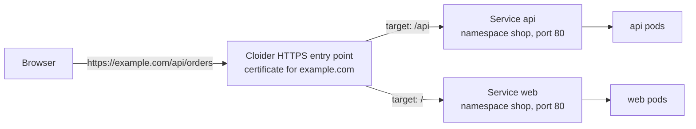

To make an HTTP service in your Cloider cluster reachable on the internet, you route a domain to it with a **target**. A target says "requests for this domain and path go to this Service, on this port", and Cloider takes care of the rest: the public entry point, the routing and the HTTPS certificate. You don't create Ingress objects or install an ingress controller, and there is no load balancer charge.

## At a glance

| | |
| --- | --- |
| **What you route** | A domain, or a path of it (`/`, `/api`, ...), to a Service's port in a cluster |
| **Domains** | A free subdomain such as `shop-staging.cloider.app`, or your own domain such as `example.com` |
| **HTTPS** | Automatic. Free subdomains use Cloider's certificate; custom domains get a certificate of their own |
| **Your Service** | Any Service type, usually `ClusterIP`. It speaks plain HTTP on the port you route to |
| **Cost** | No load balancer charge. You pay only for the pods behind the Service |
| **Ingress objects** | Not served. Targets replace them |
| **Tools** | Dashboard (**Domains**), `cloider target`, `cloider_target` in Terraform, `/api/targets`, MCP |

## How targets work



1. The domain resolves to Cloider. A free subdomain does so from the start. A custom domain does once it uses Cloider's nameservers: the domain itself has an `ALIAS` record that points at Cloider from the start, and other host names need an `A` or `CNAME` record, since a target doesn't add one (see [Add a custom domain](/domains/add-a-custom-domain)).
2. Cloider terminates HTTPS for the domain.
3. It picks the target whose `path` matches the request, the longest one first. A target's path covers everything under it, so `/` catches whatever no longer path does.
4. It forwards the request as plain HTTP to the Service's port in your cluster, optionally rewriting the path.

## Before you begin

- A cluster in the `Ready` status with a Service to expose. [Deploy a workload](/kubernetes/deploy-a-workload) creates the `web` Service in the `shop` namespace used below.
- A domain in your Cloider account:
  - a free subdomain under `cloider.app`, claimed in **Domains** or with `cloider domain create shop-staging.cloider.app` (see [Free subdomains](/domains/free-subdomains)), or
  - your own domain, added, pointed at Cloider's nameservers and given a DNS record for each host name you serve (see [Add a custom domain](/domains/add-a-custom-domain)).
- A role that can create resources. Members with read-only access can't create targets.

## Find the Service to route to

Targets route to Services that Cloider sees in your clusters. List them with their namespaces and ports:

```bash
cloider cluster services staging
```

```text title="Output"
CLUSTER   NAMESPACE   SERVICE   PORTS
staging   shop        web       80/TCP
staging   shop        api       80/TCP
staging   iot         mqtt      1883/TCP
```

Cloider's own services in the cluster (cluster DNS, metrics server and the terminal) aren't listed. The same list is `GET /api/clusters/services` and the MCP tool `list_cluster_services`.

## Create a target

Route `shop-staging.cloider.app` to port 80 of the `web` Service in the `shop` namespace of the `staging` cluster.

<Tabs groupId="interface" queryString>
<TabItem value="dashboard" label="Dashboard" default>

1. Open **Domains** in the sidebar and click the domain, for example `shop-staging.cloider.app`.
2. Under **Link your app to a domain**, click **Add target**.
3. In **Target type**, choose **Cluster**.
4. Pick the **Cluster** (`staging`), the **Namespace** (`shop`), the **Service** (`web`) and the **Port** (`80`).
5. Leave **Path** as `/` and **Target path** empty to route the whole domain as it is.
6. Click **Save**.

<Screenshot
  src="/img/screenshots/kubernetes/target-form.webp"
  url="/dashboard/domains/shop-staging.cloider.app"
  alt="The Add a new target dialog on a domain page with Target type set to Cluster, the staging cluster, the shop namespace, the web service, port 80 and path /"
  caption="A target that routes the whole domain to the web Service of the staging cluster."
/>

The target appears in the domain's table with its **Type**, **Name**, **Namespace**, **Service**, **Port**, **Protocol**, **Path** and **Target path**. Click the path to open it in a new tab. If the cluster has no Services yet, the form says so: deploy one first.

</TabItem>
<TabItem value="cli" label="CLI">

```bash
cloider target create shop-staging.cloider.app --cluster staging --service shop/web
```

```text title="Output"
✓ Routed shop-staging.cloider.app/ to staging/shop/web:80
```

`--service` is `<namespace>/<service>`. When the Service has a single port, it is used; otherwise pick one with `--port`.

| Flag | Default | What it does |
| --- | --- | --- |
| `--cluster` | | The cluster, by name, label or id |
| `--service` | | The Service, as `<namespace>/<service>` |
| `--port` | the Service's only port | The Service port to send requests to |
| `--protocol` | the port's own | `TCP` or `UDP`, to pick between ports of the same number |
| `--path` | `/` | The path on the domain to route |
| `--target-path` | `--path` | The path the request reaches the Service with |
| `--app` | | Route to a Cloider app instead of a cluster. Can't be combined with `--cluster` |

List and change targets:

```bash
cloider target list shop-staging.cloider.app -o wide
cloider target update shop-staging.cloider.app t4k9 --port 8080
cloider target delete t4k9
```

</TabItem>
<TabItem value="terraform" label="Terraform">

```hcl title="main.tf"
resource "cloider_cluster" "staging" {
  name = "staging"
}

resource "cloider_domain" "shop" {
  name = "shop-staging.cloider.app"
}

# https://shop-staging.cloider.app/ reaches port 80 of the web Service in the shop namespace
resource "cloider_target" "shop" {
  domain     = cloider_domain.shop.name
  cluster_id = cloider_cluster.staging.id
  namespace  = "shop"
  service    = "web"
  port       = 80
}
```

| Attribute | Required | Description |
| --- | --- | --- |
| `domain` | yes | The domain to route. Changing it replaces the target |
| `cluster_id` | with a cluster Service | The cluster's id |
| `namespace`, `service`, `port` | with `cluster_id` | The Service and the port that speaks plain HTTP |
| `path` | no | The path on the domain, and everything under it. Default `/` |
| `target_path` | no | The path requests reach the Service with. Default `path` |
| `protocol` | no | `TCP` or `UDP`. Default `TCP` |

When the Service itself is managed with the `kubernetes` provider, reference it (`kubernetes_service_v1.web.metadata[0].name`) so the target is created after it. See [`cloider_target`](/terraform/resources/target).

</TabItem>
<TabItem value="api" label="API">

```bash
curl -X POST https://cloider.com/api/targets \
  -H "Authorization: Bearer $CLOIDER_TOKEN" \
  -H "Content-Type: application/json" \
  -d '{
    "domain_name": "shop-staging.cloider.app",
    "target_type": "Cluster",
    "cluster_id": "x8f2kq",
    "cluster_name": "staging",
    "namespace": "shop",
    "service": "web",
    "port": 80,
    "protocol": "TCP",
    "path": "/",
    "target_path": "/"
  }'
```

```json title="Response"
{
  "hashed_id": "t4k9",
  "domain_name": "shop-staging.cloider.app",
  "message": "Target created successfully"
}
```

| Field | Description |
| --- | --- |
| `domain_name` | Required. The domain, which must be in your account |
| `target_type` | `Cluster` (the default) or `App` |
| `cluster_id` | The cluster's id |
| `cluster_name` | The cluster's name |
| `namespace`, `service`, `port` | Required for a `Cluster` target |
| `protocol` | `TCP` or `UDP` |
| `path` | Default `/`. Starts with `/` and contains only letters, digits and `/ _ . -` |
| `target_path` | Default: `path`. Same characters as `path` |

List a domain's targets with `GET /api/targets?domain_name=shop-staging.cloider.app`, change one with `PUT /api/targets/{id}` (same body) and delete it with `DELETE /api/targets/{id}`. See the [Targets API](/api/endpoints/targets).

</TabItem>
<TabItem value="mcp" label="MCP">

Ask your agent:

```text title="Prompt"
Serve the web service of the shop namespace in the staging cluster at shop-staging.cloider.app.
```

It calls `create_domain_target`:

```json title="Tool call: create_domain_target"
{"domain": "shop-staging.cloider.app", "cluster": "staging", "service": "shop/web"}
```

The agent can find the Service first with `list_cluster_services`, and change or remove the target with `update_domain_target` and `delete_domain_target`.

</TabItem>
</Tabs>

## Verify

```bash
curl -I https://shop-staging.cloider.app
```

```text title="Output"
HTTP/2 200
content-type: text/html; charset=utf-8
```

A free subdomain answers within moments. A custom domain answers once its DNS points to Cloider and its certificate has been issued, see [HTTPS certificates](#https-certificates).

## Route several services on one domain

Each path of a domain routes to one target, so one domain can front several Services. The longest matching path wins:

| Domain path | Goes to | Created with |
| --- | --- | --- |
| `example.com/` | `shop/web:80` | `cloider target create example.com --cluster production --service shop/web` |
| `example.com/api` | `shop/api:80` | `cloider target create example.com --cluster production --service shop/api --path /api` |
| `example.com/grafana` | `monitoring/grafana:80` | `cloider target create example.com --cluster production --service monitoring/grafana --path /grafana` |

A request for `https://example.com/api/orders` goes to the `api` Service as `/api/orders`, and `https://example.com/about` goes to `web`.

A path can be used by only one target per domain. A second target with the same path is refused with `This path is already in use on this domain. Please choose a different path.`.

## Rewrite the path

By default a request reaches the Service with the path it was made with. Set a **target path** to replace the routed path:

```bash
cloider target create example.com --cluster production --service docs/docs --path /docs --target-path /
```

Now `https://example.com/docs/intro` reaches the `docs` Service as `/intro`. This is useful for apps that expect to be served at the root. Remember that such an app also generates links without the `/docs` prefix unless you configure its base path.

## Use a custom domain

1. Add the domain to your account and point it at Cloider's nameservers. See [Add a custom domain](/domains/add-a-custom-domain) and [Nameservers](/domains/nameservers).
2. Add a DNS record for every other host name you serve. The domain itself comes with an `ALIAS` record that points at Cloider, but a target doesn't add records: use a `CNAME` to one of your free `cloider.app` subdomains for `www` and other subdomains. See [Add a custom domain](/domains/add-a-custom-domain#step-4-point-the-host-names-you-serve-at-cloider).
3. Create targets on it exactly as for a free subdomain. A subdomain such as `www.example.com` is a domain of its own for targets, so add it with `cloider domain create` first.

```bash
cloider domain create example.com
cloider dns create example.com --type CNAME --name www --value shop-staging.cloider.app. --ttl 3600
cloider target create example.com --cluster production --service shop/web

cloider domain create www.example.com
cloider target create www.example.com --cluster production --service shop/web
```

See [Domains and DNS](/domains/overview) for the domain side, and [Targets](/domains/targets) for targets from the domain's point of view.

## HTTPS certificates

Every target is served over HTTPS:

- **Free subdomains** (`*.cloider.app`) are covered by Cloider's own certificate, so HTTPS works immediately.
- **Custom domains** get a certificate issued for the host name automatically, through an HTTP challenge, once the domain resolves to Cloider. Until DNS points to Cloider, the certificate can't be issued.

Your Service receives plain HTTP: don't configure TLS in the app for traffic that comes through a target. See [HTTPS certificates](/domains/https-certificates).

## What about Ingress?

Ingress objects you create inside a Cloider cluster aren't served: Cloider doesn't publish them, so they have no effect. Targets do the same job, routing host names and paths to Services with HTTPS, and are managed from the dashboard, CLI, Terraform, API and MCP.

When you install a Helm chart that can create an Ingress, disable it (usually `ingress.enabled: false`) and create a target for the chart's Service. See [Helm](/kubernetes/helm).

For non-HTTP traffic, such as raw TCP or UDP, use a [Service of type LoadBalancer](/kubernetes/load-balancers) instead of a target.

## Limits

- **Path characters.** `path` and `target_path` start with `/` and contain only letters, digits and `/ _ . -`. Other values are refused with `Path must start with / and may only contain letters, numbers and / _ . -`.
- **Name length.** The Service name, the namespace and the cluster name together may not exceed 57 characters. Longer combinations are refused with `Service and namespace names are too long for this cluster (combined limit exceeded)`. Use shorter names.
- **Plain HTTP backends.** The Service's port must speak HTTP, not HTTPS.
- **One target per path.** Each path of a domain routes to exactly one target.

## Troubleshooting

**`404` or a default page on the domain**: no target matches, or the target points at the wrong namespace, Service or port. Check `cloider target list <domain>` against `cloider cluster services <cluster>`.

**`502 Bad Gateway` or `503 Service Temporarily Unavailable`**: the target matches but nothing answers behind it. Check that the Service has endpoints (`kubectl get endpoints web -n shop`), that the pods are ready, that the routed port is the Service port and not the container port, and that the app speaks plain HTTP. A paused cluster has no running pods, so its targets answer with errors until you resume it.

**Certificate error on a custom domain**: the domain doesn't resolve to Cloider yet, so its certificate couldn't be issued. Check the nameservers and that the host name has an `A` or `CNAME` record (see [Domains troubleshooting](/domains/troubleshooting)), then wait for DNS to propagate.

**Links or assets break under a path**: the app generates absolute links for the root. Configure the app's base path, or give it its own subdomain instead of a path.

**`Orphaned targets detected!` on the domain page**: the targets point to a cluster, Service or app that no longer exists, for example after deleting a cluster. Delete them or point them at a Service that exists.

**`cluster staging has no services to route to yet` (CLI)** or **`no service shop/web in cluster staging`**: create the Service first, or check its namespace and name with `cloider cluster services`.

More cases are in [Kubernetes troubleshooting](/kubernetes/troubleshooting) and [Domains troubleshooting](/domains/troubleshooting).

## Next steps

- [Targets](/domains/targets) in the Domains section.
- [Load balancers](/kubernetes/load-balancers) for TCP and UDP.
- [Add a custom domain](/domains/add-a-custom-domain).

<FAQ items={[
  {q: 'How do I expose a Kubernetes service on a domain on Cloider?', a: 'Create a target that routes the domain to the Service. For example: cloider target create shop-staging.cloider.app --cluster staging --service shop/web. Cloider serves the domain over HTTPS and forwards requests to the Service port as plain HTTP.'},
  {q: 'Does Cloider Kubernetes support Ingress?', a: 'Ingress objects inside a Cloider cluster are not served. Use targets instead: they route host names and paths to Services and include automatic HTTPS certificates.'},
  {q: 'Do I get HTTPS for my Kubernetes services on Cloider?', a: 'Yes. Free subdomains under cloider.app are covered by Cloider\'s certificate right away, and custom domains get a certificate issued automatically once they resolve to Cloider.'},
  {q: 'Do targets cost anything?', a: 'There is no load balancer charge for targets. You pay for the pods behind the Service, like for any workload.'},
  {q: 'Can I route several paths of one domain to different services?', a: 'Yes. Create one target per path, for example / for the web Service and /api for the api Service. The longest matching path wins, and each path can have only one target.'},
]} />
