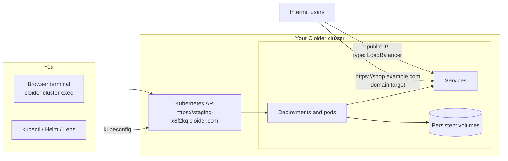

A Cloider Kubernetes cluster is a fully managed, serverless Kubernetes cluster: you get your own Kubernetes API, a kubeconfig and cluster admin rights, while Cloider runs the control plane and the nodes. There are no nodes to size, patch or scale, and you pay for the CPU and memory your workloads actually use, plus the volumes and load balancers they claim.

This page explains how a cluster works, what it costs, what you can and can't do with it, and where to go next. If you just want a cluster now, go to [Create a cluster](/kubernetes/create-a-cluster).

## At a glance

| | |
| --- | --- |
| **What it is** | A Kubernetes cluster with its own API server, reached with `kubectl`, Helm and any Kubernetes tool. Cloider manages the control plane and the nodes |
| **Kubernetes versions** | The dashboard and API offer `1.34`, `1.33` and `1.32`, newest first. See [Limits and compatibility](/kubernetes/limits-and-compatibility) |
| **Billing** | Compute in compute units (CPU or memory, whichever is larger), volumes per GiB of provisioned capacity, load balancers per load balancer for the time they run. All metered and prorated. See [How is a cluster billed?](#how-is-a-cluster-billed) |
| **Access** | A kubeconfig with a client certificate that is cluster admin, a browser terminal, and `cloider cluster exec` with `kubectl` and `helm` preinstalled |
| **Networking** | Services of type `LoadBalancer` get a public IP. HTTP(S) services are published on a domain with a [target](/domains/targets), with automatic HTTPS. Ingress objects inside the cluster are not served |
| **Storage** | Standard PersistentVolumeClaims, billed per GiB provisioned |
| **Lifecycle** | Create, pause, resume, delete. A paused cluster keeps its state and isn't billed for compute |
| **Plans** | The Free plan allows one cluster at a time. Paid accounts can create more |
| **Tools** | [Dashboard](https://cloider.com/dashboard/clusters), [CLI](/cli/commands/cluster), [Terraform](/terraform/resources/cluster), [REST API](/api/endpoints/clusters), [MCP](/mcp/tools) |

<Screenshot
  src="/img/screenshots/kubernetes/list.webp"
  url="/dashboard/clusters"
  alt="The Kubernetes page in the Cloider dashboard listing the clusters staging and production as Ready and a third cluster as Paused, each with its Kubernetes version and an actions menu"
  caption="The Kubernetes page lists every cluster in the account with its label, Kubernetes version and status."
/>

## What is a serverless Kubernetes cluster?

A serverless Kubernetes cluster is a Kubernetes cluster where the provider runs all the infrastructure underneath and bills you for what your pods use, not for servers. On Cloider, each cluster has its own Kubernetes API server, its own namespaces, RBAC, Secrets and objects, and is isolated from every other cluster. Your pods are scheduled onto nodes that Cloider operates, patches and scales.

In a classic managed Kubernetes service you still choose node pools, machine sizes and autoscaling rules, and you pay for every node whether it is busy or idle. On Cloider you skip that layer entirely:

- **No node pools.** You never pick an instance type or a node count. You declare pods with CPU and memory requests, and they are scheduled.
- **No idle capacity bill.** A pod that requests 250 millicores and uses 250 millicores costs 250 millicores. Nothing is charged for spare room on a node.
- **No control plane to babysit.** The API server, the cluster DNS and the metrics server are installed and run for you.
- **Standard Kubernetes.** `kubectl`, Helm, Kustomize, Lens, k9s, Terraform's `kubernetes` and `helm` providers, and CI tools all work, because the cluster speaks the standard Kubernetes API.

:::info[New to Kubernetes?]
Kubernetes is an open source system that runs containers for you. You describe what you want (for example "three copies of my web server, reachable on port 80") in YAML files called manifests, and Kubernetes keeps it that way. The most common objects are:

- a **Pod**, one or more containers that run together,
- a **Deployment**, which keeps a number of identical pods running and replaces them on updates,
- a **Service**, a stable network address in front of a set of pods,
- a **PersistentVolumeClaim** (PVC), a request for disk space that survives pod restarts,
- a **ConfigMap** and a **Secret**, configuration and credentials handed to pods.

[Deploy a workload](/kubernetes/deploy-a-workload) walks through each of them with complete examples.
:::

## How a Cloider cluster works

When you create a cluster, Cloider provisions a dedicated Kubernetes control plane for it and gives it a public API endpoint, such as `https://staging-x8f2kq.cloider.com`. The endpoint name is the cluster name followed by its id. The kubeconfig you download points `kubectl` at that endpoint and authenticates you with a client certificate that is cluster admin.

Everything you create through that API, Deployments, Services, PersistentVolumeClaims, ConfigMaps, Secrets, RBAC rules, lives in your cluster only. Pods run on Cloider's managed nodes, so `kubectl get nodes` lists nodes you can see but don't administer.

Each cluster comes with:

- **Cluster DNS**, so pods reach Services by name (`http://api.shop.svc.cluster.local`).
- **The Kubernetes metrics server**, so `kubectl top pods` and the HorizontalPodAutoscaler work out of the box.
- **A terminal Deployment** in the `kube-system` namespace that powers the [browser terminal](/kubernetes/web-terminal-and-exec). Don't delete it, or the browser terminal and `cloider cluster exec` stop working.

## What can you run on a cluster?

You can run any containerized workload that a standard Kubernetes cluster runs: web apps and APIs, background workers, cron jobs, queues, and stateful services with persistent volumes. Common examples:

- A web application as a Deployment and a Service, published on your domain with HTTPS. See [Deploy a workload](/kubernetes/deploy-a-workload) and [Expose services on a domain](/kubernetes/expose-services).
- Off the shelf software installed with Helm charts, such as WordPress, Grafana or Redis. See [Helm](/kubernetes/helm).
- Services that need a raw TCP or UDP port, published with a `LoadBalancer` Service. See [Load balancers](/kubernetes/load-balancers).
- Stateful workloads with PersistentVolumeClaims. See [Persistent volumes](/kubernetes/persistent-volumes).
- Private images from the [Cloider container registry](/container-registry/overview). See [Pull private images](/kubernetes/pull-private-images).

Your pods can also reach your [Cloider databases](/databases/overview) over the network like any other client. See [Connect to a database](/databases/connect) for the connection details.

## What can't you do?

Cloider runs the infrastructure under your cluster, so a few things that you control in a self-managed cluster are managed for you:

- **You don't manage nodes.** You can't add, remove, resize, cordon or SSH into nodes, and there are no node pools to configure.
- **Ingress objects are not served.** An `Ingress` you create in the cluster isn't published to the internet. To serve HTTP(S) on a domain, create a [target](/kubernetes/expose-services) that routes the domain to your Service. Cloider then handles the ingress and the HTTPS certificate.
- **No highly available control plane option.** Every cluster has a single control plane. The API rejects `is_ha: true` with `HA clusters are not supported at the moment!`.
- **No in-place upgrades or renames.** A cluster keeps the name and Kubernetes version it was created with. To move to a newer version, create a new cluster and redeploy into it.

The full list, with versions and the errors you may see, is in [Limits and compatibility](/kubernetes/limits-and-compatibility).

## How is a cluster billed?

A Cloider cluster is billed on three meters: compute, volumes and load balancers. There is no fixed fee per cluster and no charge for nodes. Prices are on the [pricing page](https://cloider.com/#pricing) and in [Pricing](/reference/pricing), and `cloider pricing` prints the current rates.

### Compute: CPU and memory, whichever is larger

Compute is measured in **compute units**. Every few seconds Cloider samples every running pod in your cluster and, for each container, counts the larger of what it requests and what it actually uses, for CPU and for memory separately. The totals are converted to compute units: one compute unit is one vCPU, or the amount of memory that the price list pairs with one vCPU (the `cpu_to_mem_ratio` rate), whichever of the two gives the higher number. Compute units are priced per month and prorated to the second, with a month counted as 30 days.

In practice this means:

- **A pod that sets no requests is billed on what it uses.** A pod that requests more than it uses is billed on its request, because that capacity is reserved for it.
- **Only pods in the `Running` phase count.** Pending, completed and failed pods cost nothing.
- **The cluster's own components count too.** The control plane and the cluster DNS are metered like your own pods, so a running cluster with no workloads still accrues a small compute charge. The pricing calculator on the home page shows an estimate of it as **Control plane**.
- **Paused clusters have no running pods**, so they accrue no compute. See [Pause and resume](/kubernetes/pause-and-resume).

:::tip[Set requests that match your app]
Because a container is billed on the larger of its request and its use, a request far above what the container really uses costs you money for nothing. Set requests close to the real steady state use, and let `kubectl top pods` tell you what that is.
:::

### Volumes: per GiB provisioned

Volumes are billed on the **capacity** of every PersistentVolume bound to your cluster's claims, in GiB, per month, prorated over time. A 10 GiB claim is billed as 10 GiB whether it holds 1 GiB or 9 GiB of data. Only your own claims are billed, not the storage the control plane uses. Volumes keep being billed while a cluster is paused, because the data is kept. See [Persistent volumes](/kubernetes/persistent-volumes).

### Load balancers: per load balancer, prorated

Every Service of type `LoadBalancer` that has been given an external IP is billed per load balancer per month, prorated to the second it was active. Delete the Service and the meter stops. The **Usage** page shows each load balancer by name and IP, with its usage time and cost. See [Load balancers](/kubernetes/load-balancers).

### Where to see what a cluster costs

Open **Usage** in the dashboard sidebar. Each cluster shows its average CPU, memory and persistent volume use for today and this month, the cost to date, a forecast for this month and next month, and a **LoadBalancers Usage** table. The same data is available with `cloider usage` and the [`GET /api/usage`](/api/endpoints/account) endpoint. See [Usage](/account/usage).

## Cluster names, labels and ids

Every cluster has three identifiers:

| Field | Example | What it is |
| --- | --- | --- |
| `cluster_name` | `staging` | The name you chose. Lower case letters, digits and `-`, starting with a letter, at least 2 characters. Names don't have to be unique in an account |
| `cluster_label` | `staging` or `staging-1` | The name the dashboard shows. It is the name, with `-1`, `-2` and so on appended when another cluster of the account already uses it |
| `hashed_id` | `x8f2kq` | The cluster's id, used in API paths and in the API endpoint's host name |

The CLI and MCP tools accept a name, label or id wherever a cluster is expected. When two clusters share a name, use the label or the id.

## Statuses

A cluster is always in one of these states:

| Status | Meaning |
| --- | --- |
| `Creating` | The control plane is being provisioned |
| `Starting` | The control plane is up and the cluster is finishing its setup (kubeconfig and terminal) |
| `Ready` | The cluster is running. You can download the kubeconfig, open the terminal and deploy |
| `Pausing` | The cluster is being paused |
| `Paused` | The cluster is stopped. Its objects and volumes are kept, no pods run |
| `Terminating` | The cluster and everything in it are being deleted |

A deleted cluster ends as `Terminated` and disappears from lists. See [Status values](/reference/status-values) for every product's states.

## Manage clusters with any tool

Everything on this section's pages can be done in five ways, shown in tabs on each how-to page:

| Tool | Best for | Start here |
| --- | --- | --- |
| Dashboard | Creating your first cluster, the browser terminal, watching usage | **Kubernetes** in the sidebar of [cloider.com/dashboard](https://cloider.com/dashboard/clusters) |
| CLI | Day to day work, scripts and CI | [`cloider cluster`](/cli/commands/cluster) |
| Terraform | Clusters as code, with the `kubernetes` and `helm` providers on top | [`cloider_cluster`](/terraform/resources/cluster) |
| REST API | Your own automation | [Clusters API](/api/endpoints/clusters) |
| MCP | Letting an AI agent create clusters and run `kubectl` | [MCP tools](/mcp/tools) |

## Next steps

<Cards cols={2}>
  <Card title="Create a cluster" href="/kubernetes/create-a-cluster" icon="kubernetes">
    Create a cluster from the dashboard, CLI, Terraform, the API or an AI agent.
  </Card>
  <Card title="Connect with kubectl" href="/kubernetes/connect-with-kubectl" icon="console">
    Download the kubeconfig, merge contexts, and use Lens or k9s.
  </Card>
  <Card title="Deploy a workload" href="/kubernetes/deploy-a-workload" icon="rocket-launch-outline">
    A complete Deployment, Service, ConfigMap and Secret, step by step.
  </Card>
  <Card title="Expose services on a domain" href="/kubernetes/expose-services" icon="web">
    Route a domain to a Service with automatic HTTPS.
  </Card>
</Cards>

<FAQ items={[
  {q: 'What is Cloider Kubernetes?', a: 'Cloider Kubernetes is a fully managed, serverless Kubernetes service. Each cluster has its own Kubernetes API, kubeconfig and cluster admin access, while Cloider runs the control plane and the nodes. You pay for the CPU and memory your pods use, the volumes they claim and the load balancers they create.'},
  {q: 'Do I need to manage nodes on Cloider?', a: 'No. A Cloider cluster has no node pools and no machine sizes to choose. You declare pods with CPU and memory requests and Cloider schedules them on nodes it operates, patches and scales.'},
  {q: 'How is a Cloider Kubernetes cluster billed?', a: 'On three meters. Compute is billed in compute units: for each running container, the larger of its request and its actual use, with CPU or memory counted, whichever is larger. Volumes are billed per GiB of provisioned capacity per month. Each LoadBalancer Service with an external IP is billed per load balancer per month. All three are prorated.'},
  {q: 'Does a paused cluster cost anything?', a: 'A paused cluster runs no pods, so it accrues no compute charge. Its persistent volumes are kept and still billed per GiB, and any LoadBalancer Service that still holds an external IP is still metered.'},
  {q: 'Can I use kubectl and Helm with Cloider?', a: 'Yes. Download the kubeconfig and use kubectl, Helm, Kustomize, Lens, k9s or any other Kubernetes client. The browser terminal and cloider cluster exec also come with kubectl and helm preinstalled and already pointed at the cluster.'},
  {q: 'Does Ingress work on Cloider Kubernetes?', a: 'Ingress objects created inside a Cloider cluster are not served. To publish an HTTP service on a domain, create a target that routes the domain, or a path of it, to your Service. Cloider creates the ingress and the HTTPS certificate for you.'},
  {q: 'How many clusters can I create?', a: 'The Free plan allows one cluster at a time. Accounts on a paid plan can create more clusters.'},
]} />
