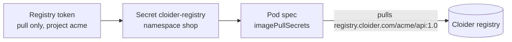

To run an image from a private registry, Kubernetes needs credentials to pull it. For the [Cloider container registry](/container-registry/overview) at `registry.cloider.com`, you create a **pull-only registry token**, store it in the cluster as a Secret of type `kubernetes.io/dockerconfigjson`, and reference that Secret as an `imagePullSecret` in your pods. This page shows the whole flow, from pushing an image to running it.

## Before you begin

- A cluster in the `Ready` status. See [Create a cluster](/kubernetes/create-a-cluster).
- A registry project with an image in it, for example `registry.cloider.com/acme/api:1.0`. See [Create a project](/container-registry/create-a-project) and [Push and pull images](/container-registry/push-and-pull-images).
- A role that can create registry tokens.

## How it works



- A **registry token** is a username and secret that can log in to the registry. Give the cluster its own token with the **Pull only** permission, limited to the projects it needs, so a leaked cluster secret can't push or delete images.
- A Kubernetes **Secret of type `kubernetes.io/dockerconfigjson`** holds that login. Secrets are namespaced, so create it in every namespace whose pods pull private images.
- **`imagePullSecrets`** in a pod spec (or on the namespace's ServiceAccount) tells Kubernetes to use the Secret when it pulls.

## Step 1: Create a pull-only registry token

<Tabs groupId="interface" queryString>
<TabItem value="dashboard" label="Dashboard" default>

1. Open **Registry** in the sidebar and go to the **Tokens** tab.
2. Click **Create Token**.
3. In **Name**, type `staging-cluster`.
4. In **Projects**, choose **Only specific projects** and pick `acme`.
5. In **Permission**, choose **Pull only**.
6. Choose when it **Expires** (the expiry can't be changed later).
7. Click **Create token**.

The **Token created** dialog shows the **Registry host**, **Username**, **Secret**, a **Docker login** command and a ready **Kubernetes pull secret** command. Copy the pull secret command now: the secret isn't shown again. Then click **I've saved the secret**.

</TabItem>
<TabItem value="cli" label="CLI">

```bash
cloider registry token create --label staging-cluster --project acme --read-only
```

```text title="Output"
✓ Created registry token staging-cluster
Username:    acme
Secret:      xxxxxxxxxxxxxxxxxxxxxxxxxxxxxxxx
Host:        registry.cloider.com
Projects:    acme
Permission:  Pull
Expires:     never

Docker:
  echo 'xxxxxxxxxxxxxxxxxxxxxxxxxxxxxxxx' | docker login registry.cloider.com -u 'acme' --password-stdin
Kubernetes pull secret:
  kubectl create secret docker-registry cloider-registry --docker-server=registry.cloider.com --docker-username='acme' --docker-password='xxxxxxxxxxxxxxxxxxxxxxxxxxxxxxxx'
! The secret is not shown again, keep it now.
```

Add `--expires-days 365` to make the token expire after a year (`0`, the default, means never). See [`cloider registry token`](/cli/commands/registry).

</TabItem>
<TabItem value="terraform" label="Terraform">

```hcl title="main.tf"
resource "cloider_registry" "acme" {
  name = "acme"
}

# For the cluster to pull images with
resource "cloider_registry_token" "pull" {
  label     = "staging-cluster"
  projects  = [cloider_registry.acme.id]
  read_only = true
}
```

The token's `username` and `secret` are used in step 2. See [`cloider_registry_token`](/terraform/resources/registry-token).

</TabItem>
<TabItem value="api" label="API">

Registry tokens are created with `POST /api/registry/tokens`. See the [Registry tokens API](/api/endpoints/registry-tokens) for the request and response, which includes the secret once.

</TabItem>
<TabItem value="mcp" label="MCP">

Ask your agent:

```text title="Prompt"
Create a pull-only registry token called staging-cluster for the acme project.
```

It calls the `create_registry_token` tool:

```json title="Tool call: create_registry_token"
{"label": "staging-cluster", "projects": ["acme"], "read_only": true}
```

The answer holds the username and the secret, which is never shown again. The secret ends up in the agent's context, so prefer the dashboard, CLI or Terraform for production credentials.

</TabItem>
</Tabs>

## Step 2: Create the image pull secret in the cluster

Run the pull secret command from step 1, adding the namespace your pods run in with `-n`. Without `-n`, the Secret is created in the `default` namespace only.

<Tabs groupId="interface" queryString>
<TabItem value="dashboard" label="Dashboard" default>

Open the cluster's terminal (**Kubernetes**, the cluster's name, then **Terminal**) and paste the command, with `-n shop` added:

```bash
kubectl create namespace shop --dry-run=client -o yaml | kubectl apply -f -
kubectl create secret docker-registry cloider-registry -n shop \
  --docker-server=registry.cloider.com \
  --docker-username='acme' \
  --docker-password='xxxxxxxxxxxxxxxxxxxxxxxxxxxxxxxx'
```

```text title="Output"
secret/cloider-registry created
```

</TabItem>
<TabItem value="cli" label="CLI">

With `kubectl` locally:

```bash
kubectl create secret docker-registry cloider-registry -n shop \
  --docker-server=registry.cloider.com \
  --docker-username='acme' \
  --docker-password="$REGISTRY_SECRET"
```

Or without a kubeconfig, through the cluster's terminal. Passing the secret on stdin keeps it out of your shell history and the process list:

```bash
printf '%s' "$REGISTRY_SECRET" | cloider cluster exec -i staging -- sh -c \
  'kubectl create secret docker-registry cloider-registry -n shop --docker-server=registry.cloider.com --docker-username=acme --docker-password="$(cat)"'
```

</TabItem>
<TabItem value="terraform" label="Terraform">

With the `kubernetes` provider configured from the cluster's `kube_config`:

```hcl title="main.tf"
resource "kubernetes_secret_v1" "registry" {
  metadata {
    name      = "cloider-registry"
    namespace = "shop"
  }

  type = "kubernetes.io/dockerconfigjson"

  data = {
    ".dockerconfigjson" = jsonencode({
      auths = {
        (cloider_registry.acme.host) = {
          username = cloider_registry_token.pull.username
          password = cloider_registry_token.pull.secret
          auth     = base64encode("${cloider_registry_token.pull.username}:${cloider_registry_token.pull.secret}")
        }
      }
    })
  }
}
```

</TabItem>
<TabItem value="api" label="API">

Run the `kubectl create secret` command through the cluster's exec endpoint, with the secret passed on stdin (base64 encoded in the request):

```bash
curl -N -X POST https://cloider.com/api/clusters/x8f2kq/exec \
  -H "Authorization: Bearer $CLOIDER_TOKEN" \
  -H "Content-Type: application/json" \
  -d "{\"command\": [\"sh\", \"-c\", \"kubectl create secret docker-registry cloider-registry -n shop --docker-server=registry.cloider.com --docker-username=acme --docker-password=\\\"\$(cat)\\\"\"], \"stdin\": \"$(printf '%s' "$REGISTRY_SECRET" | base64)\"}"
```

</TabItem>
<TabItem value="mcp" label="MCP">

Ask your agent:

```text title="Prompt"
In the staging cluster, create an image pull secret called cloider-registry in the shop namespace for registry.cloider.com with the username acme and the secret in my REGISTRY_SECRET variable.
```

It calls `cluster_exec`, passing the secret on stdin:

```json title="Tool call: cluster_exec"
{"cluster": "staging", "command": "kubectl create secret docker-registry cloider-registry -n shop --docker-server=registry.cloider.com --docker-username=acme --docker-password=\"$(cat)\"", "stdin": "xxxxxxxxxxxxxxxxxxxxxxxxxxxxxxxx"}
```

</TabItem>
</Tabs>

Check it:

```bash
kubectl get secret cloider-registry -n shop
```

```text title="Output"
NAME               TYPE                             DATA   AGE
cloider-registry   kubernetes.io/dockerconfigjson   1      10s
```

## Step 3: Use the secret in your pods

Reference the Secret in the pod template with `imagePullSecrets`:

```yaml title="api.yaml"
apiVersion: apps/v1
kind: Deployment
metadata:
  name: api
  namespace: shop
spec:
  replicas: 2
  selector:
    matchLabels:
      app: api
  template:
    metadata:
      labels:
        app: api
    spec:
      imagePullSecrets:
        - name: cloider-registry
      containers:
        - name: api
          image: registry.cloider.com/acme/api:1.0
          ports:
            - containerPort: 8080
          resources:
            requests:
              cpu: 100m
              memory: 128Mi
```

```bash
kubectl apply -f api.yaml
kubectl rollout status deployment/api -n shop
```

### Use the secret for every pod in a namespace

Instead of adding `imagePullSecrets` to each Deployment, attach the Secret to the namespace's `default` ServiceAccount. Every pod that uses that ServiceAccount then pulls with it:

```bash
kubectl patch serviceaccount default -n shop \
  -p '{"imagePullSecrets": [{"name": "cloider-registry"}]}'
```

Pods created after the patch pick it up; restart existing Deployments with `kubectl rollout restart` if they failed to pull before.

### Helm charts

Most charts take pull secrets as a value, often `imagePullSecrets`:

```yaml title="values.yaml"
image:
  repository: registry.cloider.com/acme/api
  tag: "1.0"
imagePullSecrets:
  - name: cloider-registry
```

Check the exact key with `helm show values <chart>`.

## Verify

```bash
kubectl get pods -n shop -l app=api
kubectl describe pod -n shop -l app=api | grep -A3 "Events"
```

A successful pull shows `Successfully pulled image "registry.cloider.com/acme/api:1.0"` in the pod's events, and the pods are `Running`.

## Rotate or revoke the token

Registry tokens can't be extended once created. To rotate, create a new token, update the Secret, and delete the old token:

```bash
kubectl create secret docker-registry cloider-registry -n shop \
  --docker-server=registry.cloider.com \
  --docker-username='acme' \
  --docker-password="$NEW_REGISTRY_SECRET" \
  --dry-run=client -o yaml | kubectl apply -f -
```

Running pods keep their already pulled images; the new Secret is used for the next pull. See [Registry tokens](/container-registry/tokens) for listing and deleting tokens.

## Troubleshooting

**`ImagePullBackOff` or `ErrImagePull`**: run `kubectl describe pod <pod> -n shop` and read the events:

| Event message contains | Cause and fix |
| --- | --- |
| `unauthorized` or `authentication required` | The Secret is missing, in another namespace, not referenced in `imagePullSecrets`, or the token expired or was deleted. Check `kubectl get secret cloider-registry -n shop` and the pod spec |
| `not found` or `manifest unknown` | The repository or tag doesn't exist. Check `cloider registry images acme api` |
| `denied` or `forbidden` | The token isn't allowed on that project. Edit the token's projects in **Registry**, **Tokens**, or with `cloider registry token update` |

**The secret was created in `default`**: the pull secret command from the dashboard and CLI doesn't include a namespace. Recreate it with `-n <namespace>`.

**A tag was overwritten but pods run the old image**: Kubernetes reuses an image already on the node when the tag is unchanged. Use a new tag for every release (recommended, see [Immutable tags](/container-registry/immutable-tags)), or set `imagePullPolicy: Always`.

More cases are in [Kubernetes troubleshooting](/kubernetes/troubleshooting) and [Registry troubleshooting](/container-registry/troubleshooting).

## Next steps

- [Use the registry with Kubernetes](/container-registry/use-with-kubernetes) in the Container Registry section.
- [CI/CD for the registry](/container-registry/ci-cd), to build and push images on every commit.
- [Deploy a workload](/kubernetes/deploy-a-workload).

<FAQ items={[
  {q: 'How do I pull private images from the Cloider registry in Kubernetes?', a: 'Create a pull-only registry token, store it in the cluster with kubectl create secret docker-registry cloider-registry -n <namespace> --docker-server=registry.cloider.com and the token\'s username and secret, then add imagePullSecrets with the name cloider-registry to your pod spec.'},
  {q: 'Why does my pod show ImagePullBackOff for a registry.cloider.com image?', a: 'Usually the pull secret is missing, in another namespace, not referenced in imagePullSecrets, or its token expired or cannot access the project. kubectl describe pod shows the exact reason in the pod events.'},
  {q: 'Should the cluster use a pull-only token?', a: 'Yes. Give each cluster its own token with the Pull only permission, limited to the projects it needs. A leaked cluster credential then cannot push or delete images.'},
  {q: 'Do I need a pull secret in every namespace?', a: 'Yes. Kubernetes Secrets are namespaced, so create the pull secret in each namespace whose pods pull private images, or attach it to each namespace\'s default ServiceAccount.'},
]} />
