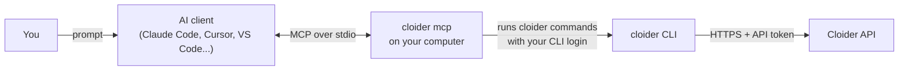

The Cloider MCP server lets AI assistants such as Claude Code, Claude Desktop, Cursor, VS Code with GitHub Copilot, Windsurf, Codex and Gemini CLI manage your Cloider account for you: deploy an app from your project folder, create a Kubernetes cluster and a database, read logs, fix DNS records, or tell you what this month will cost. It is built into the [`cloider` CLI](/cli/overview) as the `cloider mcp` command, runs on your own computer, and acts with the same login and permissions as the CLI.

## At a glance

| | |
| --- | --- |
| **Command** | `cloider mcp`, part of the `cloider` CLI |
| **Transport** | stdio: your AI client starts `cloider mcp` as a local process and talks to it over stdin and stdout |
| **Authentication** | The CLI's login: the current profile, `--profile`, `CLOIDER_TOKEN` or `--token-file` |
| **Tools** | 119 tools in 8 toolsets: `account`, `clusters`, `databases`, `buckets`, `registry`, `apps`, `domains`, `support` |
| **Read only tools** | 51, the only ones offered with `--read-only` |
| **Safety hints** | Standard MCP tool annotations (`readOnlyHint`, `destructiveHint`, `idempotentHint`) so clients can ask before changes |
| **MCP protocol versions** | `2025-11-25`, `2025-06-18`, `2025-03-26` and `2024-11-05` |
| **Not offered** | Managing members and API tokens, and the CLI's interactive commands |
| **Cost** | The server is free. Resources an agent creates are billed like any other, see [Billing model](/concepts/billing-model) |

## What is MCP?

The [Model Context Protocol](https://modelcontextprotocol.io) (MCP) is an open standard for connecting AI assistants to tools and data. An **MCP client** is the AI application you talk to (Claude Code, Cursor, VS Code and many others). An **MCP server** is a small program that offers that client a list of **tools**: named actions with typed parameters and a description, such as `create_database` with `name`, `engine` and `plan`.

When you ask your assistant "create a PostgreSQL database called orders-db", the model reads the tool list, picks `create_database`, fills in the parameters, and the client runs the tool through the server. The server does the work and answers with the result, which the model reads to decide what to do next. The client decides which tool calls need your approval first.

Without MCP, an assistant can only tell you which commands to type. With the Cloider MCP server, it can run them, read the answers, and chain several steps together, while you stay in control of what it is allowed to do.

## How the Cloider MCP server works



1. Your AI client starts `cloider mcp` as a child process when it starts, as configured in [MCP setup](/mcp/setup).
2. The server tells the client which tools it has, with their parameters, descriptions and safety annotations, plus short instructions about Cloider for the model.
3. When the model calls a tool, the server runs the matching `cloider` command (for example `cloider db create orders-db --engine=postgresql`) with JSON output, and answers with the result.
4. The command talks to the [Cloider REST API](/api/overview) with the CLI's API token.

Because every tool is a real CLI command, the agent gets exactly what a script gets: the same name and id resolution, the same waiting for resources to become ready, the same uploads and the same error messages. Everything an agent does is visible in the dashboard, like anything else you do.

## What can an agent do with Cloider?

| Area | Examples |
| --- | --- |
| **Apps** | Deploy the current folder, create an app from a GitHub repository, follow the build, read logs, set environment variables, run a migration in the container |
| **Kubernetes** | Create, pause, resume and delete clusters, get the kubeconfig, list Services, run `kubectl` and `helm` commands in the cluster |
| **Databases** | Create PostgreSQL, MySQL, MongoDB and Redis databases, resize, back up and restore, change trusted sources and SSL, run queries |
| **Object storage** | Create buckets, upload and download files, restore earlier versions, set policies and lifecycle rules, create S3 keys |
| **Container registry** | Create projects, list repositories and images, delete or untag images, create tokens, set retention and immutability rules |
| **Domains** | Claim `cloider.app` subdomains, add custom domains, manage DNS records, route paths to apps and cluster Services |
| **Account** | Check usage and the month's forecast, bills and prices, list members and tokens |
| **Support** | Open and reply to support requests, download attachments |

See [Example prompts](/mcp/example-prompts) for 30 and more realistic prompts and the tools each one calls, and [Tools reference](/mcp/tools) for every tool.

## How does the MCP server authenticate?

The server uses the CLI's own login. It never asks for a password or opens its own session:

- By default it uses the CLI's **current profile**, the one `cloider login` saved.
- `cloider --profile acme mcp` uses another profile, so you can add one server per account.
- `CLOIDER_TOKEN` or `--token-file` in the server's environment or arguments take priority, as they do for the CLI.

Every tool call acts as that one API token, in that one account. The model can call `whoami` to see which account it is in, which role you have there, and whether the token can only read. See [CLI authentication](/cli/authentication) for how logins, profiles and tokens work.

A token's access level is enforced by the API, whatever the client or the model does: a **Read** token can't change anything, and the API refuses every write with `This API token is read only!`. That makes a read only login the strongest guarantee you can give an agent.

## Toolsets and read only mode

Tools are grouped in eight **toolsets**: `account`, `clusters`, `databases`, `buckets`, `registry`, `apps`, `domains` and `support`. Two flags narrow what the server offers:

```bash
# Only the tools that change nothing
cloider mcp --read-only

# Only some toolsets, for clients that take few tools or for focused agents
cloider mcp --toolsets apps,databases,domains
```

Fewer tools also means a shorter tool list for the model to read, which helps clients that limit the number of tools. See [Safety and permissions](/mcp/safety-and-permissions) for how to combine these with read only tokens.

## What the MCP server can't do

Some things are deliberately left out:

- **Members and API tokens.** The agent can list members (`list_members`) and tokens (`list_api_tokens`), but inviting members, changing roles and creating or revoking API tokens are dashboard only. The API refuses them from any API token, so an agent can never give itself or anyone else more access.
- **Interactive commands.** `cloider cluster shell`, `cloider db shell`, `cloider app shell`, `cloider db connect`, `cloider login`, `cloider logout`, `cloider profile`, `cloider update`, `cloider app open`, `cloider app link` and `cloider registry login` need a terminal or a browser, so they have no tool. For one-off commands the agent uses the exec tools instead (`cluster_exec`, `database_exec`, `app_exec`).
- **Remote access.** The server runs on your computer over stdio. There is no hosted MCP endpoint to add by URL.
- **Billing changes.** Bills and usage can be read, but payment methods and plans are managed in the [dashboard](/account/billing).

## Requirements

- The `cloider` CLI, installed and on your `PATH`. See [Install the CLI](/cli/install).
- A login: run `cloider login` once (or set `CLOIDER_TOKEN`). See [CLI authentication](/cli/authentication).
- An MCP client. Setup for each one is in [MCP setup](/mcp/setup).

## Quick start with Claude Code

```bash
# 1. Install the CLI and log in
curl -fsSL https://cloider.com/install.sh | sh
cloider login

# 2. Add the MCP server
claude mcp add cloider -- cloider mcp
```

Then ask, for example:

```text title="Prompt"
Which Cloider account am I in, and what is running there?
```

The agent calls `whoami`, then `list_apps`, `list_clusters`, `list_databases` and `list_buckets`, and summarizes them.

## What happens when you run cloider mcp in a terminal?

Nothing visible: the server waits for an MCP client on stdin. When started from a terminal it prints a hint and keeps waiting:

```text title="Output"
cloider mcp talks MCP on stdin and stdout, for an AI client to start. Add it to Claude Code with:
  claude mcp add cloider -- cloider mcp
```

Press Ctrl-C to stop it. Your AI client starts and stops the server itself.

## Next steps

<Cards cols={2}>
  <Card title="Set up your AI client" href="/mcp/setup" icon="robot-outline">
    Claude Code, Claude Desktop, Cursor, VS Code, Windsurf, Codex, Gemini CLI, Zed, Cline and Continue.
  </Card>
  <Card title="Tools reference" href="/mcp/tools" icon="code-braces">
    All 119 tools, their parameters, effects and annotations.
  </Card>
  <Card title="Safety and permissions" href="/mcp/safety-and-permissions" icon="shield-check-outline">
    Read only tokens, --read-only, toolsets and approvals.
  </Card>
  <Card title="Example prompts" href="/mcp/example-prompts" icon="chat-question-outline">
    Realistic prompts by task, with the tools each one calls.
  </Card>
</Cards>

<FAQ items={[
  {q: 'Does Cloider have an MCP server?', a: 'Yes. The cloider CLI includes one: cloider mcp. It offers 119 tools for apps, Kubernetes clusters, databases, buckets, the container registry, domains, DNS, usage, billing and support to any MCP client, such as Claude Code, Claude Desktop, Cursor or VS Code.'},
  {q: 'How does the Cloider MCP server log in?', a: 'It uses the cloider CLI\'s login: the current profile, a profile passed with cloider --profile <name> mcp, or the token in CLOIDER_TOKEN. Run cloider login once before adding the server to your client.'},
  {q: 'Can an AI agent delete my Cloider resources?', a: 'Only if you let it. Destructive tools carry the MCP destructiveHint annotation, so clients ask before running them. cloider mcp --read-only removes every tool that changes something, and a read only API token makes the API refuse every change whatever the agent does.'},
  {q: 'Is there a hosted Cloider MCP endpoint?', a: 'No. The server runs locally, started by your AI client over stdio. Install the cloider CLI and add cloider mcp to your client.'},
  {q: 'Can the agent create API tokens or invite members?', a: 'No. Members, roles and API tokens are managed in the dashboard only. The MCP server can list them but not change them, and the API refuses those changes from any API token.'},
  {q: 'Which AI clients work with the Cloider MCP server?', a: 'Any client that supports local (stdio) MCP servers, including Claude Code, Claude Desktop, Cursor, VS Code with GitHub Copilot, Windsurf, OpenAI Codex CLI, Gemini CLI, Zed, Cline and Continue.'},
]} />
