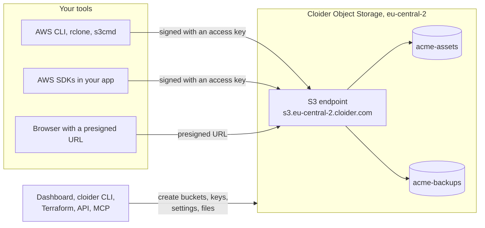

Cloider Object Storage gives you S3 compatible buckets: places to store any number of files (objects) that your apps, scripts and tools read and write over HTTPS with the S3 API. Any S3 client works with it, from the AWS CLI and rclone to the AWS SDKs for every language, and you pay only for the data you store.

This page explains the concepts behind object storage for readers who are new to it, then lists exactly what a Cloider bucket offers, how it is billed and which tools manage it. If you already know S3 and just want a bucket, go to [Create a bucket](/object-storage/create-a-bucket).

## At a glance

| | |
| --- | --- |
| **What it is** | S3 compatible buckets. Every S3 client, SDK and tool that lets you set a custom endpoint works with them |
| **Region** | `eu-central-2` (Europe), endpoint `https://s3.eu-central-2.cloider.com` |
| **Addressing** | Virtual hosted style (`https://acme-assets.s3.eu-central-2.cloider.com/logo.png`) and path style (`https://s3.eu-central-2.cloider.com/acme-assets/logo.png`) both work |
| **Billing** | Per GB of stored data per month, billed by the hour. No charges for requests or traffic. See [Usage and billing](/object-storage/usage-and-billing) |
| **Credentials** | [Access keys](/object-storage/access-keys): an access key id (`CLDR...`) and a secret, for every bucket of the account or only the ones you pick, read and write or read only. Up to 50 per account |
| **Visibility** | Private by default. A [public bucket](/object-storage/public-and-private-buckets) lets anyone download a file by its URL, while listing and changing files still need a key |
| **Features** | [Versioning](/object-storage/versioning) with restore of earlier versions and deleted files, [lifecycle rules](/object-storage/lifecycle-rules), [bucket policies](/object-storage/bucket-policies), [static website hosting](/object-storage/static-websites) on the bucket's own address or your domain, a [file browser](/object-storage/manage-files) in the dashboard, multipart uploads from S3 tools |
| **Plans** | The Free plan allows one bucket. Paid accounts can create more |
| **Status in the dashboard** | **Buckets** in the sidebar, marked **Beta** |
| **Tools** | [Dashboard](https://cloider.com/dashboard/buckets), [CLI](/cli/commands/bucket), [Terraform](/terraform/resources/bucket), [REST API](/api/endpoints/buckets), [MCP](/mcp/tools) |

<Screenshot
  src="/img/screenshots/object-storage/list.webp"
  url="/dashboard/buckets"
  alt="The Buckets page in the Cloider dashboard listing the buckets acme-assets and acme-backups with their region, size, access and status, next to an Access Keys tab"
  caption="The Buckets page lists every bucket of the account with its region, size, access and status. The Access Keys tab next to it holds the S3 credentials."
/>

## What is object storage?

Object storage is a way to store files as **objects** in flat containers called **buckets**, and to read and write them over HTTP instead of through a file system. You don't mount it like a disk. You send a request such as "put this file in bucket `acme-assets` under the name `images/logo.png`" or "give me `images/logo.png`", and the storage service answers.

Object storage is the usual home for:

- user uploads (avatars, documents, attachments),
- static assets of a website (images, CSS, JavaScript, downloads), or a whole static website,
- backups and database dumps,
- logs, exports and data files that grow without limit,
- build artifacts and release binaries,
- Terraform state and other shared files your tools need.

It suits these jobs because it scales without planning: you never size or resize a volume, and many apps, servers and tools can read and write the same bucket at once.

### The S3 API

S3 (Simple Storage Service) is Amazon's object storage, and its HTTP API has become the common language of object storage. Almost every backup tool, framework, CMS and SDK can talk to it. Cloider buckets speak the same API, so these tools work with Cloider once you give them three things: the **endpoint** (`https://s3.eu-central-2.cloider.com`), the **region** (`eu-central-2`) and an **access key**.

### Buckets, objects and keys

The vocabulary is small:

| Term | Meaning | Example |
| --- | --- | --- |
| **Bucket** | A named container for objects. Its name is unique across all of Cloider | `acme-assets` |
| **Object** | One stored file: its bytes plus metadata such as its size, content type and last modified time | the bytes of a PNG image |
| **Key** | The object's full name inside the bucket. It can contain `/` | `images/2026/logo.png` |
| **Prefix** | The start of a key. Tools show keys that share a prefix ending in `/` as a folder | `images/2026/` |
| **Endpoint** | The HTTPS address S3 clients send requests to | `https://s3.eu-central-2.cloider.com` |
| **Access key** | The credentials an S3 client signs its requests with: an access key id and a secret access key | `CLDRZ8Q4M2X7KD1PLW0B` |
| **Version** | With [versioning](/object-storage/versioning) on, each earlier state of an object, kept when it is overwritten or deleted | a version id such as `3a7f...` |

:::info[Folders don't really exist]
A bucket has no directories, only keys. The object `images/2026/logo.png` is stored under that whole key, and the dashboard, the CLI and most S3 tools display it inside the folders `images/` and `2026/` because the key contains slashes. When you create an empty folder in the dashboard, Cloider stores a zero byte object named like the folder (for example `images/`) so the folder shows up before anything is in it. See [Manage files](/object-storage/manage-files).
:::

The key of an object is also its address. In a bucket named `acme-assets`, the object `images/logo.png` is at:

```text
https://acme-assets.s3.eu-central-2.cloider.com/images/logo.png
```

A private bucket answers that URL only to requests signed with an access key, or to a [presigned URL](/object-storage/sdks#create-a-presigned-url). A public bucket answers it to anyone.

## How Cloider Object Storage works

Every bucket lives in a region and is served on that region's S3 endpoint. Today there is one region:

| Region code | Name | Endpoint |
| --- | --- | --- |
| `eu-central-2` | Europe | `https://s3.eu-central-2.cloider.com` |

`cloider bucket regions`, the `GET /api/buckets/regions` endpoint and the [`cloider_bucket_regions`](/terraform/data-sources/bucket-regions) data source list the regions with their endpoints, so scripts don't need to hard code them.



There are two ways to work with a bucket, and you will usually use both:

1. **Cloider's own tools** (the dashboard, the `cloider` CLI, Terraform, the REST API and the MCP server) create and delete buckets, manage access keys, change visibility, versioning, policies and lifecycle rules, and browse, upload, download and restore files. They authenticate with your Cloider login or an [API token](/account/api-tokens).
2. **Any S3 client** (the AWS CLI, rclone, s3cmd, the MinIO client, the AWS SDKs, backup tools, frameworks) reads and writes objects directly on the S3 endpoint. They authenticate with a bucket [access key](/object-storage/access-keys), not with your Cloider login.

Files moved with Cloider's tools travel the same way: the dashboard and the CLI ask the API for a presigned URL and then send the bytes straight to the S3 endpoint, so uploads and downloads never pass through the Cloider API.

### What a bucket gets when you create it

When you create a bucket, Cloider:

- creates the bucket on the region's endpoint under the name you chose, which nobody else can then use,
- sets its visibility (private unless you turn on **Public read access**),
- turns on versioning if you asked for it, before any key can write to it,
- gives every existing access key that covers all buckets access to it, read and write or read only as the key says,
- makes the bucket's **Files** tab ready, so you can manage files in the dashboard without creating a key first.

Creating a bucket takes a few seconds. Its status goes from `Creating` to `Ready`. The other statuses are `Failed` (setting it up didn't work, delete it and create it again), `Terminating` (being deleted) and `Terminated` (deleted). See [Create a bucket](/object-storage/create-a-bucket).

## What can you store, and how much?

You can store any kind of file, of any content type, under any key up to 1024 characters. There is no fixed storage quota on a bucket: you pay for what you store.

A few limits apply to Cloider's own tools, because they move each file in one request:

| Limit | Value |
| --- | --- |
| Largest file uploaded from the dashboard or `cloider bucket upload` | 5 GB per file |
| Largest version restored from the dashboard or `cloider bucket restore` | 5 GB |
| Files listed per page in the file browser | 200 |
| Files deleted per request | 1000 |
| Files under one folder that the dashboard deletes at once | 10,000 |

Larger files go through S3 tools, which split them into a multipart upload on their own. `aws s3 cp`, `rclone copy` and the SDKs' upload managers all do this. See [S3 tools](/object-storage/s3-tools).

## How is object storage billed?

Object storage is billed on the amount of data you store, per GB per month, charged by the hour. Cloider measures how much each bucket stores every few minutes and averages those measurements over time, so a file that you keep for one day costs one day's worth of storage. Requests, uploads, downloads and traffic are free.

Everything a bucket stores counts, including the earlier versions and delete markers that [versioning](/object-storage/versioning) keeps. [Lifecycle rules](/object-storage/lifecycle-rules) can expire old files and old versions automatically to keep the bill down.

The current price per GB is shown on the **Create bucket** page and on [cloider.com/#pricing](https://cloider.com/#pricing). See [Usage and billing](/object-storage/usage-and-billing) for how to read a bucket's usage and forecast.

## Private and public buckets

A new bucket is **private**: every request needs an access key or a presigned URL. Turning on **Public read access** lets anyone download an object if they know its URL, which is what you want for website assets and public downloads. Even on a public bucket, nobody without a key can list the bucket's contents, upload, overwrite or delete files.

For finer control, a [bucket policy](/object-storage/bucket-policies) grants or denies specific S3 actions to specific access keys, optionally only for some prefixes or under conditions. See [Public and private buckets](/object-storage/public-and-private-buckets).

A public bucket can also be served as a [static website](/object-storage/static-websites): its own HTTPS address at `https://<bucket>.s3-website.eu-central-2.cloider.com` serves index and error documents, and a target puts it on a free subdomain or your own domain.

## What does Cloider Object Storage support?

Cloider buckets support the parts of the S3 API that applications and tools use day to day:

- objects: `PutObject`, `GetObject`, `HeadObject`, `CopyObject`, `DeleteObject`, `DeleteObjects`, object tagging,
- listing: `ListObjectsV2`, `ListObjects`, `ListObjectVersions`,
- multipart uploads: create, upload part, complete, abort, list uploads and parts,
- presigned URLs for downloads and uploads,
- [versioning](/object-storage/versioning) (enable and suspend, read and delete specific versions),
- [lifecycle rules](/object-storage/lifecycle-rules) that expire objects, earlier versions and unfinished uploads,
- [bucket policies](/object-storage/bucket-policies) with Allow and Deny statements naming your access keys,
- [static website hosting](/object-storage/static-websites) with index and error documents, on the bucket's own address or a domain,
- Signature Version 4 authentication, as every current S3 client uses.

Some things work differently than on Amazon S3:

- **Buckets are created by Cloider, not by S3 clients.** Create and delete buckets in the dashboard, with the CLI, Terraform, the API or MCP. An access key can't create or delete buckets.
- **Public access is a bucket setting.** Make a bucket public with its visibility setting rather than with ACLs.
- **Static websites are a bucket setting too.** Turn one on with Cloider's tools rather than with the S3 website API. Redirect rules aren't offered.
- **Object lock is not offered.** Retention periods and legal holds can't be set on Cloider buckets. See [Data protection](/object-storage/data-protection).
- **Newer AWS CLIs and SDKs need one setting.** Since early 2025 they add a checksum to every upload by default, which Cloider's storage doesn't accept. Set `request_checksum_calculation = when_required` (or the `AWS_REQUEST_CHECKSUM_CALCULATION=when_required` environment variable). Every example in these docs includes it. See [Troubleshooting](/object-storage/troubleshooting#checksum-errors).

[S3 compatibility](/object-storage/s3-compatibility) lists every supported action and the differences in detail.

## Manage buckets with any tool

Every task in this section is shown for each tool. Here is the same bucket created five ways:

<Tabs groupId="interface" queryString>
<TabItem value="dashboard" label="Dashboard" default>

1. Open **Buckets** in the sidebar and click **Create Bucket**.
2. Enter `acme-assets` as the **Bucket Name**, keep the region `eu-central-2`, and click **Create bucket**.

</TabItem>
<TabItem value="cli" label="CLI">

```bash
cloider bucket create acme-assets --wait
```

```text title="Output"
✓ Created bucket acme-assets
✓ Bucket acme-assets is ready
```

</TabItem>
<TabItem value="terraform" label="Terraform">

```hcl title="main.tf"
resource "cloider_bucket" "assets" {
  name = "acme-assets"
}
```

</TabItem>
<TabItem value="api" label="API">

```bash
curl -X POST https://cloider.com/api/buckets \
  -H "Authorization: Bearer $CLOIDER_TOKEN" \
  -H "Content-Type: application/json" \
  -d '{"bucket_name": "acme-assets", "region": "eu-central-2"}'
```

```json title="Response"
{"hashed_id": "b7r2xw"}
```

</TabItem>
<TabItem value="mcp" label="MCP">

Ask your agent:

```text title="Prompt"
Create a bucket called acme-assets and wait until it is ready.
```

It calls the `create_bucket` tool:

```json title="Tool call: create_bucket"
{"name": "acme-assets", "wait": true}
```

</TabItem>
</Tabs>

## Where to go next

<Cards cols={2}>
  <Card title="Create a bucket" href="/object-storage/create-a-bucket" icon="bucket-outline">
    Naming rules, regions, public access and versioning, with every tool.
  </Card>
  <Card title="Access keys" href="/object-storage/access-keys" icon="key-variant">
    Create S3 credentials for one bucket or all of them, read only or read and write.
  </Card>
  <Card title="S3 tools" href="/object-storage/s3-tools" icon="console">
    Configure the AWS CLI, rclone, s3cmd, the MinIO client and Cyberduck.
  </Card>
  <Card title="SDKs" href="/object-storage/sdks" icon="code-braces">
    Complete examples for JavaScript, Python, Go, PHP, Java, Ruby and .NET.
  </Card>
  <Card title="Manage files" href="/object-storage/manage-files" icon="folder-outline">
    Browse, upload, download and delete files in the dashboard and with the CLI.
  </Card>
  <Card title="Use buckets from apps and clusters" href="/object-storage/use-with-apps-and-clusters" icon="rocket-launch-outline">
    Hand an access key to an App Engine app or a Kubernetes workload.
  </Card>
</Cards>

<FAQ items={[
  {q: 'Is Cloider Object Storage compatible with Amazon S3?', a: 'Yes. Cloider buckets speak the S3 API with Signature Version 4, so the AWS CLI, the AWS SDKs, rclone, s3cmd, the MinIO client and other S3 tools work with them. Point the tool at the endpoint https://s3.eu-central-2.cloider.com with the region eu-central-2 and a Cloider access key. Buckets themselves are created and deleted with Cloider\'s tools, not with S3 clients.'},
  {q: 'How much does Cloider Object Storage cost?', a: 'You pay per GB of data stored per month, billed by the hour on what each bucket actually stores. There are no charges for requests, uploads, downloads or traffic. The current price per GB is on the Create bucket page in the dashboard and at cloider.com/#pricing.'},
  {q: 'What is the S3 endpoint of a Cloider bucket?', a: 'Buckets in the eu-central-2 region are served on https://s3.eu-central-2.cloider.com. A bucket named acme-assets is also reachable at its own address, https://acme-assets.s3.eu-central-2.cloider.com, and path style at https://s3.eu-central-2.cloider.com/acme-assets.'},
  {q: 'Can I use Cloider Object Storage on the Free plan?', a: 'Yes. A Free plan account can create one bucket. Paid accounts can create more.'},
  {q: 'Are buckets private by default?', a: 'Yes. A new bucket is private, so every request needs an access key or a presigned URL. You can turn on Public read access when you create the bucket or later in its Settings tab. A public bucket lets anyone download a file by its URL, but listing the bucket and changing files still need an access key.'},
  {q: 'Is there a size limit for files?', a: 'The dashboard and the cloider CLI upload files of up to 5 GB each. S3 tools such as the AWS CLI and rclone, and the SDKs\' upload managers, use multipart uploads for larger files automatically.'},
  {q: 'Can a Cloider bucket host a static website?', a: 'Yes. Make the bucket public and turn on Static Website in its Settings tab. It is served at https://<bucket>.s3-website.eu-central-2.cloider.com with an index document and an optional error document, and a Bucket target serves it on a free cloider.app subdomain or your own domain. Website traffic is free like any bucket traffic.'},
  {q: 'Does Cloider support object lock, retention or legal hold?', a: 'No. Object lock is not offered on Cloider buckets. To protect data from accidental overwrites and deletes, turn on versioning, give tools read only access keys where they only need to read, and use bucket policies to deny deletes.'},
]} />
