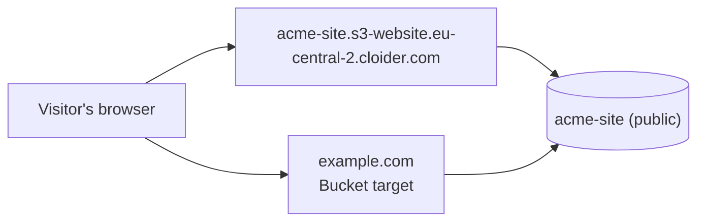

A Cloider bucket can serve its files as a static website: `/` and every path ending in `/` show that folder's index document, and anything missing shows your error document with a `404`, the way an Amazon S3 website endpoint answers. Every website bucket gets its own HTTPS address, and you can serve it on a free `cloider.app` subdomain or on your own domain with a target.

This page explains how a bucket website answers requests, how to turn it on with every tool, how to serve it on a domain, and the limits and errors you can hit.

## At a glance

| | |
| --- | --- |
| **What it serves** | The files of one public bucket, exactly as they are stored |
| **Address** | `https://<bucket>.s3-website.eu-central-2.cloider.com`, over HTTPS with Cloider's certificate |
| **Your domains** | A free subdomain or a custom domain, with a **Bucket** target. See [Serve the website on a domain](#serve-the-website-on-a-domain) |
| **Index document** | A file name without a slash, `index.html` by default |
| **Error document** | Optional, a key in the bucket such as `404.html`. Without one, a small built-in `404` page |
| **Requires** | A **Ready** bucket with [public read access](/object-storage/public-and-private-buckets) |
| **Methods** | `GET` and `HEAD`, including range and conditional requests |
| **Not offered** | Folder listings and redirect rules |
| **Cost** | Nothing extra. The bucket is billed for the data it stores, and requests and traffic are free |
| **Tools** | Dashboard, `cloider bucket website`, Terraform `cloider_bucket`, `/api/buckets/:hashed_id/website`, MCP |

## How does a bucket website work?

A bucket website reads the bucket without a key, like any visitor of a public bucket, and turns the path of each request into a key: `https://acme-site.s3-website.eu-central-2.cloider.com/about/team.html` serves the key `about/team.html`. That is why the bucket has to be public.



The website address is separate from the bucket's S3 address. Both serve the same files, but they answer differently:

| | Bucket URL `https://acme-site.s3.eu-central-2.cloider.com` | Website address `https://acme-site.s3-website.eu-central-2.cloider.com` |
| --- | --- | --- |
| Meant for | S3 tools, SDKs and links to single files | Browsers |
| `/` | An S3 `AccessDenied` error: listing is never public | The index document, `index.html` |
| `/docs/` | No index document | `docs/index.html` |
| A missing file | An S3 XML error | Your error document with `404` |
| Access keys and presigned URLs | Yes | No, every request is anonymous |
| Methods | The [S3 API](/object-storage/s3-compatibility) | `GET` and `HEAD` |

## Before you begin

- A bucket in the **Ready** state. See [Create a bucket](/object-storage/create-a-bucket).
- Public read access on that bucket. See [Make a bucket public or private](/object-storage/public-and-private-buckets#make-a-bucket-public-or-private).
- Write access to the account. Members with read-only access and read only API tokens can see the website settings but not change them.

:::warning[Everything in a website bucket is public]
The website needs a public bucket, so every file in it can be downloaded by anyone, through the website and through the bucket's S3 URL. Keep source files, drafts and anything private in another bucket.
:::

## Upload your site

Build your site, then upload the output folder so that `index.html` sits at the root of the bucket, not under a folder such as `dist/`. With the CLI, which sets each file's `Content-Type` from its extension:

```bash
cloider bucket create acme-site --public --wait
cloider bucket upload acme-site ./dist -r
```

```text title="Output"
✓ Created bucket acme-site
✓ Bucket acme-site is ready
✓ dist/index.html → index.html
✓ dist/404.html → 404.html
✓ dist/docs/index.html → docs/index.html
✓ dist/assets/app.3f9a2c.js → assets/app.3f9a2c.js
✓ dist/assets/app.3f9a2c.css → assets/app.3f9a2c.css
✓ Uploaded 5 files (162.4 KiB) to acme-site
```

For later releases and larger sites, `aws s3 sync` uploads only what changed and removes files you deleted:

```bash
aws s3 sync ./dist s3://acme-site --delete --profile cloider
```

See [S3 tools](/object-storage/s3-tools) to set up the `cloider` profile, and [Set headers when you upload](#set-headers-when-you-upload) for caching.

## Turn on the website

You can turn the website on when you create a public bucket, with the **Static website** switch on the create form (it is enabled once public read access is on), `cloider bucket create <name> --public --website`, or `"website": true` in the create request. It then starts with `index.html` as its index document and no error document. On a bucket that already exists, turn it on once the bucket is **Ready** and public, and change the index and error documents at any time.

<Tabs groupId="interface" queryString>
<TabItem value="dashboard" label="Dashboard" default>

1. Open **Buckets** in the sidebar, click the bucket, and select the **Settings** tab.
2. In the **Static Website** card, click the switch.
3. Keep **Index document** as `index.html`, or type another file name.
4. Optionally, type an **Error document**, such as `404.html`.
5. Click **Save**.

The card then shows the website's **Address** and the **Domains** that serve it, and the **Overview** tab's **Summary** gets a **Website** row with the addresses. If the bucket is private, the card says **Make the bucket public first, under Public Read Access above.** and **Save** stays disabled.

</TabItem>
<TabItem value="cli" label="CLI">

```bash
cloider bucket website acme-site on --error 404.html
```

```text title="Output"
✓ Website of acme-site is on at https://acme-site.s3-website.eu-central-2.cloider.com
```

Without `on` or `off` and without flags, the command shows the settings:

```bash
cloider bucket website acme-site
```

```text title="Output"
Website:         https://acme-site.s3-website.eu-central-2.cloider.com
Index document:  index.html
Error document:  404.html
```

`--index` and `--error` change the documents and keep whatever you don't give, so `cloider bucket website acme-site --error 404.html` changes only the error document. `--error ""` goes back to the built-in page. `cloider bucket get acme-site` shows the address on its **Website** line.

</TabItem>
<TabItem value="terraform" label="Terraform">

```hcl title="main.tf"
resource "cloider_bucket" "site" {
  name           = "acme-site"
  public         = true
  website        = true
  error_document = "404.html"
}

output "website_url" {
  value = cloider_bucket.site.website_url
}
```

```text title="Output"
website_url = "https://acme-site.s3-website.eu-central-2.cloider.com"
```

`index_document` defaults to `index.html` and `error_document` to `""`, the built-in page. See [`cloider_bucket`](/terraform/resources/bucket).

</TabItem>
<TabItem value="api" label="API">

```bash
curl -X PUT https://cloider.com/api/buckets/s3w8qn/website \
  -H "Authorization: Bearer $CLOIDER_TOKEN" \
  -H "Content-Type: application/json" \
  -d '{"enabled": true, "index_document": "index.html", "error_document": "404.html"}'
```

```json title="Response"
{
  "enabled": true,
  "index_document": "index.html",
  "error_document": "404.html",
  "url": "https://acme-site.s3-website.eu-central-2.cloider.com"
}
```

`PUT` sets all three fields, so send the ones you want to keep too. An empty `index_document` means `index.html`, and an empty `error_document` the built-in page. `GET /api/buckets/s3w8qn/website` reads the settings, with `url` empty while the website is off.

</TabItem>
<TabItem value="mcp" label="MCP">

```text title="Prompt"
Serve the acme-site bucket as a website, with 404.html as the error page.
```

It calls the `set_bucket_website` tool:

```json title="Tool call: set_bucket_website"
{"bucket": "acme-site", "enabled": true, "error_document": "404.html"}
```

`get_bucket_website` reads the settings and the address.

</TabItem>
</Tabs>

Changes to the website settings take up to about 30 seconds to show on the website.

To turn the website off, click the switch and **Save**, then confirm **Turn off** in **Turn Off Website**; run `cloider bucket website acme-site off`; set `website = false` in Terraform; or send `{"enabled": false}`. The website address stops serving the bucket, and the files stay reachable by their own S3 links. While a domain still points at the website, turning it off is refused with `Domains still point at this website, remove their targets first.`

## Verify

Request the root of the website. It answers with the index document:

```bash
curl -I https://acme-site.s3-website.eu-central-2.cloider.com/
```

```text title="Output"
HTTP/2 200
content-type: text/html; charset=utf-8
content-length: 1532
etag: "7d3f9a2c41b8e6f0a5d2c9e1b4f7a830"
last-modified: Tue, 20 Oct 2026 11:40:12 GMT
x-content-type-options: nosniff
```

A path that doesn't exist answers with your error document and `404`:

```bash
curl -I https://acme-site.s3-website.eu-central-2.cloider.com/no-such-page
```

```text title="Output"
HTTP/2 404
content-type: text/html; charset=utf-8
```

## How are requests answered?

The website answers like an Amazon S3 website endpoint:

| Request | Answer |
| --- | --- |
| `GET /` | The index document at the root, `index.html`, with `200` |
| `GET /docs/` | `docs/index.html`, with `200` |
| `GET /about.html` | The file `about.html`, with `200` |
| `GET /docs`, when there is no file `docs` but `docs/index.html` exists | `302` redirect to `/docs/`, keeping the query string |
| A file that doesn't exist, or a folder without an index document | The error document with `404`, or the built-in page without one |
| A file a [bucket policy](#restrict-the-website-with-a-bucket-policy) denies to the visitor | The error document with `403` |
| `HEAD` | The same status and headers as `GET`, without the body |
| A `Range` header | `206 Partial Content` with that part of the file, so video and audio can be seeked |
| `If-None-Match` or `If-Modified-Since` matching the file | `304 Not Modified` |
| `POST`, `PUT`, `DELETE` and other methods | `405 Method Not Allowed`, with `Allow: GET, HEAD` |

- **The index document applies in every folder.** With the index document `index.html`, `/` serves `index.html` and `/blog/2026/` serves `blog/2026/index.html`.
- **Folders are never listed.** A folder without an index document answers with the error document.
- **The error document is read like any other file.** If it is missing, or a policy denies it to the visitor, the built-in page is shown instead, with the same status.
- **There are no redirect or routing rules.** The only redirect is from a folder path without the slash to the same path with it.

## Set headers when you upload

The website sends each file with the headers stored with it at upload: `Content-Type`, `Cache-Control`, `Content-Encoding`, `Content-Disposition`, `Content-Language` and `Expires`, plus `ETag`, `Last-Modified` and `Content-Length`. It adds `X-Content-Type-Options: nosniff`, so browsers trust the stored `Content-Type` and don't guess. Upload HTML as `text/html`, CSS as `text/css` and JavaScript as `text/javascript`.

`cloider bucket upload`, the dashboard and `aws s3 sync` set `Content-Type` from the file extension. To set caching as well, upload HTML with a short lifetime and fingerprinted assets with a long one:

```bash
# Assets whose names change with their content: cache for a year
aws s3 sync ./dist/assets s3://acme-site/assets \
  --cache-control "public, max-age=31536000, immutable" --profile cloider

# HTML: browsers check for a new version on every visit
aws s3 sync ./dist s3://acme-site --exclude "assets/*" \
  --cache-control "no-cache" --profile cloider
```

To fix the type of a file already uploaded, upload it again with the type set:

```bash
aws s3 cp ./dist/index.html s3://acme-site/index.html \
  --content-type "text/html; charset=utf-8" --cache-control "no-cache" --profile cloider
```

The guide [Static assets on object storage](/guides/static-assets-on-object-storage) covers caching in more detail.

## Host a single-page app

A single-page app (React, Vue, Angular, Svelte and others) routes in the browser, so a path such as `/settings/billing` has no file in the bucket. Set the error document to `index.html`: every path that isn't a file then gets `index.html`, and the app's router shows the right page.

```bash
cloider bucket website acme-site on --index index.html --error index.html
```

Those pages are served with a `404` status, as on Amazon S3 website endpoints. Browsers show them normally, but crawlers and uptime checks see the `404`. The root `/` and real files still answer `200`. There is no setting to serve the fallback with `200`.

## Serve the website on a domain

A **Bucket** target serves a bucket's website on a domain: a [free subdomain](/domains/free-subdomains) such as `acme-site.cloider.app` or a [custom domain](/domains/add-a-custom-domain) such as `example.com`. The bucket must be **Ready** with its website on, and the target always takes the whole domain: its path and target path are `/`.

<Tabs groupId="interface" queryString>
<TabItem value="dashboard" label="Dashboard" default>

1. Turn the bucket's website on, as above.
2. Open **Domains** in the sidebar and click the domain, or add one with **Add Domain**.
3. In the **Targets** section, click **Add target**.
4. Choose **Bucket** as the **Target type** and pick the bucket in **Bucket**. Buckets whose website is off are marked **website off** and can't be picked. **Path** and **Target path** stay `/`.
5. Click **Save**.

The bucket's **Static Website** card then lists the domain under **Domains**, and the **Overview** tab shows it in the **Website** row.

</TabItem>
<TabItem value="cli" label="CLI">

```bash
cloider target create example.com --bucket acme-site
```

```text title="Output"
✓ Routed example.com/ to the bucket's website
```

`--bucket` takes the bucket's name or id and can't be combined with `--app` or `--cluster`. A free subdomain works the same way:

```bash
cloider domain create acme-site.cloider.app
cloider target create acme-site.cloider.app --bucket acme-site
```

</TabItem>
<TabItem value="terraform" label="Terraform">

```hcl title="main.tf"
resource "cloider_bucket" "site" {
  name           = "acme-site"
  public         = true
  website        = true
  error_document = "404.html"
}

resource "cloider_domain" "site" {
  name = "example.com"
}

resource "cloider_target" "site" {
  domain    = cloider_domain.site.name
  bucket_id = cloider_bucket.site.id
}
```

A `cloider_target` takes exactly one of `cluster_id`, `app_id` and `bucket_id`. See [`cloider_target`](/terraform/resources/target).

</TabItem>
<TabItem value="api" label="API">

```bash
curl -X POST https://cloider.com/api/targets \
  -H "Authorization: Bearer $CLOIDER_TOKEN" \
  -H "Content-Type: application/json" \
  -d '{"domain_name": "example.com", "target_type": "Bucket", "bucket_id": "s3w8qn"}'
```

```json title="Response"
{
  "hashed_id": "t9b3ks",
  "domain_name": "example.com",
  "message": "Target created successfully"
}
```

`path` and `target_path` can be left out; any value other than `/` is refused.

</TabItem>
<TabItem value="mcp" label="MCP">

```text title="Prompt"
Serve the acme-site bucket's website on example.com.
```

```json title="Tool call: create_domain_target"
{"domain": "example.com", "bucket": "acme-site"}
```

</TabItem>
</Tabs>

How the domain gets HTTPS depends on its kind:

- **Free subdomains** are covered by Cloider's certificate for `*.cloider.app`, so `https://acme-site.cloider.app` works as soon as the target is saved.
- **Custom domains** get a certificate of their own from Let's Encrypt, like any target, once the host name resolves to Cloider. See [Add a custom domain](/domains/add-a-custom-domain) and [HTTPS certificates](/domains/https-certificates).

`www.example.com` is a domain of its own: add it and give it a Bucket target too if you want both names to serve the site. More about targets is in [Targets](/domains/targets).

### What happens to the targets when the bucket or domain changes?

| Event | What happens |
| --- | --- |
| Turning the website off | Refused while targets point at it: `Domains still point at this website, remove their targets first.` |
| Making the bucket private | Refused while the website is on: `The bucket's website needs it public, turn the website off first.` |
| Deleting the bucket | Its website stops, and the targets pointing domains at it are removed. The domains stay |
| Deleting the domain | Its targets are removed. The bucket and its website stay |

## Restrict the website with a bucket policy

Website visitors reach the bucket as anonymous requests from their own IP address. A [bucket policy](/object-storage/bucket-policies) therefore applies to the website just as it does to the bucket's public URLs: a statement for everyone (`"Principal": "*"`) matches website visitors, and `aws:SourceIp` is the visitor's public IP. A request the policy denies gets the error document with `403`.

For example, to show a staging site only to your office network:

```json title="office-only.json"
{
  "Version": "2012-10-17",
  "Statement": [
    {
      "Sid": "OfficeOnly",
      "Effect": "Deny",
      "Principal": "*",
      "Action": "s3:GetObject",
      "Resource": "arn:aws:s3:::acme-site/*",
      "Condition": {"NotIpAddress": {"aws:SourceIp": ["203.0.113.0/24"]}}
    }
  ]
}
```

```bash
cloider bucket policy set acme-site -f office-only.json
```

This Deny names everyone, so it applies to every download from the bucket, not only the website: S3 tools, presigned URLs, the dashboard's downloads and workloads running on Cloider are refused too when they come from outside the range. See [IP addresses](/object-storage/bucket-policies#ip-addresses).

## Limits

| Limit | Value | Message |
| --- | --- | --- |
| Visibility | The bucket must be public | `Make the bucket public first, its website is read without a key.` |
| Bucket status | **Ready** to change the settings | `The bucket must be ready to change its settings.` |
| Index document | A file name without `/`, up to 255 characters | `The index document is a file name without a slash, like index.html` |
| Error document | A key in the bucket, up to 1024 characters, not starting with `/` and without `.` or `..` segments | `The error document is a key in the bucket, like 404.html, not starting with a slash` |
| Methods | `GET` and `HEAD` | `405 Method Not Allowed` |
| Folder listings | Not offered | |
| Redirect and routing rules | Not offered | |
| Private files | Not served: the website reads without a key and doesn't take access keys or presigned URLs | |
| Domains | A Bucket target takes the whole domain, path and target path `/` | `A bucket website is served at the root of its domain, the path must be /` |
| Settings changes | Show on the website within about 30 seconds | |

## Troubleshooting

| Problem | Cause and fix |
| --- | --- |
| `Make the bucket public first, its website is read without a key.` | Make the bucket public, then turn the website on |
| `The bucket's website needs it public, turn the website off first.` | You tried to make a website bucket private. Turn the website off first |
| `Domains still point at this website, remove their targets first.` | Delete the Bucket targets that serve it, with `cloider target list <domain> -o wide` and `cloider target delete <id>`, then turn the website off |
| `The bucket must be ready to change its settings.` | Wait until the bucket is **Ready** |
| `Another change to this bucket is in progress, try again in a moment!` | Another settings, policy or delete change to this bucket is running. Try again |
| `Turn on the bucket's website first, from its Settings.` | The target's bucket has its website off. Turn it on, then add the target |
| `A bucket website is served at the root of its domain, the path must be /` | Leave the path and target path as `/`. To serve the site under its own name, use a domain such as `docs.example.com` |
| Every path, even `/`, shows a plain `404 Not Found` page | The website is off, the bucket isn't **Ready** and public, or the change hasn't shown yet: settings take up to about 30 seconds. On a domain, also check that it has a Bucket target |
| `/` shows your error document with `404` | There is no index document at the root. Upload `index.html` to the bucket's root, not under a folder such as `dist/` |
| `403` with your error document | A bucket policy denies the visitor, for example with a `NotIpAddress` condition. Check `cloider bucket policy get acme-site` |
| The browser downloads a page, or shows HTML or CSS as text | The file was stored with the wrong `Content-Type`, and the website doesn't let browsers guess. Upload it again with the right type, see [Set headers when you upload](#set-headers-when-you-upload) |
| Visitors see an old version after an upload | Browsers cached it under its `Cache-Control`. Use `no-cache` for HTML and fingerprinted names for assets |
| `/docs` redirects to `/docs/` | Expected: `docs/index.html` exists, so the folder path gets its slash, as on Amazon S3 |
| Browser certificate warning on a custom domain | The domain's certificate isn't issued yet. See [HTTPS certificates](/domains/https-certificates) |

## Next steps

- [Route domains with targets](/domains/targets), including Bucket targets.
- [Write a bucket policy](/object-storage/bucket-policies) to deny some files or networks.
- [Serve static assets from a bucket](/guides/static-assets-on-object-storage), with cache headers and browser uploads.
- [Deploy an app](/apps/overview) when the site needs server-side code.

<FAQ items={[
  {q: 'Can I host a static website in a Cloider bucket?', a: 'Yes. Make the bucket public and turn on Static Website in its Settings tab, with cloider bucket website <bucket> on, or with website = true in Terraform. The bucket is then served at https://<bucket>.s3-website.eu-central-2.cloider.com with index and error documents, like an Amazon S3 website endpoint.'},
  {q: 'What is the address of a bucket website?', a: 'https://<bucket>.s3-website.eu-central-2.cloider.com, for example https://acme-site.s3-website.eu-central-2.cloider.com. It is served over HTTPS with Cloider\'s certificate. The bucket\'s S3 URL, https://acme-site.s3.eu-central-2.cloider.com, keeps serving single files but has no index or error documents.'},
  {q: 'Can I use my own domain for a bucket website?', a: 'Yes. Add the domain to Cloider and give it a Bucket target that points at the bucket, from the domain\'s page in the dashboard or with cloider target create example.com --bucket acme-site. A free cloider.app subdomain works too. The target takes the whole domain, at the path /.'},
  {q: 'How do I host a single-page app such as React or Vue in a bucket?', a: 'Upload the build, turn on the website, and set the error document to index.html. Every path that isn\'t a file then gets index.html and the app\'s router shows the page. Those fallback pages are served with a 404 status, as on Amazon S3.'},
  {q: 'Can a bucket website list the files in a folder?', a: 'No. A folder path shows the folder\'s index document, and a folder without one shows the error document with 404.'},
  {q: 'Does a bucket website support redirects?', a: 'Only one: a folder path without its slash, such as /docs, is redirected to /docs/ when docs/index.html exists. There are no redirect or routing rules.'},
  {q: 'Does serving a website from a bucket cost extra?', a: 'No. The bucket is billed for the data it stores, per GB per month. Requests and traffic, including website visits, are free.'},
]} />
