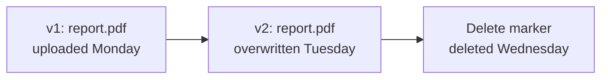

Versioning keeps the earlier contents of a file every time it is overwritten or deleted, so a mistake (a bad upload, a script that deletes the wrong folder, ransomware encrypting your files) can be undone. With versioning on, you can list every version of a file, download any of them, make an earlier one current again, and bring deleted files back.

This page explains how versions and delete markers work, how to turn versioning on, and how to restore files with every tool.

## At a glance

| | |
| --- | --- |
| **Default** | Off on a new bucket, unless you turn on **Versioning** when creating it |
| **States** | Never enabled (shown as **Off**), **Enabled**, **Suspended** |
| **Can it be turned off?** | Once enabled, versioning can only be suspended. Versions kept so far stay until you delete them or a lifecycle rule expires them |
| **Cost** | Every kept version uses storage and is billed like any file |
| **Restore** | Dashboard **Files** tab, `cloider bucket restore`, the API, MCP, or any S3 tool |
| **Who can change it** | Members who manage resources, and read and write access keys through the S3 API |

## How does versioning work?

Without versioning, a bucket keeps exactly one copy of each key: uploading to an existing key replaces it, and deleting removes it for good.

With versioning **enabled**, every upload creates a new **version** with its own **version id**, and the previous one is kept:



- The newest version is the **current** one. Plain downloads and listings see only current versions.
- An overwrite adds a new current version. The old one becomes **noncurrent** and stays available.
- A delete doesn't remove data. It adds a **delete marker** as the newest version, so the file disappears from listings and plain downloads answer `NoSuchKey`, but every earlier version is still there.
- **Undeleting** a file means removing its delete marker: the version before it becomes current again.
- **Permanently deleting** a specific version (by its version id) is the only way to destroy kept data, apart from lifecycle rules.

### Suspended versioning

Suspending versioning stops keeping new versions, without deleting the ones already kept. While suspended, an upload or delete replaces the file's single "null" version instead of adding a new one, so the content it replaces is gone for good. Versions created while versioning was enabled stay in the history and can still be restored.

A bucket can't go back to the never versioned state. To get rid of old versions after suspending, delete them or let a [lifecycle rule](/object-storage/lifecycle-rules) expire noncurrent versions.

## Turn versioning on or off

You can turn versioning on when you [create the bucket](/object-storage/create-a-bucket) (then even the first upload is versioned) or at any time later once the bucket is **Ready**.

<Tabs groupId="interface" queryString>
<TabItem value="dashboard" label="Dashboard" default>

1. Open **Buckets** in the sidebar, click the bucket, and select the **Settings** tab.
2. Click the **Versioning** switch.
3. Confirm with **Enable** in **Enable Versioning**, or **Suspend** in **Suspend Versioning**.

A **Suspended** tag shows next to the switch while versioning is suspended.

</TabItem>
<TabItem value="cli" label="CLI">

Show the current state (`Enabled`, `Suspended`, or `Off` for a bucket that was never versioned):

```bash
cloider bucket versioning acme-backups
```

```text title="Output"
Off
```

Turn it on, or suspend it:

```bash
cloider bucket versioning acme-backups on
```

```text title="Output"
✓ Versioning of acme-backups is Enabled
```

```bash
cloider bucket versioning acme-backups off
```

```text title="Output"
✓ Versioning of acme-backups is Suspended
```

</TabItem>
<TabItem value="terraform" label="Terraform">

```hcl title="main.tf"
resource "cloider_bucket" "backups" {
  name       = "acme-backups"
  versioning = true
}
```

Setting `versioning = false` after `true` suspends versioning and keeps the versions already kept.

</TabItem>
<TabItem value="api" label="API">

```bash
curl -X PUT https://cloider.com/api/buckets/k9d4mz/versioning \
  -H "Authorization: Bearer $CLOIDER_TOKEN" \
  -H "Content-Type: application/json" \
  -d '{"enabled": true}'
```

```json title="Response"
{"status": "Enabled"}
```

`{"enabled": false}` suspends it and answers `{"status": "Suspended"}`. Read the state with `GET /api/buckets/k9d4mz/versioning`, which answers `Enabled`, `Suspended` or an empty string for a bucket that was never versioned.

</TabItem>
<TabItem value="mcp" label="MCP">

```text title="Prompt"
Turn on versioning for acme-backups.
```

It calls the `set_bucket_versioning` tool:

```json title="Tool call: set_bucket_versioning"
{"bucket": "acme-backups", "enabled": true}
```

`get_bucket_versioning` reads the current state.

</TabItem>
</Tabs>

A read and write access key can also change versioning through the S3 API (`aws s3api put-bucket-versioning`), and the dashboard always shows the bucket's real state.

## List the versions of a file

<Tabs groupId="interface" queryString>
<TabItem value="dashboard" label="Dashboard" default>

1. Open the bucket's **Files** tab and find the file.
2. Click its **Versions** button (the clock icon). It only appears on versioned buckets.
3. The **Versions of** dialog lists every version, newest first, with when it was **Saved** and its **Size**. The current one is tagged **Current**, delete markers **Deleted**.

<Screenshot
  src="/img/screenshots/object-storage/file-versions.webp"
  url="/dashboard/buckets/acme-backups-k9d4mz"
  alt="The Versions dialog of a file listing several versions with their saved date and size, the newest tagged Current, with download, restore and delete buttons on each row"
  caption="Every version of one file, newest first, with download, restore and delete actions."
/>

</TabItem>
<TabItem value="cli" label="CLI">

```bash
cloider bucket versions acme-backups orders/latest.sql.gz
```

```text title="Output"
VERSION ID                          SIZE       MODIFIED
3HL4kqtJlcpXroDTDmJ.rmSpXd3dIbrH    48.2 MiB   2026-10-20 03:00  latest
Ux8Lw0q7M2Nn1pZ5t9QvKc4RbYdE6sAa    47.9 MiB   2026-10-19 03:00
8sQmV2rT5xLpK0wN3jHcYbZ7fD1gE4uA    47.1 MiB   2026-10-18 03:00
```

A delete marker shows `deleted` as its size. When a file has more than 1000 versions, only the newest 1000 are listed.

</TabItem>
<TabItem value="terraform" label="Terraform">

Not available in Terraform. Use the dashboard, the CLI, the API or an S3 tool.

</TabItem>
<TabItem value="api" label="API">

```bash
curl -G https://cloider.com/api/buckets/k9d4mz/objects/versions \
  --data-urlencode "key=orders/latest.sql.gz" \
  -H "Authorization: Bearer $CLOIDER_TOKEN"
```

```json title="Response"
{
  "versions": [
    {"version_id": "3HL4kqtJlcpXroDTDmJ.rmSpXd3dIbrH", "size": 50541363, "last_modified": "2026-10-20T01:00:04Z", "is_latest": true, "delete_marker": false},
    {"version_id": "Ux8Lw0q7M2Nn1pZ5t9QvKc4RbYdE6sAa", "size": 50226741, "last_modified": "2026-10-19T01:00:03Z", "is_latest": false, "delete_marker": false}
  ],
  "truncated": false
}
```

`truncated` is `true` when the file has more versions than the 1000 newest listed.

</TabItem>
<TabItem value="mcp" label="MCP">

```json title="Tool call: list_bucket_object_versions"
{"bucket": "acme-backups", "key": "orders/latest.sql.gz"}
```

</TabItem>
</Tabs>

## Restore an earlier version {#restore-an-earlier-version}

Restoring a version makes its content current again. Cloider does this by adding a copy of the version as the newest version, with its content type and metadata, so the history stays complete: the version you replace remains available too, and you can undo the restore the same way.

<Tabs groupId="interface" queryString>
<TabItem value="dashboard" label="Dashboard" default>

1. Open the file's **Versions** dialog from the **Files** tab.
2. Click **Restore** on the version you want.
3. Confirm with **Restore** in **Restore Version**.

To check a version first, click its **Download** button.

</TabItem>
<TabItem value="cli" label="CLI">

```bash
cloider bucket restore acme-backups orders/latest.sql.gz --version-id Ux8Lw0q7M2Nn1pZ5t9QvKc4RbYdE6sAa
```

```text title="Output"
✓ Restored orders/latest.sql.gz in acme-backups
```

Download a version without restoring it:

```bash
cloider bucket download acme-backups orders/latest.sql.gz \
  --version-id Ux8Lw0q7M2Nn1pZ5t9QvKc4RbYdE6sAa --dest ./orders-2026-10-19.sql.gz
```

</TabItem>
<TabItem value="terraform" label="Terraform">

Not available in Terraform.

</TabItem>
<TabItem value="api" label="API">

```bash
curl -X POST https://cloider.com/api/buckets/k9d4mz/objects/restore \
  -H "Authorization: Bearer $CLOIDER_TOKEN" \
  -H "Content-Type: application/json" \
  -d '{"key": "orders/latest.sql.gz", "version_id": "Ux8Lw0q7M2Nn1pZ5t9QvKc4RbYdE6sAa"}'
```

```json title="Response"
{"success": true}
```

</TabItem>
<TabItem value="mcp" label="MCP">

```text title="Prompt"
Restore yesterday's version of orders/latest.sql.gz in acme-backups.
```

The agent lists the versions with `list_bucket_object_versions`, then calls:

```json title="Tool call: restore_bucket_object_version"
{"bucket": "acme-backups", "key": "orders/latest.sql.gz", "version_id": "Ux8Lw0q7M2Nn1pZ5t9QvKc4RbYdE6sAa"}
```

</TabItem>
</Tabs>

Versions larger than 5 GB can't be restored this way: download the version with an S3 tool and upload it again (see [Restore with S3 tools](#restore-with-s3-tools)).

## Restore a deleted file

A deleted file on a versioned bucket is hidden behind a delete marker. Undeleting it removes that marker, so the file is back exactly as it was, under the same key.

<Tabs groupId="interface" queryString>
<TabItem value="dashboard" label="Dashboard" default>

1. Open the bucket's **Files** tab and go to the folder the file was in.
2. Turn on **Show deleted files**. The table now lists the deleted files of that folder with when they were **Deleted**, and folders that hold deleted files.
3. Click **Restore** on the file.

<Screenshot
  src="/img/screenshots/object-storage/deleted-files.webp"
  url="/dashboard/buckets/acme-assets-b7r2xw"
  alt="The Files tab of a versioned bucket with Show deleted files turned on, listing deleted files with the date they were deleted and a Restore button on each"
  caption="Show deleted files lists what a folder can still restore."
/>

You can also open the deleted file's **Versions** dialog and click **Undelete** on its newest delete marker, or **Restore** on an older version.

</TabItem>
<TabItem value="cli" label="CLI">

List the deleted files a folder can still restore:

```bash
cloider bucket deleted acme-assets images/
```

```text title="Output"
KEY                  DELETED           MARKER VERSION ID
images/banner.png    2026-10-20 10:12  b1Zq9Xc3Vn7Lk2Mp5Rt8Wy4Hs6Jd0Fg
images/logo-old.png  2026-10-19 16:44  N4fK8sP2qR6tV0xZ3bD7hJ1mW5yC9eA
```

Undelete one by restoring its delete marker:

```bash
cloider bucket restore acme-assets images/banner.png --version-id b1Zq9Xc3Vn7Lk2Mp5Rt8Wy4Hs6Jd0Fg
```

```text title="Output"
✓ Restored images/banner.png in acme-assets
```

</TabItem>
<TabItem value="terraform" label="Terraform">

Not available in Terraform.

</TabItem>
<TabItem value="api" label="API">

List a folder's deleted files:

```bash
curl -G https://cloider.com/api/buckets/b7r2xw/objects/deleted \
  --data-urlencode "prefix=images/" \
  -H "Authorization: Bearer $CLOIDER_TOKEN"
```

```json title="Response"
{
  "prefix": "images/",
  "folders": [],
  "objects": [
    {"key": "images/banner.png", "name": "banner.png", "deleted_at": "2026-10-20T08:12:31Z", "marker_version_id": "b1Zq9Xc3Vn7Lk2Mp5Rt8Wy4Hs6Jd0Fg"}
  ],
  "next_token": ""
}
```

A page can be empty and still have a `next_token`; keep requesting with `token` until it is empty. Then restore the marker:

```bash
curl -X POST https://cloider.com/api/buckets/b7r2xw/objects/restore \
  -H "Authorization: Bearer $CLOIDER_TOKEN" \
  -H "Content-Type: application/json" \
  -d '{"key": "images/banner.png", "version_id": "b1Zq9Xc3Vn7Lk2Mp5Rt8Wy4Hs6Jd0Fg"}'
```

</TabItem>
<TabItem value="mcp" label="MCP">

```text title="Prompt"
I deleted images/banner.png from acme-assets by mistake, bring it back.
```

The agent finds the delete marker with `list_deleted_bucket_objects` and restores it:

```json title="Tool call: restore_bucket_object_version"
{"bucket": "acme-assets", "key": "images/banner.png", "version_id": "b1Zq9Xc3Vn7Lk2Mp5Rt8Wy4Hs6Jd0Fg"}
```

</TabItem>
</Tabs>

Only the **latest** delete marker of a file can be undone. If a file was deleted, re-created and deleted again, restore one of its earlier content versions instead.

## Permanently delete versions

Deleting a specific version removes that data for good. Use it to remove a file that must really disappear (for example personal data), or to cut storage costs. To clean up old versions regularly, a [lifecycle rule](/object-storage/lifecycle-rules) with **noncurrent days** is easier.

<Tabs groupId="interface" queryString>
<TabItem value="dashboard" label="Dashboard" default>

1. Open the file's **Versions** dialog.
2. Click **Delete permanently** on a version and confirm with **Delete**.

Deleting the **Current** version makes the file go back to its previous version, or disappear if it has none.

</TabItem>
<TabItem value="cli" label="CLI">

```bash
cloider bucket rm-versions acme-backups orders/latest.sql.gz \
  --version-id 8sQmV2rT5xLpK0wN3jHcYbZ7fD1gE4uA --version-id Ux8Lw0q7M2Nn1pZ5t9QvKc4RbYdE6sAa
```

```text title="Output"
Permanently delete 2 versions of orders/latest.sql.gz? This can't be undone. [y/N] y
✓ Deleted 2 versions of orders/latest.sql.gz
```

Add `--yes` in scripts.

</TabItem>
<TabItem value="terraform" label="Terraform">

Not available in Terraform.

</TabItem>
<TabItem value="api" label="API">

```bash
curl -X POST https://cloider.com/api/buckets/k9d4mz/objects/versions/delete \
  -H "Authorization: Bearer $CLOIDER_TOKEN" \
  -H "Content-Type: application/json" \
  -d '{"key": "orders/latest.sql.gz", "version_ids": ["8sQmV2rT5xLpK0wN3jHcYbZ7fD1gE4uA"]}'
```

```json title="Response"
{"failed": []}
```

Up to 1000 version ids per request.

</TabItem>
<TabItem value="mcp" label="MCP">

```json title="Tool call: delete_bucket_object_versions"
{"bucket": "acme-backups", "key": "orders/latest.sql.gz", "version_ids": ["8sQmV2rT5xLpK0wN3jHcYbZ7fD1gE4uA"]}
```

</TabItem>
</Tabs>

## Restore with S3 tools {#restore-with-s3-tools}

Any S3 tool with a read and write [access key](/object-storage/access-keys) can work with versions directly. With the AWS CLI:

```bash
# List versions and delete markers under a prefix
aws s3api list-object-versions --bucket acme-backups --prefix orders/ --profile cloider

# Download a specific version
aws s3api get-object --bucket acme-backups --key orders/latest.sql.gz \
  --version-id Ux8Lw0q7M2Nn1pZ5t9QvKc4RbYdE6sAa ./orders.sql.gz --profile cloider

# Make it current again by uploading it as the newest version
aws s3 cp ./orders.sql.gz s3://acme-backups/orders/latest.sql.gz --profile cloider

# Undelete a file by deleting its delete marker
aws s3api delete-object --bucket acme-backups --key images/banner.png \
  --version-id b1Zq9Xc3Vn7Lk2Mp5Rt8Wy4Hs6Jd0Fg --profile cloider

# Permanently delete one version
aws s3api delete-object --bucket acme-backups --key orders/latest.sql.gz \
  --version-id 8sQmV2rT5xLpK0wN3jHcYbZ7fD1gE4uA --profile cloider
```

:::tip[Restore by downloading and uploading]
To make an earlier version current, download it and upload it again as shown, which is also what the dashboard does. Restoring with `aws s3api copy-object` and a `versionId` in the copy source can occasionally report success while the previous version stays current, so check the result with `list-object-versions` if you use it.
:::

## How much does versioning cost?

Every version and delete marker the bucket keeps counts toward its stored data and is billed like any file. A 50 MB file overwritten every night with versioning on stores about 1.5 GB after a month. Keep this in check with a lifecycle rule:

```json title="rules.json"
[
  {"id": "old-versions", "prefix": "", "enabled": true, "expire_days": 0, "noncurrent_days": 30, "abort_multipart_days": 7}
]
```

```bash
cloider bucket lifecycle set acme-backups -f rules.json
```

This removes versions 30 days after they were replaced or deleted. See [Lifecycle rules](/object-storage/lifecycle-rules) and [Usage and billing](/object-storage/usage-and-billing).

## Troubleshooting

| Message | Cause and fix |
| --- | --- |
| `This is already the current version!` | The version you picked is the current one. Pick an older version |
| `Only the latest deletion can be undone!` | You picked an older delete marker. Restore the newest marker, or an earlier content version |
| `This version doesn't exist anymore!` | The version was deleted meanwhile, by someone else or a lifecycle rule |
| `Versions over 5 GB can't be restored from the dashboard, use an S3 client!` | Download the version and upload it again with an S3 tool |
| `The bucket must be ready to change its settings.` | Wait until the bucket is **Ready** |
| `The bucket's policy denies this, change the policy first.` | A bucket policy denies `s3:PutBucketVersioning` to everyone. Edit the policy |
| No **Versions** button or **Show deleted files** switch | The bucket was never versioned. Turn versioning on; files deleted before that can't be recovered |
| A file overwritten while versioning was suspended can't be restored | Suspended versioning replaces the null version. Only versions created while versioning was enabled are kept |

## Next steps

- [Expire old versions automatically](/object-storage/lifecycle-rules).
- [Protect data with versioning, read only keys and policies](/object-storage/data-protection).
- [Back up a database to a versioned bucket](/guides/back-up-a-database-to-a-bucket).

<FAQ items={[
  {q: 'How do I restore a deleted file from a Cloider bucket?', a: 'If the bucket has versioning enabled, open its Files tab, turn on Show deleted files, and click Restore on the file. With the CLI, find the delete marker with cloider bucket deleted <bucket> and run cloider bucket restore <bucket> <key> --version-id <marker version id>. Without versioning, deleted files can\'t be recovered.'},
  {q: 'Can I turn versioning off again?', a: 'Versioning can be suspended but not removed. While suspended, new overwrites and deletes no longer keep earlier versions, and the versions kept so far stay until you delete them or a lifecycle rule expires them.'},
  {q: 'Are old versions billed?', a: 'Yes. Every kept version and delete marker counts toward the bucket\'s stored data. A lifecycle rule with noncurrent days removes old versions automatically.'},
  {q: 'Does restoring a version delete the newer versions?', a: 'No. Restoring adds a copy of the chosen version as the newest version. The versions in between stay in the history and can be restored too.'},
  {q: 'Can I recover files deleted before versioning was turned on?', a: 'No. Versioning only keeps versions of uploads, overwrites and deletes that happen while it is enabled.'},
]} />
