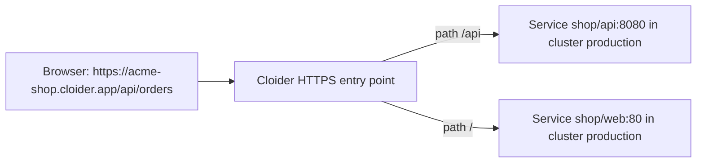

The `cloider_target` resource routes a path of a [`cloider_domain`](/terraform/resources/domain) to a Service in a [`cloider_cluster`](/terraform/resources/cluster), to an [app](/apps/overview), or to the [static website](/object-storage/static-websites) of a [`cloider_bucket`](/terraform/resources/bucket), over HTTPS. It is how a cluster's Services are reached from the internet on your own host names: Ingress objects inside a Cloider cluster aren't served, so a target takes their place. Cloider issues and renews the HTTPS certificate for you.

## At a glance

| | |
| --- | --- |
| **Required arguments** | `domain`, and one of `app_id`, `bucket_id`, or `cluster_id` with `namespace`, `service` and `port` |
| **Changes in place** | `path`, `target_path`, `cluster_id`, `namespace`, `service`, `port`, `protocol`, `app_id`, `bucket_id` |
| **Changes that replace the target** | `domain` |
| **Sensitive attributes** | None |
| **Timeouts** | None, targets are created immediately |
| **Import ID** | `<domain>/<id>`, such as `example.com/t4k9vq` |
| **API** | [`/api/targets`](/api/endpoints/targets) |
| **CLI equivalent** | [`cloider target`](/cli/commands/target) |

## How a target routes a request



A request for `https://<domain><path>...` is forwarded to the target whose `path` is the longest match, with `path` replaced by `target_path`. The Service receives plain HTTP: Cloider terminates HTTPS. See [Targets](/domains/targets).

## Example usage

### Route a free subdomain to a Service in a cluster

```hcl title="main.tf"
resource "cloider_cluster" "production" {
  name = "production"
}

resource "cloider_domain" "shop" {
  name = "acme-shop.cloider.app"
}

resource "cloider_target" "web" {
  domain     = cloider_domain.shop.name
  cluster_id = cloider_cluster.production.id
  namespace  = "shop"
  service    = "web"
  port       = 80
}
```

The Service `web` in the namespace `shop` must exist and listen on port 80. Create it with the `kubernetes` provider, Helm or `kubectl`. Once applied, `https://acme-shop.cloider.app` reaches it.

### Route to an app

Apps aren't managed by Terraform, so pass the app's id (from `cloider app list -o wide`):

```hcl title="main.tf"
resource "cloider_domain" "blog" {
  name = "blog.cloider.app"
}

resource "cloider_target" "blog" {
  domain = cloider_domain.blog.name
  app_id = "a7k2mq"
}
```

An app must have been deployed before it can be routed to. An app target needs only `app_id`: requests reach the app on the port it listens on.

### Serve a bucket's static website

```hcl title="main.tf"
resource "cloider_bucket" "site" {
  name           = "acme-site"
  public         = true
  website        = true
  error_document = "404.html"
}

resource "cloider_domain" "docs" {
  name = "docs.example.com"
}

resource "cloider_target" "docs" {
  domain    = cloider_domain.docs.name
  bucket_id = cloider_bucket.site.id
}
```

A bucket target needs only `bucket_id`. It takes the whole domain, so leave `path` and `target_path` at `/`, and the bucket must have `website = true`, which needs `public = true`. See [Static websites](/object-storage/static-websites).

### Several paths on one domain

```hcl title="main.tf"
# /api goes to the api Service, everything else to web
resource "cloider_target" "web" {
  domain     = cloider_domain.shop.name
  cluster_id = cloider_cluster.production.id
  namespace  = "shop"
  service    = "web"
  port       = 80
}

resource "cloider_target" "api" {
  domain     = cloider_domain.shop.name
  path       = "/api"
  cluster_id = cloider_cluster.production.id
  namespace  = "shop"
  service    = "api"
  port       = 8080
}
```

A domain routes each path to one target. A second target for the same domain and path is refused with `This path is already in use on this domain. Please choose a different path.`

### Rewrite the path

```hcl title="main.tf"
# https://acme-shop.cloider.app/docs/intro reaches the docs Service as /intro
resource "cloider_target" "docs" {
  domain      = cloider_domain.shop.name
  path        = "/docs"
  target_path = "/"
  cluster_id  = cloider_cluster.production.id
  namespace   = "docs"
  service     = "docs"
  port        = 80
}
```

### A custom domain, end to end

A subdomain such as `shop.example.com` needs a DNS record that points it at Cloider, because a target doesn't add one. A CNAME to a free subdomain you hold is the simplest:

```hcl title="main.tf"
resource "cloider_domain" "example" {
  name = "example.com"
}

# shop.example.com must be a domain of its own to have a target
resource "cloider_domain" "shop_example" {
  name = "shop.example.com"
}

# The DNS record lives on example.com, whose nameservers answer for shop
resource "cloider_dns_record" "shop" {
  domain = cloider_domain.example.name
  type   = "CNAME"
  name   = "shop"
  values = ["${cloider_domain.shop.name}."] # acme-shop.cloider.app.
  ttl    = 3600
}

resource "cloider_target" "shop_example" {
  domain     = cloider_domain.shop_example.name
  cluster_id = cloider_cluster.production.id
  namespace  = "shop"
  service    = "web"
  port       = 80
}
```

The apex (`example.com` itself) needs no record of its own: it comes with an `A` record that points at Cloider, so a target with `domain = cloider_domain.example.name` is enough. See [Add a custom domain](/domains/add-a-custom-domain).

### Deploy a Service and route to it in one configuration

```hcl title="main.tf"
resource "kubernetes_service_v1" "web" {
  metadata {
    name      = "web"
    namespace = "shop"
  }
  spec {
    selector = { app = "web" }
    port {
      port        = 80
      target_port = 8080
    }
  }
}

resource "cloider_target" "web" {
  domain     = cloider_domain.shop.name
  cluster_id = cloider_cluster.production.id
  namespace  = kubernetes_service_v1.web.metadata[0].namespace
  service    = kubernetes_service_v1.web.metadata[0].name
  port       = 80
}
```

Referring to the Service's attributes makes Terraform create the Service before the target. See [Kubernetes and Helm](/terraform/guides/kubernetes-and-helm).

## Argument reference

| Argument | Type | Required | Default | Changing it | Description |
| --- | --- | --- | --- | --- | --- |
| `domain` | String | Yes | | **Replaces** the target | The domain to route, a free subdomain or a custom domain |
| `path` | String | No | `/` | In place | The path on the domain to route, and everything under it. Starts with `/`, then letters, digits and `/ _ . -` |
| `target_path` | String | No | The value of `path` | In place | The path the request reaches the target with, in place of `path`. Same characters as `path` |
| `cluster_id` | String | One of `cluster_id`, `app_id` or `bucket_id` | | In place | The id of the `cloider_cluster` whose Service to route to. Requires `namespace`, `service` and `port` |
| `namespace` | String | With `cluster_id` | | In place | The Service's namespace |
| `service` | String | With `cluster_id` | | In place | The Service's name |
| `port` | Number | With `cluster_id` | | In place | The Service port to send requests to, `1` to `65535`. It must speak plain HTTP |
| `protocol` | String | No | `TCP` | In place | The protocol of the Service's port, `TCP` or `UDP`. Only with `cluster_id` |
| `app_id` | String | One of `cluster_id`, `app_id` or `bucket_id` | | In place | The id of the app to route to |
| `bucket_id` | String | One of `cluster_id`, `app_id` or `bucket_id` | | In place | The id of the `cloider_bucket` whose static website to serve. The bucket's `website` must be on, and `path` and `target_path` stay `/` |

Validation at plan time:

- Exactly one of `cluster_id`, `app_id` and `bucket_id` must be set.
- `cluster_id` requires `namespace`, `service` and `port`, and each of those requires `cluster_id`.
- `protocol` can't be combined with `app_id` or `bucket_id`.
- `path` and `target_path` must match `must start with / and hold only letters, digits and / _ . -`.
- At apply time, the cluster must be one of yours: `there is no cluster <id>`. A bucket target is refused with `A bucket website is served at the root of its domain, the path must be /` for another path, and with `Turn on the bucket's website first, from its Settings.` when the bucket's website is off.

## Attribute reference

| Attribute | Type | Description |
| --- | --- | --- |
| `id` | String | The target's id, such as `t4k9vq` |
| `created_at` | String | When the target was created, in RFC 3339 |
| `target_path`, `protocol` | String | The values in use, also when you didn't set them |

## Behavior notes

- **Changing `path` moves `target_path` with it** when you haven't set `target_path`, the same way the API defaults it.
- **Switching between a cluster, an app and a bucket** (from `cluster_id` to `app_id` or `bucket_id`, or back) updates the same target in place.
- **HTTPS** is automatic: Cloider issues a certificate for the domain once it is routed. For a custom domain this needs the DNS record to point at Cloider first. See [HTTPS certificates](/domains/https-certificates).
- **Name length.** The Service name, namespace and cluster name together can be at most 57 characters long, or the API refuses the target with `Service and namespace names are too long for this cluster (combined limit exceeded)`. Use a shorter Service or namespace name.
- **Deleting the domain** deletes its targets, and so does deleting a bucket for the targets that serve its website. When the target or its domain is gone, the next refresh removes the target from state.

## Import

A target is imported as `<domain>/<id>`, because Cloider lists targets per domain. `cloider target list <domain> -o wide` shows the ids:

```bash
cloider target list acme-shop.cloider.app -o wide
```

```text title="Output"
ID       ROUTE                       TARGET                         TARGET PATH   PROTOCOL
t4k9vq   acme-shop.cloider.app/      production/shop/web:80         /             TCP
w2n8hd   acme-shop.cloider.app/api   production/shop/api:8080       /api          TCP
```

With an `import` block:

```hcl title="imports.tf"
import {
  to = cloider_target.web
  id = "acme-shop.cloider.app/t4k9vq"
}
```

With the `terraform import` command:

```bash
terraform import cloider_target.web acme-shop.cloider.app/t4k9vq
```

An ID without the domain fails with `Invalid target import id: Import a target as <domain>/<id>, such as example.com/t4k9vq.`

## Related

- [`cloider_domain`](/terraform/resources/domain) and [`cloider_dns_record`](/terraform/resources/dns-record)
- [`cloider_cluster`](/terraform/resources/cluster) and [`cloider_bucket`](/terraform/resources/bucket)
- [Targets](/domains/targets) and [Expose services](/kubernetes/expose-services)
- [Kubernetes and Helm guide](/terraform/guides/kubernetes-and-helm)

<FAQ items={[
  {q: 'How do I expose a Kubernetes Service on Cloider with Terraform?', a: 'Add a cloider_domain and a cloider_target with domain, cluster_id, namespace, service and port. Cloider routes https://<domain> to the Service over HTTPS. Ingress objects in a Cloider cluster aren\'t served, so targets take their place.'},
  {q: 'Can a cloider_target route to a Cloider app?', a: 'Yes. Set app_id to the app\'s id, from cloider app list -o wide, instead of cluster_id. The app must have been deployed.'},
  {q: 'Can a cloider_target serve a bucket\'s static website?', a: 'Yes. Set bucket_id to the cloider_bucket\'s id, and give the bucket public = true and website = true. A bucket target takes the whole domain, at the path /.'},
  {q: 'Why does my custom domain target not work?', a: 'A target doesn\'t create DNS records. The custom domain itself comes with an A record that points at Cloider; for a subdomain, add a cloider_dns_record CNAME to a free subdomain you hold. A subdomain such as shop.example.com also has to be a cloider_domain of its own.'},
  {q: 'What is the import ID of a cloider_target?', a: 'The domain and the target id joined by a slash, such as example.com/t4k9vq. cloider target list <domain> -o wide shows the ids.'},
]} />
